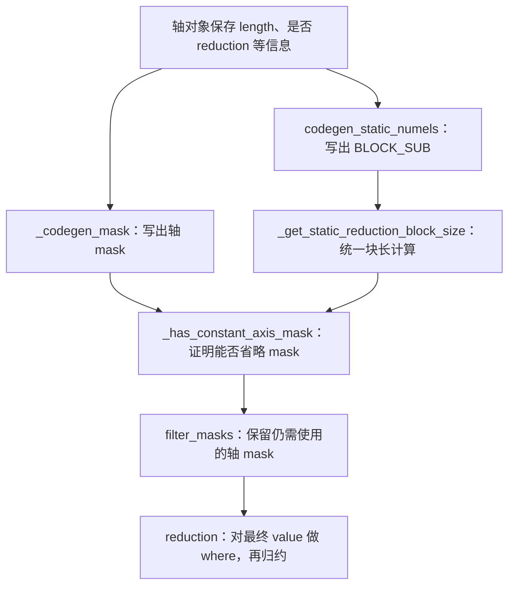

# 修复 ①：从 mask 生成到 persistent reduction 的尾块保护

对应整合提交 `a514111f108c5715994692736c702b4824fd46c4`，主题为
`fix(inductor): mask persistent reduction tails`。
阅读基线是该提交的父提交；后续 axes、load 等提交的效果不归入本提交。
完整改动见[补丁][patch]，八项关系见[总览][overview]。

## 这个提交解决什么问题

**解决归约尾部的补齐元素被当成真实数据参与计算，导致模型结果与 eager 不一致的问题。**

- **触发场景**：GPT2、BERT 的归一化计算中，真实归约长度为 768，生成的块长却补齐到 1024。
  后面多出的 256 个位置需要始终排除在求和之外。
- **修复前**：读取时虽然用 0 填充这些位置，但计算 `(value - mean) ** 2` 后，
  它们变成了 `mean ** 2`；若直接求和，就把这 256 份额外贡献计入方差，造成精度错误。
  前面若把静态轴的 mask 删除，归约处甚至没有可用条件排除这些位置。
- **修复后**：保留必要的尾部 mask，并在最终送入归约前，把无效位置恢复为相应归约的中性值
  （例如 sum 使用 0），使求和只统计真实输入。

这是计算正确性修复。具体对照见[修复后 DSL][dsl]和[检查记录][checks]；
它覆盖本篇所述 persistent reduction 尾部路径，其他独立的 masked load 问题仍需单独判断。

## 先认识这里的代码在做什么

模型中的 `mean`、`sum` 不会原样交给设备执行。
Inductor 先分析归约轴，再用 Python 类 `NPUIndexTritonKernel` 写出 Triton 程序。
例如 Python 生成器执行 `self.cse.generate(self.compute, "tl.sum(tmp0, 1)", ...)` 时，
是在代码缓冲区添加一行文本；设备真正执行的是之后编译好的 `tl.sum`。

这里的 lane 指一个 tile 中的一个逻辑元素位置，不代表一个独立 NPU 核。
tile 是 kernel 一次处理的分块；`R1BLOCK_SUB` 是该块在 `r1` 轴上的长度。
mask 是与这些位置对应的真假条件，决定位置是否属于真实输入。
persistent reduction 指本路径把归约轴完整纳入块内归约的方式；完整覆盖不等于没有补齐元素。

以长度 768 的归约为例，统一 SIMT 路径把块长补成 1024：

| 项目 | 范围或数值 |
| --- | --- |
| 真实输入 | `r1 = 0..767` |
| 生成的 tile | `r1 = 0..1023` |
| `r1_mask` | `r1 < 768` |
| 应被排除的尾部 | `r1 = 768..1023`，共 256 个位置 |

`tl.load(..., mask, other=0)` 只能保证这次读取的尾部是 0。
假设之后计算 `(value - mean) ** 2`，尾部会变成 `mean ** 2`。
再直接 `sum`，这些元素也被算进去。因此要保护的是**最终送入归约的表达式**。

## 为什么涉及多个函数

源码文件均为 `torch_npu/_inductor/codegen/triton.py`。
下面是职责之间的关系，不是省略中间调用后的完整 Python 栈：



只在 `reduction()` 加 `where` 不够：若前面错误删除 `r1_mask`，此时已没有正确条件可用。
只在 load 保留 mask 也不够：后续算术会改变尾部填充值。
本提交把“mask 是否存在”“能否消去”“如何应用到归约值”一起修正。

## 按补丁顺序解释修改

### 1. `IterationRangesEntryNPUIndex._codegen_mask()`：先保证条件存在

旧逻辑通常把静态 no-loop 轴视作无需生成 mask。
新增条件是：

```python
if V.kernel.is_unified_simt_kernel() or (V.kernel.persistent_reduction and self.is_reduction):
    codegen_mask = self.is_tiling_axis
```

`self` 在这里是轴对象，不是 kernel。
`self.is_reduction` 判断当前轴是否参与归约；`is_tiling_axis` 判断是否真的在块内展开。
新增右侧分支让 persistent reduction 轴也进入 mask 生成判断。
它修正了“完整归约轴就可以不考虑补齐尾部”的错误前提。

进入生成分支后先调用 `_has_constant_axis_mask(self)`。
只有证明整个块都合法，才写出 `r1_mask = True` 及方向变体的 `..._mask = True`，然后返回。
否则继续原来的索引上界计算，例如 `r1 < r1_numel`。
方向变体对应轴拆分/重排后使用的条件名称；同时定义它们可以避免某处仍引用未定义的变体。

### 2. `_get_static_reduction_block_size()`：让证明与实际块长一致

新增 helper 的源码为：

```python
def _get_static_reduction_block_size(self, node):
    numel = V.graph.sizevars.simplify(node.length)
    if not isinstance(numel, (int, sympy.Integer)):
        return None
    block = int(numel)
    return next_power_of_2(block) if self.is_unified_simt_kernel() else block
```

`V.graph` 是当前正在编译的图；`sizevars` 负责化简尺寸和证明尺寸关系。
第一行尝试把轴长化简为常量；不是静态整数就返回 `None`，不猜一个块长。
统一 SIMT 路径返回二次幂块长，其余路径返回实际静态长度。

`codegen_static_numels()` 原本自己计算这个数，现在调用该 helper 再写出 `BLOCK_SUB`。
这样 mask 证明和生成代码使用同一份规则，不会一个按 768 判断、另一个实际生成 1024。

### 3. `_has_constant_axis_mask()`：省略 mask 必须有证明

入口先排除四类情况：关闭 `optimize_mask`、非 persistent、非 reduction、vectorized split。
vectorized split 有自己的索引方式，不能复用这个证明。
其余情况要求：

```python
block is not None
and block > 0
and V.graph.sizevars.statically_known_gt(node.length, 0)
and V.graph.sizevars.statically_known_multiple_of(node.length, block)
```

这里的“静态已知”表示编译器能够证明，不是拿当前样例输入试算一次。
长度 256、实际块长 256 时能整除，mask 可消去。
长度 197、统一 SIMT 块长 256 时不能整除，必须保留。
动态长度无法化成整数时也保留。长度 0 不能被当成“整除所以全部合法”。

对 persistent split 轴，本代码依赖既有 runtime 规则把 `BLOCK` 固定到完整 numel；
该规则的检查包含在新增测试中，不是本提交另加了一套拆分算法。

### 4. `filter_masks()`：不能按 persistent 标签批量删掉归约 mask

`filter_masks(mask_vars)` 接收一个可变集合，在原集合里删除不需要的条件。
函数先整理应保留的轴名称，最后按名称过滤 mask；循环中的 `continue` 因而可能意味着
“这个轴不加入保留名单”，不能仅从单个 `continue` 理解为“保留”。

本提交先用 `_has_constant_axis_mask(node)` 决定是否可以省略。
同时删除旧的“只要是 persistent reduction 轴就跳过”条件，
并修改静态 no-loop 分支，让未证明恒真的 persistent 归约轴仍进入保留名单。
这与第 1 步配套：前面生成了条件，这里也不能把它无条件删掉。

函数对 `TritonCSEVariable` 类型的 semantic mask 有既有独立处理。
semantic mask 表达额外的有效性条件，如间接索引是否合法；
它与 `r1 < r1_numel` 这种轴范围条件不是一回事。
新增测试确认消除恒真的轴 mask 时不会顺带消掉这类条件。

### 5. `reduction()` 开头：收集所有轴，再做有依据的过滤

旧代码在“persistent 且只有一个归约轴”时只收集非 `r` 轴 mask。
新代码统一先收集 `self.sorted_axis` 中所有轴的 mask，再调用 `filter_masks()`。
因此 `r1_mask` 不会因为走到单归约轴路径就提前失去参与机会。

### 6. 重建 `cond`：mask 的维度必须和 value 对齐

假设 value 的实际布局是 `[X0BLOCK_SUB, R1BLOCK_SUB]`。
两个一维条件不能随便相与，生成器先构造：

```python
# 语义示意；具体变量名取决于当前轴顺序
x0_mask.reshape([X0BLOCK_SUB, 1])
r1_mask.reshape([1, R1BLOCK_SUB])
```

`value_order = reversed(golden_var_list)` 给出 value 的实际轴顺序。
生成器为每个轴创建全 1 的 shape，仅在该轴对应槽位填入 `...BLOCK_SUB`。
按此 reshape 后再相与，条件就可以正确广播到 value。
多归约轴时先 broadcast 到完整 shape；若 value 做了 permute，条件也做同一个 permute；
随后 reshape 成与待归约 value 一样的布局。
单轴 persistent 分支直接 broadcast 到最终 dense shape。

额外 semantic mask 不属于轴名称集合，最后还要与重建后的条件相与。
没有任何条件时 `cond = ""`，`where_cond()` 直接返回原值，避免生成无意义语句。

### 7. persistent 分支：从 `masked_value = value` 改为单位元填充

除明确保留的 `welford_reduce` 专用分支外，新逻辑先取得：

```python
default = ir.Reduction.default_value(reduction_type, src_dtype)
```

单位元是“加入归约也不改变结果”的值：sum 用 0、prod 用 1、max 用负无穷、min 用正无穷。
最终生成的核心形式是 `tl.where(cond, value, default)`，然后才调用归约。
合法位置仍用原值，尾部位置被换成该运算需要的单位元。

`update_constant_dtype()` 处理整数 min/max 的极值常量。
若原始输入是 int32，而实际 value 已变为 int64，不能仍用 int32 最大值充当 int64 min 的单位元。
该 helper 在源/目标 dtype 不同时把极值换成目标 dtype 的极值；0 等通用值保持。

`mask_value()` 把生成的 where 写进 `self.compute`，同时记录 dtype 和 shape。
tuple reduction 用 `zip(value, default)` 逐成员填充，不能把整个 tuple 当成一个张量。
argmin/argmax 的索引广播字符串另有分行调整，该处只改 Python 字符串排版，没有修改生成内容。

## 用一个极小例子连起来

下面是语义示意，不是模型捕获产物。真实长度 3，块长补成 4，真实值全是 2：

```python
loaded = [2, 2, 2, 0]
mask = [True, True, True, False]
mean = 2
squared = [0, 0, 0, 4]
old_variance = sum(squared) / 3       # 4/3，错误
masked_squared = [0, 0, 0, 0]
new_variance = sum(masked_squared) / 3  # 0
```

这说明错误发生在归约输入集合，不能通过调整最后的除数补救。
[真实修复后 DSL][dsl] 中在均值 sum、方差 sum 前均能看到 `tl.where`。
[总览][overview]第 1 项保留了原始 GPT2 DSL 的对照摘录和完整产物入口。

## 为什么改这里，而不是改模型或 Triton 编译器

生成器在这里同时知道当前轴、实际块长、归约类型和 value 布局，能够生成通用的正确条件。
模型的 LayerNorm 数学定义没有错；修改模型会把一个 codegen 问题转嫁给所有调用者。
下层编译器看见无 mask 的 `tl.sum(tmp14, 1)`，无法自行推断哪些元素只是 padding。
因此修复需要落在写出这行归约代码的边界。

## 对模型测试是否必要，可能引入什么影响

GPT2/BERT 已捕获到尾部进入方差的数值错误，这是目标模型正确性所需修复。
现有记录为 mask 框架单元 4/4、静态/动态数值回归 22/22；
GPT2 累计八场景通过，BERT 前向恢复后另暴露多轴反向问题。
单元的四个方法分别检查实际块长、未证明条件保留、persistent split、semantic mask。
这些测试代码均在[完整补丁][patch]中，结果见[mask 检查][checks]。

影响不限于长度 768：该补丁覆盖上述 persistent 条件和 mask 重建路径。
额外 where/broadcast 可能增加代码量和资源开销；轴顺序、tuple、整数 dtype 组合仍需关注。
Welford 保留专用路径，不能据此宣称所有 Welford 尾块都已修好。
独立 TA masked indirect load 缺陷仍存在，本修复只是屏蔽它在已验证归约场景中的影响。
本次新增说明未重跑设备测试；历史 PASS 也不是所有 dtype、NaN/Inf 和 tiling 的证明。

[overview]: model-fix-dsl-explained-20261021.md
[patch]: ../../../artifacts/cicd/model_fixes_20261020/patches/codegen-reduction-mask.patch
[dsl]: ../../../artifacts/cicd/model_fixes_20261020/generated/gpt2_embedding_norm.py
[checks]: ../../../artifacts/cicd/model_fixes_20261020/final_checks/mask.txt
