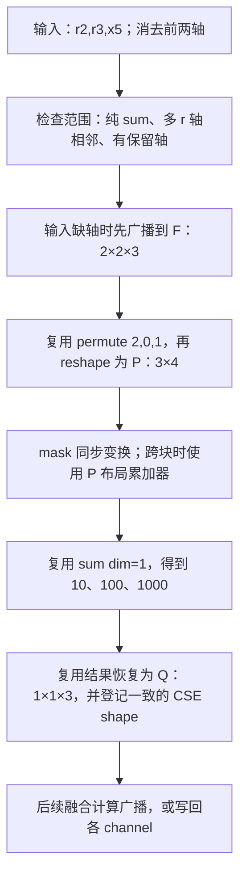

# 修复 ② 新分支详解：限定相邻多轴 sum 的布局修正

本文解释新分支 `bugfix/cicd-02-contiguous-reduction-master-20261024` 的实际修改，
供与 committer 检视时使用。按输入、布局分析、广播、重排、归约、结果消费的顺序展开，
每处修改都给出对应 diff、函数职责、修改原因、前后返回值和影响。

**这次修正的是：tile 中相邻的多个求和轴，被地址表达式中的外层标量轴误判为不相邻，
导致保留的 channel 轴也被 flatten 后求和。适用范围限定为 kernel 内所有归约均为 `sum`、
实际 tile 中归约轴相邻、并且至少保留一个输出轴。
该范围内的广播和结果 shape 同步修正；尚未执行这个新提交的 NPU 数值及整网验证。**

## 检视版本与旧 PR 的关系

| 项目 | 本文对应内容 |
| --- | --- |
| 新分支 | [bugfix/cicd-02-contiguous-reduction-master-20261024][branch] |
| 基线 | `0c3f556423d8a5aa1fec77d93ee17ccb6327aef1`，2026-10-24 建分支时拉取的 master |
| 修复提交 | [7c7c20c21af250cca6344ec554e1e604f84e103f][commit] |
| 生产代码 | `kernel_analysis.py` 增加 8 行；`triton.py` 增加 53 行、删除 7 行 |
| 回归测试 | 新增 `test/_inductor/test_contiguous_sum_layout.py`，140 行 |
| 总 diff | 3 个文件，增加 201 行、删除 7 行；[完整补丁][patch] |
| 关联缺陷背景 | [Issue #5625][issue] |
| 旧 PR | [!48471][old-pr] 对应旧分支和旧实现；本文的新提交尚未替换该 PR |

旧实现的逐处说明保留在[旧版 02 文档](model-fix-02-reduction-axes-20261022.md)。
旧版包含“实际 value 中归约轴分离”的通用多轴扩展，也涉及单轴归约的共享结果元数据。
新分支从上述 master 重新实现，不能把旧 PR 的 diff、设备结果或影响范围直接套过来。
本文所说“修改前”均指 `0c3f556423`，“修改后”均指 `7c7c20c21a`，
不表示 2026-10-26 远端 master 的最新状态。

## 先讲问题：输出需要每个 channel 一个和

BERT bias gradient 的原始表达式为：

```python
value.reshape(4, 12, 128, 64).permute(0, 2, 1, 3).reshape(512, 768).sum(0)
```

输出保留 768 个 channel；每个 channel 累加 `4 × 128 = 512` 个值。
[历史失败 kernel][old-dsl]中的外层 x4 是标量循环变量；一个 value tile 的槽位顺序为：

```text
value 的维度顺序：[r2, r3, x5]
                 求和 求和 保留

地址中涉及的轴：[r2, x4, r3, x5]
                     ↑
                 外层标量，不占 value 的一个独立维度
```

历史产物的关键语句如下，保持原文格式：

```python
                tmp0 = tl.load(in_ptr0 + (x5 + 64*r3 + 8192*x4 + 98304*r2), x5_mask, other=0.0)
                tmp1 = tl.reshape(tmp0, [R2BLOCK_SUB* R3BLOCK_SUB* X5BLOCK_SUB])
                tmp3 = triton_helpers.promote_to_tensor(tl.sum(tmp1, 0))
                tl.store(out_ptr1 + (x5 + 64*x4 ), tmp3, x5_mask)
```

load 得到 `[R2,R3,X5]`。错误 reshape 把 X5 也并入唯一维度，sum 后只剩一个总和；
store 仍按 x5 的多个位置写回，因此多个 channel 得到相同结果。
X5 tile 为 1 时错误可能被掩盖；X5 tile 大于 1 时会混入其他 channel 的数值。

[历史单 kernel 对照][historical-validation]记录：原 DSL 在 block=1 时通过、block=8 时失败，
block=8 的最大绝对误差为 `187.43621826171875`；手动修正 DSL 后通过。
这证明历史错误的数学机制，**不是新分支 `7c7c20c21a` 的设备验证结果**。

## 全文用同一个例子跟踪数据

先把 tile 缩小到 `[2,2,3]`，归约轴仍然相邻，符合新分支的处理条件：

```text
逻辑轴：[r2, r3, x5]
尺寸：  [ 2,  2,  3]

value[0,0,:] = [1, 10, 100]
value[0,1,:] = [2, 20, 200]
value[1,0,:] = [3, 30, 300]
value[1,1,:] = [4, 40, 400]

预期 sum((0,1)) = [10, 100, 1000]
旧逻辑 flatten 全部维度再求和 = 1110
```

以下尺寸是 tile 的块大小，不是整个模型 tensor 的 shape。
文中用 F、P、Q 标识三个阶段的布局，仅为阅读方便，不是新增接口：

| 表示 | 槽位语义 | 小例子尺寸 | 代码中的尺寸 |
| --- | --- | --- | --- |
| F，完整 value 布局 | `[r2,r3,x5]` | `[2,2,3]` | `[R2BLOCK_SUB,R3BLOCK_SUB,X5BLOCK_SUB]` |
| P，求和计算布局 | `[x5,合并的r轴]` | `[3,4]` | `[X5BLOCK_SUB,R3BLOCK_SUB * R2BLOCK_SUB]` |
| Q，恢复后的结果布局 | 原 r 槽位置 1，x5 保留 | `[1,1,3]` | `[1,1,X5BLOCK_SUB]` |



这张图描述数据表示及依赖关系。分析对象的一部分在生成器初始化时建立，
并不表示 Python 严格按图中顺序调用每个函数。

## 从流程定位到实际修改

下面 A—H 是完整生产 diff 的 8 个片段，按数据流排列，
合计覆盖 **61 行新增、7 行删除**，每条生产变更只出现一次。
`-` 表示基线删除行，`+` 表示新提交新增行；`@@` 保留原补丁中的定位信息，空白上下文行省略标记。
测试文件在后文单独说明。

| 流程 | 直接修改 | 沿用但受影响的代码 | 本例变化 |
| --- | --- | --- | --- |
| [1. 范围与轴判定](#flow-1) | A、B | ReductionAnalysis 初始化 | 相邻性 False→True |
| [2. 准备布局和 rank](#flow-2) | C、D | dense_size_str、analyze_reduction_dim | 计算布局 `[12]`→P；dim 0→1；rank 1→2 |
| [3. 补齐输入广播](#flow-3) | E、F | axis_list 收集方式保留 | 需要时按 F 广播，再进入 P |
| [4. 重排与打包](#flow-4) | 无 | 原有 permute、reshape | 进入原有相邻归约分支，生成 P |
| [5. mask 与跨块累加](#flow-5) | 无 | 原有 mask、accumulator | 消费同一 permute 和 P |
| [6. 求和与恢复结果](#flow-6) | G、H | final_reduction、reduction_resize | 生成 Q，返回变量 shape 也记录 Q |
| [7. 后续消费与写回](#flow-7) | 无 | CSE、融合计算、store | 消费三个独立 channel 结果及一致的 shape |

## 阅读源码前需要分清的几个概念

这些 Python 函数负责生成 Triton 代码，当时尚未在设备上求和。
例如函数返回字符串 `"s.reshape(1, 1, X5BLOCK_SUB)"`，表示把这个表达式写入生成代码，
不是已经返回了一个设备 tensor。

| 名称 | 本文含义 |
| --- | --- |
| DSL | 生成的 Triton 代码，例如 `tl.reshape`、`tl.sum` |
| golden_var_list | 生成器选定的参考轴顺序；`reversed(golden_var_list)` 对应本文讨论的 value 槽位顺序 |
| tiling_axis | 当前分块使用的轴列表；与 golden 的职责不同，本次目标 rank 以 golden 为准 |
| 相邻 / contiguous | 本文指多个 r 轴在参考 value 槽位中连续，不等同于 PyTorch tensor 的内存 contiguous |
| BLOCK_SUB | kernel 内一个 tile 的轴长度；可能小于整个逻辑维度长度 |
| CSEVariable | 生成器记录临时值的对象，包括变量名、dtype 和 shape，后续生成代码会消费它 |
| persistent 分支 | 此处在该分支中对 tile 直接求和；non-persistent 分支跨归约循环块累加后求和 |
| mask | 标识 tile 中哪些元素有效；sum 的无效位置应贡献 0 |

特别注意两个同名函数：

| 函数 | 返回什么 | 本例修改后、归约体内 |
| --- | --- | --- |
| `ReductionAnalysis.dense_size_list()` | 按原槽位排列的尺寸字符串列表 | F：`[R2,R3,X5]` |
| `NPUIndexTritonKernel.dense_size_list()` | 若判为相邻归约，返回打包布局；否则返回完整布局 | P：`[X5,R3 * R2]` |

上表省略了每项中的 `BLOCK_SUB` 后缀。
把这两个返回值混为一谈，就会把输入广播用的 F 与求和用的 P 混在一起。

<a id="flow-1"></a>

## 1. 确认范围，再判断归约轴是否相邻

### A：新增 `_use_contiguous_sum_layout()`，统一决定是否修正

源码：[triton.py，_use_contiguous_sum_layout][scope-source]。
原来没有这个函数；现在返回 bool，供后面的相邻判断、rank、广播及结果 shape 共同使用。
它只决定生成器选用哪种布局，不执行 sum，也不修改图的数学算子。

```diff
@@ -3895,6 +3897,36 @@ class NPUIndexTritonKernel(TritonKernel):
             sizes[i] = f"{axis.name.upper()}BLOCK_SUB"
         return sizes

+    def _use_contiguous_sum_layout(self):
+        # Limit the layout correction to sum kernels with adjacent value
+        # reduction axes and at least one preserved output axis. In particular,
+        # do not change indexed/statistical reductions or mixed reduction kernels.
+        num_red = self.numof_reduction_axis()
+        if num_red <= 1:
+            return False
+
+        node_schedule = getattr(self, "node_schedule", None)
+        if node_schedule is None:
+            node_schedule = self.features.node_schedule
+        reductions = [
+            node.node.data
+            for node in self._iter_schedule_nodes(node_schedule)
+            if isinstance(node.node.data, ir.Reduction)
+        ]
+        if not reductions or any(node.reduction_type != "sum" for node in reductions):
+            return False
+
+        if not self.golden_var_list:
+            self.select_golden_varlist()
+        reduction_dims = [
+            i for i, axis in enumerate(self.golden_var_list) if axis.name[0] == "r"
+        ]
+        return (
+            len(reduction_dims) == num_red
+            and num_red < len(self.golden_var_list)
+            and reduction_dims[-1] - reduction_dims[0] + 1 == num_red
+        )
+
     def is_contiguous_reduction(self):
         def is_contiguous_axis(axis_list):
             axis_set = set(axis_list)  # noqa: set_linter
```

按返回条件逐步阅读：

| 条件或语句 | 为什么需要 | 不满足时的影响 |
| --- | --- | --- |
| `num_red <= 1` 返回 False | 本次只修正多轴求和 | 单轴、无归约保留原逻辑 |
| 从 node_schedule 读取真实节点 | 判断整个 kernel 中有哪些归约，不能只看当前调用的 reduction_type | 覆盖同 kernel 的其他归约节点 |
| node_schedule 未建立时读 features.node_schedule | 支持初始化阶段已有 features、尚未赋值 node_schedule 的调用 | 避免只因属性尚未建立而失败 |
| `_iter_schedule_nodes` | 沿用既有迭代器，跳过 EnableReduction、DisableReduction 哨兵 | 不把调度边界当作 IR 节点 |
| 只收集 `ir.Reduction` | 允许同 kernel 含逐点计算等非归约节点 | 非归约节点不影响 pure-sum 判定 |
| 没有归约，或任一类型不为 sum，返回 False | 不让 max/min、带索引或统计归约进入新规则 | 混合 sum+max 等 kernel 整体排除 |
| golden 为空时先选择 | 后续要基于实际参考槽位判断 | 使用已有选择函数，不新增轴选择算法 |
| `len(reduction_dims) == num_red` | 要求 golden 完整包含 kernel 归约轴数量 | 不完整布局不进入修正 |
| `num_red < len(golden)` | 至少保留一个非 r 轴 | 全轴归约到标量不进入修正 |
| `末位置 - 首位置 + 1 == num_red` | 要求全部 r 槽位相邻 | 实际 r 轴分离时不进入修正 |

相邻性在 golden 正序或反序判断结果相同：反转会改变位置编号，不会把连续位置变成不连续。
本例 golden 为 `[x5,r3,r2]`，r 位置为 `[1,2]`，数量 2，区间长度也是 2，因此返回 True。
地址中的 x4 没有占用 golden 的独立槽位，不会把 r2/r3 分开。

**影响单位是整个 kernel。** 含多个 sum 节点可以满足这个条件；sum 与 max 混合时不满足。
它没有限制模型名称、shape 数值、dtype、static/dynamic、persistent/non-persistent 或设备型号。
因此“范围已收窄”不能理解为“只影响 BERT 的这一个 kernel”。

### B：保留原判定，再补充目标 sum 的相邻判定

源码：[triton.py，is_contiguous_reduction][contiguous-source]。
该函数返回 bool，`ReductionAnalysis` 用它选择计算布局和归约 dim。

```diff
@@ -3912,7 +3944,7 @@ class NPUIndexTritonKernel(TritonKernel):
             for i, x in enumerate(reversed(stride_sorted_var_list)):
                 if x.name[0] == "r":
                     reduction_dim_list.append(i)
-            return is_contiguous_axis(reduction_dim_list)
+            return is_contiguous_axis(reduction_dim_list) or self._use_contiguous_sum_layout()
         return False

     def dense_size_str(self):
```

原逻辑从 load/store 地址提取排序后的符号，检查其中 r 轴是否相邻。
对 BERT 的 `[r2,x4,r3,x5]`，r 被 x4 分开，旧返回 False。
新逻辑是“旧判断 OR 新的范围判断”，本例变成 `False or True`，返回 True。

使用 OR 的原因是保留原来已被判 True 的路径；没有全局替换地址分析算法。
尤其要区分：

| 旧地址判断 | 新范围函数 | 最终结果 | 含义 |
| --- | --- | --- | --- |
| False | True | True | 本次补充进入相邻路径的目标 sum |
| True | True | True | 原本相邻的目标 sum 仍可能受广播、shape 修正影响 |
| True | False | True | 保留既有相邻路径，不启用新范围内的配套分支 |
| False | False | False | 保留既有非相邻路径 |

例如实际 `[r0,x1,r2]`、地址解析 `[r0,r2,x1]` 时，旧判断为 True；
新函数为 False，但最终仍为 True。测试特意保留这一行为。
所以不能用 `is_contiguous_reduction()==True` 代替新范围条件来描述影响范围。

<a id="flow-2"></a>

## 2. 准备求和布局：只合并 r 轴，保留 x5

### C：按轴身份构造 P，避免退出归约体后混入 r 的占位 1

源码：[kernel_analysis.py，dense_post_reduction_list][packed-source]。
函数名中的 post 容易误解：**它返回的是求和使用的打包尺寸 P，里面仍有归约长度乘积，
不是最终结果 Q。** Python 返回类型为 `list[str]`。

```diff
@@ -378,6 +378,14 @@ class ReductionAnalysis:

     def dense_post_reduction_list(self) -> List[str]:
         reduction_list_str = f"{' * '.join(self.dense_reduction_list())}"
+        if self.kernel._use_contiguous_sum_layout():
+            # Reduction slots become "1" outside the reduction body. Filter
+            # by axis identity so those slots do not reappear as kept axes.
+            return [
+                f"{axis.name.upper()}BLOCK_SUB"
+                for axis in reversed(self.kernel.golden_var_list)
+                if axis.name[0] != "r"
+            ] + [reduction_list_str]
         no_reduction_list = []
         # ensure order
         for dense_size in self.dense_size_list():
```

旧逻辑按尺寸文本过滤：遍历完整列表，把不在 `dense_reduction_list()` 中的项当作保留轴。
归约体内，完整列表含 `R2BLOCK_SUB` 和 `R3BLOCK_SUB`，可以正确过滤。
退出归约体后，未改动的 `ReductionAnalysis.dense_size_list()` 会把 r 槽位改为字符串 `"1"`，
这些 `"1"` 不在归约块名称列表里，旧代码于是把它们也当成保留轴。

新逻辑只对目标 sum 按 `axis.name[0] != "r"` 筛选轴身份，
保留 x5，再追加原有的归约长度乘积；不再用尺寸文本猜测某个槽位的职责。

| 调用时机 | 完整列表 `ReductionAnalysis.dense_size_list()` | 旧 dense_post 返回 | 新 dense_post 返回 |
| --- | --- | --- | --- |
| inside_reduction=True | `[R2,R3,X5]` | `[X5,R3 * R2]` | `[X5,R3 * R2]` |
| inside_reduction=False | `[1,1,X5]` | `[1,1,X5,R3 * R2]` | `[X5,R3 * R2]` |

表中均省略 `BLOCK_SUB`。这一变化让 P 在归约体内外保持同一约定。
对主例旧版误判非相邻时，kernel 的包装函数原本不采用这个 P；
现在进入相邻路径后会采用，因此这个 helper 的前后一致性也必须处理。
新范围外仍执行原有的尺寸文本过滤。

### D：计算 rank 以 golden 的保留轴数加一个合并 r 轴为准

源码：[triton.py，triton_tensor_ndim][rank-source]。
函数返回 int，用于常量/索引 shape 推导，以及 `reduction_resize()` 的分支选择。

```diff
@@ -3053,6 +3053,8 @@ class NPUIndexTritonKernel(TritonKernel):

     # for creat constant tensor, if have two axis, constant=tl.full([1,1]) else  tl.full([1])
     def triton_tensor_ndim(self):
+        if self._use_contiguous_sum_layout():
+            return len(self.golden_var_list) - self.numof_reduction_axis() + 1
         if self.numof_reduction_axis() > 1:
             if self.is_contiguous_reduction():
                 return len(self.tiling_axis) - self.numof_reduction_axis() + 1
```

目标布局的 rank 为 `len(golden) - num_red + 1`：每个保留轴占一维，全部 r 轴合并成一维。
本例是 `3 - 2 + 1 = 2`，对应 P `[3,4]`。
这同时保证计算尺寸、rank 和结果恢复依赖同一份参考轴集合。
目标范围外仍保留旧的 tiling_axis 或一维逻辑。

### 哪些旧函数没有修改，但现在返回值改变了

下列函数的实现保持基线代码；它们消费 B 的 True、C 的 P 和 D 的 rank：

| 函数 | 职责 | 主例旧返回 | 主例新返回 | 改变的直接来源 |
| --- | --- | --- | --- | --- |
| `ReductionAnalysis.dense_size_list()` | 完整 F | `[R2,R3,X5]` | `[R2,R3,X5]` | 不变 |
| `ReductionAnalysis.dense_post_reduction_list()` | 打包 P | `[X5,R3 * R2]`，旧主路径未选用 | `[X5,R3 * R2]` | C 保证体外也一致 |
| kernel `dense_size_list()` | 当前计算布局元数据 | `[R2,R3,X5]` | `[X5,R3 * R2]` | B 使其选用 P |
| `dense_size_str()` | 可写入 DSL 的尺寸字符串 | `"[R2* R3* X5]"` | `"[X5, R3 * R2]"` | B 使其选用相邻分支 |
| `analyze_reduction_dim()` / `reduction_dim()` | 在计算布局上选归约维 | `0` | `1` | B 使原有分支返回非 r 轴数量 |
| `triton_tensor_ndim()` | 计算布局 rank | `1` | `2` | D |

表中省略 `BLOCK_SUB`。P 的乘积文本 `R3 * R2` 沿用旧 helper 的返回顺序，
不意味着把逻辑元素按 r3/r2 重新交换。
真正的元素顺序由下一节已有 permute 决定；reshape 中这里只需要归约元素总数。

<a id="flow-3"></a>

## 3. 输入缺轴时，先广播到完整布局 F

### E：分开记录广播用的 F 和求和用的 P

源码：[triton.py，reduction 输入布局准备][broadcast-source]。
`reduction()` 编排归约生成过程，返回 CSEVariable；这里还只是准备局部变量。

```diff
@@ -4115,6 +4147,14 @@ class NPUIndexTritonKernel(TritonKernel):

         dense_size_str = self.dense_size_str()
         value_shape = tuple(self.dense_size_list())
+        use_contiguous_sum_layout = self._use_contiguous_sum_layout()
+        broadcast_shape = (
+            tuple(self.reduce_analysis.dense_size_list())
+            if use_contiguous_sum_layout else value_shape
+        )
+        broadcast_size_str = (
+            f"[{', '.join(broadcast_shape)}]" if use_contiguous_sum_layout else dense_size_str
+        )
         permute_order = None
         need_permute = False
         axis_list = []
```

`dense_size_str` 和 `value_shape` 继续表示 P，供后面的 reshape 和元数据登记使用。
新增的 `broadcast_shape`、`broadcast_size_str` 在目标范围内取 F。
原因是输入尚未 permute，槽位仍按 F 排列；不能提前按 P 广播。

| 局部变量 | 旧主例 | 新主例 | 用途 |
| --- | --- | --- | --- |
| dense_size_str | `"[R2* R3* X5]"` | `"[X5, R3 * R2]"` | reshape 到计算布局 |
| value_shape | `(R2,R3,X5)` | `(X5,R3 * R2)` | reshape 结果元数据 |
| broadcast_shape | 无独立变量，使用 value_shape | `(R2,R3,X5)` | 输入广播元数据 |
| broadcast_size_str | 无独立变量，使用 dense_size_str | `"[R2, R3, X5]"` | 输入广播 DSL |

这里的 `value_shape` 是生成器局部变量，不是读取输入对象的 `value.shape`。
目标外两个新增变量分别等于旧 value_shape、dense_size_str，因此仍走原来的广播逻辑。

### F：广播条件和生成语句都使用完整 rank

```diff
@@ -4123,13 +4163,13 @@ class NPUIndexTritonKernel(TritonKernel):
                 if str(axis) in str(index) and (axis not in axis_list):
                     axis_list.append(axis)

-        if len(axis_list) < len(self.dense_size_list()):
+        if len(axis_list) < len(broadcast_shape):
             value = self._map_tuple_or_scalar(
                 lambda v: self.cse.generate(
                     self.compute,
-                    f"tl.broadcast_to({v}, {dense_size_str})",
+                    f"tl.broadcast_to({v}, {broadcast_size_str})",
                     dtype=v.dtype,
-                    shape=value_shape,
+                    shape=broadcast_shape,
                 ),
                 value,
             )
```

沿用原有 axis_list 收集方法，只把比较基准从计算布局 rank 换成广播布局 rank。
例如缺少两个归约维的输入 `v.shape=[1,1,X5]`，应先广播为 F，再重排为 P：

```python
# 新规则生成的结构示意，省略 mask 与临时变量编号
full = tl.broadcast_to(v, [R2BLOCK_SUB, R3BLOCK_SUB, X5BLOCK_SUB])
packed = tl.reshape(full.permute([2, 0, 1]), [X5BLOCK_SUB, R3BLOCK_SUB * R2BLOCK_SUB])
```

若只修 B，目标主路径的 `self.dense_size_list()` 已变为 P，
旧代码就会尝试直接向 P 广播；输入仍处于 F 槽位中，rank 和轴语义不能对应。
因此 E、F 是相邻判定变更之后必须保持的布局一致性。

当输入本身已完整含有三个轴时，这里不新增广播。
axis_list 仍由当前 kernel 的 load/store indexing 收集，不是对每个输入做全新的语义分析；
本次没有证明所有复杂融合输入都已覆盖，需要真实 lowering 和 NPU 测试继续确认。

<a id="flow-4"></a>

## 4. 复用已有重排和 reshape：F → P

这一阶段**没有直接 diff**。
源码：[triton.py，reduction 的重排与打包][reshape-source]。
原有关键分支如下，展示新提交中未改动的代码：

```python
if self.numof_reduction_axis() > 1 and self.is_contiguous_reduction():
    value_order = list(reversed(self.golden_var_list))
    target_order = [x for x in value_order if x.name[0] != "r"] + [
        x for x in value_order if x.name[0] == "r"
    ]
    permute_order = [value_order.index(x) for x in target_order]
    current_order = list(range(len(value_order)))
    need_permute = permute_order != current_order
```

对本例：

```text
value_order  = [r2, r3, x5]
target_order = [x5, r2, r3]
permute_order = [2, 0, 1]
```

旧版因 B 返回 False，没有进入上述分支，直接把 `[2,2,3]` reshape 成 `[12]`。
新版因 B 返回 True，复用原代码生成：

```python
tl.reshape(value.permute([2, 0, 1]), [X5BLOCK_SUB, R3BLOCK_SUB * R2BLOCK_SUB])
```

代入小例子，结果 P 为：

```text
[[  1,   2,   3,   4],
 [ 10,  20,  30,  40],
 [100, 200, 300, 400]]
```

每一行固定一个 x5，只包含应归约的 r2/r3 元素。
已有 `shape=value_shape` 此时登记 P，与生成语句一致，无需修改该赋值本身。
如果原 value 顺序已经是 `[x5,r2,r3]`，permute_order 等于恒等排列，
已有代码会直接 reshape；并不是所有目标 sum 都会新增 permute。

<a id="flow-5"></a>

## 5. mask 和跨块累加复用同一套布局

这一阶段**没有直接 diff**。
源码：[mask 生成][mask-source]、[non-persistent 累加器][accumulator-source]。

mask 代码已有以下处理：按 golden 的完整槽位建立各轴 mask，广播到 F；
如果 need_permute 为 True，应用与 value 相同的 permute_order，再 reshape 到 dense_size_str。
因此 B 让 value 进入 P 时，mask 也随之进入 P。
本次没有修改 mask 的过滤规则、有效元素条件或 sum 的单位元 0。

| 路径 | 旧主例 | 新主例 | 为什么变化 |
| --- | --- | --- | --- |
| persistent 的 masked_value | flatten 全部轴的计算值 | P 中每个 channel 的独立归约行 | 消费 B 选出的 P 和已有 mask 变换 |
| non-persistent 初始化 DSL | `tl.full([R2* R3* X5],0,...)` | `tl.full([X5,R3 * R2],0,...)` | 既有代码调用 dense_size_str |
| non-persistent accumulator 元数据 | `(R2,R3,X5)` | `(X5,R3 * R2)` | 既有代码调用 kernel dense_size_list |
| 归约循环结束后的 sum dim | `0` | `1` | 消费已有 reduction_dim 返回值 |

表中省略 `BLOCK_SUB`，DSL 只示意相关参数。
non-persistent 仍逐元素累加各归约循环块，最后沿合并的 r 维做 sum。
修改没有调整循环层级、循环次数或 store 位置。

这属于间接影响，不能因为该段没有 diff 就视为未受影响。
本地源码 probe 覆盖了无 mask 的 persistent/non-persistent 生成；
带尾块 mask 的正确性和设备编译尚待验证，不能由源码 probe 推定通过。

<a id="flow-6"></a>

## 6. 求和、恢复原槽位，并返回一致的结果元数据

### 未修改的求和与恢复函数：P → Q

源码：[final_reduction][final-source]、[reduction_resize][resize-source]。
final_reduction 消费 `dim=1`，然后调用既有 reduction_resize 恢复结果槽位。

| 项目 | 旧主例 | 新主例 |
| --- | --- | --- |
| 计算布局 | `[12]` | P：`[3,4]` |
| sum | `tl.sum(value,0)`，得到 `1110` | `tl.sum(value,1)`，得到 `[10,100,1000]` |
| reduction_resize 返回的表达式 | `triton_helpers.promote_to_tensor(s)` | `s.reshape(1, 1, X5BLOCK_SUB)` |
| 恢复后的设备值形状 | 一个值 | Q：`[1,1,3]` |

为什么 Q 要保留两个长度为 1 的 r 槽位？
归约后的结果可能继续与 F 布局的值做融合计算，Q 的 x5 仍在原来的第 2 槽位，
可以按原轴语义广播。Q 是 kernel 内部表示；对外 tensor 的 bias shape 仍是 channel 向量，
不是把 Python 算子的输出 API 改成三维。

### G：result_shape 根据原 r 轴位置构造 Q

源码：[triton.py，reduction 结果变量创建][result-shape-source]。

```diff
@@ -4226,8 +4266,14 @@ class NPUIndexTritonKernel(TritonKernel):
         dim = self.reduction_dim()
         acc_type = triton_acc_type(src_dtype)
         torch_acc_type = upcast_acc_dtype(src_dtype)
-        result_shape = list(self.dense_size_list())
-        result_shape[dim] = "1"
+        if use_contiguous_sum_layout:
+            result_shape = [
+                "1" if axis.name[0] == "r" else size
+                for axis, size in zip(reversed(self.golden_var_list), broadcast_shape)
+            ]
+        else:
+            result_shape = list(self.dense_size_list())
+            result_shape[dim] = "1"
         result_var: Any = self.cse.newvar(dtype=torch_acc_type, shape=tuple(result_shape))
         result_var.mask_vars = {var for var in masks if var[0] != "r"}  # noqa: set_linter
         cond_expr = " & ".join(masks)
```

旧代码取 kernel dense_size_list，再把 dim 对应的一项置 1。
进入相邻路径后，这个列表是 P；本例会得到 `[X5,1]`。
但 reduction_resize 生成的是 Q `[1,1,X5]`：计算布局上的 dim 不能直接用来描述恢复后的槽位。

新目标分支遍历 `reversed(golden)` 与 F 的对应尺寸，每个 r 槽位置 `"1"`，非 r 槽位保留原尺寸。
本例因此得到 Q，供 `self.cse.newvar(...)` 登记。

| 对照点 | result_shape |
| --- | --- |
| 完整旧基线，主例仍误判非相邻 | `[1,R3,X5]`，因为只把 F 的 dim=0 置 1 |
| 假设只修 B，让它进入相邻路径 | `[X5,1]`，因为只把 P 的 dim=1 置 1 |
| 本次完整修改 | `[1,1,X5]`，与恢复表达式一致 |

表中省略 `BLOCK_SUB`。中间一行是依赖分析，不是另一个已提交版本。
目标外保留旧的 `result_shape[dim] = "1"` 逻辑；
没有借这次修改全局修复其他 reduction 的 shape。

### H：persistent 普通 sum 实际返回的 CSEVariable 也要登记 Q

源码：[triton.py，普通 persistent 归约返回值][return-source]。

```diff
@@ -4476,7 +4522,7 @@ class NPUIndexTritonKernel(TritonKernel):
                     self.compute,
                     final_reduction(masked_value),
                     dtype=masked_value.dtype,
-                    shape=masked_value.shape,
+                    shape=tuple(result_shape) if use_contiguous_sum_layout else masked_value.shape,
                 )
         else:
             accumulator = self.cse.namedvar(f"_{result_var}", dtype=torch_acc_type, shape=tuple(self.dense_size_list()))
```

这里 `self.cse.generate()` 会生成并返回另一个 CSEVariable，
它会替代 G 中预先创建的 result_var。
只改 G 不够：旧赋值仍用求和前的 `masked_value.shape`，会重新把错误 shape 登记到实际返回值。

| 分支 | 旧主例返回对象 shape | 新主例返回对象 shape | 对应生成值 |
| --- | --- | --- | --- |
| persistent 普通 sum | `(R2,R3,X5)` | Q：`(1,1,X5)` | sum 后再 reshape 为 Q |
| non-persistent sum | `(1,R3,X5)`，来自原 result_var | Q：`(1,1,X5)`，由 G 修正 | 循环后 sum，再 reshape 为 Q |

表中省略 `BLOCK_SUB`。若旧版已判相邻，persistent 原来记录的是 P；新分支也会把它改为 Q。
因此**已正确进入相邻路径的 sum 也在本次影响范围内**，并不只有旧 False→新 True 的场景。

H 只在新范围为 True 时使用 result_shape，目标外继续使用 masked_value.shape。
max/min、argmin/argmax 和 Welford 不启用新范围条件，其专用返回路径没有在本提交中改动。

<a id="flow-7"></a>

## 7. 后续融合和 store 消费修正后的值与 shape

这一阶段**没有直接 diff**。
`reduction()` 仍把结果登记到 reduction_cache、outside_loop_vars、reduction_result_vars，
并返回 CSEVariable；store 的输出地址计算保持原代码。

区别是本例收到 `[10,100,1000]`，内部形状 Q；旧实现收到丢失 channel 区分的单个总和。
例如后续计算 `full_value + bias`，Q 可沿 r2/r3 广播到 F，且每个 x5 使用自己的和。
H 提供的 shape 与真实生成值一致，也为后续 shape 推导提供了相同的轴约定。

新加的 NPU 测试不仅返回 bias，还可返回 `grouped + bias.reshape(1,12,1,width)`，
用来检查归约后继续消费的场景。
它能覆盖实际分配到的融合路径；是否真的触发目标 `golden=[x5,r3,r2]` 布局，
仍需检查生成的 kernel，不能只根据 Python 表达式相同就认定覆盖。

## 新增测试分别证明什么

源码：[test_contiguous_sum_layout.py][tests-source]。
测试变更单独增加 140 行，完整内容见[补丁][patch]，不计入前面 A—H 的生产代码行数。

### 7 个源码逻辑测试

| 测试方法后缀 | 构造的情形 | 检查的行为 |
| --- | --- | --- |
| outer_scalar_does_not_split_value_reduction_axes | value `[r2,r3,x5]`，地址含 x4 | 新范围 True；计算 P、dim=1、rank=2；恢复 Q |
| multiple_preserved_axes_keep_their_order | value `[x0,r1,r2,x3]` | 两个保留轴顺序不变；P 的 rank=3，dim=2，Q 为 `[X0,1,1,X3]` |
| reduction_axes_do_not_reappear_in_packed_shape_outside_reduction | inside_reduction 从 True 切到 False | F 中 r 变 1 后，P 不混入两个额外 1 |
| single_separated_and_scalar_reductions_keep_the_old_layout | 单轴、实际分离多轴、全轴到标量 | 不启用新范围，保留旧尺寸、dim、rank 与标量恢复 |
| specialized_and_mixed_reductions_do_not_enable_the_correction | max/min、arg、Welford、prod、混合及空列表 | 新范围 False，不套用 sum 修正 |
| legacy_adjacent_address_order_is_preserved | 实际分离，但旧地址判断相邻 | 新范围 False，原相邻 True 保留 |
| constructor_uses_the_feature_schedule_before_node_schedule_exists | 删除 node_schedule 属性 | 使用 features.node_schedule 仍能完成范围判断 |

这些测试用构造的 kernel 和 IR 对象隔离布局规则，没有真实 lowering、autotune 或设备执行。

### 8 个 NPU 数值 case：已添加，尚未运行

| 维度 | 取值 | 目的 |
| --- | --- | --- |
| dynamic | False / True | 覆盖两种编译入口 |
| width | 63 / 64 | 覆盖非整齐宽度及原始宽度；实际尾块 mask 是否出现取决于 tiling |
| consume_result | False / True | 单独返回 bias，或同时检查后续广播消费 |

共 `2×2×2=8` 项。输入为 float32、`shape=(48,128,width)`，固定随机种子；
同一输入比较 eager 与 `torch.compile(..., fullgraph=True)`，容差 `atol=2e-4, rtol=1e-3`。
测试受现有 `runIfVersion(max="2.13")` 和 NPU 可用性条件约束。
dynamic=True 当前只执行一次输入，不等同于同一 compiled function 的多尺寸复用验证。

在具备该版本依赖及 NPU 的源码环境中，可执行以下命令；**本次未在设备上执行**：

```bash
python test/_inductor/test_contiguous_sum_layout.py -v
```

## 本次文档核对时的验证证据

2026-10-26 在无 NPU 的本地环境重新执行了[源码 probe][probe]，
固定读取基线和候选提交的 Git 源码，不依赖当前 worktree 是否 checkout 到候选分支。
[结果归档][validation]保留汇总与 6 组代表性的完整旧/新生成语句、shape 和体外 helper 返回值。
使用以下命令可重新生成全部 696 组记录：

```bash
python scripts/repro/cicd/model_fixes_20261020/review_contiguous_sum_layout.py \
  --repo <framework-repo> \
  --output <output-json>
```

`<framework-repo>` 必须含本文两个固定提交；probe 还会加载同目录已归档的
`review_reduction_axes_codegen.py`，两份脚本均只依赖 Python 标准库。

| 检查 | 结果 | 能支持的结论 |
| --- | --- | --- |
| 从候选源码抽取 7 个布局测试方法运行 | 7/7 通过 | 以替代对象执行这些方法时，断言成立 |
| 源码 emitter 对比 | 696 组 | 覆盖构造的轴排列、地址插入标量、两类累加模式、缺轴广播、sum/max/混合 |
| 新范围外的比较 | 576 组完全一致 | 这些构造输入的生成文本及记录元数据与固定基线一致 |
| 新范围内的检查 | 120 组通过 | 结果 shape 为 Q；rank、dim、恢复表达式及跨块累加器符合约定 |
| 退出归约体的 helper 检查 | 696 组通过 | 目标 P 保持一致；非目标返回值与基线一致 |
| 完整框架 UT、真实图 lowering | 未运行 | 本地缺少对应 torch/torch_npu 环境 |
| Triton 编译、NPU 数值、模型整网、性能 | 未运行 | 无本地设备，本次未使用远程验证环境 |

probe 用 AST 抽取真实函数体，但替换了 schedule、IR、dtype、CSE 等运行环境，masks 为空。
它不能证明真实初始化、融合调度、mask、dtype 转换、Triton 编译和设备执行均正确，
也不能把 576 组不变推广成所有非目标 kernel 的完整证明。
归档的 `address_scalar_splits_r_axes` 是与 BERT 相同轴关系的合成样例，
不是从新分支真实运行中捕获的 BERT trace。

## 影响范围：收窄了什么，仍可能影响什么

新条件对所有调用该生成器的 kernel 生效，范围应按代码条件描述：

```text
num_red > 1
AND 至少一个 ir.Reduction
AND kernel 内所有 ir.Reduction.reduction_type == "sum"
AND golden 中 r 轴数量 == num_red
AND golden 至少有一个非 r 轴
AND golden 中全部 r 轴连续
```

| 场景 | 是否启用新修正 | 与基线的关系 |
| --- | --- | --- |
| 实际 `[r2,r3,x5]`，地址含外层 x4 | 是 | 新进入已有相邻归约路径，修正数学结果及配套元数据 |
| 已被旧逻辑判为相邻的多轴 sum，且满足新条件 | 是 | 相邻判断可不变，但广播、rank、结果元数据、体外 helper 仍受修正 |
| 多个保留轴或多个 sum 节点 | 条件满足时是 | 按 golden 保留轴顺序构造 P/Q |
| static/dynamic，persistent/non-persistent | 条件满足时是 | 没有按这些模式排除 |
| 单轴 sum | 否 | 原逻辑保留 |
| 实际 `[r0,x1,r2]` 的分离多轴 sum | 否 | 沿用基线；本次不修正其通用布局问题 |
| 所有轴都归约为标量 | 否 | 原逻辑保留，不处理该场景历史 shape 不一致 |
| max/min、argmax/argmin、Welford、prod 等 | 否 | 不启用新分支 |
| sum 与其他归约类型混合 | 否 | 整个 kernel 排除，不只排除非 sum 的那次调用 |
| 无归约节点或 golden 的 r 数量不匹配 | 否 | 新范围返回 False |

相较旧 PR，本次没有扩大到实际分离的多轴布局，没有修改单轴共享 shape，
也没有改 max/min 的专用返回赋值、通用归约 dim 算法、循环层级、tiling 候选生成或 fallback。
这些边界来自实现中的条件，不表示被排除路径原本没有缺陷。

### 剩余风险与合入前需要的证据

| 风险 | 源码原因 | 当前证据与缺口 |
| --- | --- | --- |
| 目标 kernel 的广播或融合消费仍可能有未覆盖形态 | 新 shape 会被后续消费者使用；axis_list 分析方式未重写 | 有合成广播 probe；8 项 NPU 测试未运行 |
| 尾块及语义 mask 可能暴露布局问题 | 目标路径改变了已有 mask 的 permute、reshape 选择 | probe masks 为空；需真实尾块 DSL 与数值验证 |
| 新条件需适配实际 schedule 和 golden 生命周期 | 多处共享 helper 都会调用范围函数 | 有初始化 fallback 隔离测试；缺少完整构造和 lowering 验证 |
| 特定 dtype 或设备编译行为 | 条件未限制 dtype、设备型号 | NPU 测试只设计了 float32；尚无设备编译、数值结果 |
| 性能或数值累加顺序变化 | 目标布局从错误 flatten 改为按 channel 归约，也可能改变编译结果 | 没有性能数据；不能保证 bitwise 一致或无性能回退 |
| 回归隔离证据有限 | 源码 probe 只覆盖有限构造输入 | 576 组一致可作局部证据，不能替代真实回归 |

当前可说明“修正机制有源码和局部生成证据，影响范围有明确条件”；
不能据此说明“已经具备无回归合入结论”。
设备验证时应先确认候选实际生成的目标 kernel 包含 P、dim=保留轴数、恢复 Q 和一致的返回 shape，
再检查 8 个 case、BERT 相关训练场景及代表性的非目标路径。
无需把旧版整合分支的模型通过记录当作本提交已通过。

## 会议上可以按这个顺序讲

> 这个提交针对 BERT bias gradient 暴露的一个布局误判。value tile 是 r2、r3、x5，
> x5 要保留；地址中的外层标量 x4 却把 r2/r3 看起来分开了，旧代码就把 x5 也 flatten 求和。
>
> 新分支先加一个统一条件：仅处理整个 kernel 都是 sum、实际 tile 的多个 r 轴相邻、
> 并且有保留轴的情况。它保留旧判断，再让这类 sum 进入已有的重排和归约路径。
> value 从完整布局 F 变到每个 channel 一行的 P，沿最后的合并 r 维求和，再恢复成 Q。
>
> 配套改动保证三件事：广播发生在 F；计算 rank 和打包尺寸描述 P；
> 结果变量元数据与真实恢复结果 Q 一致。permute、sum、mask 和累加主体都复用原逻辑。
>
> 这比旧 PR 排除了更多布局和归约类型，但仍会影响条件内已有的多轴 sum，不能说只动一个模型。
> 目前有 7 个源码测试和 696 组局部生成检查，设备与整网验证还没有完成。

检视时可依次打开 A/B 确认边界，C/D 确认计算布局，E/F 确认输入广播，
再看未改的重排与 sum 如何消费这些返回值，最后用 G/H 确认输出值与 shape 一致。

[branch]: https://gitcode.com/luqichao/pytorch_new/tree/bugfix/cicd-02-contiguous-reduction-master-20261024
[commit]: https://gitcode.com/luqichao/pytorch_new/commit/7c7c20c21af250cca6344ec554e1e604f84e103f
[issue]: https://gitcode.com/Ascend/pytorch/issues/5625
[old-pr]: https://gitcode.com/Ascend/pytorch/merge_requests/48471
[scope-source]: https://gitcode.com/luqichao/pytorch_new/blob/7c7c20c21af250cca6344ec554e1e604f84e103f/torch_npu/_inductor/codegen/triton.py#L3900
[contiguous-source]: https://gitcode.com/luqichao/pytorch_new/blob/7c7c20c21af250cca6344ec554e1e604f84e103f/torch_npu/_inductor/codegen/triton.py#L3930
[packed-source]: https://gitcode.com/luqichao/pytorch_new/blob/7c7c20c21af250cca6344ec554e1e604f84e103f/torch_npu/_inductor/codegen/kernel_analysis.py#L379
[rank-source]: https://gitcode.com/luqichao/pytorch_new/blob/7c7c20c21af250cca6344ec554e1e604f84e103f/torch_npu/_inductor/codegen/triton.py#L3055
[broadcast-source]: https://gitcode.com/luqichao/pytorch_new/blob/7c7c20c21af250cca6344ec554e1e604f84e103f/torch_npu/_inductor/codegen/triton.py#L4148
[reshape-source]: https://gitcode.com/luqichao/pytorch_new/blob/7c7c20c21af250cca6344ec554e1e604f84e103f/torch_npu/_inductor/codegen/triton.py#L4203
[mask-source]: https://gitcode.com/luqichao/pytorch_new/blob/7c7c20c21af250cca6344ec554e1e604f84e103f/torch_npu/_inductor/codegen/triton.py#L4285
[accumulator-source]: https://gitcode.com/luqichao/pytorch_new/blob/7c7c20c21af250cca6344ec554e1e604f84e103f/torch_npu/_inductor/codegen/triton.py#L4528
[final-source]: https://gitcode.com/luqichao/pytorch_new/blob/7c7c20c21af250cca6344ec554e1e604f84e103f/torch_npu/_inductor/codegen/triton.py#L4236
[resize-source]: https://gitcode.com/luqichao/pytorch_new/blob/7c7c20c21af250cca6344ec554e1e604f84e103f/torch_npu/_inductor/codegen/triton.py#L3960
[result-shape-source]: https://gitcode.com/luqichao/pytorch_new/blob/7c7c20c21af250cca6344ec554e1e604f84e103f/torch_npu/_inductor/codegen/triton.py#L4267
[return-source]: https://gitcode.com/luqichao/pytorch_new/blob/7c7c20c21af250cca6344ec554e1e604f84e103f/torch_npu/_inductor/codegen/triton.py#L4520
[tests-source]: https://gitcode.com/luqichao/pytorch_new/blob/7c7c20c21af250cca6344ec554e1e604f84e103f/test/_inductor/test_contiguous_sum_layout.py
[old-dsl]: ../../../artifacts/cicd/four_model_matrix_20261020/kernel_sources/BERT_pytorch/s_train_acc/BERT_pytorch__0_backward_3.1/triton_per_fused_clone_matmul_backward_sum_tra_11.py
[historical-validation]: ../../../artifacts/cicd/four_model_matrix_20261020/bert_backward_validation.json
[patch]: ../../../artifacts/cicd/model_fix_02_contiguous_sum_20261026/candidate.patch
[validation]: ../../../artifacts/cicd/model_fix_02_contiguous_sum_20261026/source_validation.json
[probe]: ../../../scripts/repro/cicd/model_fixes_20261020/review_contiguous_sum_layout.py
