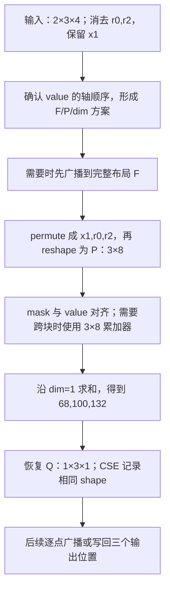

# 修复 ② 检视说明：沿数据流理解多轴归约的函数、返回值与修改原因

检视对象：[PR !48471][pr]，关联 [Issue #5625][issue]。
基线为 `955b98d43b`，修复提交为 `66bed811b6`，两个文件增加 49 行、删除 47 行。
本文按输入、布局变换、归约、结果消费的数据流解释实际 diff。mask 修复已在基线中，本 PR 只提交轴与 shape 的修改。

**BERT 的错误归约有直接证据，修复方向明确；影响范围覆盖 NPU 此 codegen 路径的多轴归约，
另有两处改变单轴归约的共享元数据，不能承诺无回归。
本次检视还确认了“多轴全部归约为标量”时 DSL 与 CSE shape 不一致，建议合入前处理。**

## 会议开场：先说明一个实际错误

可以这样开场：

> BERT 静态训练反向的 bias gradient，需要对 batch 和 sequence 求和，每个 channel 保留一个结果。
> 旧 kernel 把归约轴和 channel 轴一起 flatten，只得到一个标量，再把这个标量写给多个 channel。
> 这个 PR 让生成器先区分输出轴与归约轴，只合并归约轴；同步修改 dim、广播恢复和 CSE shape。
> 检视重点是这些约定是否一致，以及未覆盖布局的风险。

[回归脚本][repro]中的原始表达式：

```python
value.reshape(4, 12, 128, 64).permute(0, 2, 1, 3).reshape(512, 768).sum(0)
```

每个 channel 累加 `4 × 128 = 512` 个元素，输出共 `12 × 64 = 768` 个 channel。
对应 kernel 中，x4 是外层循环标量；一个 tile 的槽位为 `[r2, r3, x5]`：

| 槽位 | 长度 | 职责 |
| --- | --- | --- |
| r2 | 4 | 求和后消去 |
| r3 | 128 | 求和后消去 |
| x5 | tile 中的 channel 数 | 保留每个位置的独立结果 |

[原始 kernel][old-dsl]的关键语句如下，保持产物原文：

```python
                tmp0 = tl.load(in_ptr0 + (x5 + 64*r3 + 8192*x4 + 98304*r2), x5_mask, other=0.0)
                tmp1 = tl.reshape(tmp0, [R2BLOCK_SUB* R3BLOCK_SUB* X5BLOCK_SUB])
                tmp3 = triton_helpers.promote_to_tensor(tl.sum(tmp1, 0))
                tl.store(out_ptr1 + (x5 + 64*x4 ), tmp3, x5_mask)
```

load 得到 `[R2,R3,X5]`；reshape 把三维压成一维；sum 沿唯一维求和，也消去了 X5。
store 仍用向量 x5 写回，因此多个 channel 得到同一个结果。

用小数值说明：

```text
value[0,0,:] = [1, 10, 100]
value[0,1,:] = [2, 20, 200]
value[1,0,:] = [3, 30, 300]
value[1,1,:] = [4, 40, 400]

预期各 channel 的和：[10, 100, 1000]
全部 flatten 后求和：1110，已经无法恢复各 channel
```

[历史单 kernel 对照][direct-validation]解释了它为何可能漏测：X5 block 为 1 时旧实现通过；
block 为 8 时旧实现失败，最大绝对误差为 187.436218。
修改 DSL 后同一 block 为 8 的对照通过，最大绝对误差约 `9.54e-6`。
这是历史 DSL 实验，不能标为当前 PR head 的设备实测。

## 沿数据流理解：先固定同一个输入

下面用一个分离归约轴的小例子贯穿所有函数，避免每处换 shape。
这是一组说明生成规则的输入，不冒充 BERT 的设备 trace。

```python
# PyTorch 语义
value.shape == (2, 3, 4)
result = value.sum((0, 2))
```

| value 槽位 | 逻辑轴 | 块长度 | 求和后的职责 |
| --- | --- | --- | --- |
| 0 | r0 | 2 | 消去 |
| 1 | x1 | 3 | 保留三个独立结果 |
| 2 | r2 | 4 | 消去 |

原始值设为按行排列的 1–24：

```text
value[0,:,:] = [[1,2,3,4],    [5,6,7,8],     [9,10,11,12]]
value[1,:,:] = [[13,14,15,16],[17,18,19,20], [21,22,23,24]]

预期结果 = [68, 100, 132]
```

为什么是三个和？固定一个 x1，累加两个 r0 位置、四个 r2 位置，共 8 个数。
例如 x1=0 对应 `[1,2,3,4,13,14,15,16]`，和为 68。
旧逻辑把所有 24 个数合成一个总和 300，已经无法表达三个独立结果。

后文用三个名字标记数据表示，**这些都是本例的具体尺寸，不是新的代码接口**：

| 名称 | 轴顺序 | 代入本例后的尺寸 | codegen 中的尺寸列表 |
| --- | --- | --- | --- |
| F：完整布局 | `[r0,x1,r2]` | `[2,3,4]` | `["R0BLOCK_SUB", "X1BLOCK_SUB", "R2BLOCK_SUB"]` |
| P：打包布局 | `[x1,r0*r2]` | `[3,8]` | `["X1BLOCK_SUB", "R2BLOCK_SUB * R0BLOCK_SUB"]` |
| Q：恢复后的结果布局 | `[r0槽位,x1,r2槽位]` | `[1,3,1]` | `["1", "X1BLOCK_SUB", "1"]` |



下文按这些数据表示的依赖顺序讲修改。部分方案在初始化时就已计算，
因此图中是解释数据如何变化，不表示 Python 源码逐行执行的时序。

## 先分清函数“返回”与设备“计算结果”

这些修改位于生成器里。Python 调用函数时，通常还没有执行设备求和。

| 下文术语 | 本文中的具体含义 |
| --- | --- |
| DSL | 生成出来的 Triton 代码，例如 `tl.reshape`、`tl.sum`；随后才交给编译器执行 |
| rank / 槽位 | rank 是维数；槽位是维度的位置，例如 `[2,3,4]` 有三个槽位，x1 占槽位 1 |
| golden_var_list | 生成器选出的参考轴顺序；这里反转它，才是 value 的维度顺序，不是全部地址符号的列表 |
| CSE / CSEVariable | 公共子表达式消除及其临时变量对象；这里关注对象登记的 shape 是否与生成值相同 |
| persistent | 此处一次处理完整归约块的分支；non-persistent 则循环处理多个归约块，并保留累加器 |

| 函数 | 职责 | Python 返回类型 | 谁消费返回值 |
| --- | --- | --- | --- |
| `is_contiguous_reduction()` | 判断归约轴在选定布局中是否相邻 | bool | ReductionAnalysis 初始化、kernel 的 dense_size_list |
| `ReductionAnalysis.dense_size_list()` | 描述完整槽位及其长度 | 尺寸字符串 list | 广播、mask、结果恢复；本 PR 未改其实现 |
| `dense_post_reduction_list()` | 描述保留轴在前、归约轴合并在后的尺寸 | 尺寸字符串 list | dense_size_str、packed_value_shape，以及 kernel 包装方法 |
| `dense_size_str()` | 将归约计算所需尺寸写成可插入 DSL 的文本 | str | 生成 reshape、部分 broadcast 和 accumulator 初始化 |
| `analyze_reduction_dim()` | 决定在打包张量的哪个维度执行归约 | int | 初始化 reduced_dim，随后经 reduction_dim 取出 |
| `triton_tensor_ndim()` | 给出归约计算表示使用的 rank | int | 常量、索引 shape 推导及 reduction_resize |
| `reduction_resize(value, dim)` | 为归约结果生成恢复布局的表达式 | str | final_reduction 等将该表达式写入 DSL |
| `reduction(dtype, src_dtype, reduction_type, value)` | 编排整个归约，写 DSL 并登记结果元数据 | 普通归约返回 CSEVariable，部分统计分支返回 tuple | 后续融合表达式和 store 使用这个临时结果 |

例如 `dense_size_str()` 返回字符串 `"[X1BLOCK_SUB, R2BLOCK_SUB * R0BLOCK_SUB]"`，
并不返回一个真正的 3×8 tensor。
`reduction_resize("s", 1)` 返回 `"s.reshape(1, X1BLOCK_SUB, 1)"`，
并不在 Python 中 reshape 一个设备 tensor。

`reduction()` 的 value 则是代表已生成临时值的 CSEVariable，包含名字、dtype、shape。
返回值仍是“代表归约结果的变量”；`[68,100,132]` 是生成的 kernel 在设备上执行后应得到的数值。

下面源码均固定到 PR 提交 `66bed811b6`，见 [kernel_analysis.py][analysis-source]、[triton.py][triton-source]。
每个阶段同时说明：函数作用、输入、旧返回或状态、新返回或状态、修改原因与后续影响。

## 数据进入生成器：先确认哪些轴属于 value

### is_contiguous_reduction：分析的是 value 布局，还是地址里的全部轴

**函数作用与输入。** 没有显式参数，读取 kernel 中的轴元数据；
输出 bool，回答“多个 r 轴在当前被分析的列表里是否相邻”。
它不回答 tensor 是否整体 contiguous，也不回答哪些轴该求和。
`ReductionAnalysis.__init__()` 会用它初始化 contiguous_reduction。
kernel 的 `dense_size_list()` 也会调用它，选择返回完整还是打包尺寸。

原实现优先分析 `parse_golden_from_load_store_index()` 的结果；
新实现确保 golden 已选定，然后分析 `reversed(golden_var_list)`。

| 同一输入条件 | 修改前返回 | 修改后返回 |
| --- | --- | --- |
| 主例：解析顺序和 value 都是 `[r0,x1,r2]` | False，r 槽位为 0、2 | False，仍为 0、2 |
| 构造的 BERT 式情况：解析列表含标量 x4，value 不含 | False，见下方推导 | True，value 中两个 r 轴实际相邻 |

**为何要改。** 地址里的符号不一定都占一个 value 维度。
以 BERT 那条 load 地址为例，stride 为 `x5:1, r3:64, x4:8192, r2:98304`。
仅按这条 load 的 stride 排序再反转，得到 `[r2,x4,r3,x5]`，两个 r 轴被 x4 隔开。
但 x4 是外层标量循环，tile 是 `[r2,r3,x5]`，两个 r 轴相邻。
拿前者判断后者，会把一个无向量槽位的轴也算入相邻性。

新逻辑按 value 轴顺序遍历，记录 r 轴的下标，仍用原来的相邻性公式；
改变的是判断依据，不是把相邻性强行设为 True。
上面的 BERT 式列表是根据源码和地址构造的示例，探针也显式标注为构造输入，
不冒充历史完整 load/store 元数据快照。

**修改影响。** 主例中的 False 不变，因此后续正确处理非相邻归约仍需要其他修改。
列表确实不一致时，bool 可能改变，进而改变 kernel 包装方法的返回值。
该 helper 统一判断对象，却不能单独修好旧的全轴 flatten 算法。

### 两个 dense_size_list：同名，但返回值不能混用

这两个函数没有直接修改，却是理解新增 full_value_shape 的前提。

| 方法及条件 | 返回什么 | 主例的返回值 |
| --- | --- | --- |
| analysis 的 dense_size_list，inside_reduction=True | 原始 value 槽位的全部尺寸 | F，即 `["R0BLOCK_SUB","X1BLOCK_SUB","R2BLOCK_SUB"]` |
| kernel 的 dense_size_list，存在归约且 contiguous=False | 转调上一个方法 | F |
| kernel 的 dense_size_list，存在归约且 contiguous=True | 转调 dense_post_reduction_list | P |

因此 `self.dense_size_list()` 不保证永远描述原始 value。
如果相邻性判断改变，包装方法的返回表示也可能改变。
后面需要完整布局时，新代码直接调用 `self.reduce_analysis.dense_size_list()`，消除这层歧义。

## 为数据准备计算布局：保留输出分组，合并归约轴

### dense_post_reduction_list：只描述目标打包形状

**函数作用与输入。** 读取 golden 的轴顺序与 reduction_axis_list，返回尺寸字符串 list。
用途是描述“哪些维度分别保留、哪些维度合成一个归约维”。名字虽含 post_reduction，
返回值仍含归约长度乘积，不是求和后的结果尺寸。
调用者是 dense_size_str 和 reduction 内的 packed_value_shape；包装方法也可能调用它。

主例的输入与计算：

```text
golden_var_list                 = [r2,x1,r0]
reversed(golden_var_list)       = [r0,x1,r2]
dense_reduction_list()         = ["R2BLOCK_SUB","R0BLOCK_SUB"]
拼接的 reduction_list_str      = "R2BLOCK_SUB * R0BLOCK_SUB"
```

| 比较项 | 修改前 | 修改后 |
| --- | --- | --- |
| 选择保留尺寸的方法 | 遍历完整尺寸，排除归约尺寸字符串 | 遍历 value 轴，保留名字不以 r 开头的轴 |
| 本例实际返回 | `["X1BLOCK_SUB","R2BLOCK_SUB * R0BLOCK_SUB"]` | 同左，仍是 P |
| 代入长度后的意义 | `[3,8]` | `[3,8]` |

**这些表达式为什么这样写。** `reversed(golden_var_list)` 使筛选顺序与 value 一致；
`axis.name[0] != "r"` 按身份选输出轴；`axis.name.upper()` 加 BLOCK_SUB 生成该轴的尺寸名字；
`kept_sizes + [reduction_list_str]` 让各输出轴独立，归约乘积放最后。
最后一个维度的 8 表示“每个输出要汇总八个元素”，不是八个输出。

**修改原因与影响。** 这处把同一规则改为直接按轴身份表达，避免再从尺寸文本反推轴身份。
对本例以及常规归约内路径，旧算法本来就返回 P，不能说这里从 `[24]` 改成 `[3,8]`。
旧字符串含轴名，不能以“两轴数值长度相等”作为旧算法会混淆它们的证据。
这部分主要明确布局规则，评审时应与真正改变行为的下一处区分。

### dense_size_str：决定 reshape 究竟写成 [24] 还是 [3,8]

**函数作用与输入。** analysis 方法读取完整尺寸、归约轴数和相邻性，返回可写进 DSL 的 shape 字符串。
kernel 的同名方法对普通归约转调它。reduction 随后把字符串用于 reshape，
non-persistent 分支也把它用于 tl.full 初始化。

| 主例：两个 r 轴被 x1 隔开 | 修改前返回 | 修改后返回 |
| --- | --- | --- |
| Python 字符串 | `"[R0BLOCK_SUB* X1BLOCK_SUB* R2BLOCK_SUB]"` | `"[X1BLOCK_SUB, R2BLOCK_SUB * R0BLOCK_SUB]"` |
| 代入 2、3、4 | `"[24]"` | `"[3,8]"` |
| 表示什么 | 全部元素只有一组 | 三个 x1 分组，每组八个归约元素 |

旧算法把非相邻多轴作为特殊分支，将所有尺寸相乘。
新算法删除这个分支，对所有多轴统一调用已经能返回 P 的 helper。
`is_contig` 不再决定目标形状，所以其局部变量随之删除。

**为什么必须改。** 一旦只有一组，后面的普通 sum 无法知道三个输出分别对应哪些元素。
错误在 reshape 阶段已经发生，单改 sum 的 dim 无法恢复分组。

**后续影响。** value 的 reshape、mask 的 reshape 和累加器初始化会使用新的目标形状。
非相邻多轴行为改变；原本相邻多轴仍用打包表示；单轴仍返回原来的完整尺寸文本。
但 `[3,8]` 只描述尺寸，不保证元素分组正确，还必须在下面先 permute。

### analyze_reduction_dim：归约乘积放在最后，sum 就必须沿该维

**函数作用与输入。** 读取归约轴数和 golden，返回 int。
构造 ReductionAnalysis 时，返回值保存到 reduced_dim；
`kernel.reduction_dim()` 取出它，最终用于生成 tl.sum 等运算的 axis 参数。

| 主例 | 修改前 | 修改后 |
| --- | --- | --- |
| 计算依据 | 非相邻多轴已全部 flatten，唯一维度为 0 | P 中有一个保留维，归约乘积在维度 1 |
| Python 返回值 | `0` | `1` |
| 后面生成的求和 | `tl.sum(value, 0)` | `tl.sum(value, 1)` |

**为什么是统计保留轴。** P 把 K 个保留轴放在前面，最后追加一个合并归约维，
因此合并维的下标就是 K。主例 K=1；若输出还有两个独立维度，则 K=2。
这里无需反转 golden，因为计数不依赖顺序。

新代码先初始化 golden，再统计非 r 轴并立即返回。
旧的“多轴且相邻”专用返回分支被合并到这里，所以删除；单轴推导保留。

**后续影响。** 它与 dense_size_str 必须配套：`[24]` 只有 dim=0，`[3,8]` 必须沿 dim=1。
这个返回值还被 kernel 初始化中的 persistent 决策读取，因此改变 dim 不只影响一行 sum。
索引归约另有 axis 取值逻辑，也需要检视，不能由 sum 正确推定其正确。

### triton_tensor_ndim：描述计算表示的 rank，不是原始输入 rank

**函数作用与输入。** 读取完整轴数与归约轴数，返回 int。
常量生成、索引 shape 推导和 reduction_resize 会消费这个值。

| 主例 | 修改前 | 修改后 |
| --- | --- | --- |
| Python 返回值 | `1` | `3 - 2 + 1 = 2` |
| 对应表示 | 一维 `[24]` | 二维 P=`[3,8]` |
| 例如常量生成 | `tl.full([1], ...)` | `tl.full([1,1], ...)` |
| reduction_resize 的分支 | 认为是一维，提前 promote_to_tensor | 可以继续恢复原始输出槽位 |

新公式为“完整轴数 − 多个归约轴 + 一个合并归约维”。
改用 golden 的长度，使它与上述打包方案使用同一个轴集合；前面的初始化保证列表存在。

**为什么必须同步。** 即使广播可能容忍不同 rank 的全 1 常量，
reduction_resize 仍会根据旧返回值 1 提前走标量结果路径，无法恢复 `[1,3,1]`。
因此不能只将其解释为“常量多加一维”。
影响的是使用该 helper 的元数据和生成分支；原始 load 在重排前依然是三维 F。

## 数据真正进入计算：需要时先补齐广播

### reduction 的 full_value_shape 与 packed_value_shape 各管一个阶段

**所属函数与输入。** 这里开始都是 `reduction(..., value)` 的内部状态变化，
不是新增了几个独立返回函数。value 是输入临时变量，最终仍由 reduction 返回结果 CSEVariable。
新增局部变量只是记录不同阶段所需的尺寸。

| 局部状态 | 修改前 | 修改后，主例 |
| --- | --- | --- |
| value_shape | 由 kernel 包装方法取得，本例是 tuple(F) | 仍存在，本例仍是 tuple(F) |
| full_value_shape | 无独立变量 | analysis 直接提供 tuple(F)，即 `(R0,X1,R2)` 对应的尺寸字符串 |
| packed_value_shape | 无独立变量 | 多轴取 tuple(P)，即 `(X1,R2*R0)` 对应的尺寸字符串 |

为什么保留原变量同时新增两份？包装方法可能因相邻性返回 F，也可能返回 P，
不能再把它当作所有阶段通用的 shape。
full 明确描述广播前的轴身份，packed 明确描述重排后的计算表示；单轴 packed 仍取旧方法。

**后续影响。** full 交给下面的 broadcast，packed 交给 reshape 的元数据和 accumulator。
创建 tuple 本身不会在设备上广播、重排或分配这两个 tensor。

### broadcast：先补齐 F，才能按照原轴身份重排

这个分支仅在生成器判定 value 缺少轴时执行。
为单独解释它，将同一计算的一个输入设为只依赖 x1，输入 shape 为 `[1,3,1]`，
需要在完整计算域 `[2,3,4]` 上使用。

| 分支内的值 | 修改前 | 修改后 |
| --- | --- | --- |
| broadcast 目标 | dense_size_str，即 `[24]` | full_value_shape，即 F=`[2,3,4]` |
| 生成文本 | `tl.broadcast_to(input, [R0BLOCK_SUB* X1BLOCK_SUB* R2BLOCK_SUB])` | `tl.broadcast_to(input, [R0BLOCK_SUB, X1BLOCK_SUB, R2BLOCK_SUB])` |
| 给该临时量记录的 CSE shape | value_shape，本例为 tuple(F) | full_value_shape，本例也是 tuple(F) |

**旧值为什么不成立。** `[1,3,1]` 的三个轴还保留原槽位身份，不能直接广播成一维 `[24]`。
此时也不能直接广播成 P=`[3,8]`：x1 还没有移动到前面。
应先得到 F，再执行下一阶段的重排。

这处同时替换生成文本和 shape 参数，是让设备表示与元数据对应；
本例的元数据数值恰好没变，主要变化发生在实际 broadcast 目标。
在包装方法原来返回 P 的布局中，元数据也会从 P 改为 F。

**影响边界。** 主例输入已经完整时，这段不执行。
而且入口判据仍是 `len(axis_list) < len(self.dense_size_list())`，后者可能已是 packed rank。
本 PR 改善的是“进入后广播到哪里”，没有证明所有缺轴输入都能被正确识别。

## 让每组元素对应一个输出：permute 后才能 reshape

### 放宽已有重排算法的条件

这段属于 reduction，没有独立 Python return。
输入是 F 布局的 value；输出是写入 compute buffer 的新临时量和相应 CSEVariable。
PR 将已有算法的门控从“多轴且相邻”改为“多轴”。

| 主例中的局部值或行为 | 修改前 | 修改后 |
| --- | --- | --- |
| 是否进入计算 permute 的分支 | 否，r0/r2 不相邻 | 是，因为归约轴数为 2 |
| need_permute | 保持初值 False | True |
| permute_order | 保持初值 None | `[1,0,2]` |
| 实际生成 | `tl.reshape(input, [R0BLOCK_SUB* X1BLOCK_SUB* R2BLOCK_SUB])` | `tl.reshape(input.permute([1,0,2]), [X1BLOCK_SUB, R2BLOCK_SUB * R0BLOCK_SUB])` |
| 设备数据表示 | 一维 24 个数 | 二维 3 行，每行 8 个数 |

已有算法按下面的依赖计算：

```text
value_order   = [r0,x1,r2]
target_order  = [x1,r0,r2]     # 保留轴在前，归约轴在后；各组内部顺序保持
permute_order = [1,0,2]       # 目标中的三个轴分别在原始第 1、0、2 槽位
```

对 1–24 的输入，新 value 的三行恰好是：

```text
x1=0: [1,2,3,4,13,14,15,16]
x1=1: [5,6,7,8,17,18,19,20]
x1=2: [9,10,11,12,21,22,23,24]
```

**为什么不能只 reshape。** 直接把原始存放顺序切成三个长度为 8 的片段，
第一行会是 `[1,2,3,4,5,6,7,8]`，混入 x1=1 的值，并不等于 x1=0 应求和的那组。
修改的核心是保留每个输出对应的元素集合，元素总数不变并不足以证明正确。

**影响。** 分离多轴现在也会真正进入该算法。
输入已是 `[x1,r0,r2]` 时，目标顺序与原顺序相同，need_permute=False，仍只 reshape。
是否产生实际搬运以及性能代价，取决于下游编译，不能仅凭这个 Python 条件下结论。

### 两个 reshape 分支的 CSE shape 一起改

两条路径都得到 P，因此都将 `shape=value_shape` 改成 `shape=packed_value_shape`。
这不是额外执行一次 reshape，而是登记上一步已经生成的 tensor 的形状。

| 路径与示例 | 修改前记录的 shape | 修改后记录的 shape |
| --- | --- | --- |
| 主例 `[r0,x1,r2]`，本次启用 permute | tuple(F)，尺寸 `[2,3,4]` | tuple(P)，尺寸 `[3,8]` |
| 已是 `[x1,r0,r2]`，不需要 permute，且包装方法已返回 P | tuple(P) | tuple(P)，取值不变 |
| 其他不需要 permute 的情况 | 取决于包装方法是否返回 P | 显式使用 P |

**为什么要改。** dense_size_str 是生成文本的目标；value_shape 来自另一个可能返回 F 的接口。
旧版甚至可能生成一维 `[24]`，却记录三维 F。
新版显式登记 P，使后续 mask、累加和 CSE shape 推导看到的表示与生成的 reshape 相符。

## 同一布局中归约：先对齐 mask，需要时跨块累加

### mask 沿 value 的同一条变换路径走

mask 的主体逻辑已在基线中，本 PR 没有重新提交那项修复。
但它使用同一个 need_permute、permute_order 和 dense_size_str，
所以这些值改变后，mask 也会按 F → 重排 → P 变换。

以只保留部分 x1 的 mask 为例，它先在 x1 槽位形成 `[1,3,1]`，广播到 F，
再按 `[1,0,2]` 重排并 reshape 为 `[3,8]`，与 value 的每行逐元素对应。
如果 value 改布局而 mask 不改，同一个 True/False 位置会作用到另一组元素。
因此第一个阶段的 shape 和排列修改也会影响已有 mask 代码的生成行为。

### accumulator：已有初始化用什么形状，元数据就应记什么

仅 non-persistent 分支进入这里。它不是先得到一个最终和，
而是为各 tile 对应位置保存部分累加，最后再沿合并归约维归约。
输入 value 已是 P，accumulator 必须与之对齐。

| 主例，non-persistent | 修改前 | 修改后 |
| --- | --- | --- |
| 初始化生成的目标 shape | dense_size_str，即 `[24]` | dense_size_str，即 P=`[3,8]` |
| namedvar 登记的 accumulator shape | tuple(F)，即 `[2,3,4]` | packed_value_shape，即 `[3,8]` |
| 每轮 value 的计算布局 | 全轴 flatten | 保留 x1 的三行布局 |

本处具体 diff 将 namedvar 的 shape 参数换为 packed_value_shape；
初始化文本随前面的 dense_size_str 一起变化，不是在这里又改了一遍初始化算法。
它确保“初始化实际形状、每轮 value 形状、累加器元数据”三者一致。
对于单轴，packed_value_shape 仍取旧方法，这处取值不变。

## 执行归约并恢复输出槽位

### final_reduction 与 reduction_resize 各做一半

reduction 内的 final_reduction 负责拼出 `tl.sum(value, dim)` 等归约表达式，
再调用 reduction_resize，为归约结果生成恢复布局的文本。
前者使用已分析好的 dim；后者依据完整轴身份恢复 singleton 槽位。

| 主例的计算阶段 | 修改前 | 修改后 |
| --- | --- | --- |
| 求和输入 | `[24]` | `[3,8]` |
| dim | 0 | 1 |
| 设备求和结果 | 一个标量 300 | 三个值 `[68,100,132]` |

**reduction_resize 的函数职责与输入。** value 参数是结果表达式或变量的名字，例如 `"s"`，
dim 参数是归约维下标。函数返回一个 DSL 表达式字符串，不返回设备 tensor。

| 同样调用 reduction_resize("s", 当前 dim) | 修改前返回 | 修改后返回 |
| --- | --- | --- |
| 主例 | `"triton_helpers.promote_to_tensor(s)"` | `"s.reshape(1, X1BLOCK_SUB, 1)"` |
| 返回表达式执行后的形状 | `[1]` | `[1,3,1]` |

**原因。** 旧 ndim=1，函数在开头认为只需把标量提升为一个元素的 tensor。
新 ndim=2，不再提前返回；同时多轴恢复分支去掉了 contiguous 限制，
因此能按完整 F 遍历，将每个 r 槽位置 1，得到 Q。
取 analysis 的完整 shape 是为了知道 r0 和 r2 原来分别在哪个槽位，不能用 P 代替。

**为什么需要 Q，而不只保留 `[3]`。** 后续与 F=`[2,3,4]` 逐点计算时，
`[1,3,1]` 明确沿中间 x1 维对应；直接拿 `[3]` 进行常规尾维对齐，会尝试对到最右侧 r2=4，
不符合原来的轴语义。
新增的 1 只是广播槽位，不是复制出原归约域的数据。

本例最终文本由 `promote_to_tensor(tl.sum(value,0))`，
变为 `tl.sum(value,1).reshape(1,X1BLOCK_SUB,1)`。
全归约无保留轴时仍会命中提前返回，这个未解决边界保留在后面的风险章节。

### result_shape：登记的是恢复后的结果，不是输入 shape

这是 reduction 内的局部 list，随后传给 cse.newvar / cse.generate。
它不独立返回，也不执行 reshape。

| 主例 | 修改前 | 修改后 |
| --- | --- | --- |
| 起点 | kernel 的尺寸列表 F | analysis 的完整尺寸列表 F |
| 修改规则 | 只把 packed dim 对应的一个槽位置 1 | 按轴身份把所有 r 槽位置 1 |
| 局部 result_shape | `["1","X1BLOCK_SUB","R2BLOCK_SUB"]` | `["1","X1BLOCK_SUB","1"]` |
| 代入长度 | `[1,3,4]` | Q=`[1,3,1]` |

旧版只处理 dim=0 对应的槽位，没有表示第二个归约轴已经消去。
若只改 dim=1 却保留旧的赋值方式，更会把中间 x1 槽位改成 1。
原因是 dim 属于 P，而恢复布局属于 F，二者下标不能混用。
新逻辑按原轴身份生成 Q，与 reduction_resize 的真实输出保持一致。

**影响。** 这个局部值先用于创建结果占位变量。
non-persistent 普通归约最终直接返回该变量；persistent 部分分支还会重新调用 cse.generate，
所以修好这个局部值还不够，必须看接下来的两处赋值。

### 最终返回变量：两处 shape 参数也从输入改成结果

persistent 的 max/min 分支与其他普通分支各有一次：

```diff
-shape=masked_value.shape
+shape=tuple(result_shape)
```

masked_value 代表归约前输入；final_reduction(masked_value) 已求和并恢复为 Q。
这两行修改决定的是新生成的结果 CSEVariable 身上的 shape，不改变已拼出的求和表达式。

| 主例、persistent 普通归约 | 修改前 | 修改后 |
| --- | --- | --- |
| 输入 masked_value 的元数据 | 旧 reshape 记录的 tuple(F) | 新 reshape 记录的 tuple(P) |
| 最终结果变量的 shape 来源 | 继承 masked_value.shape | 使用 tuple(result_shape) |
| 最终返回变量记录的尺寸 | `[2,3,4]` | Q=`[1,3,1]` |

**为什么要配套。** 如果只改输入布局而不改这两处，最终结果会继承新的 P=`[3,8]`，
仍错误地声称归约维存在。即使设备已算出三个正确值，后续生成器看到的也会是归约前尺寸。

**影响不止多轴。** 这两处没有多轴条件，单轴 `[R0,X1]` 的求和仍生成 `.reshape(1,X1)`，
但最终元数据会从 `[R0,X1]` 改为 `[1,X1]`。因此单轴结果的后续消费也要回归。
argmin/argmax、Welford 有独立结果处理，不能把这两处描述为所有类型的统一实现。

## 数据离开归约：为什么后续消费也在影响范围内

reduction 最终把结果变量写入 reduction_cache，并返回 CSEVariable；
后续融合表达式通过变量名字使用真实结果，通过变量的 shape 做元数据传播。

用本例说明一个消费者：

```text
原输入 F：                    [2,3,4]
本次归约得到的设备值：         [68,100,132]
恢复后的实际 tensor 与元数据： [1,3,1]
后续逐点使用时的广播：         每个 x1 使用自己的那个和，扩展到对应 r0/r2 位置
```

旧值若是单个 300，广播无法恢复三个 channel 的差别；
新数值正确而元数据仍是 P，生成器又会错误保留一个已经消去的归约维。
因此整个修改的因果链是：**先保证分组，再保证求和维度，最后保证真实结果与记录的布局相同。**

并非每个结果都先与原输入广播；有些直接 store。
但无论是后续逐点计算还是写回地址，三个输出位置都必须对应各自结果，不能共享一个全局和。

## 回到真实 BERT：同一条数据流如何对应已捕获 DSL

主例是 `[R0,X1,R2]`。BERT 实际 tile 为 `[R2,R3,X5]`，对应的完整链是：

```text
F=[R2,R3,X5]
→ 目标轴顺序 [X5,R2,R3]，permute 下标 [2,0,1]
→ P=[X5,R3*R2]
→ dim=1，每个 X5 独立求和
→ Q=[1,1,X5]
→ 每个 x5 写入自己的输出位置；外层 x4 覆盖 12 组
```

[历史修复后 kernel][dsl]保持原文：

```python
                tmp1 = tl.reshape(tmp0.permute([2, 0, 1]), [X5BLOCK_SUB, R3BLOCK_SUB * R2BLOCK_SUB])
                tmp3 = tl.where(tl.reshape((tl.broadcast_to((x5_mask.reshape([1, 1, X5BLOCK_SUB])), [R2BLOCK_SUB, R3BLOCK_SUB, X5BLOCK_SUB])).permute([2, 0, 1]), [X5BLOCK_SUB, R3BLOCK_SUB * R2BLOCK_SUB]), tmp1, 0)
                tmp4 = tl.sum(tmp3, 1).reshape(1, 1, X5BLOCK_SUB)
                tl.store(out_ptr1 + (x5 + 64*x4 ), tmp4, x5_mask)
```

这四行分别对应布局变换、mask 对齐、归约与结果恢复、写回。
历史产物同时包含 mask 修复，不能把 tl.where 本身全部归因于本 PR。


## 影响范围：两处文件不代表只影响一个模型

直接范围是 NPUIndexTritonKernel 及其 ReductionAnalysis。
NPU scheduling 选择此类时受影响；其他路径是否选择它，应看相应路由。
本 PR 未修改 eager 算子、CUDA codegen 或 triton_experimental 的独立实现。

| 场景 | 实际影响 | 当前结论 |
| --- | --- | --- |
| 多轴、一个保留轴 | packed shape、dim、必要时的 permute、恢复与 CSE | BERT 是有直接证据的目标 |
| 多轴、归约轴被输出轴隔开 | 全轴 flatten 改成保留输出轴的 pack | 通用覆盖范围，不能只测 BERT |
| 多轴、多个保留轴 | 按原顺序保留 K 个输出轴，dim=K | 两保留轴的历史 separated-axes 小图通过，未穷举布局 |
| 多轴、无保留轴 | 标量结果的元数据 rank 改变 | 已确认 DSL/CSE 不一致，见下一节 |
| 单轴 persistent 普通归约 | 算法和 dim 分支保留，但最终 CSE shape 改变 | 不能说单轴完全不受影响 |
| non-persistent 多轴 | 累加器元数据及共享打包、恢复改变 | 需检查跨 tile 累加及最终写回 |
| argmin/argmax | 共用 pack、dim、恢复，另需生成位置索引 | sum 正确不证明索引正确，先确认多轴路径可达性 |
| Welford 等专用统计路径 | 部分前处理共用，内部还有专用布局 | 四项 sum 回归不能证明已覆盖 |
| 静态/动态、不同 kernel type | 满足上述代码路径即可影响，无固定 shape 限制 | 动态图可能选其他路径，PASS 不代表所有类型覆盖 |

另一个间接影响：`_finalize_kernel_codegen_dims()` 读取 reduction_dim，
用于 unified SIMT 路径的 persistent 决策。因此 dim 不只是 sum 的参数。
是否实际改变某个模型的路由，需要结合生成产物确认。

## 已确认边界：多轴全归约时结果 rank 不一致

2026-10-24 本地提取实际 PR 源码执行，记录 emitter 的 DSL 字符串与 CSE shape。
环境、buffer 和 CSE 使用最小替身，不导入 torch，也不执行 Triton。
脚本为 [review_reduction_axes_codegen.py][review-probe]，输出见[源码探针结果][probe-result]。

```bash
python scripts/repro/cicd/model_fixes_20261020/review_reduction_axes_codegen.py --repo <framework-repo>
```

framework-repo 需含 `66bed811b6` 及父提交。脚本检查源码生成行为，不要求设备。

当 value 只有 `[R0,R1]`、没有任何保留轴时：

```text
triton_tensor_ndim() = 2 - 2 + 1 = 1
reduction_resize() 因 ndims == 1 提前返回 promote_to_tensor(...)
生成结果：promote_to_tensor(tl.sum(value, 0))
PR 的 result_shape：("1", "1")
```

promote_to_tensor 的实现是 `x + tl.zeros((1,), tl.int1)`。
packed 一维 value 求和产生标量，再提升为一维 `[1]`；当前 CSE 却记为二维 `[1,1]`。

| 路径 | 父提交结果元数据 | PR 结果元数据 | 实际生成结果 shape |
| --- | --- | --- | --- |
| persistent sum 全归约 | `[R1*R0]` | `[1,1]` | `[1]` |
| non-persistent sum 全归约 | `[1]` | `[1,1]` | `[1]` |

**区分旧问题与新变化：** persistent 原本就沿用错误的输入 shape，PR 改了尺寸但未统一 rank；
non-persistent 这条构造路径则从原来一致的 `[1]` 变为不一致。
不能把它们全部称为新引入，也不能因为旧代码有错就忽略新的不一致。

这是源码层面确认的问题。探针没有实际图 lowering、Triton 编译和设备执行，
不能声称某个模型已经因此报错或算错；实际可达性与后续影响仍需小图验证。

建议合入前统一约定：要么保留现有 `[1]` DSL，将对应元数据也记为 `[1]`；
要么显式生成恢复所有 singleton 槽位的 reshape，并确认消费方支持。
选定后应同时检查 persistent、non-persistent 和专用归约路径。
本文记录检视建议，尚未修改 PR 实现。

## 其他风险与应补证据

| 项目 | 具体依据 | 需要验证什么 |
| --- | --- | --- |
| 单轴结果消费 | 最终结果的两处 CSE shape 修改没有多轴限制 | 单轴归约后继续逐点计算、广播和索引消费 |
| 混合广播 | broadcast 入口判据仍用可能已 packed 的 rank | 输入缺少归约轴、缺少保留轴、多个输入各缺不同轴 |
| 位置索引归约 | get_reduction_axis 用 packed dim 索引原始 golden，二者未必指向同一个轴 | 先确定多轴 argreduce 能否到达，再比较索引及 tie 情况 |
| Welford 专用布局 | vectorized 分支单独重排，向量轴可能不在 golden 内 | 开关启用时检查专用 DSL、元数据、统计量和后续广播 |
| 资源及性能 | 更多多轴布局实际生成 permute | 原本正确场景的编译资源与耗时、设备耗时是否回退 |

除全归约 shape 外，上表当前均是有代码依据的待验证点，并未据此确认发生新回归。
permute 是否形成真实搬运、是否增加 UB 由下游编译决定，不能仅凭 Python 语句给出性能结论。

## 已有验证的证明范围

| 证据 | 已支持的结论 | 限制 |
| --- | --- | --- |
| 原始及修复后 BERT DSL | 旧代码错误消去 X5；修复后按 channel 分组求和 | 历史产物，包含多项修复 |
| 历史同输入 kernel 对照 | X5 block=8 的错误通过改 DSL 恢复 | DSL 诊断实验 |
| [静态][static-results]、[动态][dynamic-results]回归 | bias gradient、separated axes，两类函数 × 静态/动态共四组通过 | 主要是 sum；历史整合版本，不穷举类型、布局和配置 |
| [模型矩阵][matrix] | 历史修复组合下 BERT 静态训练 accuracy 通过 | 不能标为独立 PR 在当前 master 的设备回归 |
| 本次源码探针 | 10 组输入分别执行父提交与 PR，共 20 条记录；核对函数返回值、生成文本和元数据，确认全归约边界 | 使用环境替身，不证明 lowering 可达性、编译与设备数值 |

PR 仅含两个生产文件，没有独立回归测试文件。
创建 PR 时的语法、diff 与离线轴排列检查也不替代设备回归。
本次文档更新未运行远程设备测试。

## 会议顺序与追问回答

1. 用原 DSL 的 flatten、标量 sum、向量 store 解释错误，再给 `[10,100,1000]` 的例子。
2. 用 [2,3,4] 的输入完整推导 [3,8] 的计算布局、dim=1、[1,3,1] 的结果布局。
3. 沿输入轴分析 → 广播 → 重排和打包 → 累加及求和 → 恢复输出 → 消费结果讲代码，每步先展示新旧返回值。
4. 展示修复后 permute → reshape → sum → 恢复槽位的完整闭环。
5. 主动交代影响面、全归约问题和验证缺口，再讨论合入前的修正与回归。

**为什么不能只把 dim 从 0 改成 1？** value 已 flatten 为一维，没有 dim=1，
必须先保留 channel 分组。

**为什么非相邻多轴也要改？** 是否相邻不改变该保留哪些轴。
非相邻时应先 permute，再合并归约轴，不能将全轴 flatten 当作替代。

**每行都是 BERT 必需的吗？** 不是。helper 的改写含明确轴身份的整理，
共享元数据还纠正其他路径。应分别解释其必要性与覆盖范围。

**单轴不受影响吗？** 算法与 dim 分支基本保留，但 persistent 普通归约结果 CSE shape 确实改变，
本次源码探针也观察到了这一变化。

**能否承诺无回归？** 不能。目标问题有明确修复证据，但全归约边界仍不一致，
广播、索引归约、专用统计路径与性能覆盖也不足。
当前适合带着具体待修点进行检视；修正边界并补齐验证后，再判断合入条件。

[pr]: https://gitcode.com/Ascend/pytorch/merge_requests/48471
[issue]: https://gitcode.com/Ascend/pytorch/issues/5625
[analysis-source]: https://gitcode.com/luqichao/pytorch_new/blob/66bed811b6a06b2847f86980611f89d8ebdb06c7/torch_npu/_inductor/codegen/kernel_analysis.py
[triton-source]: https://gitcode.com/luqichao/pytorch_new/blob/66bed811b6a06b2847f86980611f89d8ebdb06c7/torch_npu/_inductor/codegen/triton.py
[old-dsl]: ../../../artifacts/cicd/four_model_matrix_20261020/kernel_sources/BERT_pytorch/s_train_acc/BERT_pytorch__0_backward_3.1/triton_per_fused_clone_matmul_backward_sum_tra_11.py
[dsl]: ../../../artifacts/cicd/model_fixes_20261020/generated/bert_bias_gradient.py
[direct-validation]: ../../../artifacts/cicd/four_model_matrix_20261020/bert_backward_validation.json
[repro]: ../../../scripts/repro/cicd/model_fixes_20261020/validate_codegen.py
[review-probe]: ../../../scripts/repro/cicd/model_fixes_20261020/review_reduction_axes_codegen.py
[probe-result]: ../../../artifacts/cicd/model_fixes_20261020/review_20261024/source_probe.json
[static-results]: ../../../artifacts/cicd/model_fixes_20261020/regressions_v8/axes_static_none.json
[dynamic-results]: ../../../artifacts/cicd/model_fixes_20261020/regressions_v8/axes_dynamic_none.json
[matrix]: ../../../artifacts/cicd/model_fixes_20261020/model_matrix.json
