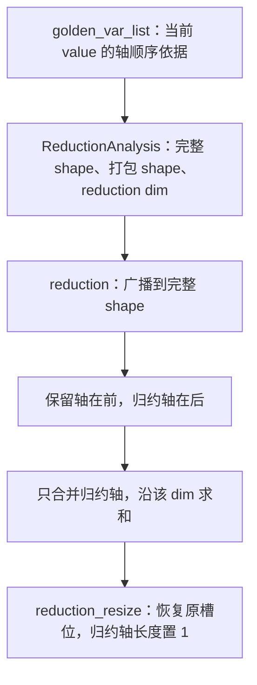

# 修复 ②：多轴归约为什么必须一起修改轴分析、reshape 和 shape 元数据

对应整合提交 `22b6b739eb3348d6d7707c9d941c328582b91319`，主题为
`fix(inductor): preserve axes in multi-axis reductions`。
该提交在 mask 修复之后；[完整补丁][patch]是本篇逐项说明的范围。
八项关系见[总览][overview]。

## 先把归约轴和输出轴分清

归约是把多个输入合成一个输出，例如 `sum`。
对 `[batch, sequence, channel]` 求 `sum((0, 1))`，被消去的 batch、sequence 是归约轴；
仍需逐项区分的 channel 是保留轴。本路径通常用 `r...` 命名归约轴、`x...` 等命名保留轴。

BERT bias gradient 的目标是得到 768 个 channel 各自的和：

```python
# 仓库回归用例中的实际 PyTorch 表达式
value.reshape(4, 12, 128, 64).permute(0, 2, 1, 3).reshape(512, 768).sum(0)
```

其中 `4 * 128 = 512` 是被求和的维度，`12 * 64 = 768` 是输出维度。
在捕获的 kernel 中，外层 `x4` 覆盖 12 组；单个块内 value 的轴顺序为：

| 块内槽位 | 轴 | 职责 |
| --- | --- | --- |
| 0 | `r2` | 归约，长度对应 4 |
| 1 | `r3` | 归约，长度对应 128 |
| 2 | `x5` | 保留，长度对应 64 |

旧 DSL 把 `[R2, R3, X5]` 全压成一维再 sum，输出一个标量。
这等于连 channel 一起求和，然后把同一个值写到多个 channel，无法满足原始定义。

## 两个文件分别负责什么

`torch_npu/_inductor/codegen/kernel_analysis.py` 的 `ReductionAnalysis`
负责回答“value 是什么形状”“哪些轴可以合并”“沿哪个 dim 归约”。
它主要返回 Python 列表、整数或字符串，不执行设备上的求和。

`torch_npu/_inductor/codegen/triton.py` 的 `NPUIndexTritonKernel`
使用这些答案写出 `tl.broadcast_to`、`permute`、`reshape`、`tl.sum` 和结果恢复语句。
同时维护 `TritonCSEVariable.shape`，让后面的代码生成知道每个临时量的形状。
CSE 是公共子表达式消除：已经生成的表达式可以复用；它也携带 dtype、shape 等元数据。
shape 写错，即使当前一行 DSL 看起来正确，后面的广播和 store 仍可能继续出错。



`golden_var_list` 是这个生成器选定的轴顺序基准。
本代码用 `reversed(golden_var_list)` 对应实际 value 的槽位顺序，阅读时不能直接把原列表当张量 shape。
这里的 contiguous reduction 判断的是归约轴在 value 槽位中是否相邻，
不等价于“整个输入 tensor 在 PyTorch 中是 contiguous”。

## 第一组修改：统一 shape 和 dim 的计算

### `ReductionAnalysis.dense_post_reduction_list()`

函数名容易误导：在本路径中，它返回用于归约计算的打包 shape，
其中最后一维仍然是所有归约轴长度的乘积，并非已经求和后的输出 shape。

新实现先按实际 value 顺序筛出保留轴，再追加归约长度乘积：

```python
value_axes = list(reversed(self.kernel.golden_var_list))
kept_sizes = [
    f"{axis.name.upper()}BLOCK_SUB"
    for axis in value_axes
    if axis.name[0] != "r"
]
return kept_sizes + [reduction_list_str]
```

`reduction_list_str` 来自 `dense_reduction_list()` 的长度乘积。
对 `[r2, r3, x5]`，结果应为 `[X5BLOCK_SUB, R3BLOCK_SUB * R2BLOCK_SUB]`。
归约轴乘积里的乘法次序不改变长度；真实元素的排列由后面的 permute 决定。
旧实现从 shape 字符串列表中过滤归约长度，新实现直接按轴身份筛选，明确保留轴及其顺序。

### `dense_size_str()`

旧代码只在“多轴且 contiguous”时使用上述打包 shape。
多轴但不 contiguous 时，直接返回所有维度乘积组成的一维 shape。
新代码让所有 `num_red > 1` 的情况都使用“保留轴 + 合并归约轴”的 shape。
这一步去掉了错误标量化的入口。

### `analyze_reduction_dim()`

旧非 contiguous 多轴分支直接返回 `dim=0`，因为它假设 value 已变成一维。
新代码先确保 `golden_var_list` 已选定，再计算保留轴数量：

```python
self.reduced_dim = sum(
    1 for axis in self.kernel.golden_var_list if axis.name[0] != "r"
)
```

因为打包形状把所有保留轴放在前面，归约轴乘积紧跟其后，
所以保留轴数恰好就是最后那个归约维的下标。
例如只有一个保留轴，打包 shape 是 `[X5, R2*R3]`，归约 dim 就是 1。
函数后面原来只针对 contiguous 多轴的重复分支随之删除，单归约轴仍走原有推导。

## 第二组修改：让其他 helper 遵守同一个布局约定

| 函数 | 原职责 | 本提交为什么要一起改 |
| --- | --- | --- |
| `triton_tensor_ndim()` | 决定生成常量等张量时需要几维 | 多轴打包后维数应为保留轴数加 1，不能对非 contiguous 返回 1 |
| `is_contiguous_reduction()` | 判断归约轴在 value 中是否相邻 | 改用 `golden_var_list`，避免重新解析某次 load/store 得到另一套顺序 |
| `reduction_resize(value, dim)` | 把归约结果放回后续表达式需要的布局 | 所有多轴都要在原归约槽位置 1，不能仅处理 contiguous |

`triton_tensor_ndim()` 新公式为 `len(golden_var_list) - numof_reduction_axis() + 1`。
这里使用的是当前 value 的完整轴集合，而不是可能与 value 布局不同的 `tiling_axis` 长度。

`reduction_resize()` 对 `[r2, r3, x5]` 把结果恢复成 `[1, 1, X5]`。
它保留两个归约轴的广播槽位，后续与原形状逐点计算时才不会对错 channel。
这不是把刚求出的 64 个数重新复制成 512 份实体数据，而是为布局/广播提供长度为 1 的维。

## 第三组修改：`reduction()` 如何使用这些答案

### 1. 显式区分三种 shape

新增 `full_value_shape` 和 `packed_value_shape`，并保留已有 `value_shape`：

| 名称 | 示例 | 使用时机 |
| --- | --- | --- |
| 完整 value shape | `[R2, R3, X5]` | 广播缺少轴的输入、按原轴构建 mask |
| 打包 value shape | `[X5, R3*R2]` | 归约前 reshape、块内累加器 |
| 结果 shape | `[1, 1, X5]` | 最终结果的 CSE 元数据和广播恢复 |

三个 shape 的元素数或维数可以不同，不能共用一个变量冒充它们。

### 2. 缺少轴时先 broadcast 到完整 shape

已有代码检测到参与 load/store 索引的轴比完整轴少时，会广播 value。
本提交让多轴分支广播到 `full_value_shape`，并把 CSE 的 shape 也记录为完整 shape。
此时还没有按保留轴/归约轴重排，直接广播到打包形状会丢失原轴对应关系。

### 3. 把保留轴搬到前面，再合并归约轴

原来受 `is_contiguous_reduction()` 限制的分支现在对所有多轴生效：

```python
value_order = list(reversed(self.golden_var_list))
target_order = [x for x in value_order if x.name[0] != "r"] + [
    x for x in value_order if x.name[0] == "r"
]
permute_order = [value_order.index(x) for x in target_order]
```

对 `[r2, r3, x5]`，得到目标 `[x5, r2, r3]`，permute 顺序为 `[2, 0, 1]`。
不是硬编码 BERT 的 `[2,0,1]`，而是从当前轴元数据推出来的。
需要重排就生成 `tl.reshape(v.permute(permute_order), dense_size_str)`；
已经是目标顺序则只 reshape。两条路径的 CSE shape 都改为 `packed_value_shape`。

### 4. 为输出生成正确的 shape

`result_shape` 从完整 shape 出发，把每个 `r` 槽位改成 `"1"`。
旧代码只按一个 `dim` 修改一处，无法表达多个原始归约槽位都已消去。
最终 `tl.sum` 等生成结果的 CSE `shape` 也改为 `tuple(result_shape)`，
不再沿用 `masked_value.shape`；后者还是归约前的打包大小。

### 5. 非 persistent 累加器也用打包 shape

非 persistent 路径会跨多个归约块累加，`accumulator` 是保存块内部分值的临时张量。
它要与当前打包 value 对齐，因此构造 `namedvar` 时的 shape 改为 `packed_value_shape`。
否则生成代码已经变成二维，而编译器元数据仍按另一套多维布局推导后续操作。

本提交没有把所有 reduction 类型改写成同一个算法；Welford 等专用分支仍有自己的生成过程。
mask 补丁已在父提交中，最终 DSL 同时出现正确 mask 和正确轴打包，不能把两者都归功于本提交。

## 用小数值看出为什么不能直接 flatten

令两个归约轴各长 2，保留轴长 3，value 为：

```text
value[0,0,:] = [  1,  10,  100]
value[0,1,:] = [  2,  20,  200]
value[1,0,:] = [  3,  30,  300]
value[1,1,:] = [  4,  40,  400]
```

正确结果是 `[10, 100, 1000]`。全部 flatten 再 sum 得到 1110，已经无法恢复三个 channel。
先 permute 成 `[X, R0, R1]`，再 reshape 为 `[3,4]`，三行分别为：

```text
[1, 2, 3, 4]
[10, 20, 30, 40]
[100, 200, 300, 400]
```

沿 dim=1 求和才得到正确的三个数，之后恢复 `[1,1,3]` 供后续广播使用。
[真实修复后 DSL][dsl] 的 `permute([2,0,1])`、二维 reshape 和 `sum(...,1)` 就对应这三步。

## 为什么修改这两个模块

错的是生成器把“哪些元素属于同一个输出”解释错了，修正后必须让分析结果、DSL、CSE 元数据一致。
单改 `sum` 的 dim 没用：value 如果已经 flatten，channel 身份已丢失。
单改 reshape 也不够：dim、常量维数、mask、输出广播仍按旧约定生成。
因此这是一项布局约定的成套修复，而不是修改 BERT bias gradient 的数学定义。

## 模型必要性、验证与风险

BERT 静态训练已捕获输出 channel 被错误归约，是目标模型 correctness 所需的修复。
[数值回归脚本][repro]包含真实 bias gradient 和分离归约轴两类图，
静态/动态合计四项通过；BERT 静态训练 accuracy 恢复，见[模型矩阵][matrix]。
本提交没有新增单独 UT 文件，不能把上述四项说成补丁内新加的四个单元方法。

实现范围是 `numof_reduction_axis() > 1`，涵盖 contiguous 和 non-contiguous 多轴归约。
成立前提是 `golden_var_list` 真正对应 value 布局、轴身份分类正确。
更复杂的 broadcast、tuple、动态布局组合可能暴露元数据不一致；新增 permute 也可能影响资源和性能。
本次仅补充文档，没有重跑设备验证，四项回归不代表所有多轴组合都已覆盖。

[overview]: model-fix-dsl-explained-20261021.md
[patch]: ../../../artifacts/cicd/model_fixes_20261020/patches/codegen-reduction-axes.patch
[dsl]: ../../../artifacts/cicd/model_fixes_20261020/generated/bert_bias_gradient.py
[repro]: ../../../scripts/repro/cicd/model_fixes_20261020/validate_codegen.py
[matrix]: ../../../artifacts/cicd/model_fixes_20261020/model_matrix.json
