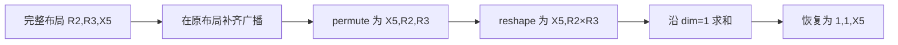

# 修复 ② 检视说明：多轴归约的逐处修改、影响范围与未解决边界

检视对象：[PR !48471][pr]，关联 [Issue #5625][issue]。
基线为 `955b98d43b`，修复提交为 `66bed811b6`，两个文件增加 49 行、删除 47 行。
本文按实际 diff 解释；mask 修复已经在基线中，本 PR 只提交轴与 shape 的修改。

**BERT 的错误归约有直接证据，修复方向明确；影响范围覆盖 NPU 此 codegen 路径的多轴归约，
另有两处改变单轴归约的共享元数据，不能承诺无回归。
本次检视还确认了“多轴全部归约为标量”时 DSL 与 CSE shape 不一致，建议合入前处理。**

## 会议开场：先说明一个实际错误

可以这样开场：

> BERT 静态训练反向的 bias gradient，需要对 batch 和 sequence 求和，每个 channel 保留一个结果。
> 旧 kernel 把归约轴和 channel 轴一起 flatten，只得到一个标量，再把这个标量写给多个 channel。
> 这个 PR 让生成器先区分输出轴与归约轴，只合并归约轴；同步修改 dim、广播恢复和 CSE shape。
> 检视重点是这些约定是否一致，以及未覆盖布局的风险。

[回归脚本][repro]中的原始表达式：

```python
value.reshape(4, 12, 128, 64).permute(0, 2, 1, 3).reshape(512, 768).sum(0)
```

每个 channel 累加 `4 × 128 = 512` 个元素，输出共 `12 × 64 = 768` 个 channel。
对应 kernel 中，x4 是外层循环标量；一个 tile 的槽位为 `[r2, r3, x5]`：

| 槽位 | 长度 | 职责 |
| --- | --- | --- |
| r2 | 4 | 求和后消去 |
| r3 | 128 | 求和后消去 |
| x5 | tile 中的 channel 数 | 保留每个位置的独立结果 |

[原始 kernel][old-dsl]的关键语句如下，保持产物原文：

```python
                tmp0 = tl.load(in_ptr0 + (x5 + 64*r3 + 8192*x4 + 98304*r2), x5_mask, other=0.0)
                tmp1 = tl.reshape(tmp0, [R2BLOCK_SUB* R3BLOCK_SUB* X5BLOCK_SUB])
                tmp3 = triton_helpers.promote_to_tensor(tl.sum(tmp1, 0))
                tl.store(out_ptr1 + (x5 + 64*x4 ), tmp3, x5_mask)
```

load 得到 `[R2,R3,X5]`；reshape 把三维压成一维；sum 沿唯一维求和，也消去了 X5。
store 仍用向量 x5 写回，因此多个 channel 得到同一个结果。

用小数值说明：

```text
value[0,0,:] = [1, 10, 100]
value[0,1,:] = [2, 20, 200]
value[1,0,:] = [3, 30, 300]
value[1,1,:] = [4, 40, 400]

预期各 channel 的和：[10, 100, 1000]
全部 flatten 后求和：1110，已经无法恢复各 channel
```

[历史单 kernel 对照][direct-validation]解释了它为何可能漏测：X5 block 为 1 时旧实现通过；
block 为 8 时旧实现失败，最大绝对误差为 187.436218。
修改 DSL 后同一 block 为 8 的对照通过，最大绝对误差约 `9.54e-6`。
这是历史 DSL 实验，不能标为当前 PR head 的设备实测。

## 阅读代码前：五个概念和三种 shape

**axis 与槽位。** axis 是 r2、x5 这样的逻辑轴；槽位是它在当前 Triton tensor 中的维度下标。
本路径用名字首字符 r 判定归约轴，其余视为保留轴。这是已有命名约定。

**golden_var_list。** codegen 选定的轴顺序。`ReductionAnalysis.dense_size_list()`
最终反转该列表，因此 value 的槽位顺序是 `reversed(golden_var_list)`。
BERT tile 的 value 顺序为 `[r2,r3,x5]`，golden 相应为 `[x5,r3,r2]`。
外层标量轴可能参与地址计算，却不占 value 的向量维度。

**contiguous reduction。** 这里表示归约轴在所分析的列表中相邻，
不等于输入 tensor 的 `is_contiguous()`，也不表示所有维度都可以归约。
`[R0,R1,X]` 中 r 轴相邻，X 仍必须保留；`[R0,X,R1]` 则需先重排。

**CSE shape。** CSE 是公共子表达式消除机制，临时变量还携带 dtype 和 shape。
`cse.generate(..., shape=...)` 的 shape 是 Python 侧记录，**不会替 tensor 执行 reshape**。
真实形状由生成字符串中的 broadcast、permute、reshape 和归约决定。
后续表达式的 shape 传播会读取这些元数据，所以二者必须一致。

**persistent 与 non-persistent。** 两条路径的块内归约和跨块累加方式不同。
non-persistent 会创建 accumulator，跨归约 tile 累积，再在 `post_loop_combine` 生成最终归约。
二者共用前面的分析与打包逻辑，均在检视范围内。

普通多轴归约的目标约定如下：

| 阶段 | BERT 示例 | 用途 |
| --- | --- | --- |
| 完整 value shape | `[R2,R3,X5]` | 原布局中的输入和 mask 广播 |
| 重排后 | `[X5,R2,R3]` | 将每个输出对应的元素放在一起 |
| packed shape | `[X5,R2*R3]` | 块内归约或累加 |
| 归约 dim | 1 | 等于保留轴数量 |
| 恢复后的结果 shape | `[1,1,X5]` | 对应原槽位，便于后续广播和写回 |



下面行号均对应 `66bed811b6`，完整源码见 [kernel_analysis.py][analysis-source] 和 [triton.py][triton-source]。

## 逐处 diff：kernel_analysis.py

### 1. L379–387：dense_post_reduction_list 构造 packed shape

旧实现遍历 `dense_size_list()` 的尺寸字符串，排除出现在 `dense_reduction_list()` 中的字符串，
再在末尾添加归约长度乘积。新实现为：

```python
reduction_list_str = f"{' * '.join(self.dense_reduction_list())}"
value_axes = list(reversed(self.kernel.golden_var_list))
kept_sizes = [
    f"{axis.name.upper()}BLOCK_SUB"
    for axis in value_axes
    if axis.name[0] != "r"
]
return kept_sizes + [reduction_list_str]
```

| 代码 | 具体含义与原因 |
| --- | --- |
| `reduction_list_str = ...` | 原有代码，构造 `R3BLOCK_SUB * R2BLOCK_SUB` 文本，此时没有执行乘法。 |
| `reversed(golden_var_list)` | 转到 value 槽位顺序，与后续 permute 使用同一依据。 |
| `for axis in value_axes` | 按 value 顺序遍历，保留轴之间的相对顺序不变。 |
| `if axis.name[0] != "r"` | 根据轴身份选择保留轴，取代尺寸字符串过滤。 |
| `axis.name.upper()` 和 `BLOCK_SUB` | 将 x5 转成 DSL 中的块长度变量 `X5BLOCK_SUB`。 |
| `kept_sizes + [reduction_list_str]` | 保留轴各占一维，归约轴合成最后一维。BERT 得到 `[X5BLOCK_SUB, R3BLOCK_SUB * R2BLOCK_SUB]`。 |

函数名中的 post_reduction 容易误导：返回值仍含归约乘积，是归约前的打包形状。
常规 `inside_reduction=True` 时，旧筛选通常也能得到相同结果。
**这部分主要明确轴身份和顺序；不能把每行都说成独立修复 BERT 数值错误的必要条件。**
实际去掉错误 flatten 分支的是下一处。

### 2. L389–397：dense_size_str 删除全轴 flatten 分支

```diff
-is_contig = self.contiguous_reduction
 if num_red > 1:
-    if is_contig:
-        result = f"[{', '.join(self.dense_post_reduction_list())}]"
-    else:
-        result = f"[{'* '.join(sizes)}]"
+    result = f"[{', '.join(self.dense_post_reduction_list())}]"
```

旧 else 将保留轴也乘进唯一维度，随后 `sum(...,0)` 会连输出一起消去。
删除后，多轴统一使用“保留轴 + 归约乘积”。`is_contig` 不再参与决策，因此删除。
单轴仍返回原始尺寸列表。

这还需要第 9 处配套：`[R0,X,R1]` 不能直接 reshape 为 `[X,R0*R1]`，必须先重排元素。

### 3. L405–412：analyze_reduction_dim 改用保留轴数量

```diff
 if self.numof_reduction_axis() > 1:
-    if not self.contiguous_reduction:
-        self.reduced_dim = 0
-        return 0
+    if not self.kernel.golden_var_list:
+        self.kernel.select_golden_varlist()
+    self.reduced_dim = sum(
+        1 for axis in self.kernel.golden_var_list if axis.name[0] != "r"
+    )
+    return self.reduced_dim
```

`if not ...` 确保 golden 已初始化；`sum(1 for ...)` 统计保留轴数 K。
packed shape 的前 K 维是保留轴，第 K 维是归约乘积，因此 dim=K。
这里不必反转 golden：计数与顺序无关，构造 shape 与 permute 才依赖顺序。

BERT 的 dim=1；`[X,Y,R0*R1]` 的 dim=2；没有保留轴时 dim=0。
函数后面旧的“多轴且 contiguous 返回保留轴数”分支删除，因为多轴已统一在开头返回。
单轴 dim 推导保留。

## 逐处 diff：triton.py 的三个 helper

### 4. L3055–3061：triton_tensor_ndim 返回 packed rank

```diff
 if self.numof_reduction_axis() > 1:
-    if self.is_contiguous_reduction():
-        return len(self.tiling_axis) - self.numof_reduction_axis() + 1
-    return 1
+    if not self.golden_var_list:
+        self.select_golden_varlist()
+    return len(self.golden_var_list) - self.numof_reduction_axis() + 1
```

新公式是“完整轴数 − 归约轴数 + 一个合并归约维”，即 K+1。
旧的非相邻多轴返回 1，对应已删除的全轴 flatten 约定。
改用 golden 的长度，使 rank 与实际选定的 value 轴集合一致；前两行确保该列表存在。

该方法还影响常量和索引表达式的 shape 推导，例如常量生成使用 `tl.full([1] * ndim, ...)`。
它不只影响某一行 sum，也不表示重排前 load 的 value 只有 K+1 维。

### 5. L3898–3912：is_contiguous_reduction 使用 golden

旧代码先调用 `parse_golden_from_load_store_index()`，没有结果才退回 golden。
新代码先确保 golden 存在，再执行：

```python
value_axis_list = list(self.golden_var_list or [])
reduction_dim_list = []
for i, x in enumerate(reversed(value_axis_list)):
    if x.name[0] == "r":
        reduction_dim_list.append(i)
return is_contiguous_axis(reduction_dim_list)
```

`list(... or [])` 构造列表；反转后的 i 是 value 槽位；循环只收集 r 轴的位置。
最后的相邻性检查没有修改。

为什么改来源？地址解析按 stride 排序，其轴集合来自 `range_tree_nodes` 和 removed nodes，
可能含外层标量轴。`IndexAnalysis.var_list` 则筛选 tiling 轴，golden 正常选取也围绕此布局进行。
两份列表的成员和顺序不必相同。

例如 BERT load 的 stride 为 `x5:1, r3:64, x4:8192, r2:98304`。
**仅按该 load 重建**的升序列表是 `[x5,r3,x4,r2]`，反转后 `[r2,x4,r3,x5]`，
r2、r3 被标量 x4 隔开；实际 tile 为 `[r2,r3,x5]`，r2、r3 相邻。
这是源码和地址推导的示例，不是历史完整 load/store 列表的日志快照。

即使第 2 处已取消相邻性限制，这个 helper 仍被 kernel 的 `dense_size_list()` 使用，
决定返回 packed 还是完整 shape，所以这处仍有实际影响。

### 6. L3924–3942：reduction_resize 恢复所有原始归约槽位

```diff
-if self.numof_reduction_axis() > 1 and self.is_contiguous_reduction():
-    if not self.golden_var_list:
-        self.select_golden_varlist()
+if self.numof_reduction_axis() > 1:
     dense_list = self.reduce_analysis.dense_size_list()
     for i, axis in enumerate(reversed(self.golden_var_list)):
         if axis.name[0] == "r":
             dense_list[i] = "1"
```

去掉 contiguous，让分离归约轴也恢复；删除局部初始化，是因为前面的 `triton_tensor_ndim()`
已对多轴确保 golden 存在。

必须用 analysis 的 `dense_size_list()` 取得完整槽位，不能用可能已返回 packed shape 的 kernel 同名方法。
循环找到每个原始 r 槽位并置 1，再用已有代码生成 reshape：

```text
[R2,R3,X5] → 求和后 [X5] → reshape(1,1,X5)
[R0,X,R1]  → 求和后 [X]  → reshape(1,X,1)
```

singleton 维度用于广播，不会重新物化原归约域。
注意函数前面的 `ndims == 1` 仍提前返回 promote_to_tensor；全归约会命中这个边界，见后文。

## 逐处 diff：reduction 主流程

### 7. L4109–4114：区分 full 与 packed shape

```python
value_shape = tuple(self.dense_size_list())
full_value_shape = tuple(self.reduce_analysis.dense_size_list())
packed_value_shape = tuple(
    self.reduce_analysis.dense_post_reduction_list()
    if self.numof_reduction_axis() > 1
    else self.dense_size_list()
)
```

第一行原有。kernel 包装方法会根据 contiguous 返回不同表示，不能假定 value_shape 总是完整形状。
新增 full 直接调用 analysis，取得 `[R2,R3,X5]`；tuple 用于元数据记录。
新增 packed 对多轴明确取 `[X5,R3*R2]`，单轴仍调用原方法。
这两个变量分别服务于重排前后，不能混用。

### 8. L4124–4137：broadcast 先到完整布局

```python
broadcast_shape = (
    f"[{', '.join(full_value_shape)}]"
    if self.numof_reduction_axis() > 1
    else dense_size_str
)
```

对多轴拼出完整尺寸的 DSL 文本；单轴保留旧目标。随后两处参数同步修改：

```diff
-f"tl.broadcast_to({v}, {dense_size_str})"
+f"tl.broadcast_to({v}, {broadcast_shape})"
-shape=value_shape
+shape=full_value_shape if self.numof_reduction_axis() > 1 else value_shape
```

第一处改实际 DSL，第二处改其 CSE shape。
例如 `[1,1,X5]` 的输入应先补齐为 `[R2,R3,X5]`，再重排与打包；
不能直接广播到 `[X5,R2*R3]`，此时轴尚未重排。

**入口判据没有改：** 仍是 `len(axis_list) < len(self.dense_size_list())`，
后者可能已经返回 packed rank。PR 改的是进入分支之后的目标，
并未证明所有需要广播的输入都能正确进入分支，混合广播仍需专项验证。

### 9. L4166–4174：非相邻多轴也计算 permute_order

```diff
-if self.numof_reduction_axis() > 1 and self.is_contiguous_reduction():
+if self.numof_reduction_axis() > 1:
```

实际修改是这个条件；后面的稳定分组算法原来已存在：

```python
value_order = list(reversed(self.golden_var_list))
target_order = [x for x in value_order if x.name[0] != "r"] + [
    x for x in value_order if x.name[0] == "r"
]
permute_order = [value_order.index(x) for x in target_order]
current_order = list(range(len(value_order)))
need_permute = permute_order != current_order
```

逐行是：取 value 顺序；保留轴在前、归约轴在后，组内顺序保持；查每个目标轴原槽位；
构造原槽位编号；比较是否真的需要 permute。
BERT 得到 `[r2,r3,x5] → [x5,r2,r3]`，下标 `[2,0,1]`。
已是目标顺序时不会额外生成 permute。

只改 shape 不放宽这里的条件，会使 `[R0,X,R1]` 直接 reshape，混淆各 X 的元素集合。
这与第 2 处必须配套。

### 10、11. L4181 与 L4191：两条 reshape 分支都记录 packed shape

```diff
 # need_permute=True，生成 tl.reshape(v.permute(...), dense_size_str)
-shape=value_shape
+shape=packed_value_shape

 # need_permute=False，生成 tl.reshape(v, dense_size_str)
-shape=value_shape
+shape=packed_value_shape
```

实际 reshape 使用 dense_size_str，已遵守 packed 约定，因此元数据也必须 packed。
两条都改，避免正确性取决于原轴顺序。这两行本身不会新增另一遍数据搬运。

### 12. L4232–4240：result_shape 按原始轴身份置 1

```diff
-result_shape = list(self.dense_size_list())
-result_shape[dim] = "1"
+if self.numof_reduction_axis() > 1:
+    result_shape = self.reduce_analysis.dense_size_list()
+    for i, axis in enumerate(reversed(self.golden_var_list)):
+        if axis.name[0] == "r":
+            result_shape[i] = "1"
+else:
+    result_shape = list(self.dense_size_list())
+    result_shape[dim] = "1"
```

dim 是 packed tensor 的下标，不能拿它只修改完整布局的一个槽位。
新多轴分支取完整布局，把每个 r 槽位置 1；单轴仍保留旧逻辑。
例如 `[R0,X,R1]` 的 packed dim=1，若只做 `result_shape[1]=1`，会错误消去 X。
按轴身份处理才能得到 `[1,X,1]`。

这里描述的是 final_reduction 已经调用 reduction_resize 后的结果，
不是 tl.sum 刚结束时的中间 shape。它必须与第 6 处一致，全归约边界当前尚未满足。

### 13、14. L4349 与 L4488：最终结果不再继承输入 shape

```diff
 # persistent 的 max/min 分支
-shape=masked_value.shape
+shape=tuple(result_shape)

 # persistent 的其他普通归约分支，例如 sum
-shape=masked_value.shape
+shape=tuple(result_shape)
```

masked_value 是归约前输入，例如 `[X5,R2*R3]`；final_reduction 已求和并恢复为 `[1,1,X5]`。
沿用输入 shape 会让后续传播仍以为归约维存在。tuple(result_shape) 改为记录恢复后的形状。

**两处没有多轴条件限制。** 单轴 `[R,X]` 会生成 `sum(...,0).reshape(1,X)`，
元数据从旧 `[R,X]` 改为 `[1,X]`。方向是纠正旧元数据，但仍属于单轴行为变化，需要回归。
argmin/argmax 走 final_argreduce，Welford 有专用分支，不能说所有类型都经过这两行。

### 15. L4491：non-persistent 累加器使用 packed shape

```diff
-accumulator = self.cse.namedvar(f"_{result_var}", dtype=torch_acc_type, shape=tuple(self.dense_size_list()))
+accumulator = self.cse.namedvar(f"_{result_var}", dtype=torch_acc_type, shape=packed_value_shape)
```

随后实际初始化仍生成 `tl.full(self.dense_size_str(), default, acc_type)`。
初始化与每轮 value 都是 packed shape，累加器元数据也应相同；
原包装方法可能返回完整 shape，显式 packed 变量消除此歧义。
单轴的 packed_value_shape 本来就取旧方法，这里的单轴取值保持原样。

## 将源码修改对应回修复后 DSL

[历史修复后 kernel][dsl]中：

```python
                tmp1 = tl.reshape(tmp0.permute([2, 0, 1]), [X5BLOCK_SUB, R3BLOCK_SUB * R2BLOCK_SUB])
                tmp3 = tl.where(tl.reshape((tl.broadcast_to((x5_mask.reshape([1, 1, X5BLOCK_SUB])), [R2BLOCK_SUB, R3BLOCK_SUB, X5BLOCK_SUB])).permute([2, 0, 1]), [X5BLOCK_SUB, R3BLOCK_SUB * R2BLOCK_SUB]), tmp1, 0)
                tmp4 = tl.sum(tmp3, 1).reshape(1, 1, X5BLOCK_SUB)
                tl.store(out_ptr1 + (x5 + 64*x4 ), tmp4, x5_mask)
```

| 生成行为 | 对应修改 |
| --- | --- |
| permute 将 channel 放到前面 | 第 9 处门控与已有分组算法 |
| reshape 为 `[X5,R3*R2]` | 第 1、2 处 shape；第 10、11 处元数据 |
| mask 与 value 同样排列和打包 | 基线已有逻辑复用 need_permute、permute_order、dense_size_str |
| sum 沿 dim=1 | 第 3 处计算 dim |
| 恢复为 `[1,1,X5]` | 第 6 处实际 reshape；第 12–14 处结果元数据 |

历史产物同时含 mask 修复，不能将 tl.where 全归因于本 PR。
对普通求和，关键是 packed 的每一行仅含同一 X5 的 R2×R3 个元素，因此 channel 之间仍独立。

## 影响范围：两处文件不代表只影响一个模型

直接范围是 NPUIndexTritonKernel 及其 ReductionAnalysis。
NPU scheduling 选择此类时受影响；其他路径是否选择它，应看相应路由。
本 PR 未修改 eager 算子、CUDA codegen 或 triton_experimental 的独立实现。

| 场景 | 实际影响 | 当前结论 |
| --- | --- | --- |
| 多轴、一个保留轴 | packed shape、dim、必要时的 permute、恢复与 CSE | BERT 是有直接证据的目标 |
| 多轴、归约轴被输出轴隔开 | 全轴 flatten 改成保留输出轴的 pack | 通用覆盖范围，不能只测 BERT |
| 多轴、多个保留轴 | 按原顺序保留 K 个输出轴，dim=K | 两保留轴的历史 separated-axes 小图通过，未穷举布局 |
| 多轴、无保留轴 | 标量结果的元数据 rank 改变 | 已确认 DSL/CSE 不一致，见下一节 |
| 单轴 persistent 普通归约 | 算法和 dim 分支保留，但最终 CSE shape 改变 | 不能说单轴完全不受影响 |
| non-persistent 多轴 | 累加器元数据及共享打包、恢复改变 | 需检查跨 tile 累加及最终写回 |
| argmin/argmax | 共用 pack、dim、恢复，另需生成位置索引 | sum 正确不证明索引正确，先确认多轴路径可达性 |
| Welford 等专用统计路径 | 部分前处理共用，内部还有专用布局 | 四项 sum 回归不能证明已覆盖 |
| 静态/动态、不同 kernel type | 满足上述代码路径即可影响，无固定 shape 限制 | 动态图可能选其他路径，PASS 不代表所有类型覆盖 |

另一个间接影响：`_finalize_kernel_codegen_dims()` 读取 reduction_dim，
用于 unified SIMT 路径的 persistent 决策。因此 dim 不只是 sum 的参数。
是否实际改变某个模型的路由，需要结合生成产物确认。

## 已确认边界：多轴全归约时结果 rank 不一致

2026-10-24 本地提取实际 PR 源码执行，记录 emitter 的 DSL 字符串与 CSE shape。
环境、buffer 和 CSE 使用最小替身，不导入 torch，也不执行 Triton。
脚本为 [review_reduction_axes_codegen.py][review-probe]，输出见[源码探针结果][probe-result]。

```bash
python scripts/repro/cicd/model_fixes_20261020/review_reduction_axes_codegen.py --repo <framework-repo>
```

framework-repo 需含 `66bed811b6` 及父提交。脚本检查源码生成行为，不要求设备。

当 value 只有 `[R0,R1]`、没有任何保留轴时：

```text
triton_tensor_ndim() = 2 - 2 + 1 = 1
reduction_resize() 因 ndims == 1 提前返回 promote_to_tensor(...)
生成结果：promote_to_tensor(tl.sum(value, 0))
PR 的 result_shape：("1", "1")
```

promote_to_tensor 的实现是 `x + tl.zeros((1,), tl.int1)`。
packed 一维 value 求和产生标量，再提升为一维 `[1]`；当前 CSE 却记为二维 `[1,1]`。

| 路径 | 父提交结果元数据 | PR 结果元数据 | 实际生成结果 shape |
| --- | --- | --- | --- |
| persistent sum 全归约 | `[R1*R0]` | `[1,1]` | `[1]` |
| non-persistent sum 全归约 | `[1]` | `[1,1]` | `[1]` |

**区分旧问题与新变化：** persistent 原本就沿用错误的输入 shape，PR 改了尺寸但未统一 rank；
non-persistent 这条构造路径则从原来一致的 `[1]` 变为不一致。
不能把它们全部称为新引入，也不能因为旧代码有错就忽略新的不一致。

这是源码层面确认的问题。探针没有实际图 lowering、Triton 编译和设备执行，
不能声称某个模型已经因此报错或算错；实际可达性与后续影响仍需小图验证。

建议合入前统一约定：要么保留现有 `[1]` DSL，将对应元数据也记为 `[1]`；
要么显式生成恢复所有 singleton 槽位的 reshape，并确认消费方支持。
选定后应同时检查 persistent、non-persistent 和专用归约路径。
本文记录检视建议，尚未修改 PR 实现。

## 其他风险与应补证据

| 项目 | 具体依据 | 需要验证什么 |
| --- | --- | --- |
| 单轴结果消费 | 第 13、14 处没有多轴限制 | 单轴归约后继续逐点计算、广播和索引消费 |
| 混合广播 | 第 8 处入口判据仍用可能已 packed 的 rank | 输入缺少归约轴、缺少保留轴、多个输入各缺不同轴 |
| 位置索引归约 | get_reduction_axis 用 packed dim 索引原始 golden，二者未必指向同一个轴 | 先确定多轴 argreduce 能否到达，再比较索引及 tie 情况 |
| Welford 专用布局 | vectorized 分支单独重排，向量轴可能不在 golden 内 | 开关启用时检查专用 DSL、元数据、统计量和后续广播 |
| 资源及性能 | 更多多轴布局实际生成 permute | 原本正确场景的编译资源与耗时、设备耗时是否回退 |

除全归约 shape 外，上表当前均是有代码依据的待验证点，并未据此确认发生新回归。
permute 是否形成真实搬运、是否增加 UB 由下游编译决定，不能仅凭 Python 语句给出性能结论。

## 已有验证的证明范围

| 证据 | 已支持的结论 | 限制 |
| --- | --- | --- |
| 原始及修复后 BERT DSL | 旧代码错误消去 X5；修复后按 channel 分组求和 | 历史产物，包含多项修复 |
| 历史同输入 kernel 对照 | X5 block=8 的错误通过改 DSL 恢复 | DSL 诊断实验 |
| [静态][static-results]、[动态][dynamic-results]回归 | bias gradient、separated axes，两类函数 × 静态/动态共四组通过 | 主要是 sum；历史整合版本，不穷举类型、布局和配置 |
| [模型矩阵][matrix] | 历史修复组合下 BERT 静态训练 accuracy 通过 | 不能标为独立 PR 在当前 master 的设备回归 |
| 本次源码探针 | 比较父提交与 PR 的结果元数据，确认全归约边界 | 使用环境替身，不证明 lowering 可达性、编译与设备数值 |

PR 仅含两个生产文件，没有独立回归测试文件。
创建 PR 时的语法、diff 与离线轴排列检查也不替代设备回归。
本次文档更新未运行远程设备测试。

## 会议顺序与追问回答

1. 用原 DSL 的 flatten、标量 sum、向量 store 解释错误，再给 `[10,100,1000]` 的例子。
2. 展示 full、packed、result 三种 shape，说明 dim 为何等于保留轴数。
3. 按第 1–15 处看 diff，区分生成行为变化与元数据同步，指出已有代码与新门控。
4. 展示修复后 permute → reshape → sum → 恢复槽位的完整闭环。
5. 主动交代影响面、全归约问题和验证缺口，再讨论合入前的修正与回归。

**为什么不能只把 dim 从 0 改成 1？** value 已 flatten 为一维，没有 dim=1，
必须先保留 channel 分组。

**为什么非相邻多轴也要改？** 是否相邻不改变该保留哪些轴。
非相邻时应先 permute，再合并归约轴，不能将全轴 flatten 当作替代。

**每行都是 BERT 必需的吗？** 不是。helper 的改写含明确轴身份的整理，
共享元数据还纠正其他路径。应分别解释其必要性与覆盖范围。

**单轴不受影响吗？** 算法与 dim 分支基本保留，但 persistent 普通归约结果 CSE shape 确实改变，
本次源码探针也观察到了这一变化。

**能否承诺无回归？** 不能。目标问题有明确修复证据，但全归约边界仍不一致，
广播、索引归约、专用统计路径与性能覆盖也不足。
当前适合带着具体待修点进行检视；修正边界并补齐验证后，再判断合入条件。

[pr]: https://gitcode.com/Ascend/pytorch/merge_requests/48471
[issue]: https://gitcode.com/Ascend/pytorch/issues/5625
[analysis-source]: https://gitcode.com/luqichao/pytorch_new/blob/66bed811b6a06b2847f86980611f89d8ebdb06c7/torch_npu/_inductor/codegen/kernel_analysis.py
[triton-source]: https://gitcode.com/luqichao/pytorch_new/blob/66bed811b6a06b2847f86980611f89d8ebdb06c7/torch_npu/_inductor/codegen/triton.py
[old-dsl]: ../../../artifacts/cicd/four_model_matrix_20261020/kernel_sources/BERT_pytorch/s_train_acc/BERT_pytorch__0_backward_3.1/triton_per_fused_clone_matmul_backward_sum_tra_11.py
[dsl]: ../../../artifacts/cicd/model_fixes_20261020/generated/bert_bias_gradient.py
[direct-validation]: ../../../artifacts/cicd/four_model_matrix_20261020/bert_backward_validation.json
[repro]: ../../../scripts/repro/cicd/model_fixes_20261020/validate_codegen.py
[review-probe]: ../../../scripts/repro/cicd/model_fixes_20261020/review_reduction_axes_codegen.py
[probe-result]: ../../../artifacts/cicd/model_fixes_20261020/review_20261024/source_probe.json
[static-results]: ../../../artifacts/cicd/model_fixes_20261020/regressions_v8/axes_static_none.json
[dynamic-results]: ../../../artifacts/cicd/model_fixes_20261020/regressions_v8/axes_dynamic_none.json
[matrix]: ../../../artifacts/cicd/model_fixes_20261020/model_matrix.json
