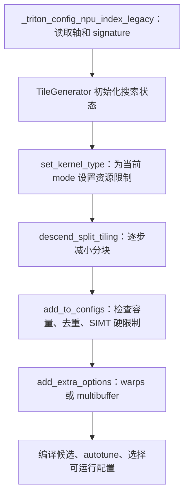

# 修复 ⑤：TileGenerator 如何搜索候选，为什么资源阈值会漏掉小 tile

对应整合提交 `2d147618bcfa088b4fffe983f9732272d708ccc1`，主题为
`fix(inductor): align tile search with kernel resource limits`。
生产修改集中在 `torch_npu/_inductor/runtime/tile_generator.py`，
另新增三个资源相关单元方法，见[完整补丁][patch]。八项关系见[总览][overview]。

## 这个提交解决什么问题

**解决存在可运行的小 tile，但搜索规则遗漏或过滤掉这些候选，最终找不到可用配置的问题。**

- **触发场景**：NFNet 动态 pooling 和 Albert 归约、softmax 等 kernel 需要较小分块才能满足资源限制。
- **修复前**：NFNet 的 SIMT 搜索在约 4096 个元素处就停止，而 FP32 接受条件最多允许 2048 个元素，
  搜索尚未进入合法区间就结束。其他路径还存在输入数量估计不准、遗漏完整归约轴大小、
  切换 mode 后资源限制或候选状态未正确更新的问题，会漏掉小候选或保留过大的候选。
- **修复后**：统一搜索停止点与资源上限，正确计入 persistent 归约轴和输入数量，
  并在 mode 切换时更新状态，使合法小配置有机会进入编译和调优。
  NFNet 的[选中配置][selected]中，三个 pooling kernel 均找到 `XBLOCK=512` 的 SIMT 配置。

softmax 的[失败记录][fail]与[通过记录][pass]也表明：固定 R3=512 时，
X2 从 512 缩到 8 可以解决该例的 UB overflow 并保持数值正确。
但小 tile 不能解决所有 UB 问题；第 4 项所述 Albert 静态例仍需要减少同时存活的临时数据。

## 先区分数学计算、tile 和候选搜索

例如长度为 N 的逐点计算，可以一次处理 512 个元素，再用不同 program/循环覆盖整个输入。
512 就是一个 tile 长度；如果换成 256，数学定义仍一样，但并行度、循环次数、资源需求会改变。
归约还要区分输出方向 X 与归约方向 R：`[XBLOCK_SUB, RBLOCK_SUB]` 决定一次处理多大块。

`TileGenerator` 不执行 softmax 或 pooling，也不精确分配 UB。
它根据轴长度、dtype、kernel type、输入数量等信息枚举 `triton.Config`。
这些候选之后交给编译器检查，再由 autotune 测量和选择。
文件位于 `runtime/`，但这里讨论的是 kernel 编译和调优阶段的候选生成。



调用方在 `runtime/triton_heuristics.py`。
混合模式会复用一个 generator，先 `SIMT_ONLY` 搜索，再 `SIMT_TEMPLATE` 搜索。
理解这一点，才能理解为什么切换 mode 和清空候选都需要修。
该调用链对应整合分支的 legacy 候选路径，不意味着所有 NPU 后端都调用这一个入口。

## 需要认识的字段

| 字段 | 含义 |
| --- | --- |
| `numels` | 输入给搜索器的各轴长度/size hint |
| `blocks` | program 覆盖范围等拆分状态 |
| `sub_blocks` | 当前块内 tiling 大小，影响 `...BLOCK_SUB` |
| `tiling_axis` | 参与块内展开的轴编号 |
| `split_axis` | 参与 program 拆分的轴编号 |
| `low_dims` | 搜索时优先按低维规则处理的轴编号集合 |
| `no_loop_axis` | 在本套规则下保持整轴、不可继续切小的轴 |
| `real_tiling_axis` | 排除 no-loop、persistent R 后仍可缩小的轴 |
| `configs` | 已接受的候选列表 |
| `max_numel_threshold` | 允许候选的元素量上界估计 |
| `stop_numel` | 向小块搜索时的停止尺度 |

“容量上界”和“搜索停止点”不同：前者决定候选是否接受，后者决定是否继续往更小处搜索。
两者若不协调，可能出现大块全被拒绝，而搜索尚未进入合法小块范围就停止。

## 改动 1：初始化顺序和真实 pointer 数量

### 提前保存 `persistent_reduction`

```python
self.persistent_reduction = persistent_reduction
self.rebuild_dynamic_axis()
```

`rebuild_dynamic_axis()` 新增逻辑需要读取这个属性，所以赋值必须提前。
这不是改变 persistent 的判定，只是满足新逻辑的数据依赖。

### 不再把输入数量截断为 3

```python
# 旧
self.input_ptr_num = 3 if input_ptr_num == 0 else min(input_ptr_num, 3)
# 新
self.input_ptr_num = input_ptr_num if input_ptr_num > 0 else 3
```

调用方从 kernel signature 中统计 pointer 数量传入。
旧代码无论 3 个还是 83 个 pointer，都至多按 3 个估计资源，
会把多输入融合的工作集估得过小。新代码保留正数，未知/非正数继续用默认 3。

pointer 数量不是准确的同时存活张量数，可能包含输出等参数；
它仍然只是一个估计系数，不能按 `83 * tile` 直接断言真实 UB 用量。
这也解释了为何后面要保留最小候选，不能把保守估计当硬件真相。

初始化中原本分散计算容量和停止点的语句被 `_update_resource_limits()` 替代，
让初始化与之后切换 mode 使用同一套规则。

## 改动 2：`rebuild_dynamic_axis()` 先计入完整 persistent R

该函数只在 `len(tiling_axis) > 3 and not no_loop_axis` 时进入这里的自动选择逻辑。
它尝试把一些低维轴纳入 no-loop，但累计块量超过 4 KiB 就停止。
旧代码从 `current_numels=1` 开始，只计算逐个遍历的低维轴，漏掉已固定的 persistent 归约轴。

新增过程先遍历 `tiling_axis`，将所有名字以 `r` 开头的轴长度乘入 `current_numels`。
再遍历 `low_dims`，跳过归约轴，尝试加入其他轴。
同时把 `axis_name == 'r'` 改为 `axis_name.startswith('r')`，因为真实名称是 `r3` 等。

Albert softmax 对应的单元输入为：

```text
numels     = [4, 64, 512, 512]
axis_names = [z0, y1, x2, r3]
low_dims   = [2, 3]
persistent = True
dtype      = float32
```

旧计算只看到 X2=512，`512*4=2048 bytes`，于是可能把 X2 也固定成 no-loop。
新计算先纳入 R3=512，再试 X2=512，得到 `512*512*4=1,048,576 bytes`，
超过 4 KiB，不能把 X2 固定住。R3 仍完整，X2 则允许继续搜索到更小 tile。
4 KiB 是这里选择 no-loop 的启发式阈值，不是这台设备 UB 总容量。

## 改动 3：`reset_configs()` 清空真正的候选列表

```python
# 旧：这个字段不是实际保存候选的列表
self.config = []
# 新
self.configs = []
```

`descend_split_tiling()` 每次搜索开头调用 reset。
混合模式先生成 SIMT 候选，再切 template；若真实列表没有清空，第二次搜索会混入上次候选。
后续 `add_extra_options()` 又会修改/复制列表中的配置，可能对旧 mode 候选施加新 mode 的处理。

这里赋值一个新列表，而不是要求调用方丢掉前一次返回结果。
调用方已经收集的 SIMT 候选应保留，generator 内部则开始独立的 template 搜索。
新增单元既检查 template 结果的 compile_mode，也检查先前 SIMT 结果没有被改成 template。

## 改动 4：`set_kernel_type()` 切换时重算资源限制

```python
def set_kernel_type(self, npu_kernel_type):
    self.npu_kernel_type = npu_kernel_type
    self._update_resource_limits()
```

旧代码只更新标签，容量和 stop_numel 仍是构造时计算的值。
同一个 generator 从 mixed 切到 SIMT 时，这些值会失配。
新增第二行就是让标签和搜索规则同时切换。

## 改动 5：逐行理解 `_update_resource_limits()`

### 先估计常规容量

```python
local_mem_size = 128 * 1024 if self.npu_kernel_type == NPUKernelType.SIMT_ONLY else config.ub_size
capacity = local_mem_size // self.input_ptr_num // self.dtype_bytes
```

第一行根据 mode 选择估计使用的本地存储容量；第二行除以 pointer 数和单元素字节数，
转为可以容纳的 tile 元素数估计。这里的 128 KiB 是源码针对 SIMT 的预算选择。
更多 pointer 或更大的 dtype 会降低该估计，促使搜索考虑更小块。

### 再计算不可继续拆分部分的最小量

```python
minimum_tile = 1
for axis in self.tiling_axis:
    if axis in self.no_loop_axis or (self.persistent_reduction and self.axis_name[axis][0] == "r"):
        minimum_tile *= self.numels[axis]
self.max_numel_threshold = max(1, capacity, minimum_tile)
```

no-loop 轴和 persistent R 在当前规则下不可继续缩小。
假设 R=2048，即使 X 缩到 1，最小块也有 2048 个元素。
若按 83 个 pointer 的保守估计让 capacity 小于 2048，单用 capacity 会把所有可构造候选过滤掉。
取 max 保留这个最小候选的尝试机会，是否真能编译仍交给下层。
这不是给所有超 UB 候选放行，也不是让 UB 变大。

### SIMT 仍遵守已有 8 KiB 限制

```python
if self.npu_kernel_type == NPUKernelType.SIMT_ONLY:
    self.max_numel_threshold = min(self.max_numel_threshold, 8 * 1024 // self.dtype_bytes)
```

`add_to_configs()` 原本已有 `total_numel * dtype_bytes > 8*1024` 的拒绝检查。
FP32 对应至多 2048 个元素。新增 min 让搜索尺度与该检查一致，
不会一边按大块尺度停止、一边把这些大块全拒绝。
SIMT 的硬限制优先，因此不可拆分部分若本身超过该限制，仍不保证存在合法候选。

### 最后重算停止点，避免归零

```python
self.stop_numel = max(
    1, min(self.max_numel_threshold, self.max_total_numel // config.num_vector_core) // 8
)
```

`max_total_numel // num_vector_core` 表示按向量核数量粗分后的工作量，
与容量阈值取较小值再除以 8，给搜索保留继续缩小的空间。
外层 max 保证至少为 1，避免整数除法得到 0 形成不合理停止尺度。
这是搜索启发式，不是严格的资源计算或最优性能证明。

## NFNet 为什么会从“没有合法候选”变为可运行

NFNet dynamic pooling 的旧 SIMT 搜索在 4096 元素附近就停止，
但已有接受条件要求 FP32 tile 不超过 2048 元素；搜索区间与可接受区间没有接上。
修复使搜索继续进入合法范围。[实际选中配置][selected]里三个 pooling kernel 均选到
`XBLOCK=512, compile_mode=simt_only`。

pooling 四点相加再除 4 的计算体未改；变的是编译参数与候选集合。
softmax 的独立固定 DSL 对照也表明：X2=512、R3=512 超 UB，
只把 X2 改成 8 即可编译并通过数值检查，最大差约 `6.98e-10`，见[失败][fail]和[通过][pass]记录。
框架修改没有写死“NFNet 用 512”或“Albert 用 8”，而是恢复这些候选被枚举的能力。

## 为什么改搜索器，tile 能否解决所有 UB overflow

这里的错误是合法小配置未被搜索，或者不同 mode 的候选状态被混用。
修改算子公式无法保证 generator 枚举合法配置；让编译器接受确实超容量的大块也不合理。
所以修复应落在候选生成和资源估计边界。

tile 可以解决“单块太大”的一部分 UB 问题，但无法覆盖所有生存期问题。
Albert 静态 performance 的 X 已经是 1、persistent R 固定，仍然超 UB；
该场景需要[load 生存期修复][load-doc]。其余三个固定候选可只缩 X 通过，不能反推所有场景都一样。

## 测试必要性与风险

该修复有 NFNet pooling 实际选中配置、Albert softmax 小 tile 数值和历史模型恢复证据。
新增三个单元分别检查 mixed-mode 搜索、83 pointer 最小 persistent tile、
计入 R 后 X2 未被错误设为 no-loop，结果见[tiling 检查][checks]。

更多或更小候选可能增加编译/autotune 时间和循环开销；不同 tile 也可能改变浮点归约顺序。
pointer 估计仍不等于活跃工作集，保留最小候选不保证下层一定接受。
影响范围是使用该 generator 及相关继承路径的 NPU 搜索逻辑，不能概括为所有后端的全部 autotune。
已有验证未穷举所有 dtype、mode、no-loop 组合，也不是稳定性能基准。
本次仅补充说明，未重跑设备矩阵。

[overview]: model-fix-dsl-explained-20261021.md
[patch]: ../../../artifacts/cicd/model_fixes_20261020/patches/tiling-resource-budget.patch
[selected]: ../../../artifacts/cicd/model_fixes_20261020/nfnet_pooling_selected_v4.json
[fail]: ../../../artifacts/cicd/model_fixes_20261020/softmax_minimal_original.txt
[pass]: ../../../artifacts/cicd/model_fixes_20261020/softmax_minimal_fixed.txt
[checks]: ../../../artifacts/cicd/model_fixes_20261020/final_checks/tiling.txt
[load-doc]: model-fix-04-load-liveness-20261022.md
