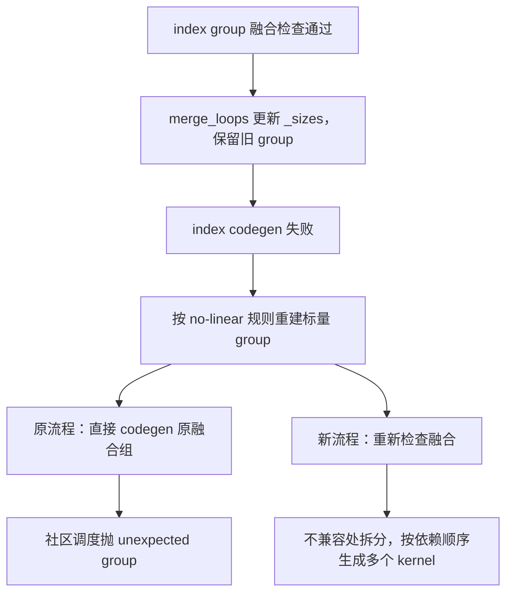

# 修复 ⑥的新方案：no-linear 回退为什么必须重新检查融合

**本例的错误来源是 backend 切换后沿用了旧融合结果：NPU index 路径接受的融合组，
重建为 no-linear 的标量 group 后已经不满足该 backend 的融合条件，却仍被直接交给社区调度器。**
修复是在回退边界重新检查融合，将不兼容部分拆成多个 kernel，再执行 no-linear codegen。

本文对应 [PR !48469][pr]、[Issue #5625][issue] 的第 6 类问题。
独立修复提交为 `9fe2e0f63540ea5e9a1a95d4505679ff2870a34a`，
分支为 `bugfix/inductor-nolinear-fusion-recheck-master-20261024`，
创建基线为官方 master `dc67771ff2`；PR 目标为 `Ascend/pytorch:master`。
生产修改集中在 `torch_npu/_inductor/codegen/npu_combined_scheduling.py`。

这里的 no-linear 仍生成 NPU kernel：`NPUNoLinearTritonScheduling` 继承社区 `TritonScheduling`，
`kernel_type` 为 `NPUTritonKernel`，非 Welford 场景沿用社区的节点调度方法，见[NPU scheduler 源码][npu-scheduling]。

此前的[符号调度方案][old]对应 `e1429cc917`，通过等值证明扩大调度匹配范围。
本文记录独立分支上的新方案；旧方案及历史记录继续保留。
旧方案下的模型 PASS 和 DSL 不能作为 `9fe2e0f635` 已通过设备验证的证据。

## 从失败现场确认问题发生在哪里

触发场景是 NFNet 的 NPU Inductor 动态训练，错误发生在 kernel 生成之前。
[历史 traceback][failure] 的关键调用顺序为：

```text
NPUCombinedScheduling.codegen_node
  -> self._nolinear_triton_scheduling.codegen_node(node)
  -> _codegen_nodes
  -> generate_node_schedule
  -> super().generate_node_schedule
  -> NotImplementedError: unexpected group
```

令 `b` 为 batch，`q = FloorDiv(H - 1, 32)`，`A = 1536*b`，错误中的规模可写为：

```text
kernel group = (A, q**2 + 2*q + 1)
producer     = (A*q**2 + 2*A*q + A, 1)
```

这里的 group 是迭代空间描述。`(X,R)` 表示对每个保留位置 X 归约 R 个元素；
`(X*R,1)` 是归约前的逐点计算，`(X,1)` 是归约后的逐点计算。
producer 指产生中间值的节点；epilogue 指归约结束后消费结果的逐点部分。

失败路径已经进入 no-linear 回退，但没有生成这次失败对应的可执行 DSL。
历史日志没有保留下来最初使 index codegen 失败的异常，
所以本次定界的是**回退路径的二次失败**，没有据此解释第一次 index 失败的原因。

## `simplify` 一致，为什么仍有不同的表达式

所核对的社区 PyTorch 为 v2.13.0，提交 `cf30153c4c131c8164ee7798e5022d810682e2cb`。
[社区 `SizeVarAllocator.simplify`][sizevars] 的标量主体是：

```python
return sympy.expand(expr).xreplace(self.replacements)
```

NPU 的[`codegen/_sizevars.py::simplify()`][npu-sizevars]对标量使用相同逻辑，另外支持 list/tuple 输入。
本例的差异来自调用方式。[社区 `SIMDScheduling.group_fn`][simd] 对每类轴先求乘积，再单独化简：

```python
return tuple(V.graph.sizevars.simplify(sympy_product(s)) for s in sizes)
```

对 producer，它化简整个 `A*(q+1)**2`；对 reduction，它分别化简 X 和 R，
之后比较时才形成 `X*R`。乘法不会自动重新调用 `sizevars.simplify()`。

| 运算 | 得到的结构 |
| --- | --- |
| `simplify(A*(q+1)**2)` | `A*q**2 + 2*A*q + A` |
| `simplify(A)` | `A` |
| `simplify((q+1)**2)` | `q**2 + 2*q + 1` |
| `simplify(A) * simplify((q+1)**2)` | `A*(q**2 + 2*q + 1)` |

两种总量数学上相等，但 SymPy 的结构比较 `==` 可以返回 False。
以下示意假设 replacements 为空，直接展示展开时机的区别：

```python
import sympy

b, q = sympy.symbols("b q", integer=True, positive=True)
producer = sympy.expand(1536*b*(q + 1)**2)
x = sympy.expand(1536*b)
r = sympy.expand((q + 1)**2)
assert producer != x*r
assert sympy.expand(producer - x*r) == 0
```

因此，“优先同步 `simplify` 的标量实现”不能解决这里的调用差异。
也没有证据要求把所有表达式还原成因式分解形式：展开式本身仍是合法表达式，
需要保证的是更换 group 表示后，融合结果仍符合目标 backend 的要求。

## 社区正常融合与 NPU 回退为什么不同

### 社区会先检查这类组合

在所核对版本的 `SIMDScheduling.can_fuse()` 中，pointwise 接 reduction 的关键逻辑可概括为：

```python
if numel1 == numel2 * rnumel2:
    # 还要通过 iteration ranges 和相关 tiling 检查
    return compatible
return numel1 == numel2
```

这里是语义摘录，不是完整函数。代入上面的标量表达式：

- `numel1 == numel2*rnumel2` 因结构不同为 False。
- `numel1 == numel2` 也为 False。

因此该 backend 检查会拒绝这组 producer/reduction 的融合。
直接把已经融合好的节点传给社区 `generate_node_schedule()`，绕过了这个前置检查，
不能据此证明社区 CUDA 的正常融合流程也会触发同一故障。
本轮没有运行 CUDA 整图，也没有通过历史提交二分认定差异由 2.13.0 首次引入。

### NPU index group 保留逐轴尺寸，比较时形成相同乘积

`NPUTritonScheduling.group_fn()` 使用 `NumelList` 保留轴列表。
`NumelList.__eq__()`、乘法等方法会取元素乘积再比较，见[`codegen/npu_kernel_features.py`][features]。
在本例的表示中：

```text
producer group = (NumelList(b, 1536, q+1, q+1), 1)
reduction group = (NumelList(b, 1536), NumelList(q+1, q+1))
```

producer 总量与 reduction 的 X×R 都形成 `1536*b*(q+1)**2`。
NPU index 的规模检查因此可以接受它，随后仍要检查 ranges 和相关 tiling。
不能把“总量相同”概括成“任意布局都可以融合”。

### 融合后合并循环，再回退重建 group，破坏了原来的接受条件

[捕获的三节点 IR][ir] 中，`op59` 是 producer，`op60` 是 reduction，`op61` 是 epilogue。
IR 第 57–58、116–117、151–152 行同时记录了逐轴 group 与已经合并的 `_sizes`：

| 节点 | 保留的 index group | 合并后的 `_sizes`，用 A、q 简写 |
| --- | --- | --- |
| op59 | `((b,1536,q+1,q+1),1)` | `((A*(q+1)**2,),())` |
| op60 | `((b,1536),(q+1,q+1))` | `((A,),((q+1)**2,))` |
| op61 | `((b,1536),1)` | `((A,),())` |

[社区 `SchedulerNode.merge_loops()`][scheduler] 更新 `_body`、`_sizes` 和依赖；
`Scheduler.merge_loops()` 保留原 group，其注释也说明不能简单地为已融合节点逐个重算 group。

原 `NPUCombinedScheduling.codegen_node()` 在 index 失败后做了两步：

```python
for snode in node.get_nodes():
    snode.group = (snode.group[0], nolinear.group_fn(snode._sizes))
return nolinear.codegen_node(node)
```

这是省略 Welford 专用分支的语义摘录。它把上述 `_sizes` 转成标量 group，
却仍把原来的 `op59_op60_op61` 当作一个融合 kernel 传下去。
此时 no-linear 的融合检查本应拒绝 op59/op60，社区调度却已没有机会提前拒绝。



## 为什么选择在回退边界修复

`e1429cc917` 通过 `same_size()` 和更广的 NPU helper 路由，让数学等价的组继续进入同一个 kernel。
新方案让 no-linear backend 使用自己的融合标准决定哪些组合可由它生成。
这样不用扩大社区调度比较的接受范围，也不用修改本例已经一致的标量 `simplify`。

检查失败后必须给出可执行的拆分结果。仅仅返回“不兼容”，会把原来的调度异常变成另一种编译失败。
本例的新结果为：

```text
kernel 1: op59 / producer
kernel 2: op60 / reduction + op61 / epilogue
```

这是基于源码级回归确认的分组结果；实际 NPU kernel、输出精度和性能仍需上机验证。
实现只在原有融合组内部按顺序分段，不重新搜索整个图的融合方案。

## 每处修改的含义

下面均对应[提交中的生产文件][combined]。代码片段是实际关键语句，文字说明补足调用上下文。

### 1. `_regroup_for_nolinear()`：统一重建回退表示

第 107–119 行把 codegen 和 benchmark 的 group 重建集中到一个 helper：

```python
snodes = list(dict.fromkeys(snode for node in nodes for snode in node.get_nodes()))
group = self._nolinear_triton_scheduling.group_fn(snode._sizes)
```

展开融合节点得到实际计算节点，并保留首次出现的顺序去重，避免重复改写或重复生成同一节点。
然后按 no-linear 的 `group_fn` 从当前 `_sizes` 重建标量规模，设备字段继续使用原值。

这里保留了既有 codegen 对 Welford 的专用 canonicalization：只有开关启用且组中包含 Welford 时才调用
`_canonical_group_size()`。benchmark 现在也复用这条规则。
本例回归关闭 Welford，不把该专用路径的覆盖算入本轮验证。

### 2. `_split_nolinear_nodes()`：按目标 backend 重新决定分组

第 121–137 行先执行 `topological_sort_schedule()`，让 producer 排在 consumer 前面。
拓扑排序按依赖排列节点，不能假设原融合列表任意拆开后仍满足执行顺序。

```python
vertical = bool(previous.get_operation_names() & snode.ancestors)
can_fuse = backend.can_fuse_vertical if vertical else backend.can_fuse_horizontal
```

若前一段包含当前节点的祖先操作，则按纵向融合检查；否则使用横向融合检查。
`backend` 明确指向 no-linear scheduler，而不是再次调用 index 的接受条件。

检查通过时用 `FusedSchedulerNode.fuse()` 扩展当前段；失败时从当前节点开始新段。
它只尝试合并相邻的累计段和下一个节点，不跨已拆开的边界追求更多融合。
本例 op59/op60 被拒绝，op60/op61 仍兼容，因此得到两段。
这补的是 backend 条件复核，并没有重新运行完整 scheduler 的全图候选搜索、重排和收益评估。

### 3. `_codegen_nolinear_groups()`：按新 kernel 边界计算最后使用位置

`last_usage` 是“当前 kernel 结束后不会再被使用的 buffer 名称集合”。
原来只有一个 kernel，拆分后就不能直接沿用整个融合组的释放时机。
第 144–150 行先保留原融合组之外仍需使用的 buffer，再从最后一段向前计算每段的 `last_usage`：

```python
future_used_buffers = OrderedSet(
    scheduler.mutation_real_name.get(name, name)
    for name in node.used_or_aliased_buffer_names()
) - node.last_usage
```

`used_or_aliased_buffer_names()` 把别名也考虑进去；`mutation_real_name` 将 mutation 相关名称映射到实际存储。
减去原节点的 `last_usage` 后，剩下的是需要继续保留的名称。
调用社区已有的 `group.set_last_usage()`，而不是另外定义一套释放算法。

以 `input -> P -> R -> E` 为简化例子，E 是最终输出，拆成 `[P]`、`[R,E]`：

| kernel | 执行结束后可释放 | 仍需保留 |
| --- | --- | --- |
| `[P]` | input，前提是没有后续使用 | P，第二个 kernel 需要读取 |
| `[R,E]` | P、R，前提是没有组外使用 | E |

真实 IR 中 buf59 还被组外 op71 使用，见 IR 第 21–24 行。
它应继续存活到组外使用结束，不能机械套用简化例子的“第二段之后释放 P”。
新增回归分别检查了共享输入、组外仍存活的输出及 mutation 名称的情况。

### 4. 更新融合映射和完成状态：让后续决策看到实际边界

第 151–152 行将每个实际节点的 `name_to_fused_node` 改为它现在所属的段。
[社区 `decide_inplace_update()`][scheduler] 会读取该映射，判断哪些用户属于同一个融合 kernel；
拆分后继续指向旧融合组，会让复用判断使用过时的 kernel 边界。

每段 codegen 后更新 `available_buffer_names` 和 `completed_operations`，
使后一段知道前一段的输出和操作已经可用；外层 scheduler 仍处理原节点的整体完成状态。

### 5. 分段维护 `buffer_names_to_free`：防止第一段释放全部中间值

外层 scheduler 在调用 backend 前，已经执行 `buffer_names_to_free.update(node.last_usage)`。
社区 SIMD codegen 又会在每段末尾调用 `free_buffers_in_scheduler()`。
若只循环生成两段，第一段就可能释放第二段仍要读取的 P。

第 156–161 行先撤下原融合组排队的释放项，再逐段加入对应的最后使用集合：

```python
scheduler.buffer_names_to_free.difference_update(node.last_usage)
for group in groups:
    scheduler.buffer_names_to_free.update(group.last_usage)
    self._nolinear_triton_scheduling.codegen_node(group)
```

`difference_update` 仅移除原节点的项，保留队列中其他已有项。
两段之间的实际释放仍由原有 scheduler/codegen 协议执行。

### 6. 保留 `current_node`：wrapper 仍需要原调度表中的位置

分段 codegen 时没有把 `scheduler.current_node` 换成新建的分组。
[社区 wrapper 的 `AllocateLine` 和 `FreeIfNotReusedLine`][wrapper] 会执行：

```python
V.graph.scheduler.nodes.index(V.graph.scheduler.current_node)
```

新分组不在外层 `scheduler.nodes` 中，替换后会触发查找失败。
因此实际分组和融合映射用于 kernel 生成，wrapper 的调度位置仍锚定原节点。
回归中的 `emit()` 也执行这个位置查找，检查该接口条件。

### 7. 保存并恢复两类移除标记：失败尝试不能决定新 kernel 的分配

第 166–181 行在 index 尝试之前保存 `removed_buffers` 和 `inplaced_to_remove`，失败后恢复。
它们分别记录可移除 buffer，以及与原地复用有关的移除状态。

index codegen 可能已把原融合 kernel 内的中间值标为可删除，之后才抛异常。
拆分后跨 kernel 的值需要重新判断是否保留，不能让失败尝试留下的标记影响新的分配。
恢复的是尝试前的集合，因此之前其他 kernel 的有效标记仍保留。

[社区 `Kernel.remove_kernel_local_buffers()`][common] 会按当前 kernel 的 store 和实际用户判断删除资格，
跨 kernel 的结果因此交回既有规则决定是否分配；同段内的临时值仍可消除。
“失败尝试留下移除标记”由注入异常的回归覆盖，并非历史 traceback 已证实的首次失败原因。

### 8. `codegen_node()`：串起恢复、重建、重查、生成

第 165–184 行保持 index 成功时的返回路径；只有原有异常回退才进入新逻辑：

```text
恢复失败尝试的移除标记
  -> _regroup_for_nolinear
  -> _split_nolinear_nodes
  -> _codegen_nolinear_groups
```

因此修改没有把所有 NPU kernel 都强制改成 no-linear，
也没有把 `NPUNoLinearTritonScheduling.generate_node_schedule()` 改为普遍接受更多符号等值关系。

### 9. `benchmark_fused_nodes()`：拒绝无效候选，退出时恢复 group

第 195–206 行在 index benchmark 异常后临时重建 no-linear group，执行相同的分组检查。
若得到多段，返回 `(float("inf"), "")`，表示这个“单 kernel 融合候选”不能采用。
不能用多个拆分 kernel 的结果冒充一个融合候选的时间。

若仍为一段，才交给 no-linear benchmark。
`finally` 会在成功、拒绝、抛异常三种情况下恢复原节点的 group，
防止一次候选测量把后续 index 融合判断的输入永久改成标量表示。
这里恢复的是 group 元数据，不代表实现了 benchmark 全部状态的事务回滚。

## 如何复现和验证

### 不依赖设备的源码级回归

仓库内保存了[CPU 源码检查入口][cpu-repro]，
它读取修复分支中原有的 `test/_inductor/test_nolinear_fallback_fusion.py`，不复制一份单元测试实现。
它从社区 v2.13.0 源码抽取 `group_fn`、`can_fuse`、`generate_node_schedule`，
从 NPU 源码抽取回退逻辑，使用 CPU torch 提供符号和 scheduler 基础设施。

```bash
python -W ignore scripts/repro/cicd/nolinear_fusion_recheck_20261024/verify_fallback.py \
    --npu-repo <torch-npu-repo-at-9fe2e0f635> \
    --torch-repo <community-pytorch-v2.13.0-repo>
```

2026-10-24 使用 torch `2.9.1+cpu`、SymPy `1.14.0` 完成源码抽取验证，结果见[检查输出][cpu-result]：
10 个非设备测试通过，1 个 NPU 动态训练测试跳过。
覆盖普通符号和 FloorDiv、静态兼容组、范围拒绝、拓扑顺序、buffer 生存期、mutation 名称、
失败尝试标记恢复、index 成功路径以及 benchmark 的拒绝和状态恢复。

这不是在原生 PyTorch 2.13 + torch_npu 安装环境中运行完整 codegen。
测试使用合成 scheduler 节点和替代 codegen 的 `emit()`，只调用真实的调度方法并记录释放集合；
关闭 Welford 和额外 tiling 启发式，以隔离 group 与状态协议。
因此它证明的是本例分组和元数据协议，不能证明 NPU 分配、kernel 执行或整网精度已通过。

### 原生环境与 NPU 回归入口

在安装了对应 PyTorch/torch_npu 的源码环境中执行[提交中的回归文件][tests]：

```bash
python test/_inductor/test_nolinear_fallback_fusion.py -v
```

设备用例对 stride=32、padding=1 的 3×3 conv 及空间 mean/sigmoid 派生训练图使用两组输入：
`(2,16,65,65)` 和 `(3,16,97,97)`，NPU float32、连续布局，开启 dynamic compile。
它强制 index codegen 抛异常，对比 eager/compiled 标量结果和输入梯度，
并要求实际出现至少一次多段回退，防止测试因未进入目标路径而通过。

历史模型派生的[双 shape 小图][training-repro]也保留在本仓库，
输入为 `(2,16,224,224)`、`(3,16,256,256)`，检查前向和输入/权重梯度：

```bash
python scripts/repro/cicd/model_fixes_eager_20261022/06_scheduler_symbolic_groups.py \
    --device npu --compile --dynamic
```

该小图不强制 index 失败，执行成功时需要另外确认实际经过了回退和重新分组，
才能用于判断本补丁目标路径。两种设备入口在本轮均未上机运行。

生产文件与回归文件已通过 `py_compile`、`git diff --check`。
目前没有 `9fe2e0f635` 对应的 NPU 成功 DSL 或模型整网 PASS 记录。

## 影响范围和剩余边界

- 新逻辑作用于 `NPUCombinedScheduling.codegen_node()` 和 `benchmark_fused_nodes()` 的既有回退入口。
  index 成功路径沿用原执行结果；template 和 combo 的独立入口没有在本提交中重写。
- 分段会增加 kernel launch 和中间 buffer 的读写，可能降低原本融合执行的性能；
  新的分组检查和状态快照也增加编译期工作。本轮没有性能测量。
- 本例的 `unexpected group` 来自 backend 表示切换后遗漏融合检查，
  第一次 index 失败的触发原因仍需独立捕获；本补丁不等于修复该首次异常。
- 状态恢复只覆盖两类 buffer 移除集合，没有撤销已经输出的 wrapper 代码或所有副作用。
  不能将它概括为“任意阶段异常都能完整回滚”；若 index 在输出 kernel 调用后才失败，需要单独审查。
- Welford、scan、复杂 reduction 布局、原生设备分配与实际内存复用仍需针对性验证。
  CPU 分组通过和历史旧方案模型 PASS 都不能替代这些检查。

[pr]: https://gitcode.com/Ascend/pytorch/merge_requests/48469
[issue]: https://gitcode.com/Ascend/pytorch/issues/5625
[old]: model-fix-06-symbolic-scheduling-20261022.md
[combined]:
  https://gitcode.com/luqichao/pytorch_new/blob/9fe2e0f635/torch_npu/_inductor/codegen/npu_combined_scheduling.py
[npu-scheduling]:
  https://gitcode.com/luqichao/pytorch_new/blob/9fe2e0f635/torch_npu/_inductor/codegen/scheduling.py
[npu-sizevars]:
  https://gitcode.com/luqichao/pytorch_new/blob/9fe2e0f635/torch_npu/_inductor/codegen/_sizevars.py
[features]:
  https://gitcode.com/luqichao/pytorch_new/blob/9fe2e0f635/torch_npu/_inductor/codegen/npu_kernel_features.py
[tests]: https://gitcode.com/luqichao/pytorch_new/blob/9fe2e0f635/test/_inductor/test_nolinear_fallback_fusion.py
[sizevars]: https://github.com/pytorch/pytorch/blob/v2.13.0/torch/_inductor/sizevars.py#L280
[simd]: https://github.com/pytorch/pytorch/blob/v2.13.0/torch/_inductor/codegen/simd.py#L1995
[scheduler]: https://github.com/pytorch/pytorch/blob/v2.13.0/torch/_inductor/scheduler.py
[wrapper]: https://github.com/pytorch/pytorch/blob/v2.13.0/torch/_inductor/codegen/wrapper.py#L895
[common]: https://github.com/pytorch/pytorch/blob/v2.13.0/torch/_inductor/codegen/common.py#L2394
[ir]: ../../../artifacts/cicd/model_fixes_20261020/scheduler/nfnet_backward_fused_group_ir.txt
[failure]: ../../../artifacts/cicd/model_fixes_20261020/matrix_v4/cases/nfnet_l0/d_train_perf/failure.txt
[cpu-repro]: ../../../scripts/repro/cicd/nolinear_fusion_recheck_20261024/verify_fallback.py
[cpu-result]: ../../../artifacts/cicd/nolinear_fusion_recheck_20261024/cpu_source_tests.txt
[training-repro]: ../../../scripts/repro/cicd/model_fixes_eager_20261022/06_scheduler_symbolic_groups.py
