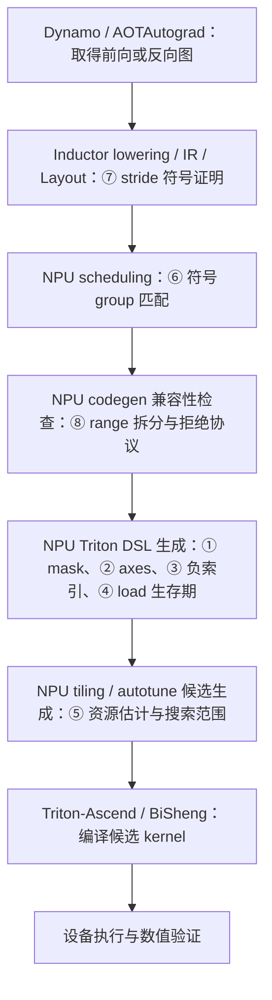

# 已推送的八类 Inductor 修复：问题、前后 DSL、正确性与影响范围

本文补充[四模型修复记录](model-fixes-20261020.md)，逐项解释已经推送的八类修复。
框架基线为 `0b4b636555`，整合分支为 `debug/cicd-all-fixes-20261020`、`5b18fac653`。
这里只说明已有修改，不为[本轮三个模型定界](three-model-boundary-20261021.md)增加框架修复。

2026-10-23 第 7 项已追加上游回移，整合分支更新到 `089231bede`。
原 `c74c45c960` 的 PythonMod 补丁与历史验证保留；当前实现使用 PyTorch `Mod`，
并补齐旧 2.13 缺少的符号整除证明依赖，见[第 7 项最新详解](model-fix-07-symbolic-strides-20261022.md)。
NPU_A5 本轮六项符号检查、静态和动态双 shape 前向及两项梯度比较均通过。
下面的八项提交表和原始 DSL 对照仍对应 `5b18fac653` 版本。

同日后续整理提交历史后，整合分支更新为 `937cdf81e3`，并恢复为八个提交。
第 1 项合入动态 cat 单测缺失的 `optimize_mask` 初始化，对应 `13cfa5a1d2`；
第 7 项合入上游回移、证明依赖和配套单测，对应 `a4e9a7f975`。
历史 NPU 验证仍对应实际加载的 `089231bede`；整理后没有新增设备验证。
当前 PR 为 [Ascend/pytorch !48387](https://gitcode.com/Ascend/pytorch/pull/48387)，
关联 [Issue #5625](https://gitcode.com/Ascend/pytorch/issues/5625)。

DSL 指 Inductor 生成、交给 Triton 编译的 kernel 程序；IR 是生成 kernel 之前的图或调度表示。
下面标为“原始摘录”的代码保留产物原文；标为“语义示意”的代码用于解释，不冒充捕获产物。
调度、stride 证明和 range 拆分的原失败发生在 DSL 生成之前，因此其“修复前 DSL”为未生成。
这三项提供失败 IR/表达式、修复前后代码以及成功生成/执行的证据，不伪造一份失败 kernel。

八类问题的 GPU 对照入口见
[独立 eager forward 用例](../../../scripts/repro/cicd/model_fixes_eager_20261022/README.md)：
共九个可单文件运行的脚本，包含原 kernel 的 ATen 子图、输入 shape/stride 和 CUDA DSL 导出命令。
其中三项编译前故障保留同一个双 shape 训练小图，并明确区分 IR 分析与最终成功路径的 DSL。
第 7 项另有[符号 stride 的 CUDA 验证脚本及说明][stride-probe-readme]，
分别检查纯表达式、当前安装的 Layout 方法和真实 CUDA 编译路径。

以下各节的“影响范围与潜在回归”按整合提交的实际条件分析，不将“数学上保持语义”写成
“不存在回归”。性能、编译耗时和未覆盖 layout 的风险属于源码审查结论，未注明实测时不代表已经发生。
①–⑥、⑧修改 NPU 路径；⑦运行时替换社区公共 Layout 方法，安装后具有进程级影响。
历史模型 PASS、针对性小图 PASS 和仅凭源码可推导的适用范围分别记录。

## 逐提交源码精读

下面八篇从函数职责、输入输出和相关调用开始，按补丁解释为什么修改该函数、
每处条件或元数据如何影响最终行为，并用具体数值走一遍修复前后的过程。
不熟悉相关函数时，可先读对应精读，再回到本文查看模型 DSL 与影响范围。

| 条目与整合提交 | 独立文档 | 重点解释的问题 |
| --- | --- | --- |
| ① `a514111f10` | [reduction mask](model-fix-01-reduction-mask-20261022.md) | mask 的生成、消除与归约前重屏蔽 |
| ② `22b6b739eb` | [reduction axes](model-fix-02-reduction-axes-20261022.md) | 轴分析、reshape、dim 与 CSE shape |
| ③ `c32818e10e` | [negative index](model-fix-03-negative-index-20261022.md) | 索引代理、wrap 与 bounds 检查 |
| ④ `7381eb8188` | [load liveness](model-fix-04-load-liveness-20261022.md) | 生成顺序、生存期与 UB 峰值 |
| ⑤ `2d147618bc` | [tiling resource](model-fix-05-tiling-resource-20261022.md) | 容量阈值、停止点与候选状态 |
| ⑥ `e1429cc917` | [symbolic scheduling](model-fix-06-symbolic-scheduling-20261022.md) | group 等值证明与调度入口 |
| ⑦ `c74c45c960` | [symbolic strides](model-fix-07-symbolic-strides-20261022.md) | Layout 证明与补丁安装/恢复 |
| ⑧ `5b18fac653` | [range split](model-fix-08-range-split-20261022.md) | 索引重建、拒绝协议与检查顺序 |

精读以每个整合提交相对其父提交的差异为范围，不把后续提交的效果算入前一项。
完整补丁已在各篇链接；若要在框架仓库中阅读上下文，可执行
`git show <完整提交 SHA>:<源码路径>`，或用 `git show <完整提交 SHA> -- <源码路径>` 查看差异。
这避免本地当前分支不同、或多个提交修改同一函数时读错版本。
示例代码会注明语义示意；历史实测结果与本次文档工作分开记录，本次未新增设备验证。

## 全局视角：问题在 Inductor 的哪个模块

这八项涉及 Inductor 的五种职责：DSL 生成、tiling 候选生成、节点调度、Layout 符号证明、
迭代范围兼容性检查。修复均通过 `torch_npu/_inductor` 接入路径落地；
其中第 7 项修改的是社区 `torch._inductor.ir.Layout` 方法的行为，由 NPU 侧安装补丁。
因此需要同时看出错逻辑所属的模块与实际修复文件，不能仅凭补丁目录判断全部根因都在 NPU 专有代码中。
这些定位也不等于已经在社区 CUDA 后端复现了相同缺陷，GPU 对照仍以实际运行和源码为准。

下图按职责标出位置，编号对应本文八项问题。lowering 指把图中算子转换为 Inductor 内部表示；
调度负责安排融合节点与归约前后的执行顺序；codegen 负责把这些表示写成 kernel 程序。
范围兼容性检查可在调度选择候选时调用，图中的连线用于说明职责关系，不表示严格的单次串行调用栈。



下表文件路径均相对于 `torch_npu/_inductor/`；“模块”按职责归类，完整入口见各节的“模块归属”。

| 条目 | 主责模块与修复文件 | 定位要点 | 代码证据 |
| --- | --- | --- | --- |
| ① reduction mask | DSL 生成：`codegen/triton.py` | 待归约表达式的非法 lane 未重新屏蔽 | [补丁][mask-patch] |
| ② reduction axes | DSL 生成：`codegen/kernel_analysis.py`、`codegen/triton.py` | 输出轴被错误压入归约轴 | [补丁][axes-patch] |
| ③ negative index | 索引生成：`codegen/triton.py` | 调试开关取消 wrap，bounds 传播不一致 | [补丁][negative-patch] |
| ④ load liveness | DSL 指令排布：`codegen/triton.py` | load 与消费计算分离，中间 tile 同时存活 | [补丁][load-patch] |
| ⑤ tiling resource | 候选生成：`runtime/tile_generator.py` | 资源估计和搜索停止条件漏掉合法小 tile | [补丁][tile-patch] |
| ⑥ symbolic groups | 节点调度：`codegen/scheduling.py` | 数学等价尺寸被按表达式结构判为不等 | [补丁][schedule-patch] |
| ⑦ symbolic strides | Layout 符号证明：`codegen/_sizevars.py` | 社区 Layout 的取模化简引入倒数 | [补丁][stride-patch] |
| ⑧ range split | 范围兼容性：`codegen/triton.py` | NPU 拒绝分支不符合 `CantSplit` 协议 | [补丁][range-patch] |

按修复文件统计，`codegen/triton.py` 涉及五项，但第 8 项是在生成 DSL 前判断候选是否兼容，
与第 1–4 项的 DSL 生成错误应分开理解。
第 5 项虽然位于 `runtime/`，这里负责的是编译候选的 tiling 搜索，不是设备执行时的算子逻辑。
第 7 项还涉及 `lowering_patch.py` 中社区方法的保存/恢复，属于补丁接入管理，
触发原异常的主逻辑仍是 Layout/sizevars 的符号证明。

**失败位置与责任模块也要分开。** 第 4、5 项表现为下层 kernel 编译资源不足，
定位到的修复分别是 Inductor 的 load 排布和候选搜索；下层拒绝超容量候选本身不能证明编译器有 bug。
另有独立的 TA masked indirect load 缺陷，仍标为“未修复、影响被屏蔽、不阻塞当前模型验证”，
不能与第 1 项已经修复的 Inductor mask 生成问题合并。
涉及模型与故障暴露顺序见下表；“第一层、第二层”等表示排障顺序，和本节的编译模块划分是两个维度。

## 修复覆盖与故障层级

| 修复分支 | 涉及模型/用例 | 故障层级 | 整合提交 |
| --- | --- | --- | --- |
| `bugfix/codegen-reduction-mask` | GPT2ForSequenceClassification、BERT_pytorch 前向 | 各模型第一层 | `a514111f10` |
| `bugfix/codegen-reduction-axes` | BERT_pytorch 静态训练 bias gradient | 第二层 | `22b6b739eb` |
| `bugfix/codegen-negative-index` | 独立负索引回归，未证实四模型触发 | 不分配模型层级 | `c32818e10e` |
| `bugfix/codegen-load-liveness` | AlbertForMaskedLM 多路参数梯度 | 第一层，与 tiling 共同解决 | `7381eb8188` |
| `bugfix/tiling-resource-budget` | AlbertForMaskedLM、nfnet_l0 | 两者第一层；另覆盖 Albert softmax 第二层 | `2d147618bc` |
| `bugfix/scheduler-symbolic-groups` | nfnet_l0 动态训练 | 第二层 | `e1429cc917` |
| `bugfix/layout-symbolic-strides` | NFNet 派生小图第二组动态 shape | 第三层，仅小图 | `c74c45c960` |
| `bugfix/codegen-range-split` | 同一小图的初次 backward 编译 | 第四层，仅小图 | `5b18fac653` |

层级表示前一阻塞解决之后实际暴露的下一问题，不表示组件栈。
各独立分支的 SHA 与整合提交不同，准确对应关系见
[branches.json](../../../artifacts/cicd/model_fixes_20261020/branches.json)。
八份完整补丁保存在 [patches](../../../artifacts/cicd/model_fixes_20261020/patches/)。

## 1. Persistent reduction：计算后必须重新屏蔽无效 lane

**模块归属：NPU Inductor 的 reduction/mask DSL 生成。**
修复文件为 `torch_npu/_inductor/codegen/triton.py`，入口包括
`IterationRangesEntryNPUIndex._codegen_mask()`、`NPUIndexTritonKernel.filter_masks()` 与 `reduction()`。
问题在把合法元素范围写入归约代码的环节；具体改动见[mask 补丁][mask-patch]。

**问题描述。** GPT2/BERT 的 embedding + norm 在隐藏维度 768 上计算均值、方差。
实际 SIMT tile 扩到 1024；多出的 256 个 lane 不属于输入。
load 设置 `other=0` 并不足以保证后续表达式的无效 lane 仍是规约单位元。
例如减去均值再平方后，尾部变成 `mean²`，错误方差额外包含 `256 * mean² / 768`。

**问题 DSL，原始 GPT2 kernel 摘录：**

```python
        tmp8 = tmp2 + tmp7
        tmp10 = tl.sum(tmp8, 1).reshape(X0BLOCK_SUB, 1)
        tmp11 = tl.full([1, 1], 768.0, tl.float32)
        tmp12 = (tmp10 / tmp11)
        tmp13 = tmp8 - tmp12
        tmp14 = tmp13 * tmp13
        tmp16 = tl.sum(tmp14, 1).reshape(X0BLOCK_SUB, 1)
```

**修复逻辑。** `_codegen_mask` 与 `filter_masks` 保留不能证明恒真的条件；
`reduction()` 在执行融合表达式之后、实际归约之前，用 `tl.where` 选择单位元。
sum 为 0、prod 为 1、max 为负无穷、min 为正无穷，整数极值按实际 dtype 转换。
mask 与 value 采用同一轴顺序、permute 和 reshape，不能把某个轴的条件广播到另一轴。
只有长度能被实际 `BLOCK_SUB` 整除时才消去 mask；SIMT 的二次幂扩展也计入这个证明。

**修复后 DSL，同一模型生成路径的原始摘录：**

```python
        tmp8 = tmp2 + tmp7
        tmp10 = tl.where(tl.broadcast_to((x0_mask.reshape([X0BLOCK_SUB, 1]) & r1_mask.reshape([1, R1BLOCK_SUB])), [X0BLOCK_SUB, R1BLOCK_SUB]), tmp8, 0)
        tmp11 = tl.sum(tmp10, 1).reshape(X0BLOCK_SUB, 1)
        tmp12 = tl.full([1, 1], 768.0, tl.float32)
        tmp13 = (tmp11 / tmp12)
        tmp14 = tmp8 - tmp13
        tmp15 = tmp14 * tmp14
        tmp17 = tl.where(tl.broadcast_to((x0_mask.reshape([X0BLOCK_SUB, 1]) & r1_mask.reshape([1, R1BLOCK_SUB])), [X0BLOCK_SUB, R1BLOCK_SUB]), tmp15, 0)
        tmp18 = tl.sum(tmp17, 1).reshape(X0BLOCK_SUB, 1)
```

**为什么可以这样修。** 对合法 lane，`where` 仍选择原表达式；对非法 lane，选择运算单位元，
不会改变合法元素集合的规约结果。应屏蔽的是最终待规约值，而不只是最初 load。
这也能阻断下层 masked indirect load 错误尾值对归约的影响，但没有修复那个独立 TA 缺陷。
其状态仍为“缺陷未修复，影响被屏蔽；不阻塞当前模型验证”。

证据：[原 DSL][mask-old]、[修复后完整 DSL][mask-new]、[补丁][mask-patch]。
验证：mask 单元 4/4、静态/动态数值回归 22/22；GPT2 累计 8/8，BERT 前向恢复后还暴露下一项。

**影响范围与潜在回归。** [补丁][mask-patch]同时修改 mask 生成、mask 消除和 reduction 中的
mask 布局。常量 mask 消除仅适用于 `optimize_mask and persistent_reduction and node.is_reduction`
且非 vectorized split 的轴，还要求长度为正、能被实际生成的 `BLOCK_SUB` 整除；
无法证明时保留 mask。实际重屏蔽 value 的新增逻辑用于 persistent reduction，
其中 `welford_reduce` 明确保留专用路径；mask 的 reshape/broadcast 重建还涉及多轴 reduction。
因此不能把整个补丁的范围缩成“只有隐藏维 768 的 sum”，也不能声称它已修复 Welford 的所有尾块问题。

单位元正确且 mask 与 value 对齐时，合法元素的数学结果保持；风险主要是轴顺序、broadcast、
tuple reduction 和整数极值 dtype 的组合，以及额外 `where`/broadcast 带来的代码量、UB 占用或性能变化。
已有回归覆盖 sum/prod/min/max/argmin/argmax、整数极值及静态/动态尾块，
单元还检查 semantic mask 不被轴 mask 消除误删。它们不构成所有 dtype、NaN/Inf、极值并列位置及
所有 tiling 的穷举证明；专用 Welford 路径和全模型性能仍需单独评估。
GPT2/BERT 原失败是已捕获的数值错误，修复具有模型必要性证据，不能靠缩小 tile 的一般性说法替代。

## 2. 多轴归约：压平 reduction axes，保留输出 channel

**模块归属：NPU Inductor 的 reduction 轴分析与 DSL layout 生成。**
`torch_npu/_inductor/codegen/kernel_analysis.py` 中的
`ReductionAnalysis.dense_post_reduction_list()`、`analyze_reduction_dim()` 决定压平后的形状与归约维；
`torch_npu/_inductor/codegen/triton.py` 的 `NPUIndexTritonKernel.reduction()` 等入口写出对应变换。
错误来自轴分析和生成布局不一致，具体改动见[axes 补丁][axes-patch]。

**问题描述。** BERT 静态反向 bias gradient 应对两个批次/序列轴求和，保留 768 个 channel。
原输入重排对应 `reshape(4,12,128,64).permute(0,2,1,3).reshape(512,768).sum(0)`。
其中 X4=12、X5=64 是输出维，R2=4、R3=128 是规约维。
旧代码把 R2、R3、X5 全压成一维，产生一个标量，再把相同标量写给全部 X5。

**问题 DSL，原始摘录：**

```python
                tmp0 = tl.load(in_ptr0 + (x5 + 64*r3 + 8192*x4 + 98304*r2), x5_mask, other=0.0)
                tmp1 = tl.reshape(tmp0, [R2BLOCK_SUB* R3BLOCK_SUB* X5BLOCK_SUB])
                tmp3 = triton_helpers.promote_to_tensor(tl.sum(tmp1, 0))
                tl.store(out_ptr1 + (x5 + 64*x4 ), tmp3, x5_mask)
```

**修复逻辑。** 以 `golden_var_list` 的实际 value 布局为准，把 preserved axes 放前面、
reduction axes 放后面，只合并后者；沿合并后的 reduction dim 求和，再恢复 broadcast 维。
同时修正 CSE 表达式的 shape 元数据，使后续 layout 分析看到的形状与已生成 DSL 一致。

**修复后 DSL，原始摘录：**

```python
                tmp1 = tl.reshape(tmp0.permute([2, 0, 1]), [X5BLOCK_SUB, R3BLOCK_SUB * R2BLOCK_SUB])
                tmp3 = tl.where(tl.reshape((tl.broadcast_to((x5_mask.reshape([1, 1, X5BLOCK_SUB])), [R2BLOCK_SUB, R3BLOCK_SUB, X5BLOCK_SUB])).permute([2, 0, 1]), [X5BLOCK_SUB, R3BLOCK_SUB * R2BLOCK_SUB]), tmp1, 0)
                tmp4 = tl.sum(tmp3, 1).reshape(1, 1, X5BLOCK_SUB)
                tl.store(out_ptr1 + (x5 + 64*x4 ), tmp4, x5_mask)
```

**为什么可以这样修。** permute/reshape 只重排索引，没有增加或丢失元素；
每个 X5 对应的 R2×R3 元素集合保持独立，求和后仍有 X5BLOCK_SUB 个结果。
外层 X4 循环再覆盖 12 组，合计 12×64=768 个输出，符合 bias gradient 定义。
反过来，原来的单标量不可能表示任意 64 个独立 channel 的梯度。

证据：[原 DSL][axes-old]、[修复后完整 DSL][axes-new]、[补丁][axes-patch]。
验证：bias gradient/分离规约轴的静态和动态回归 4/4，BERT 静态训练 accuracy 恢复通过。
此分支依赖 mask 修复；整合后的产物同时包含两项，不能把所有差异都归因于 axes。

**影响范围与潜在回归。** [补丁][axes-patch]将多处条件从“多轴且 contiguous”扩展为
`numof_reduction_axis() > 1`，影响 contiguous 和 non-contiguous 多轴归约的 packed shape、
reduction dim、常量张量维数、broadcast 及 CSE shape 元数据；不是只对 BERT 的一个 bias gradient 生效。
single-reduction 的主分支保留，但共享 CSE 元数据的消费方也需要关注。

规则成立的前提是 `golden_var_list` 与当前 value 的实际轴顺序一致，且 preserved/reduction 轴分类正确。
若某个尚未覆盖的 layout 元数据不满足此前提，可能产生错误 reshape、mask 广播或后续 store；
增加 permute/布局转换也可能影响编译资源和性能。现有四项回归及 BERT 静态训练证明目标场景恢复，
没有证明所有混合 broadcast、tuple reduction、动态多轴和 SIMD/SIMT 组合均无回归。
该项修复的是已证实的输出 channel 被错误归约，属于目标模型正确性所需的修复。

## 3. 负索引：dump/check 开关不能取消 wrap

**模块归属：NPU Inductor 的间接索引生成与数值范围传播。**
修复文件为 `torch_npu/_inductor/codegen/triton.py`，具体是 NPU kernel 安装的
`CSEProxy.indirect_indexing()`；它决定负索引回绕及后续边界检查可采用的 bounds。
具体改动见[负索引补丁][negative-patch]。

**问题描述。** 对长度 8 的 tensor，索引 -1 应访问第 7 个元素。
旧 `CSEProxy.indirect_indexing()` 在设置 dump/check 环境变量时强制 `wrap_neg=False`，
使相同图因调试开关不同而改变访问地址。此项来自专门回归，未证明原四模型输入触发。

**问题与修复后 DSL 语义示意：** 以下是由实际 codegen 分支导出的等价语义，不是模型原始产物。

```python
# 旧：dump/check 强行禁用 wrap，idx=-1 仍访问负地址
value = tl.load(table + idx * 16 + column)

# 新：保持调用方 wrap_neg=True 的要求
wrapped = tl.where(idx < 0, idx + 8, idx)
value = tl.load(table + wrapped * 16 + column)
```

**修复逻辑。** 删除环境变量修改 `wrap_neg` 的分支，遵守调用者的语义。
另修正 bounds 传播：只有实际 wrap 才计算加 size 后的范围，no-wrap 必须保留原 bounds。
例如 `[-2,3]` 在 wrap 模式变为 `[0,7]` 的保守范围，no-wrap 模式仍为 `[-2,3]`；
若后者也标成非负，后续可能错误消除 lower-bound check。CSE 同时保留 dtype/shape。

**为什么可以这样修。** wrap 是索引算子的行为，调试开关只应增加观察/检查，不能改变算子行为。
对于明确要求 no-wrap 的调用，修复也没有强制 wrap，而是保留负范围及对应边界检查。
这是两种调用协议各自的一致性修复，不是给所有负地址加 size。

证据：[完整前后 codegen 补丁][negative-patch]、[no-wrap 单元结果][negative-unit]、
[静态 dump 数值结果][negative-result]。
验证：静态/动态 × none/dump/check 共 6 项数值通过，no-wrap bounds 专项通过。
修复后的 v8 真实静态 kernel 已从原回归缓存补充归档，明确保留了 `idx<0` 的转换：

```python
            tmp0 = tl.load(in_ptr0 + (y0), y0_mask)
            tmp1 = tl.full([Y0BLOCK_SUB, X1BLOCK_SUB], 8, tl.int32)
            tmp2 = tmp0 + tmp1
            tmp3 = tmp0 < 0
            tmp4 = tl.where(tmp3, tmp2, tmp0)
            tl.device_assert(((0 <= tmp4) & (tmp4 < 8)) | ~(y0_mask), "index out of bounds: 0 <= tmp4 < 8")
            tmp6 = tl.load(in_ptr1 + (x1 + 16*tmp4), x1_mask & y0_mask)
```

见[负索引完整 DSL][negative-dsl]。修复前没有留存同一回归的完整 kernel，
旧行为以补丁删除的环境变量分支和上面的语义示意为证，没有将示意标成实测产物。

**影响范围与潜在回归。** [补丁][negative-patch]只在间接索引的 bounds 可能为负时进入相关分支。
它取消 dump/check 环境变量对 `wrap_neg` 的覆盖，并修复显式 `wrap_neg=False` 时的 bounds、dtype、shape
传播；这不是对所有索引无条件加 size。bounds 已证明非负的路径不需要新增 wrap。

合法负索引恢复调用方要求的语义；no-wrap 保留负范围可避免误删下界检查。
潜在影响包括调试模式下新增原本被错误省掉的 wrap 指令、保守 bounds 保留更多检查，以及 dtype/shape
传播影响后续 CSE。显式 no-wrap 调用方仍须遵守自身索引契约；该修复不使任意越界索引变得合法。
现有六组静态/动态与调试开关对照、no-wrap 单元通过，不能据此覆盖全部符号 size、空维和非法索引行为。
这项来自独立回归，没有证据表明四个历史模型通过必须依赖它。

## 4. Load 生存期：不要让 81 个输入 tile 同时存活

**模块归属：NPU Inductor 的 kernel 内 load/compute DSL 排布。**
修复文件为 `torch_npu/_inductor/codegen/triton.py`，入口是 `NPUIndexTritonKernel.load()`。
它选择把 load 和 layout transform 写入 `prefix`、`loads` 还是 `compute` buffer，
区别于第 6 项对融合节点的调度；具体改动见[load 补丁][load-patch]。

**问题描述。** Albert LayerNorm 参数梯度融合 12 路贡献，生成 81 次输入 load。
旧 codegen 把 load 都放入 `self.loads`，把消费运算放入后续 compute buffer；
较多中间 tile 同时占用片上 UB，候选编译因资源不足失败。

**问题 DSL，原始 load 序列开头：**

```python
        tmp0 = tl.load(in_ptr0 + (x0 + 4096*r1), x0_mask, other=0.0)
        tmp1 = tl.load(in_ptr1 + (x0 + 4096*r1), x0_mask, other=0.0)
        tmp2 = tl.load(in_ptr2 + (r1), None)
        tmp4 = tl.load(in_ptr3 + (r1), None)
        tmp11 = tl.load(in_ptr4 + (x0 + 4096*r1), x0_mask, other=0.0)
        tmp12 = tl.load(in_ptr5 + (x0 + 4096*r1), x0_mask, other=0.0)
```

这里继续加载其余输入后才执行 `tmp1 - tmp2` 等计算；完整顺序见原始文件。

**修复逻辑。** reduction 内普通输入 load 写入 compute，与首次消费计算相邻；
依赖计算结果的 indirect/tmpmask load 同样进 compute；可提升的循环不变量仍留在 prefix。
load 后的 layout transform 也放入相同 buffer，保证先定义、后使用。

**修复后 DSL，原始摘录：**

```python
        tmp0 = tl.load(in_ptr0 + (x0 + 4096*r1), x0_mask, other=0.0)
        tmp1 = tl.load(in_ptr1 + (x0 + 4096*r1), x0_mask, other=0.0)
        tmp2 = tl.load(in_ptr2 + (r1), None)
        tmp3 = tmp1 - tmp2
        tmp4 = tl.load(in_ptr3 + (r1), None)
        tmp5 = tmp3 * tmp4
        tmp6 = tmp0 * tmp5
        tmp8 = tl.where(tl.broadcast_to((x0_mask.reshape([1, X0BLOCK_SUB])), [R1BLOCK_SUB, X0BLOCK_SUB]), tmp6, 0)
        tmp9 = tl.sum(tmp8, 0).reshape(1, X0BLOCK_SUB)
        tmp11 = tl.where(tl.broadcast_to((x0_mask.reshape([1, X0BLOCK_SUB])), [R1BLOCK_SUB, X0BLOCK_SUB]), tmp0, 0)
        tmp12 = tl.sum(tmp11, 0).reshape(1, X0BLOCK_SUB)
        tmp13 = tl.load(in_ptr4 + (x0 + 4096*r1), x0_mask, other=0.0)
        tmp14 = tl.load(in_ptr5 + (x0 + 4096*r1), x0_mask, other=0.0)
        tmp15 = tmp13 + tmp14
```

**为什么可以这样修。** 不改 load 的地址、mask、dtype，也不改各路梯度的表达式和贡献集合；
改变的是互不依赖指令之间的排布。消费者及时计算后，前一组输入不必全部保留到最后一组加载。
有真实数据依赖的 load 不会被提前，循环公共值也没有被错误移入循环。
UB 估计不是精确编译器模型，最终仍需固定候选编译和数值对照。

证据：[原 DSL][load-old]、[修复后完整 DSL][load-new]、[补丁][load-patch]、
[固定候选数值结果][load-numeric]。deferred 静态 performance 对照最大差约 `3.66e-4/2.44e-4`，
在 `atol=0.002、rtol=0.001` 下通过。Albert 四项训练失败还需要下一项提供合法 tile，
不能声称仅重排 load 就独立解决整网所有候选。

**影响范围与潜在回归。** [补丁][load-patch]将 `has_tmpmask or indirect_indexing` 的 load 放入 compute，
此条件不限于 reduction；其后仍将可提升的循环公共 load 放入 prefix，再将其他 reduction 输入放入 compute。
非 reduction 的普通 load 保留在 loads。permute 结果在 load 位于 compute 时也放入 compute；
prefix load 的变换仍在 loads，保证定义在使用之前，不是所有变换都迁移到 prefix。

源码没有修改 load 地址、mask 或梯度公式，但指令排布会影响编译器的存储复用、预取和访存计算重叠。
缩短生存期有机会降低峰值 UB，也可能降低某些小融合的访存并行度；不能据此承诺普遍性能提升。
“靠近消费者”是生成顺序上的安排，不保证下层编译器最终严格保持同一指令顺序。
现有证据重点覆盖普通多输入 reduction，未单独证明新增 indirect 分支是 Albert 原失败的原因。

固定 kernel 实验可以区分 load 重排和缩小 tile；`deferred` 只重排 load，`tile1` 保留计算体并设 X tile 为 1：

| Albert 场景 | 原始配置 | 只设 X tile=1 | 只重排 load、保留原配置 |
| --- | --- | --- | --- |
| 静态训练 performance | X=1，编译失败 | 仍失败，需要 6,030,080 bits，只有 2,031,616 bits | 编译与数值通过 |
| 静态训练 accuracy | X=16，编译失败 | 编译与数值通过 | 编译通过 |
| 动态训练 performance | X=80、R=128，编译失败 | 编译与数值通过 | 仍编译失败 |
| 动态训练 accuracy | X=8、R=512，编译失败 | 编译与数值通过 | 编译通过 |

证据：[静态编译对照][load-static-ablation]、[动态编译对照][load-dynamic-ablation]、[数值对照][load-numeric]。
静态 performance 的 R 在原 persistent DSL 中固定为 2048，X 已为 1；在这套拆分规则下，
tile 搜索无法再缩小 X，重排 load 有直接必要性证据。改成可分段归约的其他 kernel 属于额外算法选择。
尚未做最终整合版本“只撤销本提交”的完整模型对照，因此不能断言所有其他编译模式都不能替代它，
也不能把这个提交中的三个改动分别说成模型 PASS 的必要条件。

## 5. Tiling：搜索必须覆盖设备能编译的较小 tile

**模块归属：NPU Inductor 的 tiling/autotune 候选生成与资源估计。**
修复文件为 `torch_npu/_inductor/runtime/tile_generator.py`，入口包括
`TileGenerator.__init__()`、`rebuild_dynamic_axis()`、`reset_configs()`、`set_kernel_type()`
及新增的 `_update_resource_limits()`。它们决定交给编译器尝试哪些候选，
不修改 pooling/softmax 的数学公式；具体改动见[tiling 补丁][tile-patch]。

**问题描述。** NFNet dynamic pooling 的 SIMT 候选受到每 tile 8 KiB 的限制。
FP32 对应最多 2048 个元素，而旧搜索在 4096 元素处已停止，未枚举任何合法 SIMT 小 tile。
Albert 多输入梯度还受到 pointer 数量被截断为 3、persistent 最小 tile 未保留的影响。
切换 template/SIMT 时资源上限不更新，`self.config` 拼写错误又没有清空真实 `self.configs`。

**问题 DSL 与修复后 DSL。** NFNet pooling 的函数体没有修改，下面是两边共有的原始摘录：

```python
    tmp2 = tmp0 + tmp1
    tmp4 = tmp2 + tmp3
    tmp6 = tmp4 + tmp5
    tmp7 = tl.full([1], 4.0, tl.float32)
    tmp8 = (tmp6 / tmp7)
    tl.store(out_ptr0 + (x3), tmp8, xmask)
```

实际差异在 constexpr 和编译 options，而不是把四点均值换一种算法：

| 阶段 | 生成/选择的候选 | 结果 |
| --- | --- | --- |
| 修复前 | SIMT 搜索未进入 `XBLOCK<=2048` 范围；template 候选编译失败 | 无合法候选 |
| 修复后 | 正常 autotune 选中 `XBLOCK=512, compile_mode=simt_only` | 三个 dynamic pooling kernel 均可执行 |

**修复逻辑。** 保存真实 pointer 数量，切换 kernel type 时重算容量和搜索停止点；
SIMT 搜索上限与已有 8 KiB 检查一致；每种 mode 独立清空候选。
persistent/no-loop 轴不可继续切分，保守的 pointer 估计不应提前丢弃最小候选；SIMT 的硬资源限制仍保留，实际合法性由编译器验证。

Albert 第一层解决后又暴露动态 softmax 第二层：`rebuild_dynamic_axis()` 漏算完整 R3，
并用 `axis_name == 'r'` 判断实际名字 `r3`，把 X2 错误设为不可继续切分。
修复先乘入全部 persistent reduction 轴，使用 `startswith('r')`，再决定其他轴能否免循环。

**Softmax 的前后 DSL 参数化方式不变，原始摘录：**

```python
    base_x2= tl.arange(0, X2BLOCK_SUB)
    loops_x2 = (x2_numel + X2BLOCK_SUB - 1) // X2BLOCK_SUB
    base_r3= tl.arange(0, R3BLOCK_SUB)
    loops_r3 = (r3_numel + R3BLOCK_SUB - 1) // R3BLOCK_SUB
```

独立固定 DSL 对照中，`X2BLOCK_SUB=512、R3BLOCK_SUB=512` 编译超 UB，
仅将 X2 改为 8 后编译及 eager 比较通过，最大差 `6.98e-10`。
这证明存在合法小 tile；框架修复是恢复枚举能力，没有在框架里写死 X2=8。

**为什么可以这样修。** XBLOCK/X2BLOCK_SUB 只改变分块和循环次数，原 mask 仍限制合法索引，
所有输出元素仍被覆盖，每行 softmax 的 reduction 轴仍完整。
资源阈值只筛选候选，不改变数学运算。下层合理拒绝超 UB 的候选，不等于下层有 bug。
这也没有在 Inductor 中过滤某个模型名或固定绕过特定 TA 编译错误。

证据：[完整补丁][tile-patch]、[修复前 pooling DSL][pool-old]、[修复后 pooling DSL][pool-new]、
[实际选中配置][pool-config]、[softmax DSL][softmax-new]、[固定候选失败][softmax-fail]、
[小 tile 数值通过][softmax-pass]。tiling 单元 3/3；Albert 累计 8/8、NFNet 推理恢复通过，
后者动态训练继续暴露下一项。

**影响范围与潜在回归。** [补丁][tile-patch]影响使用 `TileGenerator` 的 NPU 候选生成，
包括 pointer 数量估计、kernel type 切换、每种 mode 的候选清空及最小 tile 保留。
`rebuild_dynamic_axis()` 的新增 persistent 轴计数位于 `len(tiling_axis) > 3 and not no_loop_axis`
的分支，不应概括为所有 kernel 都重新切分所有轴。persistent reduction/no-loop 轴仍不可继续切分。

pointer 数量不等于同时存活的 tensor 数量，只是资源估计；更多输入可能使搜索偏向更小 tile，
增加循环开销或漏掉原本高效的较大候选。恢复小候选也可能增加编译/autotune 时间；
保留最小合法 tile 只保证尝试机会，不保证下层一定能编译。不同 tile 的浮点归约顺序可能变化，
因此“算子数学公式不变”不等于逐 bit 相同或性能必然提高。

现有三项候选单元、NFNet 选中配置及 softmax 独立数值对照证明目标路径可用，
没有覆盖所有 dtype、mode、dynamic/no-loop 组合或稳定性能基准。
tiling 确实能单独解决前表中的三个 Albert 候选及 softmax 大 tile 的 UB overflow；
它不能在既有 persistent 拆分规则下替代静态 performance kernel 的 load 重排。

## 6. Scheduling：比较符号尺寸的数学值，而非表达式结构

**模块归属：NPU Inductor 的融合节点调度与符号 group 匹配。**
修复文件为 `torch_npu/_inductor/codegen/scheduling.py`，入口是 `_generate_npu_node_schedule()`；
`NPUNoLinearTritonScheduling`、`NPUTritonScheduling` 的 `generate_node_schedule()` 统一调用它。
这里决定 producer、reduction、epilogue 如何进入执行序列；具体改动见[调度补丁][schedule-patch]。

**问题描述。** NFNet dynamic training 的融合组包含 pointwise producer、空间 sum、epilogue。
令 `q=FloorDiv(H-1,32)`、`A=1536*batch`，真实调度 IR 可写为：

```text
producer group = (A*q*q + 2*A*q + A, 1)
reduction group = (A, q*q + 2*q + 1)
epilogue group = (A, 1)
```

**修复前 DSL：未生成。** 旧调度器用结构 `==` 比较 producer_numel 与 `numel*rnumel`；
展开式与因式分解式在 SymPy 中不是同一结构，错误抛出 `unexpected group`，尚未调用 Triton。

**修复逻辑，前后代码语义：**

```python
# 旧匹配路径
node_numel == numel * rnumel
# 新：NumelList 先转换为其总元素数；结构快路径后尝试证明相等
sizevars.statically_known_equals(node_numel, numel * rnumel)
```

两条 NPU 调度路径统一复用该匹配，不再只对 Welford 融合启用符号证明。
无法证明相等的组仍拒绝，不追加新的 shape guard，也不把所有组强行判为可融合。

**修复后真实 DSL，NFNet 反向 producer → reduction → epilogue 的摘录：**

```python
    tmp26 = tl.sum(_tmp26, 1)[:, None]
    tmp28 = tl.load(in_ptr1 + (x0), xmask)
    tmp29 = tl.sigmoid(tmp28)
    tmp30 = tl.full([1, 1], 1.0, tl.float32)
    tmp31 = tmp30 - tmp29
    tmp32 = tmp29 * tmp31
    tmp33 = tmp26 * tmp32
    tl.store(in_out_ptr2 + (x0), tmp33, xmask)
```

**为什么可以这样修。** `A*(q²+2q+1)=Aq²+2Aq+A` 是恒等式，两个组的元素数确实相等。
尺寸证明只接受原本合法的等价关系；调度 helper 内已有的依赖和归约循环开闭逻辑保留，
但本提交也扩大了该 helper 的调用范围，具体边界见下文。
生成后 `tmp26` 沿空间轴求和，再计算 sigmoid 梯度 epilogue，符合原 IR。

证据：[原始完整调度 IR][schedule-ir]、[修复后完整 DSL][schedule-new]、[补丁][schedule-patch]。
验证：等价组、非等价组拒绝及无新增 guard 的单元 2/2；NFNet dynamic training 两项通过。
同一小图扩展到第二组动态 shape 后另暴露下一项，不能把第一组通过当成两组都通过。

**影响范围与潜在回归。** [补丁][schedule-patch]的范围不止于替换一次 `==`：
`NPUNoLinearTritonScheduling` 和 `NPUTritonScheduling` 均无条件使用 `_generate_npu_node_schedule()`，
原先非 Welford/关闭 Welford 时调用社区父类的分支被删除。
因此静态、动态、Welford 和非 Welford 的这两类 NPU 调度都在实现影响范围内。
`NumelList` 按总元素数比较；结构相等快速返回，否则要求 `statically_known_equals` 证明相等，
无法证明仍拒绝，不通过追加 guard 强行接受。

潜在回归点是更广的调度路由、producer/reduction/epilogue 的依赖处理和循环切换，
以及额外符号证明的编译成本。总元素数相同不代表任意 layout 都可融合，后续范围与布局兼容性检查仍需成立。
现有测试覆盖两类 scheduler、Welford 开关、预期执行序列及不等组拒绝、无新增 guard；
NFNet 两个动态训练场景通过，但未穷举 scan、多次相依 reduction 和所有融合拓扑。
该项有整模型原始 `unexpected group` 到 PASS 的必要性证据，不能描述为所有场景均只改变比较开销。

## 7. Symbolic stride：整数整除证明不能引入倒数

**模块归属：社区 Inductor IR/Layout 的符号 stride 比较，经 NPU 侧补丁修复。**
出错入口为 `torch._inductor.ir.Layout._stride_expr_ge_or_false()`，依赖 sizevars/ShapeEnv 证明整数关系。
实际修复落在 `torch_npu/_inductor/codegen/_sizevars.py` 的 `patch_simplify()`，
并在 `torch_npu/_inductor/lowering_patch.py` 中维护方法的保存/恢复。
应归类为 Layout/符号证明问题，不能因补丁文件位于 `codegen/` 就归成 Triton DSL 计算错误；
具体改动见[stride 补丁][stride-patch]。

**问题描述。** NFNet 派生训练小图第二组输入 `(3,16,256,256)` 在 convolution backward
layout 证明时失败。实际 stride 为 `a=q+1`、`b=(q+1)²`，`q=FloorDiv(H-1,32)`、H≥33。
旧 SymPy `%` 会把 `Mod(a,b)` 变为包含 `b/a` 的表达式；展开后残留倒数，
整数值域分析遇到指数 -1，抛出 `Invalid ranges [0:-1]`。

**修复前 DSL：未生成。** 异常发生于 `Layout._stride_expr_ge_or_false()`，
不分配 NPU tensor 的 ShapeEnv 元数据调用也可复现；下层编译器尚未参与。

**修复前后符号/IR 对照：**

```python
# 旧：SymPy 通用 Mod 可以引入有理式
Eq(left % right, 0)
# 原问题中间形式：a * Mod(1, b/a)

# 新：表达整数取模，不在该边界引入倒数
Eq(PythonMod(left, right), 0)
```

**修复逻辑。** 保留原先的 right=0、left=0、大小证明和整除证明顺序，
只将整除表达式替换成社区已有的 `PythonMod`；仍由 sizevars 证明真假。
在 NPU `_sizevars.patch_simplify` 安装补丁并防止重复安装。
baseline 保存/恢复使用 `inspect.getattr_static`，保留 staticmethod 描述符，避免恢复后错误绑定 self。

**修复后 DSL 的变化。** 这项不直接修改 Triton 计算或访存模板，修复的是生成之前能否证明布局合法。
对仍然选中相同布局的输入，没有需要替换的 DSL 表达式；证明结果改变时则可能影响布局/copy 选择。
对失败的第二组 shape，
修复后才继续生成 convolution backward 等 kernel。已从实际 v8 缓存补充[双 shape 小图的反向 DSL][training-dsl]，它不使用前一项 NFNet 整网 v5 的产物。
其中一个下游 kernel 的原始摘录为：

```python
    tmp6 = tmp1 * tmp5
    tmp7 = tmp3 * tmp6
    tmp8 = (ks0).to(tl.float32)
    tmp9 = (tmp8).to(tl.float32)
    tmp10 = (tmp7 / tmp9)
    tmp11 = tmp2 + tmp10
    tl.store(out_ptr0 + (x2), tmp11, xmask)
```

这里 `ks0` 是空间归约长度，修复后仍按原图对空间 mean 的梯度除以该长度，
再与逐点梯度相加；没有把符号证明替换成新的数值算法。

**为什么可以这样修。** stride 是整数；对非零 right，`left` 能被 `right` 整除等价于整数取模为 0。
替换不改变这条判定，只避免符号化简进入整数分析不支持的有理式域。
实际元数据对照中 `compare(a,b)=False`、`compare(b,a)=True`，符合 a≥2 时 a<b 的关系。
不捕获异常后强制放行，不针对某个模型或 shape 做特判。

证据：[补丁及四项框架检查][stride-patch]、[旧版元数据异常][stride-old]、
[最终 stride 检查][stride-new]、[双 shape 训练日志][training-new]。
v8 静态/动态各两组 shape 的前向、输入梯度、权重梯度均通过；原 NFNet 模型矩阵没有观察到此新失败。

**CUDA、版本与线性化的边界。** 同版本社区 CUDA 使用同一个 Layout 方法，仍写 `%`，
并没有在该位置使用 `PythonMod`；这次修改保留判定语义，但不是照抄 CUDA 的同位置实现。
该方法由上游 [98b772f8ab8 / PR #183840][stride-upstream-intro] 在 2.13 开发周期引入，
用于加强符号 stride、特别是 unbacked size 的顺序判断。
社区 2.7.1、2.10.0、2.11.0、2.12.0 的对应 Layout 直接比较相邻 stride 的大小，
没有此取模分支；`PythonMod` 类在旧版本已存在。本地 NPU 2.7.1/2.10 分支的 `patch_simplify()`
只有 expand/replacements，没有这个 Layout 替换；回补上游方法的维护分支应另行检查。
源码对照：[2.7.1 Layout][stride-upstream271]、[2.10 Layout][stride-upstream210]、
[2.13 Layout][stride-upstream213]。

相同 `%` 不保证相同模型自动走到相同条件：实际 operand 的展开形式、ShapeEnv 约束、
layout optimization 及 convolution backward 的布局选择都会影响是否进入该分支。
现有证据不能归因成“CUDA 无缺陷，只有 NPU 非线性化造成问题”。
2026-10-22 新增的纯社区 CPU 对照不导入 torch_npu，PyTorch 2.9.1+cpu / SymPy 1.14.0 中：
`Eq(a % expand(a**2), 0)` 在 ShapeEnv 求值时也出现 `Invalid ranges [0:-1]`，
`Eq(PythonMod(a, expand(a**2)), 0)` 返回 False；factored 形式在该环境正常。
这证明底层表达式异常不需要 NPU 或非线性化；2.9.1 没有新 Layout helper，
所以不能将这个结果写成“2.9.1 原 Layout 也会自然触发”。记录见[CPU 对照输出][stride-probe-cpu]。

[独立脚本][stride-probe-script]提供三层验证：`percent_expr/pythonmod_expr` 直接观察 ShapeEnv，
`native_layout` 调用当前安装的真实方法，`--mode compile` 执行原双 shape 小图的 CUDA 前向/反向，
记录实际 Layout 调用及异常。没有 helper 时明确 SKIP，不伪造旧版本实现；
`--patch-pythonmod` 只在该脚本进程的 compile 对照中安装候选，并在退出时恢复原描述符。
详细命令和结果判读见[脚本说明][stride-probe-readme]。本地没有 CUDA，本轮没有 GPU PASS/FAIL 结论。

**影响范围与潜在回归。** 对合法整数 stride、非零 right，取模为零的整除语义保持；
right=0、left=0 和大小判断顺序均沿用原实现。因此没有依据认为替换本身会改变合法整数整除的数学真假。
但“数学等价”不保证符号求解路径、guard、编译耗时和最终布局选择完全相同。
若新表达式更难证明，可能保守拒绝某个合法布局、增加 copy，或产生不同的 guard；
这些需要比较完整编译图、guard 和性能，不能由四个单元证明不存在。

`PythonMod` 内部仍会尝试 `p/q` 和 `sympy.Mod(p,q)==0`；关键是不能化简时保留
`PythonMod(p,q)` 节点，而非把含倒数的通用 Mod 化简结果直接返回给 ShapeEnv。
它不是对所有符号有理式问题的全局修复。实现依据见社区已有的
[PythonMod][stride-pythonmod-source]、[解释器映射][stride-interp-source]及[值域分析][stride-ranges-source]。

安装位置虽在 NPU `_sizevars`，替换目标却是公共 `ir.Layout` 类，且没有 device 判断，
同进程其他后端调用也可能受影响。必须关注重复安装、后端切换恢复、staticmethod 描述符，
以及未来社区方法增加分支后这份复制实现是否同步。现有恢复测试验证幂等和描述符，
不是全后端切换矩阵。补丁对方法不存在的旧版本直接跳过；原生 2.7.1/2.10 无需照搬此替换。
该修复有双 shape 训练小图的必要性证据，没有原 NFNet 整网或 CUDA 模型的同等失败证据。

## 8. Range 拆分：合法拒绝应返回“不兼容”，不能变成 TypeError

**模块归属：NPU Inductor 的迭代范围拆分及融合候选兼容性检查。**
修复文件为 `torch_npu/_inductor/codegen/triton.py`，入口是
`NPUIndexTritonKernel._split_iteration_ranges()`，调用方 `is_compatible()` 捕获 `CantSplit`。
根因是 NPU 拒绝分支与社区异常构造协议不匹配，以及 group 耗尽检查晚于数组访问；
属于生成 DSL 之前的候选检查错误，具体改动见[range 补丁][range-patch]。

**问题描述。** 同一双 shape 小图在 stride 修复后最终能得到正确结果，
但第二组初次 backward 编译仍报 `CantSplit.__init__()` 缺少 `expr/remaining`。
原因是社区异常要求两个操作数，NPU 四个拒绝分支却使用无参 `raise CantSplit`；
另一分支在判断 group 耗尽之前访问 `remaining[current_group]`，先触发 IndexError。

**修复前 DSL：这个失败的融合候选没有生成 DSL。** `is_compatible()` 本应捕获 `CantSplit`
并返回 False，旧版实际抛出的 TypeError/IndexError 不在捕获协议内。
后续 AOT 重试能数值通过，也不能证明第一次检查正确。

**修复逻辑，前后代码：**

```python
# 旧
raise CantSplit
# 新：各分支传入当前不能整除的实际操作数
raise CantSplit(remaining[i], expr)

# 新：在读取 remaining[current_group] 之前检查 group 是否耗尽
if current_group >= len(remaining):
    raise CantSplit(size, 0)
```

**修复后 DSL/索引行为。** 被拒绝的融合候选仍不生成 DSL；`is_compatible()` 正常返回 False，
让已有调度流程选择合法安排。合法的多组拆分算法保留，例如 groups `[2,3,5]` 合成长度 30 时，
重建索引仍是 `15*i0 + 5*i1 + i2`，没有将 NPU 多组算法替换成仅支持两组的算法。
这项改变异常协议，不改变成功候选的 load/store/归约公式。
整图成功路径实际生成的 v8 反向 kernel 见[完整 DSL][training-dsl]；
不能将被拒绝的融合候选写成“修复后强行生成了 kernel”。

**为什么可以这样修。** 无法整除本来就意味着该候选不兼容；传参使既定拒绝信号能被既定调用者捕获，
而不是把不合法融合强行编译。提前检查耗尽条件也只是将 Python 越界变成同一拒绝协议。
正常索引重建的对照证明没有破坏合法三组拆分。

证据：[完整补丁与三项检查][range-patch]、[旧版五个拒绝错误][range-old]、
[修复后检查][range-new]、[最终动态双 shape 训练][training-new]。
v8 range 检查 3/3，双 shape 日志不再出现 CantSplit TypeError。
原 NFNet 整网没有观察到这个新错误，因此不把它写成 NFNet 整网第四层失败。

**影响范围与潜在回归。** [补丁][range-patch]修改四个拒绝分支的异常构造，
并把 group 耗尽检查提前到 `remaining[current_group]` 读取之前；合法拆分的分配、整除判断和索引重建保留。
`CantSplit(size, 0)` 的 0 是“没有剩余 group”的异常诊断参数，不会执行一次除零运算。
`is_compatible()` 只捕获 CantSplit，这次修复恢复该协议，没有吞掉其他任意异常。

不兼容候选原本应返回 False，现在可以继续调度，最终可能形成不同 fusion、更多 kernel，
暴露后续编译问题或改变性能；这不能解释成“不兼容融合被强行接受”。
仍需遵守依赖的 CantSplit 构造协议，已有算法末尾的其他 RuntimeError 检查也未被这项修复覆盖。
三项测试覆盖四类不兼容输入、异常参数和合法三组索引重建，不是任意符号 range 的完整证明。
小图实测触发的是无参 CantSplit 的 TypeError；检查位置导致的 IndexError 在专项输入
`groups=(2,), lengths=([2,3],[])` 复现，未证实它单独阻塞了四个整模型。

## 验证范围与剩余问题

四个历史模型累计 32/32 场景通过，但结果来自不同修复阶段，不能称为 v8 整套矩阵重新跑过。
最终 v8 的证据是 32 项数值回归、17 项针对性框架检查，以及静态/动态双 shape 训练小图。
准确版本和通过范围以[原修复日志](model-fixes-20261020.md)及
[模型矩阵](../../../artifacts/cicd/model_fixes_20261020/model_matrix.json)为准。

TA masked indirect load 的 template 独立用例仍失败；上面的 Inductor mask 修复屏蔽了它对已验证模型归约结果的影响。
它没有被这些分支修复，模型 PASS 与缺陷仍存在分别记录。
本轮 MobileNet、fastNLP BERT、ConvNeXt 新发现的问题也不属于这八个已修复条目，
其状态和复现见[三模型定界记录](three-model-boundary-20261021.md)。

2026-10-22 补充的八项影响范围来自整合分支补丁审查和已有验证记录，未重跑 NPU 模型矩阵，
也未做八个提交逐项撤销的完整模型测试。新增 CPU 元数据对照验证公共符号表达式问题，
不增加 CUDA 或 NPU 模型 PASS 数。风险评估支持在已验证范围内使用这些修复，
不能据此承诺对全部模型、版本、性能和异常路径均无回归。

[mask-old]: ../../../artifacts/cicd/four_model_matrix_20261020/kernel_sources/GPT2ForSequenceClassification/s_infer_acc/GPT2ForSequenceClassification__0_inference_0.0/triton_per_fused_add_addmm_arange_embedding_na_3.py
[mask-new]: ../../../artifacts/cicd/model_fixes_20261020/generated/gpt2_embedding_norm.py
[mask-patch]: ../../../artifacts/cicd/model_fixes_20261020/patches/codegen-reduction-mask.patch
[axes-old]: ../../../artifacts/cicd/four_model_matrix_20261020/kernel_sources/BERT_pytorch/s_train_acc/BERT_pytorch__0_backward_3.1/triton_per_fused_clone_matmul_backward_sum_tra_11.py
[axes-new]: ../../../artifacts/cicd/model_fixes_20261020/generated/bert_bias_gradient.py
[axes-patch]: ../../../artifacts/cicd/model_fixes_20261020/patches/codegen-reduction-axes.patch
[negative-patch]: ../../../artifacts/cicd/model_fixes_20261020/patches/codegen-negative-index.patch
[negative-unit]: ../../../artifacts/cicd/model_fixes_20261020/final_checks/negative.txt
[negative-result]: ../../../artifacts/cicd/model_fixes_20261020/regressions_v8/negative_static_dump.json
[load-old]: ../../../artifacts/cicd/four_model_matrix_20261020/kernel_sources/AlbertForMaskedLM/s_train_perf/triton_per_fused_add_native_layer_norm_backwar_14.py
[load-new]: ../../../artifacts/cicd/model_fixes_20261020/generated/albert_backward.py
[load-patch]: ../../../artifacts/cicd/model_fixes_20261020/patches/codegen-load-liveness.patch
[load-numeric]: ../../../artifacts/cicd/four_model_matrix_20261020/analysis/Albert_configs/numeric_validation.json
[tile-patch]: ../../../artifacts/cicd/model_fixes_20261020/patches/tiling-resource-budget.patch
[pool-old]: ../../../artifacts/cicd/four_model_matrix_20261020/kernel_sources/nfnet_l0/d_infer_perf/triton_poi_fused__native_batch_norm_legit_avg_pool2d_convolution_view_21.py
[pool-new]: ../../../artifacts/cicd/model_fixes_20261020/generated/nfnet_pooling_v4.py
[pool-config]: ../../../artifacts/cicd/model_fixes_20261020/nfnet_pooling_selected_v4.json
[softmax-new]: ../../../artifacts/cicd/model_fixes_20261020/generated/albert_softmax_v2.py
[softmax-fail]: ../../../artifacts/cicd/model_fixes_20261020/softmax_minimal_original.txt
[softmax-pass]: ../../../artifacts/cicd/model_fixes_20261020/softmax_minimal_fixed.txt
[schedule-ir]: ../../../artifacts/cicd/model_fixes_20261020/scheduler/nfnet_backward_fused_group_ir.txt
[schedule-new]: ../../../artifacts/cicd/model_fixes_20261020/generated/nfnet_backward_v5.py
[schedule-patch]: ../../../artifacts/cicd/model_fixes_20261020/patches/scheduler-symbolic-groups.patch
[stride-patch]: ../../../artifacts/cicd/model_fixes_20261020/patches/layout-symbolic-strides.patch
[stride-old]: ../../../artifacts/cicd/model_fixes_20261020/layout_checks_v7/baseline_unit.txt
[stride-new]: ../../../artifacts/cicd/model_fixes_20261020/layout_checks_v8/fixed_stride_unit.txt
[training-new]: ../../../artifacts/cicd/model_fixes_20261020/layout_checks_v8/fixed_training.txt
[range-patch]: ../../../artifacts/cicd/model_fixes_20261020/patches/codegen-range-split.patch
[range-old]: ../../../artifacts/cicd/model_fixes_20261020/layout_checks_v8/baseline_range_unit.txt
[range-new]: ../../../artifacts/cicd/model_fixes_20261020/layout_checks_v8/fixed_range_unit.txt

[negative-dsl]: ../../../artifacts/cicd/model_fixes_20261020/explanation_20261021/negative_index_v8.py
[training-dsl]: ../../../artifacts/cicd/model_fixes_20261020/explanation_20261021/training_backward_v8.py
[load-static-ablation]: ../../../artifacts/cicd/four_model_matrix_20261020/analysis/Albert_configs/static_results.json
[load-dynamic-ablation]: ../../../artifacts/cicd/four_model_matrix_20261020/analysis/Albert_configs/results.json
[stride-probe-script]: ../../../scripts/repro/cicd/model_fixes_20261020/symbolic_stride_cuda_probe.py
[stride-probe-readme]: ../../../scripts/repro/cicd/model_fixes_20261020/symbolic_stride_cuda_probe.md
[stride-probe-cpu]: ../../../artifacts/cicd/model_fixes_20261020/final_checks/stride_cuda_probe_cpu_20261022.jsonl
[stride-upstream-intro]: https://github.com/pytorch/pytorch/commit/98b772f8ab86176b8e0b572d88f4e09510c1b587
[stride-upstream271]: https://github.com/pytorch/pytorch/blob/v2.7.1/torch/_inductor/ir.py
[stride-upstream210]: https://github.com/pytorch/pytorch/blob/v2.10.0/torch/_inductor/ir.py
[stride-upstream213]: https://github.com/pytorch/pytorch/blob/v2.13.0/torch/_inductor/ir.py
[stride-pythonmod-source]: https://github.com/pytorch/pytorch/blob/v2.13.0/torch/utils/_sympy/functions.py
[stride-interp-source]: https://github.com/pytorch/pytorch/blob/v2.13.0/torch/utils/_sympy/interp.py
[stride-ranges-source]: https://github.com/pytorch/pytorch/blob/v2.13.0/torch/utils/_sympy/value_ranges.py
