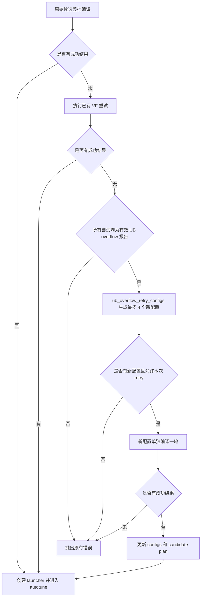

# UB overflow retry：如何从失败的最小 tile 继续生成 config

`ub_overflow_retry_configs()` 从第一轮编译失败的候选中选出一个小 tile，利用编译器报告的
UB 需求与可用容量估算缩小目标，然后沿固定的逐轴下降路径，返回最多 4 个新 config。
它只生成候选，不调用编译器，不修改传入的 config；生成的候选仍要交给编译器确认是否可用。

本文对应提交 [`448cd7439d`][commit]、[PR !48470][pr]，关联 [Issue #5625][issue]。
源码以该提交的 [`runtime/tile_generator.py`][generator] 和
[`runtime/triton_heuristics.py`][heuristics] 为准，路径均相对于 `torch_npu/_inductor/`。
初始 TileGenerator 的搜索规则沿用基线；本文重点解释编译失败后怎样继续生成配置。
历史初始候选搜索方案见[第 05 项详解](model-fix-05-tiling-resource-20261022.md)。

## 要解决的问题：原有候选都太大，但更小的 tile 可能可用

NFNet 派生 pooling kernel 的原始候选有 20 个，包含不同 tile 大小及编译选项组合。
其中不同的 XBLOCK 为 `4096、8192、16384、32768`，编译均发生 UB overflow。
最小的 `XBLOCK=4096` 报错为：

```text
ub overflow, requires 2097152 bits while 1769472 bits available!
```

这里的单位是 bit：需要 `2097152 / 8 = 262144` 字节，即 256 KiB；
实际可用 `1769472 / 8 = 221184` 字节，即 216 KiB。
原始候选没有覆盖更小的 tile，原有 VF 重试也未找到可编译结果，最终没有可用二进制。

retry 使用这个编译反馈继续生成小 tile。它不把 pointer 数或 load 数直接当成同时存活 buffer 数，
也不尝试精确模拟 UB 分配；容量报错只用于缩小搜索起点。

tile 是一次处理的数据分块，config 是指定 tile、编译模式及其他选项的 `triton.Config`。
同一个 XBLOCK 可以对应多个 config，所以“20 个配置”和“4 种 tile 大小”并不矛盾。

## 调用边界：先完成整轮编译，再生成一批新候选



入口限制由外层负责：仅普通 `NPUCachingAutotuner` 支持本次 UB retry；
costmodel 等子类、自定义 kernel、grouped 场景不追加本次搜索。
原候选有任何成功结果、出现任何非 UB overflow 错误，或容量报错无法完整解析，都不会触发搜索。

`precompile` 在这里负责将 config 编译成二进制。单配置 `_precompile_config()` 与基线一致，
新逻辑放在整批编译的结果汇总和外层调度中。搜索不与尚未完成的编译任务同时修改候选空间。

## 函数入参及其来源

```python
def ub_overflow_retry_configs(
    configs, failures, inductor_meta, constexpr_names, runtime_block_names=(),
    persistent_reduction=False, max_configs=4,
):
```

| 入参 | 含义和来源 | 示例 |
| --- | --- | --- |
| `configs` | 原始候选列表；调用方先执行 `unique_configs(self.configs)`。不是原始候选与 VF 副本拼接后的列表 | `Config({"XBLOCK": 4096, "multibuffer": False}, num_warps=1)` |
| `failures` | 已结束的编译尝试反馈，每项为 `(cfg, required, available)`；容量单位均为 bit，可能包含原始和 VF 编译变体 | `(cfg, 2097152, 1769472)` |
| `inductor_meta` | 提供轴名、参与 tiling 的轴编号和轴约束；本函数使用下表四个字段 | `axis_names=["x0", "r1"]` |
| `constexpr_names` | 从 DSL 函数的 `arg_names` 和 `constexprs` 提取的编译期参数名集合，不包含参数值 | `{"X0BLOCK_SUB", "R1BLOCK_SUB"}` |
| `runtime_block_names` | 运行时 block 参数名；配置匹配和去重时忽略这些字段的值 | `("X0BLOCK",)` |
| `persistent_reduction` | 是否按 persistent 约束保护归约轴；当前调用方对 `PERSISTENT_REDUCTION` 和 `TEMPLATE` 两种 heuristic 传 `True` | 为 `True` 时保留 R tile，仅缩小可变 X tile |
| `max_configs` | 最多检查和收集的新候选位置数，默认 4；可能返回少于 4 个配置 | `4` |

`inductor_meta` 中的相关字段：

| 字段 | 如何使用 |
| --- | --- |
| `axis_names` | 将轴编号映射成名字，例如轴 0 对应 `x0`、轴 1 对应 `r1` |
| `tiling_axis` | 指定参与 tiling 的轴编号及其顺序；这个顺序也决定逐轴缩小时的优先级 |
| `requires_no_linear_block_remap` | 为 `True` 时查找 `<AXIS>BLOCK`，否则查找 `<AXIS>BLOCK_SUB` |
| `no_loop_axis` | 显式要求保持整轴、不能继续切小的轴编号 |

返回值是 `list[Config]`。元数据不足、没有有效起点或没有允许缩小的轴时，返回 `[]`。
“只能追加一次”由外层 `_ub_retry_attempted` 控制，不是该函数自身记录的状态。

## 第一步：确定哪些 DSL block 是搜索维度

函数按 `tiling_axis` 遍历轴，拼出参数名，再与 `constexpr_names` 求交：

```python
name = axis_names[axis].upper() + ("BLOCK" if remap else "BLOCK_SUB")
if name in constexpr_names:
    block_names.append((axis, name))
```

例如：

| 轴名 | `requires_no_linear_block_remap` | 查找参数 |
| --- | --- | --- |
| `x` | `True` | `XBLOCK` |
| `x0` | `False` 或未设置 | `X0BLOCK_SUB` |
| `r1` | `False` 或未设置 | `R1BLOCK_SUB` |

假设 DSL 的运行时参数为 `X0BLOCK`，编译期参数为 `X0BLOCK_SUB`、`R1BLOCK_SUB`，
搜索维度就是后两者。`constexpr_names` 只提供名字，实际大小从每个 config 的 kwargs 中取。
DSL 里直接写死、没有暴露为对应 constexpr 参数的轴不会被改写。

没有 `axis_names`、`tiling_axis`，或者找不到任何对应 constexpr block，就不生成新配置。

## 第二步：匹配 UB 报告，并选一个原始 config 作为起点

### 为什么需要 `key(cfg)`

原始 config 可能带着运行时 block 和 `split_blocks`，实际编译变体则可能已经剥离这些字段。
直接比较完整 config 会导致明明来自同一编译配置的失败反馈无法匹配。

`key(cfg)` 按下面的内容构造比较键：

| 内容 | 是否进入 key |
| --- | --- |
| `num_warps`、`num_stages`、`num_ctas`、`maxnreg` | 保留 |
| `runtime_block_names` 中列出的字段 | 忽略 |
| `split_blocks` | 忽略 |
| `enable_vf_fusion` | 转成单独的布尔值保留，不再重复放进 kwargs 部分 |
| 其余 kwargs，例如 block、`compile_mode`、`multibuffer` | 按名字排序后保留 |

例如，只有运行时 `X0BLOCK` 不同，而编译期 block 和其他选项相同的配置，可以匹配到同一个 key。
没有设置 VF 与显式 `False` 归到同一布尔值；VF=True 则是另一个 key。
因此不会把 VF=True 的 UB 报告直接套给 VF=False 的原始起点。

### UB 报告怎样保留

仅接受 `required > available > 0` 的反馈。如果同一个 key 有多条报告，代码使用：

```python
required * previous_available < previous_required * available
```

这等价于比较 `required / available`，保留超容量比例更小的报告。
这是偏乐观的反馈选择，后续仍以真实编译是否成功为准；并不是选最大的 UB 报告作为严格上界。

外层已经要求所有尝试均为有效 UB overflow，才调用本函数。
函数自身仍会过滤无效反馈，这是外层触发条件与内部输入处理的两层职责。

### 起点怎样选

先从原始 `configs` 筛选能匹配有效 UB 报告、且所有参与计算的 block 都为正整数的配置。
候选体积定义为：

```text
volume(cfg) = block_names 中全部 block 值的乘积
```

例如 `XBLOCK=4096` 的体积是 4096，`X0BLOCK_SUB=32, R1BLOCK_SUB=512` 的体积是 16384。
它表示参与搜索的 tile 元素数量指标，不是全局输入 numel，也不是 UB 字节数。

选择规则为：

```python
seed = min(seeds, key=lambda cfg: (
    volume(cfg),
    bool(cfg.kwargs.get("multibuffer", False)),
))
```

先选最小体积，体积相同则优先 `multibuffer=False`；再相同则保留原列表中的先后顺序。
没有设置 multibuffer 时，这里的排序值也按 `False` 处理，后端实际默认行为仍由编译器决定。
它不会比较所有配置的预测性能，也不会从每个原始 config 分别展开搜索。

同时计算 `minimum_volume`，即所有原始合法 config 中的最小体积。
这个量决定后续新配置必须比原候选小到什么程度；它与“匹配到 UB 报告的起点”是两个概念。

## 第三步：从报错容量推算目标体积

核心公式为：

```python
target_volume = min(
    minimum_volume - 1,
    volume(seed) * available * 4 // (required * 5),
)
```

第二项采用的近似关系是：

```text
新 tile 的预计 UB 需求 ≈ 起点 UB 需求 × 新体积 / 起点体积

目标体积 ≈ 起点体积 × 可用 UB / 起点 UB 需求 × 0.8
```

`4 / 5` 将预计需求控制在可用容量的 80%，为对齐、固定 buffer 和非线性编译行为留出余量。
`minimum_volume - 1` 则把目标限制在原始最小 tile 以下。两处容量使用同一 bit 单位，
比值中无需先转为字节。

这不是精确的峰值 UB 估算。固定 buffer、padding、multibuffer 和编译优化可能使 UB 需求不按体积线性变化。
函数没有据此断言新配置一定可编译，只用估算结果减少明显过大的候选尝试。

## 第四步：确定真正允许缩小的轴

`block_names` 用于计算体积，`shrink_names` 才是可以被修改的参数列表：

```python
shrink_names = [
    name for axis, name in block_names
    if axis not in fixed_axes
    and not (persistent_reduction and axis_names[axis].startswith("r"))
]
```

因此，以下两种轴保持原值：

- `no_loop_axis` 中显式保护的轴。
- persistent 模式下名字以 `r` 开头的归约轴。

被保护的 block 仍参与 `volume` 的乘积。例如 R 固定为 512 时，体积是 `X * 512`，不能只按 X 估算目标。
真正的运行时 block 通过 constexpr 名字筛选不进入可变维度；`runtime_block_names` 另用于匹配和去重。

如果 `shrink_names` 为空，返回 `[]`。起点随后通过 `copy.deepcopy(seed)` 复制，
搜索只改变副本中允许缩小的 block，其余 config 字段沿用起点。

## 第五步：`descend()` 每次只缩小一个轴

```python
def descend():
    for name in shrink_names:
        value = candidate.kwargs[name]
        if value > 1:
            candidate.kwargs[name] = 1 << ((value - 1).bit_length() - 1)
            return True
    return False
```

新值是严格小于当前值的最大 2 的幂：

| 当前值 | 下一步 |
| ---: | ---: |
| 4096 | 2048 |
| 2048 | 1024 |
| 3000 | 2048 |
| 3 | 2 |
| 2 | 1 |
| 1 | 当前轴无法继续缩小 |

对已经是 2 的幂的值，这相当于减半；非 2 的幂则先落到下方最近的 2 的幂。
每次调用都从 `shrink_names` 的第一个轴重新开始，找到一个大于 1 的轴就修改并返回。
所以第一个可变轴降到 1 后，才会缩小第二个轴。

例如两个轴都允许缩小时，完整下降路径示意为：

```text
(32, 64) → (16, 64) → (8, 64) → (4, 64) → (2, 64) → (1, 64)
                                                              ↓
                                 (1, 8) ← (1, 16) ← (1, 32)
```

顺序来自 metadata 的 `tiling_axis`，函数不会重新分析 stride 决定优先级。
默认只收集达标后的最多 4 步，未必会走到第二个轴；也不会分支探索 `(16, 32)` 等组合。
这是单条下降路径，不是所有轴取值的组合枚举。

## 第六步：先定位追加起点，再收集最多 4 个 config

这里有两个循环，作用不同。

```python
while volume(candidate) > max(1, target_volume):
    if not descend():
        break
```

这个循环只在内存中缩小 config，直到不超过目标，或已经没有轴能继续缩小。
中间经过的值不加入返回列表，也不会被编译。

接下来才开始收集：

```python
seen = {key(cfg) for cfg in configs}
extra_configs = []
for _ in range(max_configs):
    candidate_key = key(candidate)
    if volume(candidate) < minimum_volume and candidate_key not in seen:
        extra_configs.append(copy.deepcopy(candidate))
        seen.add(candidate_key)
    if not descend():
        break
```

每个返回项必须严格小于原始最小体积，并且 key 未出现在原始配置和已新增配置中。
这里要求的是体积更小，不要求每一根轴都严格小于所有原候选。
`max_configs=4` 限制的是这段循环检查的候选位置数；如果位置被过滤，不会额外补齐到 4 个。

停止条件包括达到本次数量上限、所有可缩小轴已经为 1。
如果原始最小体积已经为 1，就没有更小的正整数体积可追加。

还有一个有意保留的边界行为：目标值用 `max(1, target_volume)` 保护，且下降到底时允许跳出。
因此，如果固定轴导致最小可达体积仍高于估算目标，只要它严格小于原始最小体积，仍可能被返回。
例如 persistent R 固定为 512，即使估算目标小于 512，`X=1, R=512` 仍可交给编译器尝试。
这样不会仅因线性估算过于悲观，就直接放弃最小可达 tile。

## NFNet 实际例子：4096 如何变成 2048、1024、512、256

原始最小候选和报错为：

```text
seed XBLOCK  = 4096
minimum      = 4096
required     = 2097152 bits = 256 KiB
available    = 1769472 bits = 216 KiB
target       = min(4095, floor(4096 × 216 / 256 × 0.8))
             = 2764
```

| 阶段 | XBLOCK | 判断 | 是否加入返回列表 |
| --- | ---: | --- | --- |
| 起点 | 4096 | 大于目标 2764 | 否 |
| 内存中下降一次 | 2048 | 已不超过目标，结束定位循环 | 进入收集阶段 |
| 收集第 1 项 | 2048 | 小于原始最小值且不重复 | 是 |
| 收集第 2 项 | 1024 | 继续下降且不重复 | 是 |
| 收集第 3 项 | 512 | 继续下降且不重复 | 是 |
| 收集第 4 项 | 256 | 达到本次候选数量上限 | 是 |

返回列表为 `[2048, 1024, 512, 256]`，并继承起点的 `compile_mode`、multibuffer 等配置。
本例选到的起点为 `multibuffer=False`，编译模式为 `simd_simt_template`。
函数不会为这 4 个新 tile 再分别枚举 multibuffer、warps 或其他 mode 的组合。

本例定位阶段只下降了一次。如果报错估算出的目标是 600，则路径会先在内存中经过
`4096 → 2048 → 1024 → 512`，再从 512 开始收集，返回 `512、256、128、64`。
后一个数值例子是规则演示，不是该 NFNet kernel 的实际报错。

## 固定 R 的示意例子：只缩小 X，保留运行时 block

以下是独立的参数演示，不代表某个模型的实际报错：

```python
cfg.kwargs = {
    "X0BLOCK": 64,
    "X0BLOCK_SUB": 32,
    "R1BLOCK_SUB": 512,
    "split_blocks": (64,),
    "compile_mode": "simd_simt_template",
}
inductor_meta = {"axis_names": ["x0", "r1"], "tiling_axis": [0, 1]}
constexpr_names = {"X0BLOCK_SUB", "R1BLOCK_SUB"}
runtime_block_names = ("X0BLOCK",)
persistent_reduction = True
required, available = 4194304, 2097152
```

起点体积为 `32 * 512 = 16384`，估算目标为 `floor(16384 * 0.5 * 0.8) = 6553`。
R 受 persistent 约束保护，X 可以缩小：

| X0BLOCK_SUB | R1BLOCK_SUB | 体积 | 处理方式 |
| ---: | ---: | ---: | --- |
| 32 | 512 | 16384 | 原始起点 |
| 16 | 512 | 8192 | 高于目标，定位阶段跳过，不编译 |
| 8 | 512 | 4096 | 第 1 个新候选 |
| 4 | 512 | 2048 | 第 2 个新候选 |
| 2 | 512 | 1024 | 第 3 个新候选 |
| 1 | 512 | 512 | 第 4 个新候选，X 已不能继续缩小 |

四个结果的运行时 `X0BLOCK=64`、`split_blocks=(64,)` 和编译模式均保持原值。
体积计算包含固定 R，但实际修改只发生在 `X0BLOCK_SUB`。

## 可直接执行的候选生成示例

在安装了本文提交对应 torch_npu 的环境中运行以下代码。它调用真实候选生成函数，
使用构造的容量反馈演示 NFNet 数值，不加载模型，也不运行设备 kernel。

```bash
python - <<'PY'
from torch._inductor.runtime.triton_heuristics import Config
from torch_npu._inductor.runtime.tile_generator import ub_overflow_retry_configs

configs = [
    Config({
        "XBLOCK": size,
        "compile_mode": "simd_simt_template",
        "multibuffer": False,
    }, num_warps=1)
    for size in (32768, 16384, 8192, 4096)
]
failures = [(cfg, cfg.kwargs["XBLOCK"] * 512, 1769472) for cfg in configs]
meta = {
    "axis_names": ["x"],
    "tiling_axis": [0],
    "requires_no_linear_block_remap": True,
}
extra = ub_overflow_retry_configs(configs, failures, meta, {"XBLOCK"})
print("original:", [cfg.kwargs["XBLOCK"] for cfg in configs])
print("retry:", [cfg.kwargs["XBLOCK"] for cfg in extra])
assert [cfg.kwargs["XBLOCK"] for cfg in extra] == [2048, 1024, 512, 256]
PY
```

预期输出：

```text
original: [32768, 16384, 8192, 4096]
retry: [2048, 1024, 512, 256]
```

## 生成之后如何编译、更新状态和处理失败

外层将返回项与原始 config 组成临时列表，构建临时 candidate plan，
只提取新增候选对应的编译变体，执行：

```python
compile_results = compile_fn(extra_variants, allow_vf_retry=False)
```

这里的 `allow_vf_retry=False` 禁止新候选失败后自动再补一轮 VF 编译，不会把 config 中的
`enable_vf_fusion` 强制设为 False。VF 重试属于基线已有逻辑，其做法是复制原 config，
设置 `enable_vf_fusion=True` 再编译一次；本次 helper 沿用 seed 的编译选项。

VF 是 Vector Function，VF fusion 是底层向量函数的融合选项。本次 NFNet 编译环境已经提示
`enable_vf_fusion` 弃用且不再传给 NPU 编译器；因此下表的 VF 20 项指 Inductor 层的编译尝试数，
不表示这个环境实际切换了底层融合开关。追加批次的有效变化来自更小的 tile。

`_ub_retry_attempted` 在开始新增批次前置位，避免重复追加。新增批次至少有一个结果成功后，
才更新 `self.configs`、`self.candidate_plan`、`self.compile_results`。
没有更小候选、场景不允许追加、或新增批次全部编译失败时，外层重新抛出第一轮的
`NoTritonConfigsError`；新增批次失败不会替换第一轮的编译报错，也不会发布临时候选列表和映射。

## 已有验证、搜索范围与局限

去敏后的数量、容量和版本记录见[验证摘要][validation]。

| 验证 | 实际代码版本 | 结果和边界 |
| --- | --- | --- |
| NFNet 原始 kernel 的编译重放，2026-10-24，Ascend A5 | 历史提交 `66ac527207` | 原始 20 项和 VF 20 项全部 UB overflow；追加 4 项全部编译成功；共 44 次编译尝试，最终候选数 24；未 launch kernel |
| UB retry 单测，2026-10-24，PyTorch/torch_npu 2.13 环境 | 当前提交 `448cd7439d` | 18 项通过，覆盖候选生成、串并行、整批结果边界、固定轴、混合错误和 retry 失败保留原异常 |
| precompile 无设备初始化邻近回归，同日、同环境 | 当前提交 `448cd7439d` | 2 项通过 |

NFNet 编译重放早于最终的“保留第一轮错误”调整；两个版本的 `tile_generator.py` 文件内容完全相同，
Git blob 均为 `bb4476e5d6082d8ba6eb764ce5746d6dc9e4f6ce`。
候选生成数值与该次重放一致，但不将历史重放写成当前最终提交的整模型验证。
本次文档整理未重跑设备测试；文中的一维和固定 R 示例另经 CPU 执行真实 helper 的函数体核对，
使用轻量配置对象，不代表真实编译或设备精度检查。

原始轮次没有全部 UB 失败时，新搜索开销为零；触发时最多额外编译 4 个新候选。
定位目标阶段可能经过多个更大 tile，但只是整数计算，不增加编译次数。
本次不扩大正常路径的初始候选列表，也不追加所有 compile mode、multibuffer 和多轴组合。

这个限制保留了明确的适用边界：

- 单条下降路径可能漏掉其他轴组合里的可行配置，找到的配置也未必是性能最优。
- 体积与 UB 需求近似成比例是启发式；20% 余量不是容量证明。
- 只保留一个 seed 的其他选项，可能漏掉其他选项搭配下才可编译的配置。
- 固定轴或固定 buffer 已经占满 UB 时，缩小允许修改的轴也可能无效。
- 重试配置需要真实编译和后续 autotune，编译成功本身不证明整模型精度或性能。

[commit]: https://gitcode.com/luqichao/pytorch_new/commit/448cd7439d90e47f3a7418468838d83340b263a8
[pr]: https://gitcode.com/Ascend/pytorch/merge_requests/48470
[issue]: https://gitcode.com/Ascend/pytorch/issues/5625
[generator]: https://gitcode.com/luqichao/pytorch_new/blob/448cd7439d90e47f3a7418468838d83340b263a8/torch_npu/_inductor/runtime/tile_generator.py
[heuristics]: https://gitcode.com/luqichao/pytorch_new/blob/448cd7439d90e47f3a7418468838d83340b263a8/torch_npu/_inductor/runtime/triton_heuristics.py
[validation]: ../../../artifacts/cicd/ub_overflow_retry_20261024/validation_summary.json
