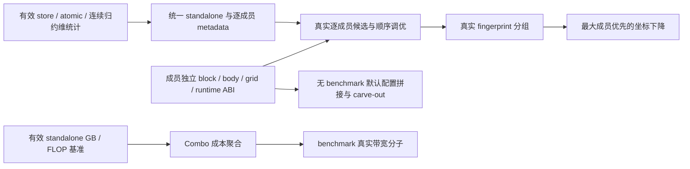

# 2.13 Combo/foreach 最新结果与问题分析

<a id="validation213"></a>

<!-- combo-section:validation213:start -->
## 最新执行结果

2026-11-13 在 NPU_A5 Docker 的 `pta_213_case` 环境，按固定 CSV 全量重新收集和执行 105 个源方法、464 个参数实例。CSV 的 116 行包含 11
个随外层方法验证的嵌套函数。实例结果为 **419 PASS、35 FAIL、10 SKIP**；没有抽样或复用旧执行结果。

| 范围 | PASS | FAIL | SKIP |
| --- | ---: | ---: | ---: |
| 2.10 重合范围 60 个方法 | 57 | 3 | 0 |
| 2.10 重合范围 413 个实例 | 410 | 3 | 0 |
| 重合范围外 45 个方法 | 6 | 30 | 9 |
| 重合范围外 51 个实例 | 9 | 32 | 10 |
| 全量 105 个方法 | 63 | 33 | 9 |
| 全量 464 个实例 | 419 | 35 | 10 |

### 验证版本与范围

torch_npu `2.13.0.dev20261113`，提交 `44555141711c0c825c5a201e303dcadad1f5fcb4`。

PyTorch `2.13.0+cpu`，提交 `cf30153c4c131c8164ee7798e5022d810682e2cb`；Triton `3.6.0`。

物理卡 1、2、3，每卡两个进程，Inductor/Triton 缓存和日志独立；没有生产代码 overlay。

测试分支 `fix/combo-213-210-overlap`，提交 `a3cfe564cd60cb83f4c81bab5dcd388305992ff2`，main 基线
`91435bdf732e772c3240329797a9a29166ce533a`。

执行时间：北京时间 2026-11-13 18:58:49 至 2026-11-13 20:11:18。

Community 分支只包含与既定 60 个重合方法相关的适配，修改 3 个文件、30 个方法；范围外测试修改未迁入该分支。仅本轮验证副本加上 TMA 和三个 PDL 方法的硬件 SKIP，方法
body 和断言保持原内容。foreach 按已确认口径保留数值、mutation、布局和梯度检查，NPU 不要求 CUDA 单 kernel／FOREACH 专属结构。

执行前后 301 个测试文件、588 个 Torch/NPU Inductor Python 文件哈希一致；其中 194 个 NPU Inductor Python
文件与实际包提交逐项一致。三卡基础计算均通过。全部分片 JUnit 已独立重新解析，464 个实例无遗漏或跨分片重复。

[2.13 PASS 清单][pass213]保留 2.10 重合范围口径，当前为 410 个实际 PASS 实例，在 2.13 NPU 测试目录执行；[全范围
PASS][all-pass]另存在本轮证据目录。2.10 原生 397 条清单保持不变。既定 60 方法适配范围与 2.10 原生 54 方法清单的口径不同，本轮用 [60
方法范围清单][overlap]精确划分。

`test_combo_autotune_grouping_by_metadata_fingerprint` 直接调用社区 helper 和模拟 metadata；其 PASS 证明该 helper
的分组规则，本轮未验收真实 NPU 成员 metadata 到该分组的连接。

[当前 CSV][csv]保持原文件名、116 行顺序及五列，所有行均来自本轮结果。[方法与逐实例报告][jobs]、[完整环境和分片证据][evidence]、[JUnit
交叉核对][junit]及[Community 范围审计][scope]可追溯当前结论。

<!-- combo-section:validation213:end -->

<a id="analysis213"></a>

<!-- combo-section:analysis213:start -->
## 当前问题与按根因排序的修复队列

原全量共有 **33 FAIL、9 SKIP 方法**。其中 **37 个非硬件方法（33 FAIL＋4 软件 SKIP）**进入根因队列，包括 2.10 重合范围的 3 个 FAIL；另 5 个硬件/平台协议方法保留 SKIP。下表按生成正确性、真实统计、出口、成员 ABI、调优与功能验收的依赖排序；同一用例可以覆盖多个根因。

**R 表示已定位的根因/能力或验收缺口，D 表示仍需定界的数值/轴映射或原生优化契约。**本轮只定位和整理，未实施生产修复、未扩张 Community 分支范围。原 CSV、410 条重合范围 2.13 PASS 清单和原全量结果不由补充诊断改写；未实现的软件目标在后续正式适配中应保持 FAIL，只有硬件差异或明确不再支持的目标可 SKIP。

全部证据固定在实际安装的 Torch/NPU 提交。[结构化根因队列及 42 方法/45 个非 PASS 实例覆盖审计][root-queue]和[10 项有效补充诊断][root-evidence]可逐项追溯；无效的早期 hook/仍未解除 skip 的记录已排除。

这里的“成员”是 Combo 中保留独立计算域的一条分支。ABI 指生成 body 与 launcher 之间参数名、类型和值的约定；TTIR 是 Triton 编译的中间表示，校验失败后可能退回普通 kernel。CSE（公共子表达式消除）用缓存复用相同计算，计数应排除这类复用。block tensor 是 DSL 中向量/矩阵形状的值，标量只有一个值。fingerprint 由真实尺寸和优化字段判断候选是否等价；坐标下降在固定其他配置时，依次改变一组分块参数并实测。

### 根因队列

| 优先级 | 根因/定位项 | 当前判定 | 前置依赖 | 覆盖方法 |
| --- | --- | --- | --- | ---: |
| P0 | [D01 非连续多轴 FP32 sum 超差，数值责任模块尚未定界](#root-d01) | 仍 FAIL；同输入证据已固定，根因待定界 | — | 1 |
| P0 | [R01 persistent 多轴归约的 store 指针是标量，结果却是 block tensor](#root-r01) | 生成缺陷已实测确认；未修复 | — | 2 |
| P0 | [R02 argmin/argmax 的轴索引实际 int32，却被 CSE 标成 int64](#root-r02) | 生成缺陷已在原 pytest 实测确认；未修复 | — | 1 |
| P0 | [R03 动态 shape/stride 符号被当成 masked subblock 的迭代轴](#root-r03) | 生成前缺陷已实测及源码确认；未修复 | R06 门控已在诊断解除 | 1 |
| P0 | [D02 动态归约 DSL 引用了未定义 x0，轴映射的具体根因待定界](#root-d02) | 失败 DSL 已确认；生成规则仍待定位 | R03 | 1 |
| P0 | [R04 动态整数 index_expr 在实际 cast 前被声明为 FP32](#root-r04) | 生成缺陷已实测及版本源码对照确认；未修复 | R06 门控已在诊断解除 | 1 |
| P1 | [R05 eager contiguous(memory_format=channels_last) 被 NPU 公共接口拒绝](#root-r05) | 原 eager 前置失败已确认；未修复 | — | 1 |
| P1 | [R06 通用软件测试被旧 NPU/XPU decorator 提前跳过](#root-r06) | 门控原因已确认；补充诊断 3 PASS、1 FAIL，正式分支未改 | — | 4 |
| P1 | [R07 测试固定匹配 CUDA Grid1D/XBLOCK/size_hints，未读取 NPU 真实 ABI](#root-r07) | 测试观测不兼容已确认；功能目标保留 | — | 3 |
| P1 | [R08 profiler JSON 读取器只接受 traceEvents 字典，不接受 NPU 列表](#root-r08) | 测试数据解析根因已确认；后续 grid 尚未验收 | 仅布局分支依赖 R05 | 2 |
| P1 | [R09 Native Index 的有效普通/归约 store 没有维护 num_store](#root-r09) | producer 缺口已由源码确认；原用例先停在成员字典缺失 | — | 3 |
| P1 | [R10 Native Index 发出 atomic_add，却没有设置 atomic_add_found](#root-r10) | producer 缺口已由源码确认；相关原图未触发原子加验收 | — | 2 |
| P1 | [R11 Native Index load/store 未维护连续归约维布局状态](#root-r11) | producer 缺口已由源码确认；原用例先停在成员字典缺失 | — | 1 |
| P1 | [R12 standalone/Combo 没有统一 per-kernel 统计出口，Combo 缺逐成员 metadata](#root-r12) | 出口缺口已由原断言和源码确认；未修复 | R09、R10、R11 | 7 |
| P1 | [R13 standalone 的 FLOP 估算没有导出为 kernel_flop](#root-r13) | 出口缺口已由源码确认；原比较先停在 Combo GB | — | 1 |
| P1 | [R14 Combo 没有聚合成员访存 GB/FLOP，也未在 profile 模式导出 GB](#root-r14) | Combo 成本出口缺口已由原断言和源码确认；未修复 | R13 | 2 |
| P1 | [R15 Combo benchmark 带宽分子 num_gb 被硬编码为 0](#root-r15) | 独立 benchmark 出口缺口已由原断言和源码确认；未修复 | R14 | 1 |
| P1 | [R16 Combo 未导出 optimize_mem 的图阶段取值，训练前向错误依赖默认 True](#root-r16) | 图阶段 metadata 缺口已确认；尚未证明输入污染 | — | 2 |
| P1 | [R17 provenance 接收 node=None 的 Combo 外壳，真实分区 origins 被跳过](#root-r17) | 追踪映射缺口已由原产物和源码确认；未修复 | — | 1 |
| P2 | [R18 per_subkernel_blocks 在 NPU scheduling 接入时丢失，body/grid 共用 block ABI](#root-r18) | 独立成员分块能力缺口已由源码确认；未实现 | — | 9 |
| P2 | [R19 NPU override 绕过无 benchmark 的默认配置拼接和 carve-out](#root-r19) | 默认配置处理能力缺口已由源码确认；未实现 | R18 | 3 |
| P2 | [R20 NPU runtime 没有逐成员候选的 Combo 顺序调优消费者](#root-r20) | 独立成员调优能力缺口已由源码确认；未实现 | R18、R12 | 3 |
| P2 | [R21 真实 NPU 成员 metadata 未接入 fingerprint 调优分组](#root-r21) | 分组输入/消费链缺口已由源码确认；未实现 | R12、R18、R20 | 1 |
| P2 | [D03 共享/独立 X 模式的 max_persistent_rblock 原生资源契约待明确](#root-d03) | 原 False 实例 FAIL；True 实例 PASS 不证明独立 ABI | R18、R20 | 1 |
| P2 | [D04 RMSNorm add_persistent_rblock 的资格与 native R 候选对应待确认](#root-d04) | 原首失败是 R12；不能认作 persistent 归约整体缺失 | R12、R18、R20 | 1 |
| P2 | [R22 NPU 有 CoordescTuner 对象和计时缓存，但未执行成员坐标下降](#root-r22) | 成员坐标下降能力缺口已由源码确认；未实现 | R18、R20、R21 | 1 |
| P2 | [R23 共享 launcher 限制异构成员组合，标量链/向量归约被拆为 singleton](#root-r23) | 特定组合能力缺口已由实际分区及源码确认；未实现 | R18；mean 另需 R03/R04/D02 | 2 |
| P2 | [R24 mixed-order 联合归约在 NPU config 固定关闭](#root-r24) | 共享输入行/列联合归约特性未启用，原目标未实现 | — | 1 |
| P2 | [R25 disable_ftz 没有从 NPU codegen 贯通到实际编译选项/数学路径](#root-r25) | 生成/编译消费链缺口已确认；硬件非正规数能力尚未知 | — | 1 |
| P3 | [R26 WideResNet 图没有进入 memory gate，原峰值比较未覆盖拒绝路径](#root-r26) | 验收前提缺失已实测确认；gate 本身已有实现 | — | 1 |

表中覆盖数可以重叠，不能相加当成失败数。R03/R04 对 R06 的依赖是执行测试需解除门控，补充诊断已经完成；它不是需要先做的生产修复。P0 待定位与已确认生成缺陷优先，P1 修入口和事实出口，P2 在依赖齐备后验收新功能，P3 补有效峰值拒绝路径。



### metadata 和七个统计用例具体检查什么

“metadata 2”是两个 `optimize_mem` 图阶段方法，不是缺两个不同 metadata。“统计 7”是四个计数/布局方法加三个成本/带宽方法，不是缺七种计数。下表逐字段说明实际用途和确认到的缺口；成员字典缺失与真实 producer 未维护是不同根因。

| 字段/出口 | 作用 | 当前具体缺口或已有能力 |
| --- | --- | --- |
| `optimize_mem` | 推理/反向 True；训练前向 False。允许或关闭按预算 CPU 备份的内存优化，输入保护仍必须正确。 | [R16](#root-r16)：两个方法缺同一字段的两个阶段取值；native clone 已有，输入污染未被证明。 |
| `inductor_meta_i` | 每个成员自己的统计/优化字典，不能用首成员或空字典代替。 | [R12](#root-r12)：Combo 出口缺失；standalone 也没接统一 per-kernel helper。 |
| `heuristic_i` / `size_hints_i` | 逐成员候选类别与尺寸输入，供默认配置、候选等价分组和独立调优。 | [R12](#root-r12)/[R21](#root-r21)：共同命名出口缺失；NPU 已有真实轴/尺寸的 combo_subkernel_meta。 |
| `reduction_hint_i` | 描述成员归约访问方向；本用例要求行 INNER、列 OUTER。 | [R12](#root-r12)：缺逐成员出口，不能只沿用首成员 hint。 |
| `num_load` | CSE 去除缓存复用后有效 load 数，描述逻辑访存工作量。 | producer 已有；[R12](#root-r12) 没有导出到成员字典。 |
| `num_store` | 有效普通/归约最终写回数，被移除写回不应计入。 | [R09](#root-r09)：Native Index CSEProxy 未维护；[R12](#root-r12) 出口也缺。 |
| `num_reduction` | 归约 primitive 数，为候选和工作量提供输入。 | producer 已有；[R12](#root-r12) 没有导出到成员字典。 |
| `autotune_hints` | 实际成员的候选提示，例如 ONE_ELEMENT_PER_THREAD。 | top-level native 提示已有；[R12](#root-r12) 缺逐成员统一来源/出口。 |
| `atomic_add_found` | 成员是否实际发出原子加，影响候选和写回规则。 | [R10](#root-r10)：Native Index atomic 分支未设置 True；[R12](#root-r12) 出口也缺。 |
| `has_loadstore_with_contiguous_rdim` | 是否有真实连续归约维的 load/保留 store，参与归约候选过滤。 | [R11](#root-r11)：Native Index 未维护布局 producer；[R12](#root-r12) 出口也缺。 |
| `no_x_dim` | per-kernel 的独立非归约维情况，需按真实 NPU split/布局定义。 | dispatch 的 no_x_dim_i 已有；[R12](#root-r12) 的完整 per-kernel 字典未导出。 |
| `tiling_scores` | 各轴 tiling 评价信息，standalone/Combo 的比较需对应 native 候选语义。 | [R12](#root-r12)：未接统一字段出口；不能用空解析作为相同基准。 |
| `kernel_num_gb` | 逻辑读写字节的 GB 估算，供成本/带宽报告使用。 | 普通 kernel 在 profile/benchmark 下已有；[R14](#root-r14) 缺 Combo 聚合和出口。 |
| `kernel_flop` | 按共同规则估算逻辑计算量；Combo 需聚合成员。 | [R13](#root-r13) 缺 standalone 出口，[R14](#root-r14) 缺聚合；不能说估算器整体没有实现。 |
| benchmark `num_gb` | 独立 benchmark 带宽计算的访存分子。 | [R15](#root-r15) 生成入口硬编码 0，需消费 [R14](#root-r14) 的真实 GB。 |
| `max_persistent_rblock` | 原共享 X/HIP 候选资源限制，与真实独立 X 模式有不同约束。 | [D03](#root-d03)：原生 UB/共享与独立约束需明确；True 的负向字段 PASS 未验实际独立 ABI。 |
| `add_persistent_rblock` | 资格标志，让候选生成器增加专门的大 R 配置。 | 原首失败是 [R12](#root-r12)；[D04](#root-d04) 尚需对照 native 实际候选，不能说 persistent 归约缺失。 |
| `disable_ftz` | 控制是否保留非正规数，需要实际编译选项/数学消费者。 | [R25](#root-r25)：codegen、native options 和 Triton Ascend 消费链未接通，硬件能力尚未知。 |

七个方法与字段一一对应如下。原方法多为字段存在性/解析比较；“需验真实值”是完整修复验收要求，不冒充原方法已经检查到真实 producer。

| 统计方法 | 具体目标 | 原首失败/后续依赖 |
| --- | --- | --- |
| `test_combo_pointwise_combo_grid_meta_has_per_subkernel_fields` | 三个 relu/sigmoid/tanh 成员的 load/store/reduction、提示和 atomic 状态 | 缺成员字典 R12；producer 后续 R09/R10。 |
| `test_combo_reduction_combo_grid_meta_has_per_subkernel_fields` | sum/mean 两成员的有效 load/store/reduction | 缺成员字典 R12；store producer 后续 R09。 |
| `test_combo_reduction_deterministic_has_contiguous_rdim_per_subkernel` | 确定性 sum/mean 逐成员连续归约维布局 | 缺成员字典 R12；布局 producer 后续 R11。 |
| `test_combo_per_kernel_inductor_meta_matches_standalone` | 两侧非空完整计数、atomic、no_x_dim、提示和 tiling_scores 相同 | standalone 两项 vs Combo 零项；R12 和 R09/R10。 |
| `test_combo_kernel_num_gb_and_flop_match_standalone_sum` | Combo GB/FLOP 等于有效 standalone 成员之和 | 先缺 Combo GB R14；standalone FLOP 出口 R13 未执行到。 |
| `test_combo_inductor_meta_has_kernel_num_gb_under_profile_bandwidth` | profile-only 导出真实 Combo GB，不导出 FLOP | 先缺 GB R14，后续 FLOP 负向检查未执行。 |
| `test_benchmark_combo_kernel_emits_real_num_gb` | benchmark 实际带宽分子与 NPU device 参数 | 入口 num_gb=0，R15；device 后续检查未执行。 |

### 各根因的证据、入口与完整验收

<a id="root-d01"></a>

#### D01 非连续多轴 FP32 sum 超差，数值责任模块尚未定界

**P0 · 仍 FAIL；同输入证据已固定，根因待定界**。失败阶段：accuracy check。

实测/原首失败：原全量 (16,32,64)、stride (64,1024,1) 的 sum((1,2))：16 个输出中 1 个超差，最大绝对误差 1.1920928955078125e-5，原 atol=1e-5。最终执行同一个
no-linear 普通 kernel 的两次 launch；后续数量断言未执行。

已确认缺陷与尚缺证据：补充诊断保存原方法新构造的同一组输入、NPU eager/compiled 输出和 CPU float64 基准，并记录实际
winner：XBLOCK=2、R0_BLOCK=32、R1_BLOCK=64、compile_mode=simd_simt_template、multibuffer=True。输入 0/1 的 eager 对高精度基准最大误差分别为
8.5845e-6/9.2548e-6，compiled 为 8.9811e-6/1.1516e-5；两种 FP32 结果都有误差，尚不能把责任定为归约树或下层编译器。这组输入不是恢复原全量输入。补充路径也触发
R01，但最终数值失败仍发生在 no-linear 路径。

定位入口：使用已保存输入固定重放该 winner，逐项对齐归约元素集合、两条 R 轴、partial loop、累加 dtype 和写回；定位社区多轴 DSL、NPU 候选 remap 或 Triton 数学路径。无需再跑全量。

完整验收：固定非连续输入在原 dtype 和原容差下通过；数值检查通过后再完成原组合目标。若 R01 修复使图改走 Combo，仍单独保留这个 no-linear 固定输入复现，不能由新路径 PASS 宣称旧路径已修复。

覆盖用例（结果为原全量，非补充诊断）：

- `test_combo_kernels.py::ComboKernelTests::test_combo_kernel_per_config_subkernel_r0_r1`：范围外，1 FAIL；原首失败关联。

证据：[E16][E16]、[E17][E17]；补充诊断 [accuracy-v2][diag-accuracy-v2]；[原全量 wrapper][accuracy-wrapper]与[来源/布局对应][accuracy-source]；[原方法与断言][test-index]；[原逐实例报告][jobs]。

<a id="root-r01"></a>

#### R01 persistent 多轴归约的 store 指针是标量，结果却是 block tensor

**P0 · 生成缺陷已实测确认；未修复**。失败阶段：Native Index DSL → TTIR check → fallback。

实测/原首失败：per_config_subkernel_red 原数值通过，单 Combo 目标期望 1、实际 2。诊断确认两个成员已进入同一分区 [['op0','op1']]，没有被分区拒绝；首个 TTIR 错误是 Value
argument cannot be block type if pointer argument is not a block。

根因与代码证据：NPU triton.py:4021 的 reduction_resize 在 rank=1 时调用 promote_to_tensor；共同 helper:86 把标量提升成 shape=(1,)
tensor。triton.py:3127 的 store_reduction 只在多 R 且非 persistent 时把指针提升为 block；persistent 路径保留 tl.store(out_ptr0 + (x0),
tmp4, None) 的标量指针。整组 Combo 校验失败后，npu_combined_scheduling.py:240 回退到普通 kernel，普通 Native Index 也失败，最终 no-linear 执行。D01
中同类错误是补充观测，不等于数值根因已经定位。

修复入口：修 reduction_resize 与 store_reduction 的通用 rank 契约，让 pointer/value/mask 的形状一致；覆盖
persistent/non-persistent、标量输出和多轴非连续归约。

完整验收：原 red 图数值通过且生成一个实际 Combo，原 X/R 配置要求完整执行；TTIR 校验不再因 rank 错误回退。不改数量期望为 2。D01 的数值目标另行验收。

原始失败 DSL 关键行（保持生成格式）：

```python
                tmp4 = triton_helpers.promote_to_tensor(tl.sum(tmp3, 0))
                tl.store(out_ptr0 + (x0 ), tmp4, None)
```

覆盖用例（结果为原全量，非补充诊断）：

- `test_combo_kernels.py::ComboKernelTests::test_combo_kernel_per_config_subkernel_red`：2.10 重合，1 FAIL；原首失败关联。
- `test_combo_kernels.py::ComboKernelTests::test_combo_kernel_per_config_subkernel_r0_r1`：范围外，1 FAIL；补充生成缺陷关联；最终精度另属 D01。

证据：[E17][E17]；补充诊断 [reduction-v2][diag-reduction-v2]、[accuracy-v2][diag-accuracy-v2]；[原方法与断言][test-index]；[原逐实例报告][jobs]。

<a id="root-r02"></a>

#### R02 argmin/argmax 的轴索引实际 int32，却被 CSE 标成 int64

**P0 · 生成缺陷已在原 pytest 实测确认；未修复**。失败阶段：Native Index DSL → dtype assertion → fallback。

实测/原首失败：原 pytest 数值通过，两个 Combo 目标期望 2、实际 4。补充原 pytest 已复现；速度准入为 True，pointwise 和 min/max 的分区已是
[['op4','op5'],['op0_op1','op2_op3']]。

根因与代码证据：NPU triton.py:4438 的 argreduce 中，logical_index 分支显式 .to(tl.int64)，axis-derived 分支只
tl.broadcast_to(r1.reshape(...), tmp2.shape)，却以 dtype=torch.int64 创建 CSE 变量。实际 r1 是 int32，生成
tl.static_assert(tmp5.dtype == tl.int64) 失败。codegen_combo_kernel 会先校验所有分区，因此 min/max 分区失败连带丢掉合法 pointwise Combo，最终为 4
个普通 kernel。早期手工调用的完成结果不覆盖原 pytest 生命周期下的失败。

修复入口：修 argreduce 索引实际 cast 与 CSE dtype 的一致性，保证 ATen 索引结果的 int64 语义；不要删除 dtype 断言或用更改分区数量掩盖生成错误。

完整验收：原 pytest 数值通过且保留 pointwise、min/max 两个实际 Combo；axis-derived 与非连续 logical-index 两条路径的实际索引 dtype 和 CSE 一致。

原始失败 DSL 关键行（保持生成格式）：

```python
            tmp5 = tl.broadcast_to(r1.reshape([1,R1BLOCK_SUB]), tmp2.shape)
            tl.static_assert(tmp5.dtype == tl.int64)
```

覆盖用例（结果为原全量，非补充诊断）：

- `test_torchinductor.py::CommonTemplate::test_combo_kernel_filter_cpu`：2.10 重合，1 FAIL；原首失败关联。

证据：[E18][E18]、[E17][E17]；补充诊断 [filter-pytest][diag-filter-pytest]；[原方法与断言][test-index]；[原逐实例报告][jobs]。

<a id="root-r03"></a>

#### R03 动态 shape/stride 符号被当成 masked subblock 的迭代轴

**P0 · 生成前缺陷已实测及源码确认；未修复**。失败阶段：LoopBody masked-index analysis → DSL generation。

实测/原首失败：原全量被旧 NPU decorator SKIP。解除门控的原 pytest 首次 Combo 生成在 sympy_index_symbol(sub_axis + "_mask") 触发 assert name[0]
!= "s"；此时还没有失败 Combo DSL。最终数值通过、数量期望 1 实际 3，store mask 断言未执行。

根因与代码证据：NPU codegen/ir.py:1873 的 generate_masked_indexing 把 indexing 表达式各项的所有 free_symbols 并入
index_vars，没有排除动态尺寸/stride；triton.py:315 随后把每个字符串都当成轴名追加 _mask。共同 utils.py:1249 明确禁止用 index-symbol API 创建 s* shape
符号。普通 indexing:4963 本来会跳过 s/ps/i 符号，这条 masked-subblock 路径遗漏了同类约束。

修复入口：从 LoopBody 的真实迭代变量和映射后的活跃 NPU 轴生成 mask 依赖；尺寸系数不应生成 s*_mask。生产端 ir.py 和消费端 masked 必须按同一轴协议处理，不能只删共同 assert。

完整验收：动态 mean 原图不再在 mask 符号构造阶段失败；仍保留真实边界 mask。D02/R04/R23 是同一用例补充诊断暴露的其他问题，必须完成它们后再执行最终 store mask 验收。

覆盖用例（结果为原全量，非补充诊断）：

- `test_torchinductor.py::CommonTemplate::test_combo_kernel_store_mask`：范围外，1 SKIP；解除 gate 的补充诊断关联。

证据：[E19][E19]；补充诊断 [store-mask-open][diag-store-mask-open]；[原方法与断言][test-index]；[原逐实例报告][jobs]。

<a id="root-d02"></a>

#### D02 动态归约 DSL 引用了未定义 x0，轴映射的具体根因待定界

**P0 · 失败 DSL 已确认；生成规则仍待定位**。失败阶段：Native Index ordinary-kernel fallback → TTIR check。

实测/原首失败：R03 导致 Combo 回退后，普通三轴归约定义 y0/x1/r2，load/store 地址仍引用 x0：tl.load(in_ptr0 + (x0 + ks0*r2 + ks0*ks1*x1), ...)，TTIR
报 NameError；y0 的索引和 mask 定义也未进入该 body。

已确认缺陷与尚缺证据：完整 failed-ttir-0.py 已固定；这是生成符号与迭代域不一致，不能归为 Triton 数学能力或 store mask 未实现。尚未捕获
rename_indexing、range_tree_nodes 和 find_axis_in_load_store 前后的同一组轴映射，因此不能断言只改 x0 字符串或只补 y0 定义就是通用修复。

定位入口：沿 triton.py:index_to_str/rename_indexing、codegen_body 的轴使用判定、IndexAnalysis 替换关系继续定界；把原索引、rename 后索引、实际
axis.symbol 和 emission 依赖对应起来。

完整验收：所有地址与 mask 引用均有对应定义，保持原 mean 的维度和 stride 语义；重新生成 DSL 后再完成单 Combo 与最终 store mask 目标。

原始失败 DSL 关键行（保持生成格式）：

```python
                tmp0 = tl.load(in_ptr0 + (x0 + ks0*r2 + ks0*ks1*x1), r2_mask & x1_mask, other=0.0)
```

覆盖用例（结果为原全量，非补充诊断）：

- `test_torchinductor.py::CommonTemplate::test_combo_kernel_store_mask`：范围外，1 SKIP；解除 gate 的补充诊断关联。

证据：[E21][E21]、[E19][E19]；补充诊断 [store-mask-open][diag-store-mask-open]；[原方法与断言][test-index]；[原逐实例报告][jobs]。

<a id="root-r04"></a>

#### R04 动态整数 index_expr 在实际 cast 前被声明为 FP32

**P0 · 生成缺陷已实测及版本源码对照确认；未修复**。失败阶段：Native Index ordinary-kernel fallback → dtype assertion。

实测/原首失败：同一次补充诊断的另一普通 mean 生成 tmp3 = ks0*ks1*ks2（ks* 为整数参数），紧接 tl.static_assert(tmp3.dtype == tl.float32)，然后才 tmp4 =
tmp3.to(tl.float32)，因此校验失败。

根因与代码证据：NPU triton.py:344 的 index_expr 先以请求的非整数 dtype 记录原 indexing.index_str，再单独生成 to_dtype；整数表达式中间值被错误标注。实际 PyTorch
固定提交的对应实现:2390 已在同一个 CSE 生成表达式中显式 cast，并从实际 compute dtype 推导 metadata；NPU override 未采用该契约。

修复入口：对齐 index_expr 实际表达式的 cast 与 CSE dtype/shape，保留整数索引语义和浮点 value-producing 用途；不关闭 runtime_triton_dtype_assert。

完整验收：动态 mean 的整数除数转换为 FP32 后才被标记和检查为 FP32；整数索引用途和原数值目标仍正确。单 Combo 与最终 store mask 目标还依赖 R03、D02、R23。

原始失败 DSL 关键行（保持生成格式）：

```python
    tmp3 = ks0*ks1*ks2
    tl.static_assert(tmp3.dtype == tl.float32)
    tmp4 = tmp3.to(tl.float32)
```

覆盖用例（结果为原全量，非补充诊断）：

- `test_torchinductor.py::CommonTemplate::test_combo_kernel_store_mask`：范围外，1 SKIP；解除 gate 的补充诊断关联。

证据：[E20][E20]、[E18][E18]；补充诊断 [store-mask-open][diag-store-mask-open]；[原方法与断言][test-index]；[原逐实例报告][jobs]。

<a id="root-r05"></a>

#### R05 eager contiguous(memory_format=channels_last) 被 NPU 公共接口拒绝

**P1 · 原 eager 前置失败已确认；未修复**。失败阶段：eager ATen / memory format。

实测/原首失败：原用例先在 eager contiguous(memory_format=channels_last) 报 NPU 仅支持 contiguous 格式；compiled、成员独立分块和 profiler grid
检查均未开始。

根因与代码证据：固定 NPU TensorProperties.cpp:10 先返回已经满足请求格式的 tensor；需要转换时只接受 MemoryFormat::Contiguous，原 channels_last
转换因此被拒绝。责任入口是 eager memory-format 接口，不能根据用例名称直接判为 Inductor 分块失败，也不能由换成任意相同 stride 的输入宣称 channels_last 转换已支持。

修复入口：先明确并补公共 ATen 的 channels_last 转换契约；之后继续原八种布局转换以及 R18/R08 的验收。

完整验收：原 NCHW → channels_last 的 eager/compiled 数值、stride 和布局正确；再完成逐成员分块及真实 launch grid 检查。没有明确不再支持的依据，目标保持 FAIL。

覆盖用例（结果为原全量，非补充诊断）：

- `test_combo_kernels.py::ComboKernelTests::test_combo_kernel_per_config_subkernel_block_size`：范围外，1 FAIL；原首失败关联。

证据：[E11][E11]；[原方法与断言][test-index]；[原逐实例报告][jobs]。

<a id="root-r06"></a>

#### R06 通用软件测试被旧 NPU/XPU decorator 提前跳过

**P1 · 门控原因已确认；补充诊断 3 PASS、1 FAIL，正式分支未改**。失败阶段：test collection / decorator。

实测/原首失败：原全量四个方法仍为 SKIP。只解除软件门控、保留 body 和其他 config decorators 的补充原 pytest：basic、after_extern、dynamic persistent 三项
PASS；store_mask FAIL。

根因与代码证据：两个输入距离用例仅检查图输入依赖深度：basic 捕获 2 个真实 SchedulerNode，min/max 均 0；after_extern 捕获 mm extern 距离 0、foreach 消费者
FusedSchedulerNode 距离 1。它们不要求 NPU FOREACH 专属单 kernel。动态归约没有 XPU intrinsic，补充诊断已形成 sum/mean/max 三成员 NPUComboKernel，实际
benchmark/准入事件与原数值检查完成。store_mask 的真实阻塞另列 R03/D02/R04/R23。

修复入口：后续在获准的测试范围内移除这四个旧软件 skip，以实际功能断言决定 PASS/FAIL。当前仅定位和归档；不把范围外适配迁入已完成的 2.10 重合 Community 分支。

完整验收：输入距离检查的节点集合非空；dynamic 保留动态约束、编译期 autotune 和数值检查；store_mask 在未完成原目标时保持 FAIL。原全量 CSV 的 SKIP 不由补充诊断悄悄改写。

覆盖用例（结果为原全量，非补充诊断）：

- `test_snode_runtime.py::InputDistanceTests::test_foreach_basic`：范围外，1 SKIP；原首失败关联。
- `test_snode_runtime.py::InputDistanceTests::test_foreach_after_extern`：范围外，1 SKIP；原首失败关联。
- `test_combo_kernels.py::ComboKernelDynamicShapesTests::test_dynamic_shapes_persistent_reduction_mixed_x_dim_xpu`：范围外，1 SKIP；原首失败关联。
- `test_torchinductor.py::CommonTemplate::test_combo_kernel_store_mask`：范围外，1 SKIP；原首失败关联。

证据：[E9][E9]、[E10][E10]；补充诊断 [input-basic-open][diag-input-basic-open]、[input-after-open][diag-input-after-open]、[dynamic-gate-open][diag-dynamic-gate-open]、[store-mask-open][diag-store-mask-open]；[原方法与断言][test-index]；[原逐实例报告][jobs]。

<a id="root-r07"></a>

#### R07 测试固定匹配 CUDA Grid1D/XBLOCK/size_hints，未读取 NPU 真实 ABI

**P1 · 测试观测不兼容已确认；功能目标保留**。失败阶段：post-execution FileCheck。

实测/原首失败：single 两种 benchmark 开关的数值和 kernel 数检查已通过，随后固定 Grid1D 匹配失败，实际为 GridNpu。persistent size_hint 已匹配 native
heuristic，固定 CUDA x/r0_ 字典失败；数值检查未执行。per_config_subkernel_per 数值和 generated_kernel_count=1 通过，随后固定 XBLOCK :
tl.constexpr 失败。

根因与代码证据：NPU 使用真实多轴名称、runtime split block 与 native launcher；这些生成 ABI 与 CUDA 字面量不同。size_hint 的共享 split extent 是
x0=1536、R 包络 r1=32；成员真实 R=16/32 应分别核对。per 用例的成员 R=64/512 和完整归约要求仍有效，缺固定字符串不证明 persistent 归约缺失。

修复入口：将观测改为解析 NPU wrapper、真实轴/模式、block 参数和 launch；区分 kernel 定义数、benchmark probe 与实际执行数。

完整验收：single 两种开关均保持两个独立计算且无 Combo；size_hint 覆盖两个成员真实 R 和共享候选包络并完成数值；per 保持实际单 Combo 和两个成员完整 R。不能只删除 FileCheck。

覆盖用例（结果为原全量，非补充诊断）：

- `test_combo_kernels.py::ComboKernelTests::test_single_combo_kernels`：范围外，2 FAIL；原首失败关联。
- `test_combo_kernels.py::ComboKernelTests::test_persistent_reduction_size_hint`：范围外，1 FAIL；原首失败关联。
- `test_combo_kernels.py::ComboKernelTests::test_combo_kernel_per_config_subkernel_per`：2.10 重合，1 FAIL；原首失败关联。

证据：[E1][E1]、[E2][E2]、[E11][E11]；[原方法与断言][test-index]；[原逐实例报告][jobs]。

<a id="root-r08"></a>

#### R08 profiler JSON 读取器只接受 traceEvents 字典，不接受 NPU 列表

**P1 · 测试数据解析根因已确认；后续 grid 尚未验收**。失败阶段：profiler result parsing。

实测/原首失败：yz_overflow 已编译执行，随后 trace_json["traceEvents"] 对实际 list 报 TypeError，真实 grid 及最终数值断言未执行。block_size 原先先被 R05
阻塞，这里是源码确认的后续相同读取目标。

根因与代码证据：测试假定 CUDA profiler 的事件容器和三维 grid；NPU 导出列表并用 native split/一维 dispatch。解析错误不能证明 launch grid 已溢出或已正确。

修复入口：兼容实际 NPU 事件容器，关联执行 wrapper 的最终 kernel launch；原生 launcher 参数是 grid 的判定依据，过滤 autotune 的测量 launch。

完整验收：保留原大尺寸 permute/clone 和数值检查，确认真实 NPU X grid 合法、Y/Z 为 1；布局用例解除 R05 后继续分块/grid 原目标。

覆盖用例（结果为原全量，非补充诊断）：

- `test_combo_kernels.py::ComboKernelTests::test_combo_kernel_yz_overflow`：范围外，1 FAIL；原首失败关联。
- `test_combo_kernels.py::ComboKernelTests::test_combo_kernel_per_config_subkernel_block_size`：范围外，1 FAIL；相关/后续覆盖。

证据：[E1][E1]、[E3][E3]；[原方法与断言][test-index]；[原逐实例报告][jobs]。

<a id="root-r09"></a>

#### R09 Native Index 的有效普通/归约 store 没有维护 num_store

**P1 · producer 缺口已由源码确认；原用例先停在成员字典缺失**。失败阶段：codegen statistics producer。

实测/原首失败：相关原用例首失败是 R12 的 inductor_meta_i 缺失或成员数组为空，尚未检查到真实 num_store 值。

根因与代码证据：NPU triton.py:5524/5535 的自定义 CSEProxy.store/store_reduction 对保留写回直接调用生成函数，未递增 num_store；load 的非缓存计数和 reduction
的计数已经存在。super().__enter__ 后 NPU 又安装自己的 CSEProxy，所以继承共同初始化不能补足被覆盖的统计维护。no-linear 普通 kernel 继承共同 CSE，不能把缺口扩展到全部 NPU 路径。

修复入口：在 Native Index 的有效写回入口按共同的去除/缓存规则维护计数，并与 deferred reduction store 的最终生成一致。

完整验收：真实最终写回有对应计数，被移除 buffer 不计为有效写回；standalone 与 Combo 成员采用相同口径。不填固定 0、也不按 DSL 字符串出现次数替代 CSE 计数。

覆盖用例（结果为原全量，非补充诊断）：

- `test_combo_kernels.py::ComboKernelMetadataTests::test_combo_pointwise_combo_grid_meta_has_per_subkernel_fields`：范围外，1 FAIL；相关/后续覆盖。
- `test_combo_kernels.py::ComboKernelMetadataTests::test_combo_reduction_combo_grid_meta_has_per_subkernel_fields`：范围外，1 FAIL；相关/后续覆盖。
- `test_combo_kernels.py::ComboKernelMetadataTests::test_combo_per_kernel_inductor_meta_matches_standalone`：范围外，1 FAIL；相关/后续覆盖。

证据：[E4][E4]、[E22][E22]；[原方法与断言][test-index]；[原逐实例报告][jobs]。

<a id="root-r10"></a>

#### R10 Native Index 发出 atomic_add，却没有设置 atomic_add_found

**P1 · producer 缺口已由源码确认；相关原图未触发原子加验收**。失败阶段：codegen state producer。

实测/原首失败：原 pointwise 图先停在 R12；其 relu/sigmoid/tanh 并无 atomic_add，不能由字段存在性测试推定原子路径已验证。

根因与代码证据：NPU triton.py:3219 发出 tl.atomic_add 后没有维护 atomic_add_found=True；共同 triton.py:4415
有这一步。这会使后续导出的状态与真实生成操作不一致，即使普通 pointwise 图的默认 False 本来正确。

修复入口：在真实 atomic store 分支维护状态，并让 R12 使用成员状态；覆盖保留/移除写回和 standalone/Combo。

完整验收：无 atomic 的原图为 False；真实保留 atomic_add 的成员为 True，并由候选/写回消费者使用真实值。

覆盖用例（结果为原全量，非补充诊断）：

- `test_combo_kernels.py::ComboKernelMetadataTests::test_combo_pointwise_combo_grid_meta_has_per_subkernel_fields`：范围外，1 FAIL；相关/后续覆盖。
- `test_combo_kernels.py::ComboKernelMetadataTests::test_combo_per_kernel_inductor_meta_matches_standalone`：范围外，1 FAIL；相关/后续覆盖。

证据：[E22][E22]；[原方法与断言][test-index]；[原逐实例报告][jobs]。

<a id="root-r11"></a>

#### R11 Native Index load/store 未维护连续归约维布局状态

**P1 · producer 缺口已由源码确认；原用例先停在成员字典缺失**。失败阶段：index/stride analysis → layout statistics。

实测/原首失败：确定性 sum/mean 原数值通过，随后缺 inductor_meta_i；has_loadstore_with_contiguous_rdim 的成员检查未执行。

根因与代码证据：共同 load/store 按实际 indexing 维护 has_load_with_contiguous_rdim 和 stores_with_contiguous_rdim，最后排除已移除写回。Native
Index 完整 override 没有这两个状态的维护；共用的 block_ptr store 生成 helper 本身也不承担它们的记录。no-linear 的共同路径需单独保留。

修复入口：由实际地址、stride、归约轴以及最终保留 store 推导连续性，再通过 R12 导出；不要直接把默认 False 当作实际布局。

完整验收：连续/非连续归约成员的标志与生成访存对应，保留 deterministic 配置和数值；该字段描述布局，不能把它当成是否支持确定性归约的开关。

覆盖用例（结果为原全量，非补充诊断）：

- `test_combo_kernels.py::ComboKernelMetadataTests::test_combo_reduction_deterministic_has_contiguous_rdim_per_subkernel`：范围外，1 FAIL；相关/后续覆盖。

证据：[E22][E22]、[E4][E4]；[原方法与断言][test-index]；[原逐实例报告][jobs]。

<a id="root-r12"></a>

#### R12 standalone/Combo 没有统一 per-kernel 统计出口，Combo 缺逐成员 metadata

**P1 · 出口缺口已由原断言和源码确认；未修复**。失败阶段：generated metadata / FileCheck / parsing。

实测/原首失败：四个计数/布局方法在缺 inductor_meta_i 或 Combo 成员解析为 0 项时失败；归约方向方法缺 reduction_hint_0；RMSNorm 在缺成员字典时失败，尚未执行
add_persistent_rblock 检查。调优分组日志未出现，R21 的真实输入链未完成。

根因与代码证据：NPU create_inductor_meta:1926 不调用共同 inductor_meta_per_kernel；Combo jit_line:207 只取第一个成员的
metadata。combo_grid_meta:465 没有 inductor_meta_i、heuristic_i、size_hints_i、reduction_hint_i。已有 combo_subkernel_meta
记录真实轴、尺寸、模式并供共享 tiling 搜索，它不能代替逐成员统计字典。no_x_dim_i 的 dispatch 标志已有，但不等于每个 inductor_meta_i 中完整的真实字段。

修复入口：统一 native standalone/Combo 的 per-kernel 元信息来源，先完成 R09/R10/R11，再逐成员导出真实计数、autotune_hints、atomic
状态、布局、no_x_dim、tiling_scores 及归约方向。优化资格的原生对应另见 D04。

完整验收：pointwise 三个成员、sum/mean 两个成员都有非空完整字典；两侧 standalone/Combo 必需字段均完整后再比较真实值。行/列归约分别为 INNER/OUTER，按实际 stride/axis
生成。不能用空字典、复制首成员或纯日志满足目标。

覆盖用例（结果为原全量，非补充诊断）：

- `test_combo_kernels.py::ComboKernelMetadataTests::test_combo_pointwise_combo_grid_meta_has_per_subkernel_fields`：范围外，1 FAIL；原首失败关联。
- `test_combo_kernels.py::ComboKernelMetadataTests::test_combo_reduction_combo_grid_meta_has_per_subkernel_fields`：范围外，1 FAIL；原首失败关联。
- `test_combo_kernels.py::ComboKernelMetadataTests::test_combo_per_kernel_inductor_meta_matches_standalone`：范围外，1 FAIL；原首失败关联。
- `test_combo_kernels.py::ComboKernelMetadataTests::test_combo_reduction_deterministic_has_contiguous_rdim_per_subkernel`：范围外，1 FAIL；原首失败关联。
- `test_combo_kernels.py::ComboKernelTestsMaxAutotune::test_combo_kernel_per_subkernel_reduction_hint`：范围外，1 FAIL；原首失败关联。
- `test_combo_kernels.py::ComboKernelMetadataTests::test_combo_rms_norm_forwards_add_persistent_rblock`：范围外，1 FAIL；原首失败关联。
- `test_combo_kernels.py::ComboKernelTestsMaxAutotune::test_combo_autotune_grouping`：范围外，1 FAIL；相关/后续覆盖。

证据：[E2][E2]、[E4][E4]、[E11][E11]、[E22][E22]；[原方法与断言][test-index]；[原逐实例报告][jobs]。

<a id="root-r13"></a>

#### R13 standalone 的 FLOP 估算没有导出为 kernel_flop

**P1 · 出口缺口已由源码确认；原比较先停在 Combo GB**。失败阶段：standalone cost metadata generation。

实测/原首失败：原数值检查已完成，先在 Combo kernel_num_gb 的空匹配失败；FLOP 聚合检查还未执行。空 standalone 匹配的求和不能视为有效基准。

根因与代码证据：NPU 普通 kernel 在 benchmark/profile 模式生成 kernel_num_gb，但没有 kernel_flop 出口。estimate_flops 的共同估算器仍可继承，当前证据不能说整个
FLOP 估算器未实现。

修复入口：按固定的估算规则和开关导出有效 standalone kernel_flop，明确逻辑计算量口径；先建立非空基准，再做 R14 聚合。

完整验收：benchmark 模式的每个 standalone 具备有效 FLOP 与 GB 基准；profile-only 的原目标仍只导出 GB，原比较不允许空解析对齐。

覆盖用例（结果为原全量，非补充诊断）：

- `test_combo_kernels.py::ComboKernelMetadataTests::test_combo_kernel_num_gb_and_flop_match_standalone_sum`：范围外，1 FAIL；相关/后续覆盖。

证据：[E12][E12]；[原方法与断言][test-index]；[原逐实例报告][jobs]。

<a id="root-r14"></a>

#### R14 Combo 没有聚合成员访存 GB/FLOP，也未在 profile 模式导出 GB

**P1 · Combo 成本出口缺口已由原断言和源码确认；未修复**。失败阶段：Combo cost metadata generation。

实测/原首失败：两个原方法数值通过后缺 Combo kernel_num_gb；FLOP 求和或 profile 不应输出 FLOP 的后续检查未执行。

根因与代码证据：普通 NPU triton.py:2470 已按 benchmark/profile 条件计算逻辑读写字节；Combo 的独立生成路径没有成员成本求和和同期开关出口。kernel_num_gb 是逻辑读写量的 GB
估算，不是 profiler 测得的真实传输量。

修复入口：建立与 standalone 同口径的成员成本，再由实际 Combo 成员聚合并按 benchmark/profile 开关导出。

完整验收：Combo 的 GB/FLOP 与有效 standalone 成员基准之和一致；profile-only 只输出真实 GB；关闭相关开关的已 PASS 目标仍保持其原有无成本字段行为。

覆盖用例（结果为原全量，非补充诊断）：

- `test_combo_kernels.py::ComboKernelMetadataTests::test_combo_kernel_num_gb_and_flop_match_standalone_sum`：范围外，1 FAIL；原首失败关联。
- `test_combo_kernels.py::ComboKernelMetadataTests::test_combo_inductor_meta_has_kernel_num_gb_under_profile_bandwidth`：范围外，1 FAIL；原首失败关联。

证据：[E12][E12]；[原方法与断言][test-index]；[原逐实例报告][jobs]。

<a id="root-r15"></a>

#### R15 Combo benchmark 带宽分子 num_gb 被硬编码为 0

**P1 · 独立 benchmark 出口缺口已由原断言和源码确认；未修复**。失败阶段：benchmark source generation。

实测/原首失败：原数值通过，随后没有匹配到浮点 num_gb；后续 device 参数检查未执行。

根因与代码证据：NPU triton_combo_kernel.py 的独立 benchmark 生成调用 codegen_kernel_benchmark(num_gb=0)，模板没有拿到真实 Combo 访存量。它与 R14 的主
metadata 出口是两个不同接入点。

修复入口：把 R14 同源计算的实际逻辑 GB 传给 benchmark 模板，并核对 native device/launch 参数。

完整验收：benchmark 的 num_gb 为有效正值，与当前 Combo 逻辑访存量一致；保留数值和 NPU device 参数验收。不能仅把 0 改为 0.0 来通过正则。

覆盖用例（结果为原全量，非补充诊断）：

- `test_combo_kernels.py::ComboKernelMetadataTests::test_benchmark_combo_kernel_emits_real_num_gb`：范围外，1 FAIL；原首失败关联。

证据：[E12][E12]；[原方法与断言][test-index]；[原逐实例报告][jobs]。

<a id="root-r16"></a>

#### R16 Combo 未导出 optimize_mem 的图阶段取值，训练前向错误依赖默认 True

**P1 · 图阶段 metadata 缺口已确认；尚未证明输入污染**。失败阶段：graph-phase metadata → autotune input protection。

实测/原首失败：推理和训练前向两个原方法的数值通过，分别缺 optimize_mem=True/False；原训练方法没有完成反向梯度与输入恢复验收。

根因与代码证据：两个方法检查同一个字段的两个阶段。NPU Combo 未显式导出该字段，runtime 用 pop(..., True) 得到默认 True。True 允许按内存预算把待保护 mutation 输入备份到
CPU；False 关闭这一内存优化。两种值都仍需正确保护输入；Native benchmark 的 clone 逻辑已有，字段缺失不能直接证明 alias/mutation 已被污染。

修复入口：在 Combo jit_line 按推理/反向 True、训练前向 False 的图阶段契约传值，核对 NPU save/restore 与 clone 的实际消费路径。

完整验收：两个原字段断言和数值通过；接通消费后用真实 mutation/alias 及训练梯度验证输入备份恢复。False 不应被实现为关闭输入保护。

覆盖用例（结果为原全量，非补充诊断）：

- `test_combo_kernels.py::ComboKernelMetadataTests::test_combo_inductor_meta_has_optimize_mem`：范围外，1 FAIL；原首失败关联。
- `test_combo_kernels.py::ComboKernelMetadataTests::test_combo_inductor_meta_optimize_mem_false_in_training_forward`：范围外，1 FAIL；原首失败关联。

证据：[E5][E5]；[原方法与断言][test-index]；[原逐实例报告][jobs]。

<a id="root-r17"></a>

#### R17 provenance 接收 node=None 的 Combo 外壳，真实分区 origins 被跳过

**P1 · 追踪映射缺口已由原产物和源码确认；未修复**。失败阶段：define_kernel/comment → post-grad provenance。

实测/原首失败：Inductor 执行和 debug trace 已完成，Combo 到 post-grad 映射为空，原目标是一项；第二个 AOTInductor 子场景尚未开始。

根因与代码证据：NPU scheduling.py:500/501 把 [combo_kernel_node] 传给 define_kernel/codegen_comment。该外壳 node=None，共同 provenance
追踪跳过它；实际 kernel 分区 node_group 的真实叶子节点/origins 没有展开传递。

修复入口：按每个实际生成分区展开真实 get_nodes()/origins 给定义与追踪链，避免把外层全部 Combo origins 复制到每个分区。

完整验收：生成 kernel 到真实 post-grad FX 的映射非空且准确；原 Inductor 与随后 AOTInductor 两个场景均完成，不填虚构节点或仅打印 origins。

覆盖用例（结果为原全量，非补充诊断）：

- `test_provenance_tracing.py::TestProvenanceTracingArtifact::test_triton_kernel_to_post_grad_tracing_combo_kernel`：范围外，1 FAIL；原首失败关联。

证据：[E6][E6]、[E23][E23]；[原方法与断言][test-index]；[原逐实例报告][jobs]。

<a id="root-r18"></a>

#### R18 per_subkernel_blocks 在 NPU scheduling 接入时丢失，body/grid 共用 block ABI

**P2 · 独立成员分块能力缺口已由源码确认；未实现**。失败阶段：scheduler metadata → Combo body/grid/runtime ABI。

实测/原首失败：no-bench 两个方法数值和单定义通过后缺三个独立 XBLOCK_i；调优方法没有成员顺序调优/分组日志；其他方法有 R05 或字段检查前置阻塞。开关 True 的负向字段 PASS 不能证明独立分块生效。

根因与代码证据：共同 scheduler 的 ForeachKernelSchedulerNode 保存 per_subkernel_blocks；NPU codegen_combo_kernel:474 没有把它传给
generate_combo_kernel_code（默认 False）。NPU get_block_args:367 按轴名共用 block，SIMDDispatch:284 让所有成员使用 block_args[0]。共同
SIMDScheduling:3724 则读取并传递该字段。NPU 构造函数接受参数不等于完整消费者已实现。

修复入口：贯通 scheduler flag、成员独立命名/值、body、grid、runtime blocks 和 autotune 坐标；先完成一个通用独立 ABI，再接 R19/R20/R21/R22。只补 flag
传递不足以完成目标。

完整验收：实际三个成员有各自独立 block 值，改变成员 1 的分块只影响成员 1；wrapper/grid 与实际 launch 一致，数值和原单 Combo 目标保留。原 channels_last 用例仍需先完成 R05。

覆盖用例（结果为原全量，非补充诊断）：

- `test_combo_kernels.py::ComboKernelTests::test_combo_kernel_per_config_subkernel_block_size`：范围外，1 FAIL；相关/后续覆盖。
- `test_combo_kernels.py::ComboKernelTests::test_combo_kernel_no_bench_stitched_config`：范围外，1 FAIL；原首失败关联。
- `test_combo_kernels.py::ComboKernelTests::test_combo_kernel_no_bench_persistent_reduction`：范围外，1 FAIL；原首失败关联。
- `test_combo_kernels.py::ComboKernelTestsMaxAutotune::test_combo_kernel_max_autotune`：范围外，1 FAIL；相关/后续覆盖。
- `test_combo_kernels.py::ComboKernelTestsMaxAutotune::test_combo_kernel_max_autotune_with_reduction`：范围外，1 FAIL；相关/后续覆盖。
- `test_combo_kernels.py::ComboKernelTestsMaxAutotune::test_combo_autotune_many_subkernels`：范围外，1 FAIL；相关/后续覆盖。
- `test_combo_kernels.py::ComboKernelTestsMaxAutotune::test_combo_autotune_grouping`：范围外，1 FAIL；相关/后续覆盖。
- `test_combo_kernels.py::ComboKernelTestsMaxAutotune::test_combo_max_persistent_rblock_gated_on_per_subkernel`：范围外，1 FAIL、1 PASS；相关/后续覆盖。
- `test_combo_kernels.py::ComboKernelTestsMaxAutotune::test_combo_kernel_coordesc_tunes_largest_subkernel_first`：范围外，1 FAIL；相关/后续覆盖。

证据：[E1][E1]、[E23][E23]；[原方法与断言][test-index]；[原逐实例报告][jobs]。

<a id="root-r19"></a>

#### R19 NPU override 绕过无 benchmark 的默认配置拼接和 carve-out

**P2 · 默认配置处理能力缺口已由源码确认；未实现**。失败阶段：no-benchmark candidate probe/stitch/partition。

实测/原首失败：前两项缺独立默认 XBLOCK_0/1/2；carve_out 数值通过，但 kernel 定义期望 2、实际 1，bucketize 与其余 pointwise 仍未按默认配置目标分离。定义数不等于 launch 数。

根因与代码证据：共同 simd.py:3504 的 _stitch_no_bench_combo_config 与 :3644 的成员默认 config probe、carve-out、stitch 流程没有进入 NPU
generate_combo_kernel_code:509 的 override，后者直接生成 Combo。

修复入口：基于 R18 的独立 ABI 接通成员合法默认配置探测、拼接与不适合拼接成员的分离；body、default_config 与 launcher 必须使用同源数值配置。不要照搬 CUDA 的候选数量门槛。

完整验收：三个 pointwise/persistent 成员有真实独立默认 X，静态完整 R 保留；无额外 benchmark 搜索，默认配置与实际 launch 一致；bucketize 独立，其余 pointwise 仍组成
Combo，数值通过。

覆盖用例（结果为原全量，非补充诊断）：

- `test_combo_kernels.py::ComboKernelTests::test_combo_kernel_no_bench_stitched_config`：范围外，1 FAIL；相关/后续覆盖。
- `test_combo_kernels.py::ComboKernelTests::test_combo_kernel_no_bench_persistent_reduction`：范围外，1 FAIL；相关/后续覆盖。
- `test_combo_kernels.py::ComboKernelTests::test_combo_kernel_no_bench_carve_out`：范围外，1 FAIL；原首失败关联。

证据：[E23][E23]、[E11][E11]；[原方法与断言][test-index]；[原逐实例报告][jobs]。

<a id="root-r20"></a>

#### R20 NPU runtime 没有逐成员候选的 Combo 顺序调优消费者

**P2 · 独立成员调优能力缺口已由源码确认；未实现**。失败阶段：runtime candidate generation / sequential autotune。

实测/原首失败：三个方法编译执行返回后，Combo sequential autotune 日志匹配为 0；后续数值和单 kernel 检查尚未执行。

根因与代码证据：NPU 已有 combo_subkernel_meta 驱动的共享 tile 搜索，native autotune_to_one_config 按实际 candidate timings 取
min。它没有共同运行时逐成员 block 坐标的 chained/sequential tuning 链；因此日志缺失背后是消费者缺口，而非只换日志名即可解决，也不能说 NPU 完全没有 autotune。

修复入口：在 R18 和 R12 上建立每成员合法候选，用完整 Combo 的计时评价逐成员变更；候选、试验配置、winner 和实际 launch 可对应。

完整验收：pointwise、mixed reduction、六成员图都完成真实独立成员搜索和实际单 Combo，保留原数值，日志来自真实试验；不能只补 sequential 文本。

覆盖用例（结果为原全量，非补充诊断）：

- `test_combo_kernels.py::ComboKernelTestsMaxAutotune::test_combo_kernel_max_autotune`：范围外，1 FAIL；原首失败关联。
- `test_combo_kernels.py::ComboKernelTestsMaxAutotune::test_combo_kernel_max_autotune_with_reduction`：范围外，1 FAIL；原首失败关联。
- `test_combo_kernels.py::ComboKernelTestsMaxAutotune::test_combo_autotune_many_subkernels`：范围外，1 FAIL；原首失败关联。

证据：[E3][E3]、[E24][E24]；[原方法与断言][test-index]；[原逐实例报告][jobs]。

<a id="root-r21"></a>

#### R21 真实 NPU 成员 metadata 未接入 fingerprint 调优分组

**P2 · 分组输入/消费链缺口已由源码确认；未实现**。失败阶段：member heuristic metadata → tuning groups。

实测/原首失败：原方法期望两个调优组，实际解析为空；后续数值与单 kernel 检查未执行。

根因与代码证据：共同 _subkernel_fingerprint 从各成员尺寸、heuristic 和 per-kernel 统计推导候选等价性，再产生 combo_tuning_groups。NPU Combo
缺这些真实输入和对应消费者。已 PASS 的 grouping_by_metadata_fingerprint 只直接调用共同 helper 与模拟 metadata，不证明真实 NPU 图接通。NPU 已有 standalone
symbolic grouped autotune；其 Combo 中的禁用说明不能与这里的成员候选分组混为同一个概念。

修复入口：用 R12 的真实成员输入构建候选等价组，接入 R20 的独立成员调优；组成员与候选要可观察。

完整验收：原 grouping 图形成预期两个真实候选组、数值和单 Combo 通过；用真实不同成员 metadata 验证组边界，不能沿用模拟 helper 的 PASS 代替。

覆盖用例（结果为原全量，非补充诊断）：

- `test_combo_kernels.py::ComboKernelTestsMaxAutotune::test_combo_autotune_grouping`：范围外，1 FAIL；原首失败关联。

证据：[E2][E2]、[E24][E24]；[原方法与断言][test-index]；[原逐实例报告][jobs]。

<a id="root-d03"></a>

#### D03 共享/独立 X 模式的 max_persistent_rblock 原生资源契约待明确

**P2 · 原 False 实例 FAIL；True 实例 PASS 不证明独立 ABI**。失败阶段：resource metadata / native-equivalence validation。

实测/原首失败：per_subkernel=False 数值通过，缺 max_persistent_rblock=1024；True 数值及字段不存在断言通过。

已确认缺陷与尚缺证据：原注释针对共享 XBLOCK 的 HIP 资源过滤（XBLOCK * max_persistent_rblock <= 4096）。NPU 有自己的
UB/成员资源候选规则；字段缺失不能证明所有资源约束都没有实现。而 R18 已确认 True 未贯通，当前负向字段检查并没有覆盖真正独立模式。

定位入口：先完成 R18，再对照两种实际模式的完整 R 与 UB 资源边界，明确需要传递的原生共享/独立约束；保留原功能目标，不移植无依据的裸 4096 限制。

完整验收：证明开关实际改变成员 block ABI；共享/独立模式的合法候选和资源约束行为分别验收，不以缺字段的负向 PASS 代替能力验证。

覆盖用例（结果为原全量，非补充诊断）：

- `test_combo_kernels.py::ComboKernelTestsMaxAutotune::test_combo_max_persistent_rblock_gated_on_per_subkernel`：范围外，1 FAIL、1 PASS；原首失败关联。

证据：[E1][E1]、[E3][E3]、[E11][E11]、[E23][E23]；[原方法与断言][test-index]；[原逐实例报告][jobs]。

<a id="root-d04"></a>

#### D04 RMSNorm add_persistent_rblock 的资格与 native R 候选对应待确认

**P2 · 原首失败是 R12；不能认作 persistent 归约整体缺失**。失败阶段：member optimization eligibility → R candidates。

实测/原首失败：两个 (2048,4096) RMSNorm 数值通过，先缺 inductor_meta_i，尚未执行到 add_persistent_rblock 的检查。

已确认缺陷与尚缺证据：该字段让共同 _reduction_configs 增加专门的大 R 候选；Native NPU 已有完整-R persistent 和自己的资源筛选。目前确认的是出口缺失，还未用真实
standalone/Combo 候选证明该优化资格在 NPU 上是否丢失。

定位入口：在 R12/R18 上对齐 standalone 与 Combo 的实际 R 候选和 winner，再定义对应优化资格与消费者。

完整验收：原 RMSNorm 数值、成员资格及合法完整 R/大 R 候选与 standalone 对齐；字段必须有实际消费者，不能补一个永远 True 的标志冒充优化。

覆盖用例（结果为原全量，非补充诊断）：

- `test_combo_kernels.py::ComboKernelMetadataTests::test_combo_rms_norm_forwards_add_persistent_rblock`：范围外，1 FAIL；相关/后续覆盖。

证据：[E2][E2]、[E3][E3]、[E11][E11]；[原方法与断言][test-index]；[原逐实例报告][jobs]。

<a id="root-r22"></a>

#### R22 NPU 有 CoordescTuner 对象和计时缓存，但未执行成员坐标下降

**P2 · 成员坐标下降能力缺口已由源码确认；未实现**。失败阶段：runtime coordinate-descent tuning。

实测/原首失败：原 assertLogs 退出时失败，未捕获 coordinate_descent_tuner DEBUG；后续数值、多个成员配置和最大成员优先断言未执行。

根因与代码证据：NPU triton_heuristics.py:1734 会把候选 timing 缓存进继承的 coordesc_tuner；但 native :1803 的终选仅取 candidate timings
最小值，:1927 的 run 走 native autotuner，没有共同逐成员 coordesc 迭代。found_by_coordesc 标记或缓存计时不是执行过坐标下降的证据。

修复入口：在独立成员坐标和真实工作量排序之上接通坐标下降，完整配置重新编译/计时并记录试验顺序。

完整验收：实际尝试多个不同成员配置；首个变更只修改工作量最大的成员 1 的 X 分块，随后再调其他成员，数值和最终实际 Combo 通过。

覆盖用例（结果为原全量，非补充诊断）：

- `test_combo_kernels.py::ComboKernelTestsMaxAutotune::test_combo_kernel_coordesc_tunes_largest_subkernel_first`：范围外，1 FAIL；原首失败关联。

证据：[E24][E24]、[E11][E11]；[原方法与断言][test-index]；[原逐实例报告][jobs]。

<a id="root-r23"></a>

#### R23 共享 launcher 限制异构成员组合，标量链/向量归约被拆为 singleton

**P2 · 特定组合能力缺口已由实际分区及源码确认；未实现**。失败阶段：horizontal partition compatibility / member ABI。

实测/原首失败：scalar 原数值通过，单 Combo 目标期望 1、实际 2。补充诊断已形成 add→mul→scalar sum 的 op1_op3_op4 FusedSchedulerNode；它与另一条向量归约 op0
被拆为两个 singleton。store_mask 补充诊断的两个 mean 成员也已按不同模式/轴拆开。

根因与代码证据：NPU horizontal_partition:74 按 kernel type、inside/persistent 和完整轴标志 tuple 分组，以满足一个共享 launcher/autotuner 的 block
ABI。scalar 成员仅 r0=2048、无 split；vector 成员有 x0/r1=2048、split x0。store_mask 的全局 mean 为 simt_only、维度 mean 为 simt_template
且轴布局不同。普通垂直融合在 scalar 链已发生，缺的是合法异构成员的 Combo 打包契约，不是普通垂直融合整体未实现。

修复入口：在 R18 上定义合法异构成员的 block/grid/模式契约和共享 launch，保留成员边界；不能只删除兼容性 key 让不一致参数强行进入同一 kernel。store_mask 还需先修 R03/R04/D02。

完整验收：scalar 的生产/消费链与独立向量归约组成原目标的一个实际 Combo，数值、标量 store、广播均正确；动态 mean 图完成实际单 Combo 后执行最终 store mask 断言。

覆盖用例（结果为原全量，非补充诊断）：

- `test_combo_kernels.py::ComboKernelTests::test_combo_kernel_scalar_store_broadcast`：范围外，1 FAIL；原首失败关联。
- `test_torchinductor.py::CommonTemplate::test_combo_kernel_store_mask`：范围外，1 SKIP；解除 gate 的补充诊断关联。

证据：[E1][E1]、[E15][E15]；补充诊断 [scalar-v2][diag-scalar-v2]、[store-mask-open][diag-store-mask-open]；[原方法与断言][test-index]；[原逐实例报告][jobs]。

<a id="root-r24"></a>

#### R24 mixed-order 联合归约在 NPU config 固定关闭

**P2 · 共享输入行/列联合归约特性未启用，原目标未实现**。失败阶段：joint reduction scheduling / lowering。

实测/原首失败：原数值通过，kernel 目标期望 3、实际 4。补充诊断 y_sum/z_sum 已组成 Combo，共享输入的 row/column 归约分别处理；没有 FusedMixOrderReductions 路径。

根因与代码证据：NPU config.py:179 固定 inductor_config.triton.mix_order_reduction=False；row 与 column 的实际 persistent
状态也不同，不能简单当成同 ABI 独立成员打包。这是联合复用输入完成不同方向归约的功能差异，应列为 NPU 特性目标。

修复入口：定义 native mixed-order 联合节点的 lowering、归约布局和合法 grid/候选，再接调度入口；只把 config 改为 True 不能证明已有完整消费者。

完整验收：共享输入的 row/column 实际进入联合归约，原数值和 3 kernel 目标通过；不能直接改期望为 4 或归为普通融合策略差异。

覆盖用例（结果为原全量，非补充诊断）：

- `test_combo_kernels.py::ComboKernelTests::test_fuse_mix_order_reductions_combo_kernels`：范围外，1 FAIL；原首失败关联。

证据：[E15][E15]、[E3][E3]；补充诊断 [mixed][diag-mixed]；[原方法与断言][test-index]；[原逐实例报告][jobs]。

<a id="root-r25"></a>

#### R25 disable_ftz 没有从 NPU codegen 贯通到实际编译选项/数学路径

**P2 · 生成/编译消费链缺口已确认；硬件非正规数能力尚未知**。失败阶段：triton_meta → NPU compiler options → math。

实测/原首失败：False/True 两个原实例数值通过，随后分别缺 disable_ftz 字段；正值输入没有覆盖非正规数。

根因与代码证据：NPU jit_line 未导出该值，native _make_ttir_module_from_cfg:922 和 _precompile_config:1220 显式构造 options 时没有 FTZ 转译。共同
runtime 只在 CUDA 分支转为 enable_reflect_ftz=False。实际安装 Triton 的 NPUOptions 没有这两个选项；AscendBackend.parse_options:1656
按声明字段过滤，单补 triton_meta 字符串也没有消费者。硬件数学能力仍需实测，不满足硬件 SKIP 的证据要求。

修复入口：定义 Inductor flag 到 Triton Ascend/下层数学指令的真实映射，核对 exp/exp2 的非正规数边界。

完整验收：两个开关值正确传出且被实际编译/数学路径消费；增加非正规数边界验证，保留原正值数值目标。不以单纯打印 flag 宣称 FTZ 控制已经支持。

覆盖用例（结果为原全量，非补充诊断）：

- `test_combo_kernels.py::ComboKernelMetadataTests::test_combo_triton_meta_has_disable_ftz`：范围外，2 FAIL；原首失败关联。

证据：[E8][E8]、[E25][E25]；[安装的 NPUOptions 字段][triton-options]与[实际 parse_options 源码][triton-compiler]；[原方法与断言][test-index]；[原逐实例报告][jobs]。

<a id="root-r26"></a>

#### R26 WideResNet 图没有进入 memory gate，原峰值比较未覆盖拒绝路径

**P3 · 验收前提缺失已实测确认；gate 本身已有实现**。失败阶段：candidate construction / peak-memory test coverage。

实测/原首失败：原及补充原 pytest 的 disabled/tight 首次执行峰值都为 616101888 B。补充诊断捕获 create_combo_kernel_nodes 前/后各两次，schedule
不变；memory-gate 调用 0，也没有 speedup/partition 事件；普通 kernel 定义 168。

根因与代码证据：共同 scheduler 已实现 _try_combo_with_memory_check。当前 WRN 图有大量 extern conv/BN 和串行 activation，实际没有候选进入 gate；更深的拓扑
wave 过滤理由未逐组捕获，不能把未进 gate 的原因定到某一个过滤条件。首次执行峰值还包含编译/autotune，当前等峰值不能证明生产 gate 缺失。

修复入口：先构造会产生正 memory delta 的合法 NPU Combo，观察真实 gate 接受/拒绝；随后让模型验收具备同样前提，并隔离 warm 运行峰值。此项修测试覆盖，不先改生产 gate。

完整验收：有真实候选、正 delta 和实际拒绝事件；相同输入的 warm 运行峰值下降且数值正确。原模型若仍无有效候选，其当前 FAIL 保留，不能仅放宽阈值。

覆盖用例（结果为原全量，非补充诊断）：

- `test_combo_kernels.py::ComboKernelPeakMemoryTests::test_combo_kernel_peak_memory_wide_resnet`：范围外，1 FAIL；原首失败关联。

证据：[E7][E7]、[E13][E13]；补充诊断 [peak-pytest][diag-peak-pytest]；[原方法与断言][test-index]；[原逐实例报告][jobs]。

### 软件 SKIP 的补充诊断与硬件 SKIP 边界

| 原软件 SKIP 方法 | 解除门控的原 pytest | 已验到/尚未验到 |
| --- | --- | --- |
| `test_foreach_basic` | PASS | 2 个真实节点，min/max 距离均 0；不要求 FOREACH 分组单 kernel。 |
| `test_foreach_after_extern` | PASS | mm 距离 0、真实消费节点距离 1。 |
| `test_dynamic_shapes_persistent_reduction_mixed_x_dim_xpu` | PASS | 三成员 NPUCombo、benchmark、动态约束和数值。 |
| `test_combo_kernel_store_mask` | FAIL | 数值通过；1 vs 3，mask 符号/后续 DSL/异构分区仍阻塞最终 store mask。 |

以上均为补充定位，四个原 SKIP 保留在全量报告中；它们没有增加正式 PASS 清单条数。各次诊断所用脚本版本/哈希记录在 [manifest][root-evidence]，未把 v5 冒充 v2/v3/v4 的执行版本。v4 峰值诊断与 v5 四个门控诊断记录 588 个安装 Python 文件执行前后未变；v2/v3 报告没有该末尾哈希字段，不声称它们做过同样的独立审计。

| 保留 SKIP 的方法 | 明确硬件/平台协议原因 |
| --- | --- |
| `test_combo_kernel_tma_descriptor_block_name` | NVIDIA SM90+ TMA descriptor 搬运协议。 |
| `test_combo_kernel_amd_special_config_args` | ROCm/HIP 专属 compile options 与 constexpr 分离。 |
| `test_pdl_codegen_in_combo_kernel` | NVIDIA SM90+ CUDA grid dependency control 和 launch_pdl。 |
| `test_pdl_combo_kernel_pointwise` | NVIDIA PDL 每成员 wait／launch_dependents 顺序。 |
| `test_pdl_combo_kernel_reduction` | 类级开启的 NVIDIA PDL 归约 launch 协议。 |

这 5 个方法对应 6 个 SKIP 实例，未计 PASS，不进入 NPU 同协议实现队列。XPU-only 动态归约没有专属 intrinsic，已按 R06 实际验证；FTZ 尚无明确硬件不支持证据，继续保留 FAIL。

### 水平融合、垂直融合和 foreach

水平融合把彼此没有 producer/consumer 依赖的独立成员打包进一个 Combo；垂直融合沿依赖链把生产者和消费者融进同一成员。`torch._foreach_*` 是对 tensor 列表逐项计算的前端 API。社区的 FOREACH 分组融合路径将列表项形成成员、吸收各项的生产/消费链，再水平打包。NPU 当前没有注册 FOREACH 专属 backend feature，但普通垂直融合入口可用。

```text
成员 0：add(a0, a0) → foreach 第 0 项 → mul(d0, a0)
成员 1：mul(a1, a1) → foreach 第 1 项 → mul(d1, a1)
```

`test_non_foreach_consumer_producer_list` 展示这两条链；`test_scheduler_fusion_list` 展示 foreach→foreach 的成员配对；`test_single_list` 展示独立列表成员水平打包。社区 2.13 支持上述组合，基础机制在 2.10 已存在，见 [E15][E15]。这些 foreach 方法按用户确认的功能适配口径保留数值、mutation、布局和梯度检查，其 PASS 不宣称 FOREACH 专属单 kernel 已完成，本轮不恢复被接受的 CUDA 结构断言。

补充 scalar 诊断的 `op1_op3_op4` 已明确证明普通 add→mul→sum 垂直融合发生；失败的是它与另一向量成员的异构 Combo 打包（R23）。mixed-order 联合归约（R24）、独立成员分块/调优（R18/R20）分别作为 NPU 功能目标讨论，不再合并写成“融合策略不同”。

### 固定输入/生成代码的针对性复现

诊断脚本只在进程内观察 scheduler/codegen、保存原始 DSL/wrapper；`--open-software-gate` 只对白名单四方法解除软件 decorator，保留 body 和其他 config decorators。以下命令在目标 NPU Docker 工作目录、`pta_213_case` 及对应测试快照中执行，按物理卡设置选卡变量；本轮无需重跑全量。

```bash
python <repo>/artifacts/inductor-combo-tests-v2.13-full-a3cfe56-20261113/root-diagnostics/instrumentation/diagnose_roots_v5.py \
  --test-root <community>/v2.13.0/inductor_npu \
  --node test_torchinductor.py::CommonTemplate::test_combo_kernel_store_mask \
  --output <diagnostic-workspace>/store-mask-focused --pytest --open-software-gate
```

该归档 driver 无论测试结果如何都会正常落盘；判断 PASS/FAIL 必须读取 `result.json` 的 `pytest_returncode` 与 JUnit，不用外层 driver 的退出码代替测试结果。[精度输入][accuracy-inputs]、[eager/compiled 输出][accuracy-outputs]、[实际 winner 与 float64 对照][diag-accuracy-v2]和[最终 wrapper][accuracy-diagnostic-wrapper]已固定。生成 Python 均按原始字节保存，未重排或格式化。

<!-- combo-section:analysis213:end -->

[pass213]:
  ../../../../scripts/tests/combo_kernel_210/combo_native_213_passed_nodeids.txt
[csv]:
  inductor-combo-tests-native-v2.13-sync-64dc85c.csv
[jobs]:
  ../../../../artifacts/inductor-combo-tests-v2.13-full-a3cfe56-20261113/jobs.json
[evidence]:
  ../../../../artifacts/inductor-combo-tests-v2.13-full-a3cfe56-20261113/status.json
[junit]:
  ../../../../artifacts/inductor-combo-tests-v2.13-full-a3cfe56-20261113/junit-cross-check.json
[scope]:
  ../../../../artifacts/inductor-combo-tests-v2.13-full-a3cfe56-20261113/community-branch-scope.json
[overlap]:
  ../../../../artifacts/inductor-combo-tests-v2.13-full-a3cfe56-20261113/overlap60-jobs.json
[all-pass]:
  ../../../../artifacts/inductor-combo-tests-v2.13-full-a3cfe56-20261113/passed-nodeids.txt
[test-index]:
  ../../../../artifacts/inductor-combo-tests-v2.13-full-a3cfe56-20261113/source/test-method-index.json
[accuracy-wrapper]:
  ../../../../artifacts/inductor-combo-tests-v2.13-full-a3cfe56-20261113/generated/r0-r1-accuracy-1.py
[accuracy-source]:
  ../../../../artifacts/inductor-combo-tests-v2.13-full-a3cfe56-20261113/generated/r0-r1-accuracy-source.json
[triton-options]:
  ../../../../artifacts/inductor-combo-tests-v2.13-full-a3cfe56-20261113/installed-triton-source/options-ast-check.json
[triton-compiler]:
  ../../../../artifacts/inductor-combo-tests-v2.13-full-a3cfe56-20261113/installed-triton-source/compiler.py
[E1]:
  ../../../../artifacts/inductor-combo-tests-v2.13-full-a3cfe56-20261113/source/shared-block-abi.txt
[E2]:
  ../../../../artifacts/inductor-combo-tests-v2.13-full-a3cfe56-20261113/source/combo-metadata.txt
[E3]:
  ../../../../artifacts/inductor-combo-tests-v2.13-full-a3cfe56-20261113/source/native-tile-search.txt
[E4]:
  ../../../../artifacts/inductor-combo-tests-v2.13-full-a3cfe56-20261113/source/cse-statistics.txt
[E5]:
  ../../../../artifacts/inductor-combo-tests-v2.13-full-a3cfe56-20261113/source/graph-optimize-mem.txt
[E6]:
  ../../../../artifacts/inductor-combo-tests-v2.13-full-a3cfe56-20261113/source/provenance-chain.txt
[E7]:
  ../../../../artifacts/inductor-combo-tests-v2.13-full-a3cfe56-20261113/source/peak-memory-gate.txt
[E8]:
  ../../../../artifacts/inductor-combo-tests-v2.13-full-a3cfe56-20261113/source/ftz-boundary.txt
[E9]:
  ../../../../artifacts/inductor-combo-tests-v2.13-full-a3cfe56-20261113/source/platform-test-gates.txt
[E10]:
  ../../../../artifacts/inductor-combo-tests-v2.13-full-a3cfe56-20261113/source/scheduler-input-distance.txt
[E11]:
  ../../../../artifacts/inductor-combo-tests-v2.13-full-a3cfe56-20261113/source/community-combo-contract.txt
[E12]:
  ../../../../artifacts/inductor-combo-tests-v2.13-full-a3cfe56-20261113/source/bandwidth-and-flop.txt
[E13]:
  ../../../../artifacts/inductor-combo-tests-v2.13-full-a3cfe56-20261113/source/wrn-grouping-and-autotune-memory.txt
[E15]:
  ../../../../artifacts/inductor-combo-tests-v2.13-full-a3cfe56-20261113/source/fusion-capabilities.txt
[E16]:
  ../../../../artifacts/inductor-combo-tests-v2.13-full-a3cfe56-20261113/source/no-linear-multi-axis.txt

[root-queue]:
  ../../../../artifacts/inductor-combo-tests-v2.13-full-a3cfe56-20261113/repair-priority.json

[root-evidence]:
  ../../../../artifacts/inductor-combo-tests-v2.13-full-a3cfe56-20261113/root-diagnostics/manifest.json

[accuracy-inputs]:
  ../../../../artifacts/inductor-combo-tests-v2.13-full-a3cfe56-20261113/root-diagnostics/accuracy-v2/diagnostic-inputs.pt

[accuracy-outputs]:
  ../../../../artifacts/inductor-combo-tests-v2.13-full-a3cfe56-20261113/root-diagnostics/accuracy-v2/diagnostic-outputs.pt

[accuracy-diagnostic-wrapper]:
  ../../../../artifacts/inductor-combo-tests-v2.13-full-a3cfe56-20261113/root-diagnostics/accuracy-v2/wrapper-0.py

[E17]:
  ../../../../artifacts/inductor-combo-tests-v2.13-full-a3cfe56-20261113/source/persistent-store-rank.txt

[E18]:
  ../../../../artifacts/inductor-combo-tests-v2.13-full-a3cfe56-20261113/source/argreduce-index-dtype.txt

[E19]:
  ../../../../artifacts/inductor-combo-tests-v2.13-full-a3cfe56-20261113/source/masked-shape-symbols.txt

[E20]:
  ../../../../artifacts/inductor-combo-tests-v2.13-full-a3cfe56-20261113/source/dynamic-index-expr-dtype.txt

[E21]:
  ../../../../artifacts/inductor-combo-tests-v2.13-full-a3cfe56-20261113/source/axis-emission-loci.txt

[E22]:
  ../../../../artifacts/inductor-combo-tests-v2.13-full-a3cfe56-20261113/source/native-index-statistics-producers.txt

[E23]:
  ../../../../artifacts/inductor-combo-tests-v2.13-full-a3cfe56-20261113/source/member-block-and-no-bench-wiring.txt

[E24]:
  ../../../../artifacts/inductor-combo-tests-v2.13-full-a3cfe56-20261113/source/member-tuning-runtime-boundary.txt

[E25]:
  ../../../../artifacts/inductor-combo-tests-v2.13-full-a3cfe56-20261113/source/npu-ftz-options-wiring.txt

[diag-reduction-v2]:
  ../../../../artifacts/inductor-combo-tests-v2.13-full-a3cfe56-20261113/root-diagnostics/reduction-v2/result.json

[diag-filter-pytest]:
  ../../../../artifacts/inductor-combo-tests-v2.13-full-a3cfe56-20261113/root-diagnostics/filter-pytest/result.json

[diag-scalar-v2]:
  ../../../../artifacts/inductor-combo-tests-v2.13-full-a3cfe56-20261113/root-diagnostics/scalar-v2/result.json

[diag-mixed]:
  ../../../../artifacts/inductor-combo-tests-v2.13-full-a3cfe56-20261113/root-diagnostics/mixed/result.json

[diag-accuracy-v2]:
  ../../../../artifacts/inductor-combo-tests-v2.13-full-a3cfe56-20261113/root-diagnostics/accuracy-v2/result.json

[diag-input-basic-open]:
  ../../../../artifacts/inductor-combo-tests-v2.13-full-a3cfe56-20261113/root-diagnostics/input-basic-open/result.json

[diag-input-after-open]:
  ../../../../artifacts/inductor-combo-tests-v2.13-full-a3cfe56-20261113/root-diagnostics/input-after-open/result.json

[diag-dynamic-gate-open]:
  ../../../../artifacts/inductor-combo-tests-v2.13-full-a3cfe56-20261113/root-diagnostics/dynamic-gate-open/result.json

[diag-store-mask-open]:
  ../../../../artifacts/inductor-combo-tests-v2.13-full-a3cfe56-20261113/root-diagnostics/store-mask-open/result.json

[diag-peak-pytest]:
  ../../../../artifacts/inductor-combo-tests-v2.13-full-a3cfe56-20261113/root-diagnostics/peak-pytest/result.json
