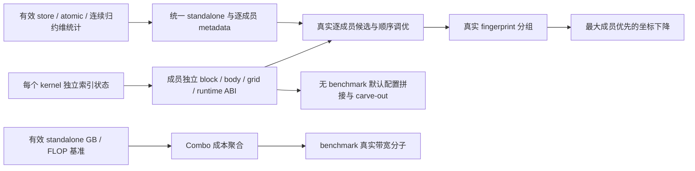

# 2.13 Combo/foreach 最新结果与问题分析

<a id="validation213"></a>

<!-- combo-section:validation213:start -->
## 最新执行结果

2026-11-13 在 NPU_A5 Docker 的 `pta_213_case` 环境，按固定 CSV 全量重新收集和执行 105 个源方法、464 个参数实例。CSV 的 116 行包含 11
个随外层方法验证的嵌套函数。实例结果为 **419 PASS、35 FAIL、10 SKIP**；没有抽样或复用旧执行结果。

| 范围 | PASS | FAIL | SKIP |
| --- | ---: | ---: | ---: |
| 2.10 重合范围 60 个方法 | 57 | 3 | 0 |
| 2.10 重合范围 413 个实例 | 410 | 3 | 0 |
| 重合范围外 45 个方法 | 6 | 30 | 9 |
| 重合范围外 51 个实例 | 9 | 32 | 10 |
| 全量 105 个方法 | 63 | 33 | 9 |
| 全量 464 个实例 | 419 | 35 | 10 |

### 验证版本与范围

torch_npu `2.13.0.dev20261113`，提交 `44555141711c0c825c5a201e303dcadad1f5fcb4`。

PyTorch `2.13.0+cpu`，提交 `cf30153c4c131c8164ee7798e5022d810682e2cb`；Triton `3.6.0`。

物理卡 1、2、3，每卡两个进程，Inductor/Triton 缓存和日志独立；没有生产代码 overlay。

测试分支 `fix/combo-213-210-overlap`，提交 `a3cfe564cd60cb83f4c81bab5dcd388305992ff2`，main 基线
`91435bdf732e772c3240329797a9a29166ce533a`。

执行时间：北京时间 2026-11-13 18:58:49 至 2026-11-13 20:11:18。

Community 分支只包含与既定 60 个重合方法相关的适配，修改 3 个文件、30 个方法；范围外测试修改未迁入该分支。仅本轮验证副本加上 TMA 和三个 PDL 方法的硬件 SKIP，方法
body 和断言保持原内容。foreach 按已确认口径保留数值、mutation、布局和梯度检查，NPU 不要求 CUDA 单 kernel／FOREACH 专属结构。

执行前后 301 个测试文件、588 个 Torch/NPU Inductor Python 文件哈希一致；其中 194 个 NPU Inductor Python
文件与实际包提交逐项一致。三卡基础计算均通过。全部分片 JUnit 已独立重新解析，464 个实例无遗漏或跨分片重复。

[2.13 PASS 清单][pass213]保留 2.10 重合范围口径，当前为 410 个实际 PASS 实例，在 2.13 NPU 测试目录执行；[全范围
PASS][all-pass]另存在本轮证据目录。2.10 原生 397 条清单保持不变。既定 60 方法适配范围与 2.10 原生 54 方法清单的口径不同，本轮用 [60
方法范围清单][overlap]精确划分。

`test_combo_autotune_grouping_by_metadata_fingerprint` 直接调用社区 helper 和模拟 metadata；其 PASS 证明该 helper
的分组规则，本轮未验收真实 NPU 成员 metadata 到该分组的连接。

[当前 CSV][csv]保持原文件名、116 行顺序及五列，所有行均来自本轮结果。[方法与逐实例报告][jobs]、[完整环境和分片证据][evidence]、[JUnit
交叉核对][junit]及[Community 范围审计][scope]可追溯当前结论。

<!-- combo-section:validation213:end -->

<a id="analysis213"></a>

<!-- combo-section:analysis213:start -->
## 当前问题与按根因排序的修复队列

原全量共有 **33 FAIL、9 SKIP 方法**。其中 **37 个非硬件方法（33 FAIL＋4 软件 SKIP）**进入根因队列，包括 2.10 重合范围的 3 个 FAIL；另 5 个硬件/平台协议方法保留 SKIP。下表按生成正确性、真实统计、出口、成员 ABI、调优与功能验收的依赖排序；同一用例可以覆盖多个根因。

**R 表示已定位的根因/能力或验收缺口，D 表示仍需定界的数值或原生优化契约。**当前为 27 项已定位根因/缺口、3 项待定界。本文给出 22 项 Inductor 相关修复方案，均未实施；只利用固定版本源码、已有 NPU
失败证据和一次本地源码控制流隔离复核，没有修改实现代码、上卡复测或扩张 Community 分支。CSV 原状态、410 条重合范围 2.13 PASS 清单和原全量结果保持。未实现的软件目标后续应保持
FAIL，只有硬件差异或明确不再支持的目标可 SKIP。

全部证据固定在实际安装的 Torch/NPU 提交。[结构化根因队列及 42 方法/45 个非 PASS 实例覆盖审计][root-queue]和[10 项有效补充诊断][root-evidence]可逐项追溯；无效的早期 hook/仍未解除 skip 的记录已排除。

这里的“成员”是 Combo 中保留独立计算域的一条分支。ABI 指生成 body 与 launcher 之间参数名、类型和值的约定；TTIR 是 Triton 编译的中间表示，校验失败后可能退回普通 kernel。CSE（公共子表达式消除）用缓存复用相同计算，计数应排除这类复用。block tensor 是 DSL 中向量/矩阵形状的值，标量只有一个值。fingerprint 由真实尺寸和优化字段判断候选是否等价；坐标下降在固定其他配置时，依次改变一组分块参数并实测。

<a id="fix-plans213"></a>

### Inductor 修复方案范围

| 责任与类型 | 具体根因 | 本次提供的方案 |
| --- | --- | --- |
| 生成正确性，5 项 | R27 索引缓存；R01 归约 store rank；R02 argreduce dtype；R03 masked 轴；R04 index_expr cast | 指向具体生成规则，写明合法 DSL/索引如何形成。 |
| 统计、metadata、成本和追踪，9 项 | R09—R17 | 分开修 producer、逐成员出口、GB/FLOP/benchmark、图阶段值和真实 origins。 |
| NPU Combo 新功能，7 项 | R18—R24 | 成员独立 block/body/grid/runtime ABI、默认拼接、顺序调优、真实分组、坐标下降、异构打包、联合归约。 |
| 跨层接口，1 项 | R25 FTZ | 分开列 Inductor 的 flag 传递和 Triton Ascend 的实际 option/数学消费者。 |
| 不属于生产 Inductor | R05 eager；R06/R07/R08 测试门控/观测；R26 峰值验收前提 | 保留定界与验收入口，本次不提出生产 Inductor 修复。 |
| 仍待定界 | D01 精度责任；D03 共享/独立资源；D04 大 R 优化资格 | 明确下一份证据和判定分支，不给猜测性修复。 |

先修 R27 的跨 kernel 状态，使候选、实际生成和回退各使用自己的索引，再修 rank/dtype/mask。
R09/R10/R11 的真实 producer 完成后接 R12；R13→R14→R15 形成同源成本出口。
R18 完成成员 ABI 后再接默认配置和调优消费者。P0 的 D01 可并行定界，不作为已确认根因的实施方案。

所有“预期生成行为”和“验收计划”都是方案要求，没有修复后的 DSL 或设备 PASS。
本地 [控制流隔离复核][axis-cache-probe]执行了固定源码的三个索引函数及实际轴使用判断，
但符号线性化、形状证明等 helper 为 mock；它证明缓存生命周期规则，不证明完整 NPU lowering 或数值已通过。

### 根因队列

| 优先级 | 根因/定位项 | 当前判定 | 前置依赖 | 覆盖方法 |
| --- | --- | --- | --- | ---: |
| P0 | [R27 LoopBody 的候选索引缓存跨 kernel 复用，导致 x0/y0 轴错配](#root-r27) | 失败 DSL、固定源码及 CPU 控制流隔离复核已定位；未修复 | — | 1 |
| P0 | [R01 persistent 多轴归约的 store 指针是标量，结果却是 block tensor](#root-r01) | 生成缺陷已实测确认；未修复 | — | 2 |
| P0 | [R02 argmin/argmax 的轴索引实际 int32，却被 CSE 标成 int64](#root-r02) | 生成缺陷已在原 pytest 实测确认；未修复 | — | 1 |
| P0 | [R03 动态 shape/stride 符号被当成 masked subblock 的迭代轴](#root-r03) | 生成前缺陷已实测及源码确认；未修复 | R06 门控已在诊断解除 | 1 |
| P0 | [R04 动态整数 index_expr 在实际 cast 前被声明为 FP32](#root-r04) | 生成缺陷已实测及版本源码对照确认；未修复 | R06 | 1 |
| P0 | [D01 非连续多轴 FP32 sum 超差，数值责任模块尚未定界](#root-d01) | 仍 FAIL；同输入证据已固定，根因待定界 | — | 1 |
| P1 | [R05 eager contiguous(memory_format=channels_last) 被 NPU 公共接口拒绝](#root-r05) | 原 eager 前置失败已确认；未修复 | — | 1 |
| P1 | [R06 通用软件测试被旧 NPU/XPU decorator 提前跳过](#root-r06) | 门控原因已确认；补充诊断 3 PASS、1 FAIL，正式分支未改 | — | 4 |
| P1 | [R07 测试固定匹配 CUDA Grid1D/XBLOCK/size_hints，未读取 NPU 真实 ABI](#root-r07) | 测试观测不兼容已确认；功能目标保留 | — | 3 |
| P1 | [R08 profiler JSON 读取器只接受 traceEvents 字典，不接受 NPU 列表](#root-r08) | 测试数据解析根因已确认；后续 grid 尚未验收 | R05 | 2 |
| P1 | [R09 Native Index 的有效普通/归约 store 没有维护 num_store](#root-r09) | producer 缺口已由源码确认；原用例先停在成员字典缺失 | — | 3 |
| P1 | [R10 Native Index 发出 atomic_add，却没有设置 atomic_add_found](#root-r10) | producer 缺口已由源码确认；相关原图未触发原子加验收 | — | 2 |
| P1 | [R11 Native Index load/store 未维护连续归约维布局状态](#root-r11) | producer 缺口已由源码确认；原用例先停在成员字典缺失 | — | 1 |
| P1 | [R12 standalone/Combo 没有统一 per-kernel 统计出口，Combo 缺逐成员 metadata](#root-r12) | 出口缺口已由原断言和源码确认；未修复 | R09、R10、R11 | 7 |
| P1 | [R13 standalone 的 FLOP 估算没有导出为 kernel_flop](#root-r13) | 出口缺口已由源码确认；原比较先停在 Combo GB | — | 1 |
| P1 | [R14 Combo 没有聚合成员访存 GB/FLOP，也未在 profile 模式导出 GB](#root-r14) | Combo 成本出口缺口已由原断言和源码确认；未修复 | R13 | 2 |
| P1 | [R15 Combo benchmark 带宽分子 num_gb 被硬编码为 0](#root-r15) | 独立 benchmark 出口缺口已由原断言和源码确认；未修复 | R14 | 1 |
| P1 | [R16 Combo 未导出 optimize_mem 的图阶段取值，训练前向错误依赖默认 True](#root-r16) | 图阶段 metadata 缺口已确认；尚未证明输入污染 | — | 2 |
| P1 | [R17 provenance 接收 node=None 的 Combo 外壳，真实分区 origins 被跳过](#root-r17) | 追踪映射缺口已由原产物和源码确认；未修复 | — | 1 |
| P2 | [R18 per_subkernel_blocks 在 NPU scheduling 接入时丢失，body/grid 共用 block ABI](#root-r18) | 独立成员分块能力缺口已由源码确认；未实现 | R27 | 9 |
| P2 | [R19 NPU override 绕过无 benchmark 的默认配置拼接和 carve-out](#root-r19) | 默认配置处理能力缺口已由源码确认；未实现 | R18 | 3 |
| P2 | [R20 NPU runtime 没有逐成员候选的 Combo 顺序调优消费者](#root-r20) | 独立成员调优能力缺口已由源码确认；未实现 | R18、R12 | 3 |
| P2 | [R21 真实 NPU 成员 metadata 未接入 fingerprint 调优分组](#root-r21) | 分组输入/消费链缺口已由源码确认；未实现 | R12、R18、R20 | 1 |
| P2 | [D03 共享/独立 X 模式的 max_persistent_rblock 原生资源契约待明确](#root-d03) | 原 False 实例 FAIL；True 实例 PASS 不证明独立 ABI | R18、R20 | 1 |
| P2 | [D04 RMSNorm add_persistent_rblock 的资格与 native R 候选对应待确认](#root-d04) | 原首失败是 R12；不能认作 persistent 归约整体缺失 | R12、R18、R20 | 1 |
| P2 | [R22 NPU 有 CoordescTuner 对象和计时缓存，但未执行成员坐标下降](#root-r22) | 成员坐标下降能力缺口已由源码确认；未实现 | R18、R20、R21 | 1 |
| P2 | [R23 共享 launcher 限制异构成员组合，标量链/向量归约被拆为 singleton](#root-r23) | 特定组合能力缺口已由实际分区及源码确认；未实现 | R18；mean 另需 R03/R04/R27 | 2 |
| P2 | [R24 NPU 配置与 backend 资格阻断 mixed-order 联合归约入口](#root-r24) | 共享输入行/列联合归约特性未启用，原目标未实现 | — | 1 |
| P2 | [R25 disable_ftz 没有从 NPU codegen 贯通到实际编译选项/数学路径](#root-r25) | 生成/编译消费链缺口已确认；硬件非正规数能力尚未知 | — | 1 |
| P3 | [R26 WideResNet 图没有进入 memory gate，原峰值比较未覆盖拒绝路径](#root-r26) | 验收前提缺失已实测确认；gate 本身已有实现 | — | 1 |

表中覆盖数可以重叠，不能相加当成失败数。R03/R04 对 R06 的依赖是执行测试需解除门控，补充诊断已经完成；它不是需要先做的生产修复。P0 先修生成状态与语义，D01 并行定界；P1 修实际统计和出口，P2 在依赖齐备后验收新功能，P3 补有效峰值拒绝路径。



### metadata 和七个统计用例具体检查什么

“metadata 2”是两个 `optimize_mem` 图阶段方法，不是缺两个不同 metadata。“统计 7”是四个计数/布局方法加三个成本/带宽方法，不是缺七种计数。下表逐字段说明实际用途和确认到的缺口；成员字典缺失与真实 producer 未维护是不同根因。

| 字段/出口 | 作用 | 当前具体缺口或已有能力 |
| --- | --- | --- |
| `optimize_mem` | 推理/反向 True；训练前向 False。允许或关闭按预算 CPU 备份的内存优化，输入保护仍必须正确。 | [R16](#root-r16)：两个方法缺同一字段的两个阶段取值；native clone 已有，输入污染未被证明。 |
| `inductor_meta_i` | 每个成员自己的统计/优化字典，不能用首成员或空字典代替。 | [R12](#root-r12)：Combo 出口缺失；standalone 也没接统一 per-kernel helper。 |
| `heuristic_i` / `size_hints_i` | 逐成员候选类别与尺寸输入，供默认配置、候选等价分组和独立调优。 | [R12](#root-r12)/[R21](#root-r21)：共同命名出口缺失；NPU 已有真实轴/尺寸的 combo_subkernel_meta。 |
| `reduction_hint_i` | 描述成员归约访问方向；本用例要求行 INNER、列 OUTER。 | [R12](#root-r12)：缺逐成员出口，不能只沿用首成员 hint。 |
| `num_load` | CSE 去除缓存复用后有效 load 数，描述逻辑访存工作量。 | producer 已有；[R12](#root-r12) 没有导出到成员字典。 |
| `num_store` | 有效普通/归约最终写回数，被移除写回不应计入。 | [R09](#root-r09)：Native Index CSEProxy 未维护；[R12](#root-r12) 出口也缺。 |
| `num_reduction` | 归约 primitive 数，为候选和工作量提供输入。 | producer 已有；[R12](#root-r12) 没有导出到成员字典。 |
| `autotune_hints` | 实际成员的候选提示，例如 ONE_ELEMENT_PER_THREAD。 | top-level native 提示已有；[R12](#root-r12) 缺逐成员统一来源/出口。 |
| `atomic_add_found` | 成员是否实际发出原子加，影响候选和写回规则。 | [R10](#root-r10)：Native Index atomic 分支未设置 True；[R12](#root-r12) 出口也缺。 |
| `has_loadstore_with_contiguous_rdim` | 是否有真实连续归约维的 load/保留 store，参与归约候选过滤。 | [R11](#root-r11)：Native Index 未维护布局 producer；[R12](#root-r12) 出口也缺。 |
| `no_x_dim` | 成员 DSL 的非归约维优化，按成员.no_x_dim 导出；与 dispatch 无 split 不同。 | dispatch 的 no_x_dim_i/no_split 已有；[R12](#root-r12) 的完整 per-kernel 字典未导出。 |
| `tiling_scores` | 各轴 tiling 评价信息，standalone/Combo 的比较需对应 native 候选语义。 | [R12](#root-r12)：未接统一字段出口；不能用空解析作为相同基准。 |
| `kernel_num_gb` | 逻辑读写字节的 GB 估算，供成本/带宽报告使用。 | 普通 kernel 在 profile/benchmark 下已有；[R14](#root-r14) 缺 Combo 聚合和出口。 |
| `kernel_flop` | 按共同规则估算逻辑计算量；Combo 需聚合成员。 | [R13](#root-r13) 缺 standalone 出口，[R14](#root-r14) 缺聚合；不能说估算器整体没有实现。 |
| benchmark `num_gb` | 独立 benchmark 带宽计算的访存分子。 | [R15](#root-r15) 生成入口硬编码 0，需消费 [R14](#root-r14) 的真实 GB。 |
| `max_persistent_rblock` | 原共享 X/HIP 候选资源限制，与真实独立 X 模式有不同约束。 | [D03](#root-d03)：原生 UB/共享与独立约束需明确；True 的负向字段 PASS 未验实际独立 ABI。 |
| `add_persistent_rblock` | 资格标志，让候选生成器增加专门的大 R 配置。 | 原首失败是 [R12](#root-r12)；[D04](#root-d04) 尚需对照 native 实际候选，不能说 persistent 归约缺失。 |
| `disable_ftz` | 控制是否保留非正规数，需要实际编译选项/数学消费者。 | [R25](#root-r25)：codegen、native options 和 Triton Ascend 消费链未接通，硬件能力尚未知。 |

七个方法与字段一一对应如下。原方法多为字段存在性/解析比较；“需验真实值”是完整修复验收要求，不冒充原方法已经检查到真实 producer。

| 统计方法 | 具体目标 | 原首失败/后续依赖 |
| --- | --- | --- |
| `test_combo_pointwise_combo_grid_meta_has_per_subkernel_fields` | 三个 relu/sigmoid/tanh 成员的 load/store/reduction、提示和 atomic 状态 | 缺成员字典 R12；producer 后续 R09/R10。 |
| `test_combo_reduction_combo_grid_meta_has_per_subkernel_fields` | sum/mean 两成员的有效 load/store/reduction | 缺成员字典 R12；store producer 后续 R09。 |
| `test_combo_reduction_deterministic_has_contiguous_rdim_per_subkernel` | 确定性 sum/mean 逐成员连续归约维布局 | 缺成员字典 R12；布局 producer 后续 R11。 |
| `test_combo_per_kernel_inductor_meta_matches_standalone` | 两侧非空完整计数、atomic、no_x_dim、提示和 tiling_scores 相同 | standalone 两项 vs Combo 零项；R12 和 R09/R10。 |
| `test_combo_kernel_num_gb_and_flop_match_standalone_sum` | Combo GB/FLOP 等于有效 standalone 成员之和 | 先缺 Combo GB R14；standalone FLOP 出口 R13 未执行到。 |
| `test_combo_inductor_meta_has_kernel_num_gb_under_profile_bandwidth` | profile-only 导出真实 Combo GB，不导出 FLOP | 先缺 GB R14，后续 FLOP 负向检查未执行。 |
| `test_benchmark_combo_kernel_emits_real_num_gb` | benchmark 实际带宽分子与 NPU device 参数 | 入口 num_gb=0，R15；device 后续检查未执行。 |

### 各根因的证据与修复方案

<a id="root-d02"></a>
<a id="root-r27"></a>

#### R27 LoopBody 的候选索引缓存跨 kernel 复用，导致 x0/y0 轴错配

**P0 · 失败 DSL、固定源码及 CPU 控制流隔离复核已定位；未修复**。失败阶段：候选索引准备/普通 kernel 重建 → Native Index DSL/TTIR。

实测/原首失败：store_mask 原全量为软件 SKIP；补充原 pytest 的候选成员轴为 x0/x1/r2，随后普通 kernel 的轴为 y0/x1/r2，却保留含 x0 的 load/store，TTIR 报
NameError。y0 的索引/mask 未进入 body，最终数值通过、单 Combo 期望 1 实际 3。

根因与代码方案源码依据：[E26][E26]、[E21][E21]。

证据：NPUIndexTritonKernel 构造即经 decide_codegen_dims_in_kernel/_transform_schedule_indexing 把 kernel 轴写到共享
node._body.indexing。ir.py:1614 仅在 indexing is None 时从当前 indices 重新生成；scheduling.py:519—572 先构造潜在 Combo 成员，再为 singleton
重建普通 kernel，未执行过 body 的候选也会留下映射。ir.py:2028 的 loopbody__call__ 只有 root_block 正常返回才清空 indexing，异常路径没有 finally；combined
回退只恢复 group/metrics。共同 rename_indexing 只改 size 参数，不能把旧迭代轴变成新轴。find_axis_in_load_store 按当前 y0 在旧 x0 地址中找使用关系失败，所以 y0
定义也被抑制。CPU 隔离复核执行固定源码函数，确认丢弃候选和异常均能保留旧映射；符号线性化/helper 是明确的 mock，未做 NPU 数值验证。

**修复方案（未实施）**。责任：torch_npu Inductor 的 LoopBody 索引准备与候选生命周期。

拟修改入口：NPU
torch_npu/_inductor/codegen/ir.py::generate_body_indexing/transform_dims_in_indexing/loopbody__call__（437、1614、2028）；NPU
torch_npu/_inductor/codegen/triton.py::decide_codegen_dims_in_kernel/_transform_schedule_indexing（1220、1480）；NPU
torch_npu/_inductor/codegen/scheduling.py::generate_combo_kernel_code（509）；npu_combined_scheduling.py::codegen_combo_kernel（240）。

1. 把 indexing、indexing_map、indirect_replacements、masked_indexing 作为当前 kernel 对各 LoopBody 的准备结果保存。每个新 kernel 从原始
indexing_exprs 和自己的 split_and_set_ranges 重新建立映射；不以共享 body.indexing 非空作为跨 kernel 命中条件。
2. 准备阶段和实际 node.codegen 阶段使用同一 kernel 的索引视图。进入时安装该视图，退出时用 finally 恢复外层状态；同一个 kernel 的多个节点及
DisableReduction/EnableReduction 阶段仍使用一致映射。不能在准备后简单清空，否则会丢失已重建的维度。
3. 候选分区被丢弃、only_gen_src_code 的 singleton 返回、LoopBody 解释异常以及 TTIR 校验回退均退出索引作用域。先复用现有 kernel/context
生命周期承载数据，不新增跨图全局缓存。masked 子块的派生索引也一起恢复。
4. 在语义层核对最终地址/mask 中每个迭代符号都有当前 kernel 的 range entry 或受控替代定义。find_axis_in_load_store 应看到当前轴；不在生成字符串中把 x0 改成
y0，也不无条件补所有轴定义。

预期生成行为：后续 y0/x1/r2 kernel 的地址由本 kernel 的映射形成，保留 y0 定义及 y0_mask；其 stride 和归约集合与原 mean 相同；合法 Combo 生成和失败后的普通 kernel
不互相继承候选的轴状态。

影响范围：覆盖 Native Index 的候选准备、singleton 重建和失败回退；no-linear 使用共同 LoopBody 路径，需保持其原调用协议。

方案风险：重建维度、被移除父轴和多次 disable_reduction 切换需要一并验证；只给 body.indexing 加 finally 清理仍不能解决未执行过 body 的候选缓存。

**验收计划（尚未执行）**：

- 同一 LoopBody 先后由不同 tiling 的 kernel 准备，后者所有索引均属于后者的轴；未生成 body 的候选也不残留状态。
- 在 masked 解释和 TTIR 校验两处分别触发失败，再走普通生成；检查地址和 mask 定义、数值与正常生成一致。
- 对原 test_combo_kernel_store_mask 检查当前 mean 的合法 DSL；最终单 Combo/store mask 目标仍另需 R03、R04、R23。

原始失败 DSL 关键行（保持生成格式）：

```python
                tmp0 = tl.load(in_ptr0 + (x0 + ks0*r2 + ks0*ks1*x1), r2_mask & x1_mask, other=0.0)
```

覆盖用例（结果为原全量，非补充诊断）：

- `test_torchinductor.py::CommonTemplate::test_combo_kernel_store_mask`：范围外，1 SKIP；解除 gate 的补充诊断关联。

证据：[E26][E26]、[E21][E21]；[CPU 控制流隔离复核][axis-cache-probe]；补充诊断
[store-mask-open][diag-store-mask-open]；[原方法与断言][test-index]；[原逐实例报告][jobs]。

<a id="root-r01"></a>

#### R01 persistent 多轴归约的 store 指针是标量，结果却是 block tensor

**P0 · 生成缺陷已实测确认；未修复**。失败阶段：Native Index DSL → TTIR check → fallback。

实测/原首失败：per_config_subkernel_red 原数值通过，单 Combo 目标期望 1、实际 2。诊断确认两个成员已进入同一分区 [['op0','op1']]，没有被分区拒绝；首个 TTIR 错误是 Value
argument cannot be block type if pointer argument is not a block。

根因与代码方案源码依据：[E17][E17]。

证据：NPU triton.py:4021 的 reduction_resize 在 rank=1 时调用 promote_to_tensor；共同 helper:86 把标量提升成 shape=(1,)
tensor。triton.py:3127 的 store_reduction 只在多 R 且非 persistent 时把指针提升为 block；persistent 路径保留 tl.store(out_ptr0 + (x0),
tmp4, None) 的标量指针。整组 Combo 校验失败后，npu_combined_scheduling.py:240 回退到普通 kernel，普通 Native Index 也失败，最终 no-linear 执行。D01
中同类错误是补充观测，不等于数值根因已经定位。

**修复方案（未实施）**。责任：torch_npu Inductor 归约结果布局与写回。

拟修改入口：NPU torch_npu/_inductor/codegen/triton.py::triton_tensor_ndim/reduction_resize（3116、4021）；NPU
torch_npu/_inductor/codegen/triton.py::store_reduction/store（3127、3157）；共同 triton_helpers.promote_to_tensor。

1. 由真正保留的输出轴和其 tiling/标量循环状态定义归约后的布局，reduction_resize 和最终 CSE shape 都采用这个布局。当前非连续多轴归约每次标量外循环得到 shape=(1,) 的结果，继续保留该单元素
tensor 契约。
2. 在 store_reduction 和 store 的保留写回路径共用布局归一化：该单元素结果配套把 scalar pointer 提升成同形状 block pointer；非空 mask
同步到输出布局。已有向量输出按其真实地址形状处理，不把同一个标量地址广播到多个有效输出元素。
3. 以 pointer/value/mask 的实际布局决定归一化，移除仅依据 non-persistent 才追加 tl.arange(0,1) 的分叉。persistent、循环归约及 deferred store
都在归约完成的正确层级写回一次。

预期生成行为：已保存的 tmp4=promote_to_tensor(tl.sum(...)) 对应单元素 block pointer；TTIR 不再报 block value/scalar pointer
不兼容；保留轴向量化时每个有效输出元素仍对应不同地址，不引入多 lane 重复写同一标量。

影响范围：Native Index 多轴归约的结果布局与最终写回；单轴、普通 pointwise 及已合法的 block pointer 继续按已有布局生成。

方案风险：不能只删除 promote_to_tensor：后续融合运算依赖 tensor 布局。不能仅按当前 CSE 声称的 rank 广播指针，必须先校正结果的实际输出布局。

**验收计划（尚未执行）**：

- 原 test_combo_kernel_per_config_subkernel_red 在原数值容差下生成一个实际 Combo，检查原 X/R 配置目标。
- 分别检查 persistent/non-persistent、无保留 tiling 轴的标量输出和有保留向量轴的多 R 输出，TTIR 与写回集合一致。
- D01 的最终 no-linear 数值问题独立保留；本项通过不能替代其精度验收。

原始失败 DSL 关键行（保持生成格式）：

```python
                tmp4 = triton_helpers.promote_to_tensor(tl.sum(tmp3, 0))
                tl.store(out_ptr0 + (x0 ), tmp4, None)
```

覆盖用例（结果为原全量，非补充诊断）：

- `test_combo_kernels.py::ComboKernelTests::test_combo_kernel_per_config_subkernel_red`：2.10 重合，1 FAIL；原首失败关联。
- `test_combo_kernels.py::ComboKernelTests::test_combo_kernel_per_config_subkernel_r0_r1`：范围外，1 FAIL；补充生成缺陷关联；最终精度另属 D01。

证据：[E17][E17]；补充诊断 [reduction-v2][diag-reduction-v2]、[accuracy-v2][diag-accuracy-v2]；[原方法与断言][test-index]；[原逐实例报告][jobs]。

<a id="root-r02"></a>

#### R02 argmin/argmax 的轴索引实际 int32，却被 CSE 标成 int64

**P0 · 生成缺陷已在原 pytest 实测确认；未修复**。失败阶段：Native Index DSL → dtype assertion → fallback。

实测/原首失败：原 pytest 数值通过，两个 Combo 目标期望 2、实际 4。补充原 pytest 已复现；速度准入为 True，pointwise 和 min/max 的分区已是
[['op4','op5'],['op0_op1','op2_op3']]。

根因与代码方案源码依据：[E18][E18]。

证据：NPU triton.py:4438 的 argreduce 中，logical_index 分支显式 .to(tl.int64)，axis-derived 分支只
tl.broadcast_to(r1.reshape(...), tmp2.shape)，却以 dtype=torch.int64 创建 CSE 变量。实际 r1 是 int32，生成
tl.static_assert(tmp5.dtype == tl.int64) 失败。codegen_combo_kernel 会先校验所有分区，因此 min/max 分区失败连带丢掉合法 pointwise Combo，最终为 4
个普通 kernel。早期手工调用的完成结果不覆盖原 pytest 生命周期下的失败。

**修复方案（未实施）**。责任：torch_npu Inductor argreduce 索引构造。

拟修改入口：NPU torch_npu/_inductor/codegen/triton.py::reduction 的 argmin/argmax 分支（4438—4470）。

1. 让 axis-derived 路径与 logical_index 路径在进入 argreduce helper 前都实际生成 tl.int64 索引：对轴坐标表达式显式 cast，再 reshape/broadcast 到
masked_value 的形状。
2. 仅在表达式已经为 int64 后以 dtype=torch.int64 创建 CSE 变量，实际索引与缓存 metadata、dtype assertion 和最终 ATen index 输出保持一致。
3. 保留原 argmin/argmax 的最小索引优先规则、无效 lane 的单位元和原归约值，不改分区准入或整组 fallback 来绕开类型错误。

预期生成行为：broadcast 的索引值实际是 tl.int64，原 tl.static_assert(tmp5.dtype == tl.int64) 成立；pointwise 与 min/max 两个合法分区均保留。

影响范围：Native Index 的 axis-derived argmin/argmax；非连续 logical_index 已有 cast，采用同一构造规则。

方案风险：大索引路径仍需由 index_dtype 保障坐标运算在溢出前使用 int64，不能事后 cast 已溢出的 int32 地址。

**验收计划（尚未执行）**：

- 原 pytest test_combo_kernel_filter_cpu 数值通过且实际生成两个 Combo。
- axis-derived 和非连续 logical-index 都检查实际 index dtype；并检查并列极值、尾块 mask 和大索引语义。

原始失败 DSL 关键行（保持生成格式）：

```python
            tmp5 = tl.broadcast_to(r1.reshape([1,R1BLOCK_SUB]), tmp2.shape)
            tl.static_assert(tmp5.dtype == tl.int64)
```

覆盖用例（结果为原全量，非补充诊断）：

- `test_torchinductor.py::CommonTemplate::test_combo_kernel_filter_cpu`：2.10 重合，1 FAIL；原首失败关联。

证据：[E18][E18]、[E17][E17]；补充诊断 [filter-pytest][diag-filter-pytest]；[原方法与断言][test-index]；[原逐实例报告][jobs]。

<a id="root-r03"></a>

#### R03 动态 shape/stride 符号被当成 masked subblock 的迭代轴

**P0 · 生成前缺陷已实测及源码确认；未修复**。失败阶段：LoopBody masked-index analysis → DSL generation。

实测/原首失败：原全量被旧 NPU decorator SKIP。解除门控的原 pytest 首次 Combo 生成在 sympy_index_symbol(sub_axis + "_mask") 触发 assert name[0]
!= "s"；此时还没有失败 Combo DSL。最终数值通过、数量期望 1 实际 3，store mask 断言未执行。

根因与代码方案源码依据：[E19][E19]、[E26][E26]。

证据：NPU codegen/ir.py:1873 的 generate_masked_indexing 把 indexing 表达式各项的所有 free_symbols 并入
index_vars，没有排除动态尺寸/stride；triton.py:315 随后把每个字符串都当成轴名追加 _mask。共同 utils.py:1249 明确禁止用 index-symbol API 创建 s* shape
符号。普通 indexing:4963 本来会跳过 s/ps/i 符号，这条 masked-subblock 路径遗漏了同类约束。

**修复方案（未实施）**。责任：torch_npu Inductor masked 子块的轴依赖分析。

拟修改入口：NPU torch_npu/_inductor/codegen/ir.py::generate_masked_indexing（1873）；NPU
torch_npu/_inductor/codegen/triton.py::NPUTritonOverrides.masked（315）、indexing/filter_masks。

1. generate_masked_indexing 从已经绑定当前 kernel 的索引收集真实迭代轴，依据 range entry 和符号类型排除 SIZE/PRECOMPUTED_SIZE 等 shape/stride
系数。不能再把每个 Mul 项的全部 free_symbols 当作需要 mask 的轴。
2. 生产端保留语义轴依赖；消费端结合当前 kernel 的替代轴/广播方向，取得实际会生成的 mask。标量有界循环或已证明无需 mask 的轴使用相应证明，间接索引继承 CSE mask 依赖；不盲目拼接字符串 _mask。
3. 继续叠加原 masked 条件和真实动态尾块 mask。进入/离开嵌套子块用 finally 恢复 current_subblock_axis，派生状态按 R27 的 kernel 作用域管理。

预期生成行为：动态 s*/ps* 系数不再产生 s*_mask；实际迭代轴的边界保护保留，所有引用均有定义。

影响范围：Native Index 动态 masked 子块及嵌套 masked 的轴依赖；共同 sympy_index_symbol 的 SIZE 防误用断言继续有效。

方案风险：只过滤 s 字符串不足以处理重建轴、方向替代和无 mask 的标量循环；只删除共同 assert 会掩盖错误依赖。

**验收计划（尚未执行）**：

- 原动态 mean 图不再在 sympy_index_symbol 构造阶段失败；检查动态尾块、嵌套 masked 和间接索引的访问范围。
- 配合 R27/R04/R23 后执行原 test_combo_kernel_store_mask 的数值、单 Combo 和最终 store mask 目标；保持未实现软件目标 FAIL。

覆盖用例（结果为原全量，非补充诊断）：

- `test_torchinductor.py::CommonTemplate::test_combo_kernel_store_mask`：范围外，1 SKIP；解除 gate 的补充诊断关联。

证据：[E19][E19]；补充诊断 [store-mask-open][diag-store-mask-open]；[原方法与断言][test-index]；[原逐实例报告][jobs]。

<a id="root-r04"></a>

#### R04 动态整数 index_expr 在实际 cast 前被声明为 FP32

**P0 · 生成缺陷已实测及版本源码对照确认；未修复**。失败阶段：Native Index ordinary-kernel fallback → dtype assertion。

实测/原首失败：同一次补充诊断的另一普通 mean 生成 tmp3 = ks0*ks1*ks2（ks* 为整数参数），紧接 tl.static_assert(tmp3.dtype == tl.float32)，然后才 tmp4 =
tmp3.to(tl.float32)，因此校验失败。

根因与代码方案源码依据：[E20][E20]、[E18][E18]。

证据：NPU triton.py:344 的 index_expr 先以请求的非整数 dtype 记录原 indexing.index_str，再单独生成 to_dtype；整数表达式中间值被错误标注。实际 PyTorch
固定提交的对应实现:2390 已在同一个 CSE 生成表达式中显式 cast，并从实际 compute dtype 推导 metadata；NPU override 未采用该契约。

**修复方案（未实施）**。责任：torch_npu Inductor index_expr 的 dtype/CSE 契约。

拟修改入口：NPU torch_npu/_inductor/codegen/triton.py::NPUTritonOverrides.index_expr（345）；TORCH
torch/_inductor/codegen/triton.py::TritonOverrides.index_expr（2390）。

1. 把固定共同实现的实际 compute dtype 规则移植到 NPU index_expr：请求 FP32/其他非整数值时，将带括号的原索引表达式和 to_dtype 合成一个 CSE 生成表达式，登记 cast 后实际 compute
dtype。
2. 整数 index 用途继续采用 kernel.index_dtype；含临时变量时按实际参与值计算类型提升，必要时显式回到索引 dtype。mask_vars、shape 和 bounds 跟随实际返回值，不能在未 cast
的整数中间值上登记 FP32。
3. 保留 runtime_triton_dtype_assert。动态除数的生成示意为 (ks0*ks1*ks2).to(tl.float32) 后才检查 FP32，不生成先错误检查、再补 cast 的两段链。

预期生成行为：动态整数除数转换完成后对应 FP32 CSE；整数地址用途仍为正确的 int32/int64。

影响范围：NPU index_expr 作为 value 的类型转换；保留整数 indexing 及 mask/布局语义。

方案风险：低精度请求的 compute upcast 和混合临时变量提升必须采用共同规则；不能仅修改注释或禁用 dtype 检查。

**验收计划（尚未执行）**：

- 原动态 mean 的除数和输出通过 dtype assertion、TTIR 与原数值检查。
- 覆盖 FP32 value、低精度 compute upcast 和含不同整数 dtype 临时值的 indexing；最终单 Combo/store mask 另依赖 R03/R27/R23。

原始失败 DSL 关键行（保持生成格式）：

```python
    tmp3 = ks0*ks1*ks2
    tl.static_assert(tmp3.dtype == tl.float32)
    tmp4 = tmp3.to(tl.float32)
```

覆盖用例（结果为原全量，非补充诊断）：

- `test_torchinductor.py::CommonTemplate::test_combo_kernel_store_mask`：范围外，1 SKIP；解除 gate 的补充诊断关联。

证据：[E20][E20]、[E18][E18]；补充诊断 [store-mask-open][diag-store-mask-open]；[原方法与断言][test-index]；[原逐实例报告][jobs]。

<a id="root-d01"></a>

#### D01 非连续多轴 FP32 sum 超差，数值责任模块尚未定界

**P0 · 仍 FAIL；同输入证据已固定，根因待定界**。失败阶段：accuracy check。

实测/原首失败：原全量 (16,32,64)、stride (64,1024,1) 的 sum((1,2))：16 个输出中 1 个超差，最大绝对误差 1.1920928955078125e-5，原 atol=1e-5。最终执行同一个
no-linear 普通 kernel 的两次 launch；后续数量断言未执行。

已确认缺陷与尚缺证据：补充诊断保存原方法新构造的同一组输入、NPU eager/compiled 输出和 CPU float64 基准，并记录实际
winner：XBLOCK=2、R0_BLOCK=32、R1_BLOCK=64、compile_mode=simd_simt_template、multibuffer=True。输入 0/1 的 eager 对高精度基准最大误差分别为
8.5845e-6/9.2548e-6，compiled 为 8.9811e-6/1.1516e-5；两种 FP32 结果都有误差，尚不能把责任定为归约树或下层编译器。这组输入不是恢复原全量输入。补充路径也触发
R01，但最终数值失败仍发生在 no-linear 路径。

定位入口：使用已保存输入固定重放该 winner，逐项对齐归约元素集合、两条 R 轴、partial loop、累加 dtype 和写回；定位社区多轴 DSL、NPU 候选 remap 或 Triton 数学路径。无需再跑全量。

完整验收：固定非连续输入在原 dtype 和原容差下通过；数值检查通过后再完成原组合目标。若 R01 修复使图改走 Combo，仍单独保留这个 no-linear 固定输入复现，不能由新路径 PASS 宣称旧路径已修复。

覆盖用例（结果为原全量，非补充诊断）：

- `test_combo_kernels.py::ComboKernelTests::test_combo_kernel_per_config_subkernel_r0_r1`：范围外，1 FAIL；原首失败关联。

证据：[E16][E16]、[E17][E17]；补充诊断 [accuracy-v2][diag-accuracy-v2]；[原全量 wrapper][accuracy-wrapper]与[来源/布局对应][accuracy-source]；[原方法与断言][test-index]；[原逐实例报告][jobs]。

<a id="root-r05"></a>

#### R05 eager contiguous(memory_format=channels_last) 被 NPU 公共接口拒绝

**P1 · 原 eager 前置失败已确认；未修复**。失败阶段：eager ATen / memory format。

实测/原首失败：原用例先在 eager contiguous(memory_format=channels_last) 报 NPU 仅支持 contiguous 格式；compiled、成员独立分块和 profiler grid
检查均未开始。

根因与代码证据：固定 NPU TensorProperties.cpp:10 先返回已经满足请求格式的 tensor；需要转换时只接受 MemoryFormat::Contiguous，原 channels_last
转换因此被拒绝。责任入口是 eager memory-format 接口，不能根据用例名称直接判为 Inductor 分块失败，也不能由换成任意相同 stride 的输入宣称 channels_last 转换已支持。

修复入口：先明确并补公共 ATen 的 channels_last 转换契约；之后继续原八种布局转换以及 R18/R08 的验收。

完整验收：原 NCHW → channels_last 的 eager/compiled 数值、stride 和布局正确；再完成逐成员分块及真实 launch grid 检查。没有明确不再支持的依据，目标保持 FAIL。

覆盖用例（结果为原全量，非补充诊断）：

- `test_combo_kernels.py::ComboKernelTests::test_combo_kernel_per_config_subkernel_block_size`：范围外，1 FAIL；原首失败关联。

证据：[E11][E11]；[原方法与断言][test-index]；[原逐实例报告][jobs]。

<a id="root-r06"></a>

#### R06 通用软件测试被旧 NPU/XPU decorator 提前跳过

**P1 · 门控原因已确认；补充诊断 3 PASS、1 FAIL，正式分支未改**。失败阶段：test collection / decorator。

实测/原首失败：原全量四个方法仍为 SKIP。只解除软件门控、保留 body 和其他 config decorators 的补充原 pytest：basic、after_extern、dynamic persistent 三项
PASS；store_mask FAIL。

根因与代码证据：两个输入距离用例仅检查图输入依赖深度：basic 捕获 2 个真实 SchedulerNode，min/max 均 0；after_extern 捕获 mm extern 距离 0、foreach 消费者
FusedSchedulerNode 距离 1。它们不要求 NPU FOREACH 专属单 kernel。动态归约没有 XPU intrinsic，补充诊断已形成 sum/mean/max 三成员 NPUComboKernel，实际
benchmark/准入事件与原数值检查完成。store_mask 的真实阻塞另列 R03/R27/R04/R23。

修复入口：后续在获准的测试范围内移除这四个旧软件 skip，以实际功能断言决定 PASS/FAIL。当前仅定位和归档；不把范围外适配迁入已完成的 2.10 重合 Community 分支。

完整验收：输入距离检查的节点集合非空；dynamic 保留动态约束、编译期 autotune 和数值检查；store_mask 在未完成原目标时保持 FAIL。原全量 CSV 的 SKIP 不由补充诊断悄悄改写。

覆盖用例（结果为原全量，非补充诊断）：

- `test_snode_runtime.py::InputDistanceTests::test_foreach_basic`：范围外，1 SKIP；原首失败关联。
- `test_snode_runtime.py::InputDistanceTests::test_foreach_after_extern`：范围外，1 SKIP；原首失败关联。
- `test_combo_kernels.py::ComboKernelDynamicShapesTests::test_dynamic_shapes_persistent_reduction_mixed_x_dim_xpu`：范围外，1 SKIP；原首失败关联。
- `test_torchinductor.py::CommonTemplate::test_combo_kernel_store_mask`：范围外，1 SKIP；原首失败关联。

证据：[E9][E9]、[E10][E10]；补充诊断 [input-basic-open][diag-input-basic-open]、[input-after-open][diag-input-after-open]、[dynamic-gate-open][diag-dynamic-gate-open]、[store-mask-open][diag-store-mask-open]；[原方法与断言][test-index]；[原逐实例报告][jobs]。

<a id="root-r07"></a>

#### R07 测试固定匹配 CUDA Grid1D/XBLOCK/size_hints，未读取 NPU 真实 ABI

**P1 · 测试观测不兼容已确认；功能目标保留**。失败阶段：post-execution FileCheck。

实测/原首失败：single 两种 benchmark 开关的数值和 kernel 数检查已通过，随后固定 Grid1D 匹配失败，实际为 GridNpu。persistent size_hint 已匹配 native
heuristic，固定 CUDA x/r0_ 字典失败；数值检查未执行。per_config_subkernel_per 数值和 generated_kernel_count=1 通过，随后固定 XBLOCK :
tl.constexpr 失败。

根因与代码证据：NPU 使用真实多轴名称、runtime split block 与 native launcher；这些生成 ABI 与 CUDA 字面量不同。size_hint 的共享 split extent 是
x0=1536、R 包络 r1=32；成员真实 R=16/32 应分别核对。per 用例的成员 R=64/512 和完整归约要求仍有效，缺固定字符串不证明 persistent 归约缺失。

修复入口：将观测改为解析 NPU wrapper、真实轴/模式、block 参数和 launch；区分 kernel 定义数、benchmark probe 与实际执行数。

完整验收：single 两种开关均保持两个独立计算且无 Combo；size_hint 覆盖两个成员真实 R 和共享候选包络并完成数值；per 保持实际单 Combo 和两个成员完整 R。不能只删除 FileCheck。

覆盖用例（结果为原全量，非补充诊断）：

- `test_combo_kernels.py::ComboKernelTests::test_single_combo_kernels`：范围外，2 FAIL；原首失败关联。
- `test_combo_kernels.py::ComboKernelTests::test_persistent_reduction_size_hint`：范围外，1 FAIL；原首失败关联。
- `test_combo_kernels.py::ComboKernelTests::test_combo_kernel_per_config_subkernel_per`：2.10 重合，1 FAIL；原首失败关联。

证据：[E1][E1]、[E2][E2]、[E11][E11]；[原方法与断言][test-index]；[原逐实例报告][jobs]。

<a id="root-r08"></a>

#### R08 profiler JSON 读取器只接受 traceEvents 字典，不接受 NPU 列表

**P1 · 测试数据解析根因已确认；后续 grid 尚未验收**。失败阶段：profiler result parsing。

实测/原首失败：yz_overflow 已编译执行，随后 trace_json["traceEvents"] 对实际 list 报 TypeError，真实 grid 及最终数值断言未执行。block_size 原先先被 R05
阻塞，这里是源码确认的后续相同读取目标。

根因与代码证据：测试假定 CUDA profiler 的事件容器和三维 grid；NPU 导出列表并用 native split/一维 dispatch。解析错误不能证明 launch grid 已溢出或已正确。

修复入口：兼容实际 NPU 事件容器，关联执行 wrapper 的最终 kernel launch；原生 launcher 参数是 grid 的判定依据，过滤 autotune 的测量 launch。

完整验收：保留原大尺寸 permute/clone 和数值检查，确认真实 NPU X grid 合法、Y/Z 为 1；布局用例解除 R05 后继续分块/grid 原目标。

覆盖用例（结果为原全量，非补充诊断）：

- `test_combo_kernels.py::ComboKernelTests::test_combo_kernel_yz_overflow`：范围外，1 FAIL；原首失败关联。
- `test_combo_kernels.py::ComboKernelTests::test_combo_kernel_per_config_subkernel_block_size`：范围外，1 FAIL；相关/后续覆盖。

证据：[E1][E1]、[E3][E3]；[原方法与断言][test-index]；[原逐实例报告][jobs]。

<a id="root-r09"></a>

#### R09 Native Index 的有效普通/归约 store 没有维护 num_store

**P1 · producer 缺口已由源码确认；原用例先停在成员字典缺失**。失败阶段：codegen statistics producer。

实测/原首失败：相关原用例首失败是 R12 的 inductor_meta_i 缺失或成员数组为空，尚未检查到真实 num_store 值。

根因与代码方案源码依据：[E22][E22]、[E27][E27]。

证据：NPU triton.py:5524/5535 的自定义 CSEProxy.store/store_reduction 对保留写回直接调用生成函数，未递增 num_store；load 的非缓存计数和 reduction
的计数已经存在。super().__enter__ 后 NPU 又安装自己的 CSEProxy，所以继承共同初始化不能补足被覆盖的统计维护。no-linear 普通 kernel 继承共同 CSE，不能把缺口扩展到全部 NPU 路径。

**修复方案（未实施）**。责任：torch_npu Inductor Native Index CSEProxy。

拟修改入口：NPU torch_npu/_inductor/codegen/triton.py::CSEProxy.store/store_reduction（5524、5535）；TORCH
torch/_inductor/codegen/common.py::CSEProxy.store/store_reduction（2894、2912）。

1. 在 name 不属于 V.graph.removed_buffers 且真正发起写回的分支维护 num_store：普通 store 成功生成后递增一次，store_reduction 按共同入口递增一次。
2. 保留 store cache、mutation 别名和 store_buffer_names 的原协议。deferred store 的排队/最终 splice 是同一个逻辑写回，不再次计数；kernel
构造失败的候选不用于正式成员统计。
3. 在 standalone 和 Combo 的真实成员生成完成后由 R12 导出同口径的 num_store，沿用共同 buffer 去除规则，不用 DSL 文本出现次数或硬编码数字补字段。

预期生成行为：原 pointwise 每个保留写回和 sum/mean 最终写回有对应计数；移除 buffer 的请求不增加计数。

影响范围：Native Index 的有效 store 请求；no-linear 共同 CSE 已有计数维护。

方案风险：避免 store_reduction 同时经过两个计数入口造成重复；延迟移除的 buffer 与字段冻结时机需按两侧同一规则核对。

**验收计划（尚未执行）**：

- 原四个计数/布局相关方法在 R12 接通后比较非空完整字段。
- 检查保留/移除写回、mutation 别名及 deferred reduction store，计数不因渲染次数变化。

覆盖用例（结果为原全量，非补充诊断）：

- `test_combo_kernels.py::ComboKernelMetadataTests::test_combo_pointwise_combo_grid_meta_has_per_subkernel_fields`：范围外，1 FAIL；相关/后续覆盖。
- `test_combo_kernels.py::ComboKernelMetadataTests::test_combo_reduction_combo_grid_meta_has_per_subkernel_fields`：范围外，1 FAIL；相关/后续覆盖。
- `test_combo_kernels.py::ComboKernelMetadataTests::test_combo_per_kernel_inductor_meta_matches_standalone`：范围外，1 FAIL；相关/后续覆盖。

证据：[E4][E4]、[E22][E22]；[原方法与断言][test-index]；[原逐实例报告][jobs]。

<a id="root-r10"></a>

#### R10 Native Index 发出 atomic_add，却没有设置 atomic_add_found

**P1 · producer 缺口已由源码确认；相关原图未触发原子加验收**。失败阶段：codegen state producer。

实测/原首失败：原 pointwise 图先停在 R12；其 relu/sigmoid/tanh 并无 atomic_add，不能由字段存在性测试推定原子路径已验证。

根因与代码方案源码依据：[E22][E22]。

证据：NPU triton.py:3219 发出 tl.atomic_add 后没有维护 atomic_add_found=True；共同 triton.py:4415
有这一步。这会使后续导出的状态与真实生成操作不一致，即使普通 pointwise 图的默认 False 本来正确。

**修复方案（未实施）**。责任：torch_npu Inductor atomic store 状态。

拟修改入口：NPU torch_npu/_inductor/codegen/triton.py::store(mode='atomic_add')（3219）。

1. 仅在实际保留并生成 tl.atomic_add 的 store 分支设置 atomic_add_found=True，使用与共同生成端相同的状态语义。
2. R12 从每个真实成员读取该值。普通 pointwise 的 False 与含 atomic 的 True 保留差异；被提前移除的 atomic store 不应触发该状态。
3. 确认候选和写回消费者使用成员的实际状态；不以存在默认字段代替原子路径验收。

预期生成行为：包含保留 atomic_add 的成员字典为 True，原 relu/sigmoid/tanh 成员为 False。

影响范围：Native Index 的 atomic store 生成；既有无原子运算路径。

方案风险：字段存在性用例没有产生 atomic，必须另选真实原子写回小图证明 producer 与 consumer，不能从默认 False 推断已支持。

**验收计划（尚未执行）**：

- 真实保留/移除 atomic 写回及普通写回分别核对状态；standalone/Combo 字段与生成操作一致。
- 原 metadata 比较用例保持数值与成员差异检查。

覆盖用例（结果为原全量，非补充诊断）：

- `test_combo_kernels.py::ComboKernelMetadataTests::test_combo_pointwise_combo_grid_meta_has_per_subkernel_fields`：范围外，1 FAIL；相关/后续覆盖。
- `test_combo_kernels.py::ComboKernelMetadataTests::test_combo_per_kernel_inductor_meta_matches_standalone`：范围外，1 FAIL；相关/后续覆盖。

证据：[E22][E22]；[原方法与断言][test-index]；[原逐实例报告][jobs]。

<a id="root-r11"></a>

#### R11 Native Index load/store 未维护连续归约维布局状态

**P1 · producer 缺口已由源码确认；原用例先停在成员字典缺失**。失败阶段：index/stride analysis → layout statistics。

实测/原首失败：确定性 sum/mean 原数值通过，随后缺 inductor_meta_i；has_loadstore_with_contiguous_rdim 的成员检查未执行。

根因与代码方案源码依据：[E22][E22]、[E27][E27]。

证据：共同 load/store 按实际 indexing 维护 has_load_with_contiguous_rdim 和 stores_with_contiguous_rdim，最后排除已移除写回。Native
Index 完整 override 没有这两个状态的维护；共用的 block_ptr store 生成 helper 本身也不承担它们的记录。no-linear 的共同路径需单独保留。

**修复方案（未实施）**。责任：torch_npu Inductor 连续归约维布局状态。

拟修改入口：NPU torch_npu/_inductor/codegen/triton.py::load/store/indexing 与 IndexAnalysis；TORCH
torch/_inductor/codegen/triton.py::_has_stride1_on_rdim/has_store_with_contiguous_rdim（3186、3214）。

1. 为 Native Index 定义连续归约维判定：从当前 range entry 的 is_reduction 语义及替代轴映射选归约变量，对实际归一化地址求 stride，仅在已证明 stride==1
时认定连续。不能直接依赖只识别共同 r0_/r1_ 类型的 helper。
2. 有效 load 设置 has_load_with_contiguous_rdim；有效 store 记录 buffer 名，最终 has_store_with_contiguous_rdim 排除已移除 buffer。block
pointer helper 不作为统计生产端，仍在语义 indexing 层记录。
3. 按共同 deterministic/force_filter_reduction_configs 条件通过 R12 导出两者的 OR，并接入原生归约候选过滤；其意义是访问布局，不能当作确定性归约支持开关。

预期生成行为：连续和非连续真实访存产生不同布局值，字段在应开启的过滤模式下导出。

影响范围：Native Index 的连续归约维布局及相应候选输入；no-linear 继续使用共同 producer。

方案风险：动态 stride 不能仅凭优化 hint 宣称等于 1；方向替代后的轴与被移除 store 要正确还原到语义访问。

**验收计划（尚未执行）**：

- 原 deterministic sum/mean 方法继续通过数值，并检查真实连续布局标志。
- 用 stride==1、明确非连续、符号 stride 及已移除写回对照，确认候选消费与字段相符。

覆盖用例（结果为原全量，非补充诊断）：

- `test_combo_kernels.py::ComboKernelMetadataTests::test_combo_reduction_deterministic_has_contiguous_rdim_per_subkernel`：范围外，1 FAIL；相关/后续覆盖。

证据：[E22][E22]、[E4][E4]；[原方法与断言][test-index]；[原逐实例报告][jobs]。

<a id="root-r12"></a>

#### R12 standalone/Combo 没有统一 per-kernel 统计出口，Combo 缺逐成员 metadata

**P1 · 出口缺口已由原断言和源码确认；未修复**。失败阶段：generated metadata / FileCheck / parsing。

实测/原首失败：四个计数/布局方法在缺 inductor_meta_i 或 Combo 成员解析为 0 项时失败；归约方向方法缺 reduction_hint_0；RMSNorm 在缺成员字典时失败，尚未执行
add_persistent_rblock 检查。调优分组日志未出现，R21 的真实输入链未完成。

根因与代码方案源码依据：[E22][E22]、[E27][E27]、[E2][E2]。

证据：NPU create_inductor_meta:1926 不调用共同 inductor_meta_per_kernel；Combo jit_line:207 只取第一个成员的
metadata。combo_grid_meta:465 没有 inductor_meta_i、heuristic_i、size_hints_i、reduction_hint_i。已有 combo_subkernel_meta
记录真实轴、尺寸、模式并供共享 tiling 搜索，它不能代替逐成员统计字典。no_x_dim_i 的 dispatch 标志已有，但不等于每个 inductor_meta_i 中完整的真实字段。

**修复方案（未实施）**。责任：torch_npu Inductor per-kernel 元信息出口。

拟修改入口：NPU torch_npu/_inductor/codegen/triton.py::create_inductor_meta（1926）；NPU
torch_npu/_inductor/codegen/triton_combo_kernel.py::jit_line/combo_grid_meta/autotune_subkernel_meta（207、465、144）；TORCH
torch/_inductor/codegen/triton.py::inductor_meta_per_kernel（6235）。

1. 把统一 per-kernel serializer 作为 standalone 和 Combo 的同一来源，接入真实 num_load/num_store/num_reduction、autotune_hints、atomic
状态和成员.no_x_dim。先补 R09/R10/R11，不复制首成员，也不填默认 0。
2. 在 combo_grid_meta 为每个实际生成成员写入 inductor_meta_i、standalone 类别的 heuristic_i、真实 size_hints_i 和
reduction_hint_i/tile_hint_i。已有 combo_subkernel_meta 的轴、模式和尺寸继续供 native tile 搜索使用，成员字典补入缺失统计。
3. no_x_dim 描述成员 DSL 的非归约维优化；dispatch 的 no_split/no_x_dim_i 只描述一维 grid 分配，不以它替换 per-kernel
的优化字段。tiling_scores、连续归约维状态及其他可选字段遵循其实际 producer 与启用条件，两侧保持同一省略规则。
4. 按当前 native protocol 拆分共同 helper 中依赖 CUDA tiling/memory-stats 的优化资格计算，D04 未定界的资格不在 serializer 中强行求值。R20/R21
从每个完整成员输入生成候选；行/列方向由实际 stride/axis 推导。

预期生成行为：pointwise 三成员、sum/mean 两成员各有非空完整统计，两个 standalone 与两个 Combo 成员能够逐项比较；逐成员 heuristic/size/hint 与 native 轴描述对应；行
INNER、列 OUTER 的原目标完整执行。

影响范围：Native Index standalone 和 NPUCombo 元信息来源；共同字段契约与 NPU 真实轴/尺寸协议同时保留。

方案风险：共同 helper 包含基于 CUDA 形状的 add_persistent_rblock 等求值，不能无条件调用后假定 native 等价；可选 tiling_scores 缺真实值时不伪造非空字典。

**验收计划（尚未执行）**：

- 原四个计数/布局方法和逐成员 reduction_hint 方法执行完整；比较前检查成员数量、必需字段和有效值，避免空解析相等。
- 候选生成实际消费各成员字典；模拟 fingerprint helper 的 PASS 不替代真实链验收。

覆盖用例（结果为原全量，非补充诊断）：

- `test_combo_kernels.py::ComboKernelMetadataTests::test_combo_pointwise_combo_grid_meta_has_per_subkernel_fields`：范围外，1 FAIL；原首失败关联。
- `test_combo_kernels.py::ComboKernelMetadataTests::test_combo_reduction_combo_grid_meta_has_per_subkernel_fields`：范围外，1 FAIL；原首失败关联。
- `test_combo_kernels.py::ComboKernelMetadataTests::test_combo_per_kernel_inductor_meta_matches_standalone`：范围外，1 FAIL；原首失败关联。
- `test_combo_kernels.py::ComboKernelMetadataTests::test_combo_reduction_deterministic_has_contiguous_rdim_per_subkernel`：范围外，1 FAIL；原首失败关联。
- `test_combo_kernels.py::ComboKernelTestsMaxAutotune::test_combo_kernel_per_subkernel_reduction_hint`：范围外，1 FAIL；原首失败关联。
- `test_combo_kernels.py::ComboKernelMetadataTests::test_combo_rms_norm_forwards_add_persistent_rblock`：范围外，1 FAIL；原首失败关联。
- `test_combo_kernels.py::ComboKernelTestsMaxAutotune::test_combo_autotune_grouping`：范围外，1 FAIL；相关/后续覆盖。

证据：[E2][E2]、[E4][E4]、[E11][E11]、[E22][E22]；[原方法与断言][test-index]；[原逐实例报告][jobs]。

<a id="root-r13"></a>

#### R13 standalone 的 FLOP 估算没有导出为 kernel_flop

**P1 · 出口缺口已由源码确认；原比较先停在 Combo GB**。失败阶段：standalone cost metadata generation。

实测/原首失败：原数值检查已完成，先在 Combo kernel_num_gb 的空匹配失败；FLOP 聚合检查还未执行。空 standalone 匹配的求和不能视为有效基准。

根因与代码方案源码依据：[E12][E12]、[E27][E27]。

证据：NPU 普通 kernel 在 benchmark/profile 模式生成 kernel_num_gb，但没有 kernel_flop 出口。estimate_flops 的共同估算器仍可继承，当前证据不能说整个
FLOP 估算器未实现。

**修复方案（未实施）**。责任：torch_npu Inductor standalone 成本 metadata。

拟修改入口：NPU torch_npu/_inductor/codegen/triton.py::codegen_kernel/create_inductor_meta（2440、1926）；TORCH
torch/_inductor/codegen/simd.py::estimate_flops（1266）；triton.py::inductor_meta_per_kernel（6270）。

1. 在 standalone/Combo 共用的成本 serializer 中调用继承的 estimate_flops；该方法聚合真实 node_schedule 中的节点估算，当前缺的是导出而非估算器。
2. 仅在 benchmark_kernel 或 benchmark_combo_kernel 下导出 kernel_flop；kernel_num_gb 的开启条件为这两者或 profile_bandwidth，profile-only
不产生 FLOP。
3. 建立数量非空的 standalone 解析基准并按共同估算口径保留未知算子的处理，不为了字段存在性伪造正数。

预期生成行为：原 relu/sigmoid 两个 standalone 在 benchmark 模式具备真实 GB/FLOP，R14 可按成员聚合。

影响范围：逻辑计算量 metadata 出口及开关矩阵，不改变算子的数学实现。

方案风险：FLOP 是框架的逻辑估算，不是设备指令计数；不要混用 profile 测量或空解析求和。

**验收计划（尚未执行）**：

- 原 GB/FLOP 求和方法先确认 standalone 数量和字段非空，再比较 Combo。
- benchmark-only、combo-benchmark-only、profile-only、全部关闭分别核对字段出现条件。

覆盖用例（结果为原全量，非补充诊断）：

- `test_combo_kernels.py::ComboKernelMetadataTests::test_combo_kernel_num_gb_and_flop_match_standalone_sum`：范围外，1 FAIL；相关/后续覆盖。

证据：[E12][E12]；[原方法与断言][test-index]；[原逐实例报告][jobs]。

<a id="root-r14"></a>

#### R14 Combo 没有聚合成员访存 GB/FLOP，也未在 profile 模式导出 GB

**P1 · Combo 成本出口缺口已由原断言和源码确认；未修复**。失败阶段：Combo cost metadata generation。

实测/原首失败：两个原方法数值通过后缺 Combo kernel_num_gb；FLOP 求和或 profile 不应输出 FLOP 的后续检查未执行。

根因与代码方案源码依据：[E12][E12]、[E27][E27]。

证据：普通 NPU triton.py:2470 已按 benchmark/profile 条件计算逻辑读写字节；Combo 的独立生成路径没有成员成本求和和同期开关出口。kernel_num_gb 是逻辑读写量的 GB
估算，不是 profiler 测得的真实传输量。

**修复方案（未实施）**。责任：torch_npu Inductor Combo 成本聚合。

拟修改入口：NPU torch_npu/_inductor/codegen/triton_combo_kernel.py::jit_line/codegen_kernel（174、385）。

1. 从当前实际分区的每个成员取得与 standalone 相同的 GB/FLOP metadata，Combo 级 GB=sum(成员 GB)，FLOP=sum(成员 FLOP)。只聚合该 kernel 的成员，不把外层所有分区或被
carve-out 的成员重复算入。
2. 跨成员即使共用同一个 pointer 参数，仍按各成员逻辑访问分别计算；成员内部的 buffer 去除与 fusion 由共同估算器处理，不用合并参数集合替代成员成本。
3. 按 R13 的开关条件输出总量，并把同一个 GB 值保存在 Combo 生成对象供 R15 使用。成员字段在前、总量在 combo_grid_meta 后输出，保持当前解析可识别的明确层级。

预期生成行为：Combo 总 GB/FLOP 等于有效 standalone 成员之和；profile-only 有 GB 且无 FLOP。

影响范围：实际 Combo 的逻辑成本聚合；standalone 基准采用 R13 同一来源。

方案风险：成员字典和总量同时出现，按正则全部求和会重复；验收要按 metadata 层级读取总量。

**验收计划（尚未执行）**：

- 原成本求和和 profile-only 两个方法执行后续断言；关闭开关的已 PASS 行为继续满足无字段目标。
- 有多个实际分区或 carve-out 时逐个核对成员归属与总量。

覆盖用例（结果为原全量，非补充诊断）：

- `test_combo_kernels.py::ComboKernelMetadataTests::test_combo_kernel_num_gb_and_flop_match_standalone_sum`：范围外，1 FAIL；原首失败关联。
- `test_combo_kernels.py::ComboKernelMetadataTests::test_combo_inductor_meta_has_kernel_num_gb_under_profile_bandwidth`：范围外，1 FAIL；原首失败关联。

证据：[E12][E12]；[原方法与断言][test-index]；[原逐实例报告][jobs]。

<a id="root-r15"></a>

#### R15 Combo benchmark 带宽分子 num_gb 被硬编码为 0

**P1 · 独立 benchmark 出口缺口已由原断言和源码确认；未修复**。失败阶段：benchmark source generation。

实测/原首失败：原数值通过，随后没有匹配到浮点 num_gb；后续 device 参数检查未执行。

根因与代码方案源码依据：[E12][E12]。

证据：NPU triton_combo_kernel.py 的独立 benchmark 生成调用 codegen_kernel_benchmark(num_gb=0)，模板没有拿到真实 Combo 访存量。它与 R14 的主
metadata 出口是两个不同接入点。

**修复方案（未实施）**。责任：torch_npu Inductor Combo benchmark 模板接入。

拟修改入口：NPU torch_npu/_inductor/codegen/triton_combo_kernel.py::codegen_kernel 的 benchmark 生成（458—459）。

1. 把 R14 计算并保存的当前 Combo GB 传入 codegen_kernel_benchmark(num_gb=...)，替代硬编码 0；格式化为有效浮点数，不从原始代码正则反推成本。
2. 沿用 NPU benchmark 输入、device 字符串和真实 launcher 参数，验证独立 benchmark 调用的 kernel 正是这份成本所描述的 Combo。
3. 该出口与 jit metadata 消费同一成本结果；有 carve-out 时按实际每个 kernel 分别生成 benchmark。

预期生成行为：原两成员 pointwise benchmark 的 num_gb 为真实正值，与 Combo kernel_num_gb 一致。

影响范围：独立 Combo benchmark 的带宽分子，运行数学语义不变。

方案风险：仅把 0 改为 0.0 只能满足格式，无法得到正确带宽；不能复用其他 kernel 的成本。

**验收计划（尚未执行）**：

- 原 test_benchmark_combo_kernel_emits_real_num_gb 核对真实 num_gb、NPU device 参数、输入数值和 launcher 一致。

覆盖用例（结果为原全量，非补充诊断）：

- `test_combo_kernels.py::ComboKernelMetadataTests::test_benchmark_combo_kernel_emits_real_num_gb`：范围外，1 FAIL；原首失败关联。

证据：[E12][E12]；[原方法与断言][test-index]；[原逐实例报告][jobs]。

<a id="root-r16"></a>

#### R16 Combo 未导出 optimize_mem 的图阶段取值，训练前向错误依赖默认 True

**P1 · 图阶段 metadata 缺口已确认；尚未证明输入污染**。失败阶段：graph-phase metadata → autotune input protection。

实测/原首失败：推理和训练前向两个原方法的数值通过，分别缺 optimize_mem=True/False；原训练方法没有完成反向梯度与输入恢复验收。

根因与代码方案源码依据：[E5][E5]、[E31][E31]。

证据：两个方法检查同一个字段的两个阶段。NPU Combo 未显式导出该字段，runtime 用 pop(..., True) 得到默认 True。True 允许按内存预算把待保护 mutation 输入备份到
CPU；False 关闭这一内存优化。两种值都仍需正确保护输入；Native benchmark 的 clone 逻辑已有，字段缺失不能直接证明 alias/mutation 已被污染。

**修复方案（未实施）**。责任：torch_npu Inductor autotune 内存优化输入。

拟修改入口：NPU torch_npu/_inductor/codegen/triton_combo_kernel.py::jit_line（207）；NPU
torch_npu/_inductor/runtime/triton_heuristics.py::cached_autotune/copy_args_to_cpu_if_needed（3326、697）。

1. 在 Combo jit metadata 显式设置 optimize_mem=V.graph.is_inference or V.graph.is_backward：推理/反向 True，训练前向 False，与共同图阶段契约一致。
2. 确保 cached_autotune 取到该实际值并传给 NPUCachingAutotuner；True 允许按预算 CPU 备份，False 返回无 CPU 备份。用真实代码消费说明语义，不采用共同注释中与实现不一致的描述。
3. 两种模式均继续使用已有 clone/restore 的 mutation 输入保护。mutated_arg_names 由全部真实成员汇总，并核对共享 storage/非连续输入在 benchmark 重试后的恢复，不能把 False
实现为关闭输入保护。

预期生成行为：两个原图阶段字段分别为 True/False，运行时值一致；前向/反向及 mutation 输入正确。

影响范围：Combo 的图阶段元信息与已有备份/保护消费者；未发现的输入污染不在本项宣称已存在。

方案风险：metadata 缺失目前只能证明默认 True 与训练前向契约不符；alias/mutation 是否受损仍需真实用例验收。

**验收计划（尚未执行）**：

- 原推理和训练前向两个方法执行完整字段与数值检查，训练继续验证梯度。
- 对相同 mutation/alias 输入分别验 True/False 和重试后的恢复；CPU 备份只在允许且超预算时发生。

覆盖用例（结果为原全量，非补充诊断）：

- `test_combo_kernels.py::ComboKernelMetadataTests::test_combo_inductor_meta_has_optimize_mem`：范围外，1 FAIL；原首失败关联。
- `test_combo_kernels.py::ComboKernelMetadataTests::test_combo_inductor_meta_optimize_mem_false_in_training_forward`：范围外，1 FAIL；原首失败关联。

证据：[E5][E5]；[原方法与断言][test-index]；[原逐实例报告][jobs]。

<a id="root-r17"></a>

#### R17 provenance 接收 node=None 的 Combo 外壳，真实分区 origins 被跳过

**P1 · 追踪映射缺口已由原产物和源码确认；未修复**。失败阶段：define_kernel/comment → post-grad provenance。

实测/原首失败：Inductor 执行和 debug trace 已完成，Combo 到 post-grad 映射为空，原目标是一项；第二个 AOTInductor 子场景尚未开始。

根因与代码方案源码依据：[E6][E6]、[E23][E23]。

证据：NPU scheduling.py:500/501 把 [combo_kernel_node] 传给 define_kernel/codegen_comment。该外壳 node=None，共同 provenance
追踪跳过它；实际 kernel 分区 node_group 的真实叶子节点/origins 没有展开传递。

**修复方案（未实施）**。责任：torch_npu Inductor 实际分区到 FX 节点追踪。

拟修改入口：NPU torch_npu/_inductor/codegen/scheduling.py::codegen_combo_kernel/define_kernel/codegen_comment（500、593）；TORCH
torch/_inductor/debug.py 与共同 provenance metadata 消费。

1. 对每个 kernel_code_list 中的 node_group 按调度顺序展开真实成员的 get_nodes()，去除重复叶子和 reduction sentinel，作为这个 kernel 的 provenance 节点集合。
2. 把该集合传给 define_kernel 与 codegen_comment，使 get_kernel_metadata/post-grad 追踪读取真实 node.data.origins；仍使用实际生成 kernel 名和
source cache，缓存命中时也记录本次图的对应关系。
3. singleton、多个 ABI 分区及 no-bench carve-out 各用自己的节点集合，不把外层 Combo 的全部 origins 复制到所有 kernel。原 AOTInductor 子场景按同一语义链检查。

预期生成行为：kernel 到实际 post-grad FX 的映射非空，并且只包含该分区实际执行的节点。

影响范围：NPU Combo 的定义/注释与 provenance 连接，不改变 fusion 或计算。

方案风险：source cache 可以复用 kernel，但当前图的 origins 仍需要建立；不能仅在日志打印节点名称。

**验收计划（尚未执行）**：

- 原 tracing 方法依次完成 Inductor 和 AOTInductor 两个子场景。
- 单 Combo、singleton、多分区/carve-out 和缓存复用分别检查不存在跨分区误归属。

覆盖用例（结果为原全量，非补充诊断）：

- `test_provenance_tracing.py::TestProvenanceTracingArtifact::test_triton_kernel_to_post_grad_tracing_combo_kernel`：范围外，1 FAIL；原首失败关联。

证据：[E6][E6]、[E23][E23]；[原方法与断言][test-index]；[原逐实例报告][jobs]。

<a id="root-r18"></a>

#### R18 per_subkernel_blocks 在 NPU scheduling 接入时丢失，body/grid 共用 block ABI

**P2 · 独立成员分块能力缺口已由源码确认；未实现**。失败阶段：scheduler metadata → Combo body/grid/runtime ABI。

实测/原首失败：no-bench 两个方法数值和单定义通过后缺三个独立 XBLOCK_i；调优方法没有成员顺序调优/分组日志；其他方法有 R05 或字段检查前置阻塞。开关 True 的负向字段 PASS 不能证明独立分块生效。

根因与代码方案源码依据：[E23][E23]、[E28][E28]。

证据：共同 scheduler 的 ForeachKernelSchedulerNode 保存 per_subkernel_blocks；NPU codegen_combo_kernel:474 没有把它传给
generate_combo_kernel_code（默认 False）。NPU get_block_args:367 按轴名共用 block，SIMDDispatch:284 让所有成员使用 block_args[0]。共同
SIMDScheduling:3724 则读取并传递该字段。NPU 构造函数接受参数不等于完整消费者已实现。

**修复方案（未实施）**。责任：torch_npu Inductor 成员独立分块 ABI。

拟修改入口：NPU torch_npu/_inductor/codegen/scheduling.py::codegen_combo_kernel/generate_combo_kernel_code（474、509）；NPU
torch_npu/_inductor/codegen/triton_combo_kernel.py::get_block_args/add_autotune_args/SIMDDispatch/combo_grid_meta（365、341、284、465）；NPU
torch_npu/_inductor/runtime/triton_heuristics.py::SequentialComboKernelGrid/build_candidate_plan/运行时 block
materialization（108）。

1. 从 combo_kernel_node.per_subkernel_blocks 贯通到 NPU 生成入口与成员工厂；False 采用共享模式，True 明确选择独立模式。R27 保证每个成员的准备索引与该成员一致。
2. 在当前合法的一维成员 split 范围内，为每个成员分别建立运行时 BLOCK 和编译期 BLOCK_SUB 名称映射，例如
X0BLOCK_0/X0BLOCK_SUB_0、X0BLOCK_1/X0BLOCK_SUB_1。不同的实际轴名按各自映射生成，static persistent R 仍由该成员的实际 extent 生成。
3. 让 signature、body 中的 block 引用、runtime_block_arg_names 和候选 kwargs 都来自同一映射。add_autotune_args 遍历真实成员，不能仅取第一个；按生成对象/参数解析
suffix，不做任意字符串替换。
4. grid 与 SIMDDispatch 同时按成员计算 G_i=ceil(split_extent_i/BLOCK_i)，无 split 成员 G_i=1，总 grid=sum(G_i)，成员局部 pid 为总 pid
减去前缀和。grid callable 消费每成员 block 值，消除 block_args[0] 的共用。
5. 编译 variant 与完整候选继续分开：BLOCK_SUB/公共 backend options 变化需重编译，纯运行时 BLOCK 变化复用合法 variant；实际 launch 使用 winner 的成员 block
向量。之后接 R19/R20，不把独立 ABI 字段存在性当成运行证据。

预期生成行为：三个实际成员使用各自的 split/subblock 值；只改成员 1 的分块，不改变其他成员的体内引用和分配；wrapper、grid、候选 full_config、runtime blocks 和实际 launch
一致；一个实际 Combo 执行正确。

影响范围：首先贯通目前合法的每成员至多一个 split 轴的独立模式；异构模式和更多 split 维度另按 R23 的合法性设计扩展。

方案风险：NPU BLOCK 是运行时 core 分配，BLOCK_SUB 是编译期向量 tile，不能照搬 CUDA 全 constexpr 的 XBLOCK_i；shared compile_mode/warps/stages
仍是整 kernel 属性。

**验收计划（尚未执行）**：

- 原 no-bench 两个方法及三成员 pointwise 用实际 NPU ABI 检查独立分块和原数值/单 Combo 目标。
- 覆盖静态/动态尾块、无 split 成员及仅改变单个成员 BLOCK；检查最终 grid 的前缀区间不重叠、不漏计算。
- 原布局用例仍先处理 eager R05 和 profiler R08；foreach 已接受的功能适配不恢复 CUDA 结构断言。

覆盖用例（结果为原全量，非补充诊断）：

- `test_combo_kernels.py::ComboKernelTests::test_combo_kernel_per_config_subkernel_block_size`：范围外，1 FAIL；相关/后续覆盖。
- `test_combo_kernels.py::ComboKernelTests::test_combo_kernel_no_bench_stitched_config`：范围外，1 FAIL；原首失败关联。
- `test_combo_kernels.py::ComboKernelTests::test_combo_kernel_no_bench_persistent_reduction`：范围外，1 FAIL；原首失败关联。
- `test_combo_kernels.py::ComboKernelTestsMaxAutotune::test_combo_kernel_max_autotune`：范围外，1 FAIL；相关/后续覆盖。
- `test_combo_kernels.py::ComboKernelTestsMaxAutotune::test_combo_kernel_max_autotune_with_reduction`：范围外，1 FAIL；相关/后续覆盖。
- `test_combo_kernels.py::ComboKernelTestsMaxAutotune::test_combo_autotune_many_subkernels`：范围外，1 FAIL；相关/后续覆盖。
- `test_combo_kernels.py::ComboKernelTestsMaxAutotune::test_combo_autotune_grouping`：范围外，1 FAIL；相关/后续覆盖。
- `test_combo_kernels.py::ComboKernelTestsMaxAutotune::test_combo_max_persistent_rblock_gated_on_per_subkernel`：范围外，1 FAIL、1 PASS；相关/后续覆盖。
- `test_combo_kernels.py::ComboKernelTestsMaxAutotune::test_combo_kernel_coordesc_tunes_largest_subkernel_first`：范围外，1 FAIL；相关/后续覆盖。

证据：[E1][E1]、[E23][E23]；[原方法与断言][test-index]；[原逐实例报告][jobs]。

<a id="root-r19"></a>

#### R19 NPU override 绕过无 benchmark 的默认配置拼接和 carve-out

**P2 · 默认配置处理能力缺口已由源码确认；未实现**。失败阶段：no-benchmark candidate probe/stitch/partition。

实测/原首失败：前两项缺独立默认 XBLOCK_0/1/2；carve_out 数值通过，但 kernel 定义期望 2、实际 1，bucketize 与其余 pointwise 仍未按默认配置目标分离。定义数不等于 launch 数。

根因与代码方案源码依据：[E23][E23]、[E28][E28]。

证据：共同 simd.py:3504 的 _stitch_no_bench_combo_config 与 :3644 的成员默认 config probe、carve-out、stitch 流程没有进入 NPU
generate_combo_kernel_code:509 的 override，后者直接生成 Combo。

**修复方案（未实施）**。责任：torch_npu Inductor 无 benchmark 默认配置组合。

拟修改入口：NPU torch_npu/_inductor/codegen/scheduling.py::generate_combo_kernel_code（509）；NPU
torch_npu/_inductor/codegen/triton_combo_kernel.py::jit_line/combo_grid_meta；NPU native TileGenerator 与
cached_autotune 的无搜索候选入口。

1. 在独立模式且 enable_autotune=False 的实际生成阶段，调用每个成员的 native 候选产生器取得合法默认配置；只做生成/合法性选择，不启动性能 benchmark。候选准备使用 R27 的独立索引视图。
2. 根据成员必需 autotune_hints、候选约束和公共 compile options 是否兼容判定能否拼接，不用 CUDA 的候选数量<=2 或 HIP 的裸资源阈值直接判 NPU。
3. 将可拼接成员的 BLOCK/BLOCK_SUB 通过 R18 映射形成一个固定完整配置；公共 compile_mode/num_warps/num_stages 必须对全部成员合法，再按真实工作量选择公共默认值。把该配置同时传给
body、combo_grid_meta 和 native runtime，返回单一无搜索配置。
4. 不适合默认拼接的 bucketize 类成员作为 standalone carve-out；余下至少两个成员保留 Combo。小于两个时按实际 singleton 生成，保持 provenance 和成本归属。

预期生成行为：三个 pointwise/persistent 成员默认 block 值独立，完整 static R 保留；没有顺序性能搜索；原 carve-out 图 bucketize 独立，其余 pointwise 组成
Combo，共两个定义。

影响范围：独立成员模式的 no-benchmark 默认配置路径；与已存在的 native 共享 tile 搜索分开。

方案风险：默认配置拼接仍需整 kernel 编译模式合法；仅生成 default_config 字典而 launcher 仍用共享 block 不满足目标。

**验收计划（尚未执行）**：

- 原 stitched_config、persistent_reduction、carve_out 三个方法按实际配置、定义数、数值及真实无搜索行为完整验收。
- 检查没有成员被遗漏或重复生成，固定配置与实际 launch 一致。

覆盖用例（结果为原全量，非补充诊断）：

- `test_combo_kernels.py::ComboKernelTests::test_combo_kernel_no_bench_stitched_config`：范围外，1 FAIL；相关/后续覆盖。
- `test_combo_kernels.py::ComboKernelTests::test_combo_kernel_no_bench_persistent_reduction`：范围外，1 FAIL；相关/后续覆盖。
- `test_combo_kernels.py::ComboKernelTests::test_combo_kernel_no_bench_carve_out`：范围外，1 FAIL；原首失败关联。

证据：[E23][E23]、[E11][E11]；[原方法与断言][test-index]；[原逐实例报告][jobs]。

<a id="root-r20"></a>

#### R20 NPU runtime 没有逐成员候选的 Combo 顺序调优消费者

**P2 · 独立成员调优能力缺口已由源码确认；未实现**。失败阶段：runtime candidate generation / sequential autotune。

实测/原首失败：三个方法编译执行返回后，Combo sequential autotune 日志匹配为 0；后续数值和单 kernel 检查尚未执行。

根因与代码方案源码依据：[E24][E24]、[E28][E28]。

证据：NPU 已有 combo_subkernel_meta 驱动的共享 tile 搜索，native autotune_to_one_config 按实际 candidate timings 取
min。它没有共同运行时逐成员 block 坐标的 chained/sequential tuning 链；因此日志缺失背后是消费者缺口，而非只换日志名即可解决，也不能说 NPU 完全没有 autotune。

**修复方案（未实施）**。责任：torch_npu Inductor 真实成员顺序调优。

拟修改入口：NPU torch_npu/_inductor/runtime/combo_tile_generator.py::成员候选接口；NPU
torch_npu/_inductor/runtime/triton_heuristics.py::triton_config_npu_index/cached_autotune/NPUCachingAutotuner.autotune_to_one_config（1803）。

1. 为每个真实成员按 native TileGenerator 生成合法候选，保留成员尺寸、dtype、persistent 完整 R、资源限制及 compiler options。共享模式继续使用已有
ComboTileGenerator；独立模式构造 R18 的成员 full_config。
2. 以完整 Combo 的基准配置开始，按实际成员工作量从大到小依次替换一个成员的 BLOCK/BLOCK_SUB 候选，其余成员保留前一步 winner。每次按完整 Combo 编译 variant、materialize runtime
blocks 并计时，不把独立 standalone 的最短耗时简单相加。
3. 公共 compile_mode/warps/stages 等在成员分块固定后单独从共同合法候选中调优。复用 native candidate_plan 的 variant 去重与真实 timing；benchmark 使用已有
mutation clone/restore。
4. 最终通过 _set_best_candidate 同时保存完整 winner、launcher、runtime block 向量及 cache 身份。缓存重载和实际 run 消费同一结果，日志由真实试验产生。deterministic
和显式 no-benchmark 继续走其不测量协议。

预期生成行为：pointwise、mixed reduction、六成员图执行真实逐成员搜索；候选、计时、winner 和 launch 可对应。

影响范围：NPU 独立成员 Combo 调优消费者；不是重新实现现有共享 tile autotune。

方案风险：完整配置中的公共 compiler options 不可随单个成员任意改变；仅缓存 coordesc timing 或打印 sequential 日志不等于执行搜索。

**验收计划（尚未执行）**：

- 原三项 max_autotune 方法执行后续数值和实际单 Combo 检查，记录至少一个真实成员配置变更。
- 检查候选合法性、runtime-only/compile-time 变化、cache 重载和 mutation 输入恢复；无搜索模式没有意外 benchmark。

覆盖用例（结果为原全量，非补充诊断）：

- `test_combo_kernels.py::ComboKernelTestsMaxAutotune::test_combo_kernel_max_autotune`：范围外，1 FAIL；原首失败关联。
- `test_combo_kernels.py::ComboKernelTestsMaxAutotune::test_combo_kernel_max_autotune_with_reduction`：范围外，1 FAIL；原首失败关联。
- `test_combo_kernels.py::ComboKernelTestsMaxAutotune::test_combo_autotune_many_subkernels`：范围外，1 FAIL；原首失败关联。

证据：[E3][E3]、[E24][E24]；[原方法与断言][test-index]；[原逐实例报告][jobs]。

<a id="root-r21"></a>

#### R21 真实 NPU 成员 metadata 未接入 fingerprint 调优分组

**P2 · 分组输入/消费链缺口已由源码确认；未实现**。失败阶段：member heuristic metadata → tuning groups。

实测/原首失败：原方法期望两个调优组，实际解析为空；后续数值与单 kernel 检查未执行。

根因与代码方案源码依据：[E24][E24]、[E28][E28]、[E27][E27]。

证据：共同 _subkernel_fingerprint 从各成员尺寸、heuristic 和 per-kernel 统计推导候选等价性，再产生 combo_tuning_groups。NPU Combo
缺这些真实输入和对应消费者。已 PASS 的 grouping_by_metadata_fingerprint 只直接调用共同 helper 与模拟 metadata，不证明真实 NPU 图接通。NPU 已有 standalone
symbolic grouped autotune；其 Combo 中的禁用说明不能与这里的成员候选分组混为同一个概念。

**修复方案（未实施）**。责任：torch_npu Inductor 调优候选等价分组。

拟修改入口：NPU torch_npu/_inductor/runtime/triton_heuristics.py::独立成员候选/fingerprint 与 R20 的组消费者；TORCH
torch/_inductor/runtime/triton_heuristics.py::_subkernel_fingerprint/_handle_combo_kernel_per_subkernel_blocks（3569、3630）。

1. 从 R12 的真实成员输入定义 native fingerprint，包含实际影响候选的 heuristic、shape/动态约束、dtype、轴/布局、persistent 和 no-loop
状态、提示、计数及资源/公共编译选项。已有 native symbolic shape group 不作为这里的成员等价组。
2. 把成员候选规范化到自身参数映射前的语义坐标，核对 fingerprint 相同确实产生同一合法候选集合及公共 options；不能省略 NPU 特有约束后直接调用 CUDA helper。
3. 产生 combo_tuning_groups，记录成员 indices、候选、coordesc 字段/上限及工作量排序；R20 对等价组一起更新其各自的参数坐标，并继续用完整 Combo 计时。
4. 实际每成员 extent 和 grid 继续独立计算；等价分组仅减少重复搜索，不合并计算、删除成员或混用代表性动态 shape。

预期生成行为：原 grouping 图形成两个真实候选等价组，日志反映真实成员与试验。

影响范围：真实 NPU Combo 成员的调优分组；与 standalone symbolic grouped autotune 的 shape 分组不同。

方案风险：fingerprint 缺一项实际候选约束就可能错误合组；加入与候选无关的算子名称也会错误拆组。

**验收计划（尚未执行）**：

- 原 test_combo_autotune_grouping 完成两个组、数值及单 Combo 检查。
- 从真实图改变 dtype/stride/候选提示或动态约束，验证只有实际改变候选等价性时才改变组；模拟 helper PASS 单独保留其范围。

覆盖用例（结果为原全量，非补充诊断）：

- `test_combo_kernels.py::ComboKernelTestsMaxAutotune::test_combo_autotune_grouping`：范围外，1 FAIL；原首失败关联。

证据：[E2][E2]、[E24][E24]；[原方法与断言][test-index]；[原逐实例报告][jobs]。

<a id="root-d03"></a>

#### D03 共享/独立 X 模式的 max_persistent_rblock 原生资源契约待明确

**P2 · 原 False 实例 FAIL；True 实例 PASS 不证明独立 ABI**。失败阶段：resource metadata / native-equivalence validation。

实测/原首失败：per_subkernel=False 数值通过，缺 max_persistent_rblock=1024；True 数值及字段不存在断言通过。

已确认缺陷与尚缺追加源码对照：[E1][E1]、[E3][E3]、[E11][E11]、[E23][E23]、[E28][E28]。

证据：原注释针对共享 XBLOCK 的 HIP 资源过滤（XBLOCK * max_persistent_rblock <= 4096）。NPU 有自己的
UB/成员资源候选规则；字段缺失不能证明所有资源约束都没有实现。而 R18 已确认 True 未贯通，当前负向字段检查并没有覆盖真正独立模式。

定位入口：先用 R18 形成真实共享/独立模式，逐项保存成员完整 R、BLOCK、BLOCK_SUB、dtype、program 数和编译资源。Native ComboTileGenerator 已按最大成员驻留 tile
估算候选、按成员边界计算总 program；对照 TileGenerator 的 UB/SIMT 阈值及真实 compiler resource，而不是移植 HIP 的
XBLOCK*R<=4096。若现有共享约束已等价，只适配有效验收；若合法小 tile 在共享或独立模式被错误遗漏，再按具体候选规则形成修复项。

完整验收：证明开关实际改变成员 block ABI；共享/独立模式的合法候选和资源约束行为分别验收，不以缺字段的负向 PASS 代替能力验证。

覆盖用例（结果为原全量，非补充诊断）：

- `test_combo_kernels.py::ComboKernelTestsMaxAutotune::test_combo_max_persistent_rblock_gated_on_per_subkernel`：范围外，1 FAIL、1 PASS；原首失败关联。

证据：[E1][E1]、[E3][E3]、[E11][E11]、[E23][E23]；[原方法与断言][test-index]；[原逐实例报告][jobs]。

<a id="root-d04"></a>

#### D04 RMSNorm add_persistent_rblock 的资格与 native R 候选对应待确认

**P2 · 原首失败是 R12；不能认作 persistent 归约整体缺失**。失败阶段：member optimization eligibility → R candidates。

实测/原首失败：两个 (2048,4096) RMSNorm 数值通过，先缺 inductor_meta_i，尚未执行到 add_persistent_rblock 的检查。

已确认缺陷与尚缺追加源码对照：[E2][E2]、[E3][E3]、[E11][E11]、[E27][E27]。

证据：该字段让共同 _reduction_configs 增加专门的大 R 候选；Native NPU 已有完整-R persistent 和自己的资源筛选。目前确认的是出口缺失，还未用真实
standalone/Combo 候选证明该优化资格在 NPU 上是否丢失。

定位入口：源码对照先区分优化触发：共同 add_persistent_rblock 只对 looped 非 persistent 的二维归约增加专门候选；NPU A5 的 INNER/DEFAULT R<=4096 本可直接选择
persistent。这不是该 RMSNorm 图实际 winner 的证据。接 R12/R18 后取得真实 standalone/Combo 路径、完整 R 和候选：若本已完整 R，缺口回到成员出口和 native 优化验收；若
standalone 有合法大 R 而 Combo 丢失，则定位具体成员资格/候选过滤生产者再设计修复，不填永远 True。

完整验收：原 RMSNorm 数值、成员资格及合法完整 R/大 R 候选与 standalone 对齐；字段必须有实际消费者，不能补一个永远 True 的标志冒充优化。

覆盖用例（结果为原全量，非补充诊断）：

- `test_combo_kernels.py::ComboKernelMetadataTests::test_combo_rms_norm_forwards_add_persistent_rblock`：范围外，1 FAIL；相关/后续覆盖。

证据：[E2][E2]、[E3][E3]、[E11][E11]；[原方法与断言][test-index]；[原逐实例报告][jobs]。

<a id="root-r22"></a>

#### R22 NPU 有 CoordescTuner 对象和计时缓存，但未执行成员坐标下降

**P2 · 成员坐标下降能力缺口已由源码确认；未实现**。失败阶段：runtime coordinate-descent tuning。

实测/原首失败：原 assertLogs 退出时失败，未捕获 coordinate_descent_tuner DEBUG；后续数值、多个成员配置和最大成员优先断言未执行。

根因与代码方案源码依据：[E24][E24]、[E28][E28]。

证据：NPU triton_heuristics.py:1734 会把候选 timing 缓存进继承的 coordesc_tuner；但 native :1803 的终选仅取 candidate timings
最小值，:1927 的 run 走 native autotuner，没有共同逐成员 coordesc 迭代。found_by_coordesc 标记或缓存计时不是执行过坐标下降的证据。 native save_cache_hook
还直接使用 coordinate_descent_tuning 开关填写 found_by_coordesc；该标记不证明实际搜索已执行。

**修复方案（未实施）**。责任：torch_npu Inductor 成员坐标下降执行。

拟修改入口：NPU
torch_npu/_inductor/runtime/triton_heuristics.py::NPUCachingAutotuner.autotune_to_one_config/run（1803、1927）；TORCH
torch/_inductor/runtime/triton_heuristics.py::Combo coordesc 字段顺序/上限；coordinate_descent_tuner。

1. R20 取得真实初始 winner 后，在 coordinate_descent_tuning 开启时把 R21 的成员字段顺序、合法上限和组约束交给坐标下降。按实际成员工作量排序，原三成员图先调成员 1。
2. 每个邻域试验只改变当前字段或等价组的对应字段；runtime BLOCK 更新要 materialize 新 grid，BLOCK_SUB 更新需要新的编译 variant。公共选项最后调，persistent 静态 R
不加入可变坐标。
3. native 编译/launch/benchmark 回调评价完整 Combo 并复用已有 timing cache；在找到合法改进后通过 _set_best_candidate 保存真实完整配置和 runtime blocks。
4. found_by_coordesc 只在实际执行过坐标下降后写入 cache；原 baseline/try 日志从真实试验生成，不用配置开关本身作为执行标记。

预期生成行为：记录多个不同成员配置，首个试验只改变最大成员 1 的 X 分块，最终 launch 使用实际 winner。

影响范围：独立成员 Combo 的坐标下降；已有 tuner 对象和计时缓存继续复用。

方案风险：共同 tuner 原先按 constexpr BLOCK 工作，NPU 的 runtime BLOCK 必须同时重算 grid；不能只更新 launcher.config 的文本。

**验收计划（尚未执行）**：

- 原 coordesc 方法保留数值、多个不同配置及最大成员优先目标，按实际 NPU 字段映射检查首个变更。
- 检查编译/运行参数两类变化、缓存标志和重载；关闭 coordesc 不执行邻域搜索。

覆盖用例（结果为原全量，非补充诊断）：

- `test_combo_kernels.py::ComboKernelTestsMaxAutotune::test_combo_kernel_coordesc_tunes_largest_subkernel_first`：范围外，1 FAIL；原首失败关联。

证据：[E24][E24]、[E11][E11]；[原方法与断言][test-index]；[原逐实例报告][jobs]。

<a id="root-r23"></a>

#### R23 共享 launcher 限制异构成员组合，标量链/向量归约被拆为 singleton

**P2 · 特定组合能力缺口已由实际分区及源码确认；未实现**。失败阶段：horizontal partition compatibility / member ABI。

实测/原首失败：scalar 原数值通过，单 Combo 目标期望 1、实际 2。补充诊断已形成 add→mul→scalar sum 的 op1_op3_op4 FusedSchedulerNode；它与另一条向量归约 op0
被拆为两个 singleton。store_mask 补充诊断的两个 mean 成员也已按不同模式/轴拆开。

根因与代码方案源码依据：[E23][E23]、[E28][E28]、[E26][E26]。

证据：NPU horizontal_partition:74 按 kernel type、inside/persistent 和完整轴标志 tuple 分组，以满足一个共享 launcher/autotuner 的 block
ABI。scalar 成员仅 r0=2048、无 split；vector 成员有 x0/r1=2048、split x0。store_mask 的全局 mean 为 simt_only、维度 mean 为 simt_template
且轴布局不同。普通垂直融合在 scalar 链已发生，缺的是合法异构成员的 Combo 打包契约，不是普通垂直融合整体未实现。

**修复方案（未实施）**。责任：torch_npu Inductor 异构成员合法组合。

拟修改入口：NPU
torch_npu/_inductor/codegen/triton_combo_kernel.py::horizontal_partition/create_triton_kernel/dispatch（74、35、284）；NPU
torch_npu/_inductor/runtime/combo_tile_generator.py 与 native 公共 compiler options。

1. 把现有相同轴名/模式 tuple 的充分条件发展成明确的合法性检查：各成员独立轴、局部 pid、BLOCK/BLOCK_SUB 和 static R 用 R18 协议描述，无 split 标量分支只分配一个 program。
2. 先覆盖同一公共 compile mode 下的 scalar 链与向量归约：保留已经垂直融合的 add→mul→sum 成员，其标量 store/广播不受另一个成员的 X 维影响，按独立 dispatch 区间水平打包。
3. 动态 mean 的 SIMT_ONLY 与 SIMT_TEMPLATE 需要证明同一个 Triton 编译模式能合法表示两种地址/归约域，规范化 unsplittable 地址表达式并保持动态尾块；按全部成员公共 options
的合法交集生成候选。若交集为空，需补对应 native lowering/下层编译接口，不能仅放开分区 key。
4. 完成生成正确性 R03/R04/R27 后再验动态 mean。不同成员彼此独立，跨成员 producer/consumer 依赖仍必须先在一个成员内垂直融合，不能由水平打包绕过依赖。

预期生成行为：scalar 图的两个异构成员进入一个实际 Combo；动态 mean 目标在完整合法模式/ABI 接通后进入一个实际 Combo。

影响范围：NPU Combo 异构计算域打包新能力；普通垂直融合已经存在。

方案风险：成员编译模式是整 kernel 的公共属性；当前没有实测证明 SIMT_ONLY/TEMPLATE 的通用交集，相关部分是待实现/待验证方案。支持更多 split 维度时需显式 flatten/recover 局部坐标。

**验收计划（尚未执行）**：

- 原 scalar_store_broadcast 的原数值、标量写回、广播和单 Combo 目标完整验收。
- 原动态 mean 先验访问/归约元素集合与 mask，再验单 Combo 和最终 store mask；模式不可合法组合时目标仍 FAIL，不按硬件差异 SKIP。

覆盖用例（结果为原全量，非补充诊断）：

- `test_combo_kernels.py::ComboKernelTests::test_combo_kernel_scalar_store_broadcast`：范围外，1 FAIL；原首失败关联。
- `test_torchinductor.py::CommonTemplate::test_combo_kernel_store_mask`：范围外，1 SKIP；解除 gate 的补充诊断关联。

证据：[E1][E1]、[E15][E15]；补充诊断 [scalar-v2][diag-scalar-v2]、[store-mask-open][diag-store-mask-open]；[原方法与断言][test-index]；[原逐实例报告][jobs]。

<a id="root-r24"></a>

#### R24 NPU 配置与 backend 资格阻断 mixed-order 联合归约入口

**P2 · 共享输入行/列联合归约特性未启用，原目标未实现**。失败阶段：joint reduction scheduling / lowering。

实测/原首失败：原数值通过，kernel 目标期望 3、实际 4。补充诊断 y_sum/z_sum 已组成 Combo，共享输入的 row/column 归约分别处理；没有 FusedMixOrderReductions 路径。

根因与代码方案源码依据：[E29][E29]、[E15][E15]。

证据：固定 NPU config.py:180 设置 mix_order_reduction=False；共同 scheduler.py:192 的 _is_gpu_triton_backend 还只接受
cuda/xpu，MixOrderReduction.can_fuse:347 使用该检查，固定 NPU 提交未覆盖这个 helper。仅打开 config 仍不能准入 NPU。NPUCombinedScheduling 继承的
CUDACombinedScheduling 会把 mixed-order codegen 委托给 NPUTritonScheduling，故不能说生成入口方法完全不存在；共同 SIMD 生成使用
r0_/RSPLIT_SIZE、workspace partial 和 wrapper 最终归约，native _get_grid_type 固定返回 GridNpu，完整 axis/grid/partial 协议尚需适配和验证。已实测
y_sum/z_sum 组成 Combo，row/column 未进入联合节点。这是共享输入联合归约特性接入缺口。

**修复方案（未实施）**。责任：共同 scheduler 资格接入与 torch_npu Inductor 联合归约。

拟修改入口：NPU torch_npu/_inductor/config.py（180）；NPUCombinedScheduling/NPUTritonScheduling 的 mixed-order 接入；TORCH
torch/_inductor/scheduler.py::_is_gpu_triton_backend/MixOrderReduction.can_fuse（192、336）；TORCH
torch/_inductor/codegen/simd.py::_generate_kernel_code_for_mix_order_reduction/_codegen_mix_order_reduction（2294、2352）；NPU
torch_npu/_inductor/codegen/triton.py::_get_grid_type/reduction/partial_accumulate 与 native wrapper/workspace。

1. 以真实 NPU mixed-order 支持条件接入 scheduler 资格，而不是仅把 mix_order_reduction 改为 True：固定共同 _is_gpu_triton_backend 还排除了 npu。先保留原
sibling、共享输入、归约类型与依赖检查，资格只在 native 联合生成可用时开启。
2. 为 row_sum/col_sum 建立同一输入矩阵的联合计算域，各输出有自己的归约轴与结果布局。共同实现中交换维度、partial_accumulate 和 r0_/RSPLIT_SIZE 协议要转换到 native
axis/grid，不能继续只由 find_reduction_node 的第一个方向决定全部输出。
3. 沿用共同‘联合 producer→workspace→wrapper 最终 sum/view/to’的数学协议，用 native split size、axis/grid 和 UB 资源规则形成列向 partial。原
x=(8192,1024) 不能整个驻留 UB；每个分片完成自己的行结果和列 partial，再按原输出布局合并。
4. native grid、公共编译选项和资源候选显式处理 mixed-order；NPU _get_grid_type 当前总返回 GridNpu，需与联合归约的 split/workspace 协议一致。共同路径已有 wrapper 侧
ATen 后处理，可先保持这一完成协议，不在联合 kernel 内引入未经证明的跨 program 同步。
5. row_sum_reduced 是 row_sum 的消费者，保留独立执行/合法依赖；y_sum/z_sum 继续组成 Combo。原计数是 generated_kernel_count，验收三个 Inductor 定义，同时单独记录
wrapper ATen 后处理的真实 launch，不能把三个定义写成总共三次设备执行。

预期生成行为：共享输入的 row/column 真正进入联合归约，partial/跨片合并正确；原最终四个输出数值和三个 Inductor kernel 定义目标成立。

影响范围：共享输入、不同归约方向的 NPU 联合归约新能力；与独立成员水平融合或 foreach 支持分开。

方案风险：已确认的是配置和资格门控；尚未实测开启后的完整 native lowering，workspace 生命周期、跨片完成协议和 UB 合法性是实现验收重点。

**验收计划（尚未执行）**：

- 原 test_fuse_mix_order_reductions_combo_kernels 检查联合节点、实际共享输入访问、partial 合并、四个输出及三个 Inductor 定义目标；额外 ATen 后处理单独核对。
- 检查非整除尾块、不同 stride 和 consumer 依赖；确定性配置的合法实现需按实际规则验收。

覆盖用例（结果为原全量，非补充诊断）：

- `test_combo_kernels.py::ComboKernelTests::test_fuse_mix_order_reductions_combo_kernels`：范围外，1 FAIL；原首失败关联。

证据：[E15][E15]、[E3][E3]；补充诊断 [mixed][diag-mixed]；[原方法与断言][test-index]；[原逐实例报告][jobs]。

<a id="root-r25"></a>

#### R25 disable_ftz 没有从 NPU codegen 贯通到实际编译选项/数学路径

**P2 · 生成/编译消费链缺口已确认；硬件非正规数能力尚未知**。失败阶段：triton_meta → NPU compiler options → math。

FTZ（Flush To Zero）将很接近零的浮点非正规数变成零；disable_ftz=True 请求保留这类值，需要编译器和数学实现实际支持。

实测/原首失败：False/True 两个原实例数值通过，随后分别缺 disable_ftz 字段；正值输入没有覆盖非正规数。

根因与代码方案源码依据：[E25][E25]、[E30][E30]、[E8][E8]。

证据：NPU jit_line 未导出该值，native _make_ttir_module_from_cfg:922 和 _precompile_config:1220 显式构造 options 时没有 FTZ 转译。共同
runtime 只在 CUDA 分支转为 enable_reflect_ftz=False。实际安装 Triton 的 NPUOptions 没有这两个选项；AscendBackend.parse_options:1656
按声明字段过滤，单补 triton_meta 字符串也没有消费者。硬件数学能力仍需实测，不满足硬件 SKIP 的证据要求。

**修复方案（未实施）**。责任：Inductor flag 传递；Triton Ascend option/数学实现分别负责消费。

拟修改入口：NPU torch_npu/_inductor/codegen/triton_combo_kernel.py::jit_line/triton_meta；NPU
torch_npu/_inductor/runtime/triton_heuristics.py::_make_ttir_module_from_cfg/_precompile_config/parse_triton_ascend_options（909、1216、1152）；安装
Triton Ascend compiler.py::NPUOptions/AscendBackend.parse_options 及数学 lowering。

1. Inductor 端按配置显式导出 disable_ftz 的 False/True 两种值。集中构造 TTIR check 和实际 precompile 的 Ascend options，确保两条路径都传递同一值，不套用 CUDA
enable_reflect_ftz 的名字后让 NPU 过滤。
2. 提出与 Triton Ascend 对齐的显式 disable_ftz option：NPUOptions 声明字段，parse_options 保留并参与编译/cache 身份，lowering
必须实际读取。这里是需要下层配合的接口方案，不声称当前已有支持。
3. 底层按硬件和数学指令能力确定保留非正规数的合法 exp/exp2 等实现，并让选项改变实际数学路径；若某条路径不能实现，不静默忽略 True。Inductor 接口接通与底层非正规数支持分别验收。
4. 当前正值图只能检查 metadata 与普通数值。用相同输入在 FP32 最小正规数附近及非正规输出范围检查 eager/compiled 和高精度基准，结果确认前保持软件目标 FAIL。

预期生成行为：原两种 flag 正确出现在 metadata 和实际 compiler options；下层支持时能证明非正规数保留行为。

影响范围：NPU Inductor 的 flag 传递方案与需要 Triton Ascend 配合的消费接口。

方案风险：硬件/数学能力未定界，Inductor 单独加字段不能完成 FTZ 特性；未知字段被过滤不能视为已消费，也没有硬件 SKIP 依据。

**验收计划（尚未执行）**：

- 原 False/True metadata 方法及两条编译路径分别核对实际 options，保留原数值。
- 下层消费证明、cache 区分及非正规数边界必须另验；未实施，未声称硬件不支持。

覆盖用例（结果为原全量，非补充诊断）：

- `test_combo_kernels.py::ComboKernelMetadataTests::test_combo_triton_meta_has_disable_ftz`：范围外，2 FAIL；原首失败关联。

证据：[E8][E8]、[E25][E25]；[安装的 NPUOptions 字段][triton-options]与[实际 parse_options 源码][triton-compiler]；[原方法与断言][test-index]；[原逐实例报告][jobs]。

<a id="root-r26"></a>

#### R26 WideResNet 图没有进入 memory gate，原峰值比较未覆盖拒绝路径

**P3 · 验收前提缺失已实测确认；gate 本身已有实现**。失败阶段：candidate construction / peak-memory test coverage。

实测/原首失败：原及补充原 pytest 的 disabled/tight 首次执行峰值都为 616101888 B。补充诊断捕获 create_combo_kernel_nodes 前/后各两次，schedule
不变；memory-gate 调用 0，也没有 speedup/partition 事件；普通 kernel 定义 168。

根因与代码证据：共同 scheduler 已实现 _try_combo_with_memory_check。当前 WRN 图有大量 extern conv/BN 和串行 activation，实际没有候选进入 gate；更深的拓扑
wave 过滤理由未逐组捕获，不能把未进 gate 的原因定到某一个过滤条件。首次执行峰值还包含编译/autotune，当前等峰值不能证明生产 gate 缺失。

修复入口：先构造会产生正 memory delta 的合法 NPU Combo，观察真实 gate 接受/拒绝；随后让模型验收具备同样前提，并隔离 warm 运行峰值。此项修测试覆盖，不先改生产 gate。

完整验收：有真实候选、正 delta 和实际拒绝事件；相同输入的 warm 运行峰值下降且数值正确。原模型若仍无有效候选，其当前 FAIL 保留，不能仅放宽阈值。

覆盖用例（结果为原全量，非补充诊断）：

- `test_combo_kernels.py::ComboKernelPeakMemoryTests::test_combo_kernel_peak_memory_wide_resnet`：范围外，1 FAIL；原首失败关联。

证据：[E7][E7]、[E13][E13]；补充诊断 [peak-pytest][diag-peak-pytest]；[原方法与断言][test-index]；[原逐实例报告][jobs]。

### 软件 SKIP 的补充诊断与硬件 SKIP 边界

| 原软件 SKIP 方法 | 解除门控的原 pytest | 已验到/尚未验到 |
| --- | --- | --- |
| `test_foreach_basic` | PASS | 2 个真实节点，min/max 距离均 0；不要求 FOREACH 分组单 kernel。 |
| `test_foreach_after_extern` | PASS | mm 距离 0、真实消费节点距离 1。 |
| `test_dynamic_shapes_persistent_reduction_mixed_x_dim_xpu` | PASS | 三成员 NPUCombo、benchmark、动态约束和数值。 |
| `test_combo_kernel_store_mask` | FAIL | 数值通过；1 vs 3，mask 符号/后续 DSL/异构分区仍阻塞最终 store mask。 |

以上均为补充定位，四个原 SKIP 保留在全量报告中；它们没有增加正式 PASS 清单条数。各次诊断所用脚本版本/哈希记录在 [manifest][root-evidence]，未把 v5 冒充 v2/v3/v4 的执行版本。v4 峰值诊断与 v5 四个门控诊断记录 588 个安装 Python 文件执行前后未变；v2/v3 报告没有该末尾哈希字段，不声称它们做过同样的独立审计。

| 保留 SKIP 的方法 | 明确硬件/平台协议原因 |
| --- | --- |
| `test_combo_kernel_tma_descriptor_block_name` | NVIDIA SM90+ TMA descriptor 搬运协议。 |
| `test_combo_kernel_amd_special_config_args` | ROCm/HIP 专属 compile options 与 constexpr 分离。 |
| `test_pdl_codegen_in_combo_kernel` | NVIDIA SM90+ CUDA grid dependency control 和 launch_pdl。 |
| `test_pdl_combo_kernel_pointwise` | NVIDIA PDL 每成员 wait／launch_dependents 顺序。 |
| `test_pdl_combo_kernel_reduction` | 类级开启的 NVIDIA PDL 归约 launch 协议。 |

这 5 个方法对应 6 个 SKIP 实例，未计 PASS，不进入 NPU 同协议实现队列。XPU-only 动态归约没有专属 intrinsic，已按 R06 实际验证；FTZ 尚无明确硬件不支持证据，继续保留 FAIL。

### 水平融合、垂直融合和 foreach

水平融合把彼此没有 producer/consumer 依赖的独立成员打包进一个 Combo；垂直融合沿依赖链把生产者和消费者融进同一成员。`torch._foreach_*` 是对 tensor 列表逐项计算的前端 API。社区的 FOREACH 分组融合路径将列表项形成成员、吸收各项的生产/消费链，再水平打包。NPU 当前没有注册 FOREACH 专属 backend feature，但普通垂直融合入口可用。

```text
成员 0：add(a0, a0) → foreach 第 0 项 → mul(d0, a0)
成员 1：mul(a1, a1) → foreach 第 1 项 → mul(d1, a1)
```

`test_non_foreach_consumer_producer_list` 展示这两条链；`test_scheduler_fusion_list` 展示 foreach→foreach 的成员配对；`test_single_list` 展示独立列表成员水平打包。社区 2.13 支持上述组合，基础机制在 2.10 已存在，见 [E15][E15]。这些 foreach 方法按用户确认的功能适配口径保留数值、mutation、布局和梯度检查，其 PASS 不宣称 FOREACH 专属单 kernel 已完成，本轮不恢复被接受的 CUDA 结构断言。

补充 scalar 诊断的 `op1_op3_op4` 已明确证明普通 add→mul→sum 垂直融合发生；失败的是它与另一向量成员的异构 Combo 打包（R23）。mixed-order 联合归约（R24）、独立成员分块/调优（R18/R20）分别作为 NPU 功能目标讨论，不再合并写成“融合策略不同”。

### 固定输入/生成代码的针对性复现

诊断脚本只在进程内观察 scheduler/codegen、保存原始 DSL/wrapper；`--open-software-gate` 只对白名单四方法解除软件 decorator，保留 body 和其他 config decorators。以下命令在目标 NPU Docker 工作目录、`pta_213_case` 及对应测试快照中执行，按物理卡设置选卡变量；本轮无需重跑全量。

```bash
python <repo>/artifacts/inductor-combo-tests-v2.13-full-a3cfe56-20261113/root-diagnostics/instrumentation/diagnose_roots_v5.py \
  --test-root <community>/v2.13.0/inductor_npu \
  --node test_torchinductor.py::CommonTemplate::test_combo_kernel_store_mask \
  --output <diagnostic-workspace>/store-mask-focused --pytest --open-software-gate
```

该归档 driver 无论测试结果如何都会正常落盘；判断 PASS/FAIL 必须读取 `result.json` 的 `pytest_returncode` 与 JUnit，不用外层 driver 的退出码代替测试结果。[精度输入][accuracy-inputs]、[eager/compiled 输出][accuracy-outputs]、[实际 winner 与 float64 对照][diag-accuracy-v2]和[最终 wrapper][accuracy-diagnostic-wrapper]已固定。生成 Python 均按原始字节保存，未重排或格式化。

<!-- combo-section:analysis213:end -->

[pass213]:
  ../../../../scripts/tests/combo_kernel_210/combo_native_213_passed_nodeids.txt
[csv]:
  inductor-combo-tests-native-v2.13-sync-64dc85c.csv
[jobs]:
  ../../../../artifacts/inductor-combo-tests-v2.13-full-a3cfe56-20261113/jobs.json
[evidence]:
  ../../../../artifacts/inductor-combo-tests-v2.13-full-a3cfe56-20261113/status.json
[junit]:
  ../../../../artifacts/inductor-combo-tests-v2.13-full-a3cfe56-20261113/junit-cross-check.json
[scope]:
  ../../../../artifacts/inductor-combo-tests-v2.13-full-a3cfe56-20261113/community-branch-scope.json
[overlap]:
  ../../../../artifacts/inductor-combo-tests-v2.13-full-a3cfe56-20261113/overlap60-jobs.json
[all-pass]:
  ../../../../artifacts/inductor-combo-tests-v2.13-full-a3cfe56-20261113/passed-nodeids.txt
[test-index]:
  ../../../../artifacts/inductor-combo-tests-v2.13-full-a3cfe56-20261113/source/test-method-index.json
[accuracy-wrapper]:
  ../../../../artifacts/inductor-combo-tests-v2.13-full-a3cfe56-20261113/generated/r0-r1-accuracy-1.py
[accuracy-source]:
  ../../../../artifacts/inductor-combo-tests-v2.13-full-a3cfe56-20261113/generated/r0-r1-accuracy-source.json
[triton-options]:
  ../../../../artifacts/inductor-combo-tests-v2.13-full-a3cfe56-20261113/installed-triton-source/options-ast-check.json
[triton-compiler]:
  ../../../../artifacts/inductor-combo-tests-v2.13-full-a3cfe56-20261113/installed-triton-source/compiler.py
[E1]:
  ../../../../artifacts/inductor-combo-tests-v2.13-full-a3cfe56-20261113/source/shared-block-abi.txt
[E2]:
  ../../../../artifacts/inductor-combo-tests-v2.13-full-a3cfe56-20261113/source/combo-metadata.txt
[E3]:
  ../../../../artifacts/inductor-combo-tests-v2.13-full-a3cfe56-20261113/source/native-tile-search.txt
[E4]:
  ../../../../artifacts/inductor-combo-tests-v2.13-full-a3cfe56-20261113/source/cse-statistics.txt
[E5]:
  ../../../../artifacts/inductor-combo-tests-v2.13-full-a3cfe56-20261113/source/graph-optimize-mem.txt
[E6]:
  ../../../../artifacts/inductor-combo-tests-v2.13-full-a3cfe56-20261113/source/provenance-chain.txt
[E7]:
  ../../../../artifacts/inductor-combo-tests-v2.13-full-a3cfe56-20261113/source/peak-memory-gate.txt
[E8]:
  ../../../../artifacts/inductor-combo-tests-v2.13-full-a3cfe56-20261113/source/ftz-boundary.txt
[E9]:
  ../../../../artifacts/inductor-combo-tests-v2.13-full-a3cfe56-20261113/source/platform-test-gates.txt
[E10]:
  ../../../../artifacts/inductor-combo-tests-v2.13-full-a3cfe56-20261113/source/scheduler-input-distance.txt
[E11]:
  ../../../../artifacts/inductor-combo-tests-v2.13-full-a3cfe56-20261113/source/community-combo-contract.txt
[E12]:
  ../../../../artifacts/inductor-combo-tests-v2.13-full-a3cfe56-20261113/source/bandwidth-and-flop.txt
[E13]:
  ../../../../artifacts/inductor-combo-tests-v2.13-full-a3cfe56-20261113/source/wrn-grouping-and-autotune-memory.txt
[E15]:
  ../../../../artifacts/inductor-combo-tests-v2.13-full-a3cfe56-20261113/source/fusion-capabilities.txt
[E16]:
  ../../../../artifacts/inductor-combo-tests-v2.13-full-a3cfe56-20261113/source/no-linear-multi-axis.txt

[root-queue]:
  ../../../../artifacts/inductor-combo-tests-v2.13-full-a3cfe56-20261113/repair-priority.json

[root-evidence]:
  ../../../../artifacts/inductor-combo-tests-v2.13-full-a3cfe56-20261113/root-diagnostics/manifest.json

[accuracy-inputs]:
  ../../../../artifacts/inductor-combo-tests-v2.13-full-a3cfe56-20261113/root-diagnostics/accuracy-v2/diagnostic-inputs.pt

[accuracy-outputs]:
  ../../../../artifacts/inductor-combo-tests-v2.13-full-a3cfe56-20261113/root-diagnostics/accuracy-v2/diagnostic-outputs.pt

[accuracy-diagnostic-wrapper]:
  ../../../../artifacts/inductor-combo-tests-v2.13-full-a3cfe56-20261113/root-diagnostics/accuracy-v2/wrapper-0.py

[E17]:
  ../../../../artifacts/inductor-combo-tests-v2.13-full-a3cfe56-20261113/source/persistent-store-rank.txt

[E18]:
  ../../../../artifacts/inductor-combo-tests-v2.13-full-a3cfe56-20261113/source/argreduce-index-dtype.txt

[E19]:
  ../../../../artifacts/inductor-combo-tests-v2.13-full-a3cfe56-20261113/source/masked-shape-symbols.txt

[E20]:
  ../../../../artifacts/inductor-combo-tests-v2.13-full-a3cfe56-20261113/source/dynamic-index-expr-dtype.txt

[E21]:
  ../../../../artifacts/inductor-combo-tests-v2.13-full-a3cfe56-20261113/source/axis-emission-loci.txt

[E22]:
  ../../../../artifacts/inductor-combo-tests-v2.13-full-a3cfe56-20261113/source/native-index-statistics-producers.txt

[E23]:
  ../../../../artifacts/inductor-combo-tests-v2.13-full-a3cfe56-20261113/source/member-block-and-no-bench-wiring.txt

[E24]:
  ../../../../artifacts/inductor-combo-tests-v2.13-full-a3cfe56-20261113/source/member-tuning-runtime-boundary.txt

[E25]:
  ../../../../artifacts/inductor-combo-tests-v2.13-full-a3cfe56-20261113/source/npu-ftz-options-wiring.txt

[diag-reduction-v2]:
  ../../../../artifacts/inductor-combo-tests-v2.13-full-a3cfe56-20261113/root-diagnostics/reduction-v2/result.json

[diag-filter-pytest]:
  ../../../../artifacts/inductor-combo-tests-v2.13-full-a3cfe56-20261113/root-diagnostics/filter-pytest/result.json

[diag-scalar-v2]:
  ../../../../artifacts/inductor-combo-tests-v2.13-full-a3cfe56-20261113/root-diagnostics/scalar-v2/result.json

[diag-mixed]:
  ../../../../artifacts/inductor-combo-tests-v2.13-full-a3cfe56-20261113/root-diagnostics/mixed/result.json

[diag-accuracy-v2]:
  ../../../../artifacts/inductor-combo-tests-v2.13-full-a3cfe56-20261113/root-diagnostics/accuracy-v2/result.json

[diag-input-basic-open]:
  ../../../../artifacts/inductor-combo-tests-v2.13-full-a3cfe56-20261113/root-diagnostics/input-basic-open/result.json

[diag-input-after-open]:
  ../../../../artifacts/inductor-combo-tests-v2.13-full-a3cfe56-20261113/root-diagnostics/input-after-open/result.json

[diag-dynamic-gate-open]:
  ../../../../artifacts/inductor-combo-tests-v2.13-full-a3cfe56-20261113/root-diagnostics/dynamic-gate-open/result.json

[diag-store-mask-open]:
  ../../../../artifacts/inductor-combo-tests-v2.13-full-a3cfe56-20261113/root-diagnostics/store-mask-open/result.json

[diag-peak-pytest]:
  ../../../../artifacts/inductor-combo-tests-v2.13-full-a3cfe56-20261113/root-diagnostics/peak-pytest/result.json

[E26]:
  ../../../../artifacts/inductor-combo-tests-v2.13-full-a3cfe56-20261113/source/loop-body-index-cache-lifetime.txt

[E27]:
  ../../../../artifacts/inductor-combo-tests-v2.13-full-a3cfe56-20261113/source/per-kernel-export-and-estimators.txt

[E28]:
  ../../../../artifacts/inductor-combo-tests-v2.13-full-a3cfe56-20261113/source/native-member-grid-candidate-resources.txt

[E29]:
  ../../../../artifacts/inductor-combo-tests-v2.13-full-a3cfe56-20261113/source/mixed-order-native-admission-and-lowering.txt

[E30]:
  ../../../../artifacts/inductor-combo-tests-v2.13-full-a3cfe56-20261113/source/native-option-filtering-for-ftz.txt

[E31]:
  ../../../../artifacts/inductor-combo-tests-v2.13-full-a3cfe56-20261113/source/native-optimize-mem-consumer.txt

[axis-cache-probe]:
  ../../../../artifacts/inductor-combo-tests-v2.13-full-a3cfe56-20261113/root-diagnostics/axis-cache-control-flow.json
