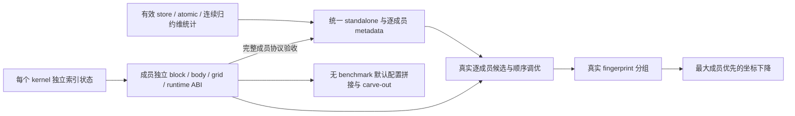

# 2.13 Combo/foreach 最新结果与问题分析

<a id="validation213"></a>

<!-- combo-section:validation213:start -->
## 2.13 当前结果与验证范围

当前唯一进展表为 [2.13 CSV](inductor-combo-tests-v2.13.csv)：116 行记录对应 105 个独立源方法、
464 个参数化实例。最新逐实例汇总为 **82 PASS、18 FAIL、5 SKIP 方法**；
实例为 **440 PASS、18 FAIL、6 SKIP**。

本轮已修复并复测两个确定的 Inductor 问题：Combo 的真实 FX 来源没有登记，多轴归约写回地址
与结果形状不匹配。两项原 FAIL 都已 PASS；追踪覆盖 Inductor 和 AOTInductor，归约实际生成
一个含两个成员的 Combo。[定向报告][case-rerun]、[生成代码及追踪校验][fix-proof]。

按用户本轮明确要求，在物理卡 1、2、3 上完整重跑 **82 个 PASS 方法的 440 个实例**，
没有抽样、没有复用旧 PASS。[全量 JUnit 校验][pass-regression]确认全部预定实例均有报告。
初跑报告为 **437 PASS、3 FAIL**；三个失败的处理如下：

- pointwise 原输入的 1024 倍尺寸差触发现有 NPU 分区策略。保留原输入并检查两个普通 kernel，
  另加中等尺寸差场景，严格检查一个真实共享 block Combo 的数量、成员尺寸和 runtime ABI。
- `r0_r1` 在写回修复后已能生成一个合法 Combo；更新 NPU 数量与共享 ABI 断言，保留原输入和 FP64 对照。
- 全局 `TORCH_LOGS=output_code` 覆盖了 SNode 用例的 metrics 设置。改用
  `TORCH_LOGS=output_code,inductor_metrics` 复测两个 SNode 方法，并补验 basic，排除空循环 PASS。

上述 **4 个方法、4 个实例复测全部 PASS**；两个 SNode 方法各实际收集到两个调度节点，
[复测与生成代码][case-followup]、[非空节点及依赖深度][snode-metrics-proof]均已校验。
最终这 **82 个方法的全部 440 个实例均已通过**；未改动 torch_npu 生产修复。

本轮没有重跑剩余 **18 FAIL、5 SKIP 方法的 24 个实例**，保留其实际历史报告与验证版本。
[合并校验][merge-check]确认这些报告逐项不变；[当前 jobs][current-jobs]保留每个实例的执行来源。

### 执行方式与源码

使用 NPU_A5 容器内 `pta_213_case`，测试来自 `Community-Use-Case-Testing:fix/combo_case`，
目录 `v2.13.0/inductor_npu`。全量执行提交为 `7332db7c9fc5a5d10da2f17ec29e22866d38154a`，
4 项复测提交为 `023fd814784896f3e2a11186787fc40b2ebc60c7`。
只修改两个结构断言方法，其他方法、fixture 和 SNode 源码保持一致，见[源码核对][followup-source-check]。
通过[原生 pytest 执行脚本](../../../../scripts/tests/combo_kernel_210/README-213.md)按方法收集全部参数，
三个 worker 分别设置 `ASCEND_RT_VISIBLE_DEVICES=1/2/3`；没有自定义 pytest 插件。

PyTorch 为 `2.13.0+cpu`（`cf30153c4c131c8164ee7798e5022d810682e2cb`），Triton 为 `3.6.0`。
基础 torch_npu 为 `2.13.0+gitefc05dd`（`efc05dd90b5fe31717d5f13e51fb3e49035bea30`），
安装的 Python 文件叠加 `pytorch_new:bugfix/combo_fix_meta` 提交
`5db866a16403644c265f3f43d747a856124de8b1`；实际修复版本以文件哈希为准。
[定向源码检查][fix-context]、[全量检查][full-regression-context]和[复测检查][followup-source-check]
确认执行前后源码一致；两个阶段的 588 个已安装 Inductor Python 文件哈希相同。

foreach 的 NPU 功能适配保留数值、原地更新及梯度检查；NPU 分支没有使用 CUDA 专属 kernel 数量
和 foreach DSL 断言。其功能 PASS 不等于已经实现独立成员分组融合。

### 六项 torch_npu 修复说明

每项生产修复各有独立提交和说明，分别记录现象、上游来源、术语解释及生成代码的变化。
下表提交对应实际 NPU 验证版本；迁入 master 后的新提交在各说明中单独列出。

| 修复 | 原验证提交 | 上游来源 | 说明 |
| --- | --- | --- | --- |
| 补齐 optimize_mem 图阶段字段 | `43c727fb81` | [#180790](https://github.com/pytorch/pytorch/pull/180790) | [上游作用与当前 NPU 的区别](npu-combo-optimize-mem-fix.md) |
| 统一访存量、FLOP 与 benchmark 成本 | `72b1727020` | [#180813](https://github.com/pytorch/pytorch/pull/180813) | [成本从哪里来、如何汇总](npu-combo-cost-metadata-fix.md) |
| 统一 arg 归约真实索引与 CSE 类型 | `0503095a63` | [#183938](https://github.com/pytorch/pytorch/pull/183938) 的索引类型部分 | [为什么索引类型必须一致](npu-arg-reduction-index-dtype-fix.md) |
| 传递共同 Triton 编译 metadata | `9f639af716` | [#180789](https://github.com/pytorch/pytorch/pull/180789) | [开关为什么会漏传](npu-triton-common-metadata-fix.md) |
| 按真实分区登记 FX 追踪 | `0dfe37f3ca` | NPU 接入修复；参考 [#163378](https://github.com/pytorch/pytorch/pull/163378) 的调用约定 | [为什么不能把 Combo 外壳交给追踪](npu-combo-provenance-fix.md) |
| 规范多轴归约写回地址的形状 | `5db866a164` | NPU 独立修复，无对应同步 PR | [标量地址如何配套单元素结果](npu-multiaxis-reduction-store-fix.md) |

`optimize_mem` 当前只补齐上游 metadata 规则，已检查的 NPU 调优路径没有调用 CPU 备份逻辑，
不能将字段验证 PASS 解释成 NPU 已实现内存节省。
六项修改已基于 master `b706240181` 迁入 `bugfix/combo_fix_meta_master_20261117`，
对应 [PR !49793](https://gitcode.com/Ascend/pytorch/merge_requests/49793)
及 [Issue #6157](https://gitcode.com/Ascend/pytorch/issues/6157)。新基线只做了本地静态核对，未重跑 NPU 测试。

CSV 新增“修复方案”列，已验证修复写明已有方案、责任仓库、简短原因、提交和说明/证据。
“当前分析”仅写剩余问题的简短原因，PASS 保持“—”。
“已上线”仍逐实例对照[上线清单](../../../../scripts/tests/combo_kernel_210/combo_native_213_passed_nodeids.txt)，
当前 PASS 不自动算上线；嵌套函数随外层方法验证，不重复计为独立 pytest 方法。
本轮完整 PASS 回归是用户指定的额外验证；后续默认仍只复测 FAIL、SKIP/ERROR。

<!-- combo-section:validation213:end -->

<a id="analysis213"></a>

<!-- combo-section:analysis213:start -->
## 当前问题与按根因排序的修复队列

当前共有 **18 FAIL、5 SKIP 方法**。18 个 FAIL 进入根因队列，5 个硬件差异方法保留 SKIP；4 个软件门控已经解除。
全范围根因表记录生成正确性、真实统计、出口、成员 ABI、调优与功能验收的依赖；同一用例可以覆盖多个根因。
本次 `bugfix/combo_fix_meta` 的剩余 R09—R12 按修改量、影响范围和依赖安排实施顺序，见下节。

**R 表示已定位的根因/能力或验收缺口，D 保留待定界的优化契约编号。**
当前保留 17 项定位记录，其中 D04 仍需定界。
14 项 Inductor 实现修复方案仍未实施。软件门控已在 `fix/combo_case` 修改并定向验证，当前状态以本次逐实例汇总为准。
未实现的软件目标保持 FAIL，硬件差异保留 SKIP；已 PASS 的用例不保留旧失败分析。

根因源码与原始诊断固定在各自实际安装的 Torch/NPU 提交，见 [原根因审计][root-queue]和[固定补充证据][root-evidence]。
本次 [定向报告][case-rerun]和[当前汇总][current-jobs]记录实际状态与验证版本。

这里的“成员”是 Combo 中保留独立计算域的一条分支。ABI 指生成 body 与 launcher 之间参数名、类型和值的约定；TTIR 是 Triton 编译的中间表示，校验失败后可能退回普通 kernel。CSE（公共子表达式消除）用缓存复用相同计算，计数应排除这类复用。block tensor 是 DSL 中向量/矩阵形状的值，标量只有一个值。fingerprint 由真实尺寸和优化字段判断候选是否等价；坐标下降在固定其他配置时，依次改变一组分块参数并实测。

### FAIL 原因的能力归属

已按当前失败实例、用例配置、实际断言和实现消费链复核当前 **18 个 FAIL 方法、18 个失败实例**。
当前失败分类沿用固定源码复核依据，执行结果采用上文的逐实例实测记录；
[归因审计][failure-capability-audit]保存剩余失败方法的分类、源码版本及依据。

其中 **14 个方法直接涉及成员独立块及配套能力**：默认配置 3 个、成员调优 5 个、逐成员 metadata 6 个。
共同实现仅在 `per_subkernel_blocks` 模式下导出成员统计、尺寸和归约方向，调优入口再消费这些信息。
因此表格统一写“独立块配套统计/归约布局 metadata 缺失”等原因，完整验收需要 R18 接通真实成员 block/body/grid 协议。
基础计数和 standalone 统计可先单独补齐；R18 完成后仍需各自补齐统计、默认配置和调优消费者。

另有 **2 个异构组合方法按当前 R23 方案间接依赖独立块**：
`test_combo_kernel_scalar_store_broadcast` 和 `test_combo_kernel_store_mask`。
前者保留异构组合缺口；后者还保留动态归约索引缺陷，不能只修独立块就视为完成。

其余 **2 个方法与成员独立块无关**：布局方法当前阻塞在 eager 的 channels_last 转换，
另一方法缺少共享输入行列联合归约功能。前者另有后续 profiler 用例适配，后者按功能需求排期。

<a id="fix-plans213"></a>

### Inductor 修复方案范围

| 责任与类型 | 具体根因 | 本次提供的方案 |
| --- | --- | --- |
| 生成正确性，3 项 | R27 索引缓存；R03 masked 轴；R04 index_expr cast | 指向具体生成规则，写明合法 DSL/索引如何形成。 |
| 统计和 metadata，4 项 | R09—R12 | 分开修 producer 和逐成员出口。 |
| NPU Combo 新功能，7 项 | R18—R24 | 成员独立 block/body/grid/runtime ABI、默认拼接、顺序调优、真实分组、坐标下降、异构打包、联合归约。 |
| 不属于生产 Inductor | R05 eager；R08 布局 profiler | 保留定界与验收入口，本次不提出生产 Inductor 修复。 |
| 仍待定界 | D04 大 R 优化资格 | 明确下一份证据和判定分支，不给猜测性修复。 |

生成正确性队列先处理 R27 的跨 kernel 状态，再修 rank/dtype/mask。
统计队列中 R09/R10/R11 的真实 producer 完成后接完整 R12。
R18 完成成员 ABI 后再接默认配置和调优消费者。

所有“预期生成行为”和“验收计划”都是方案要求，没有修复后的 DSL 或设备 PASS。
本地 [控制流隔离复核][axis-cache-probe]执行了固定源码的三个索引函数及实际轴使用判断，
但符号线性化、形状证明等 helper 为 mock；它证明缓存生命周期规则，不证明完整 NPU lowering 或数值已通过。

### 本次分支的实施优先级

排期已核对本地 `pytorch_new:bugfix/combo_fix_meta`，提交 `5db866a16403644c265f3f43d747a856124de8b1`。
以下是剩余项按当前入口评估的修改范围；各实例的实际验证版本见上文及逐实例报告。

先补入口集中的真实状态和已有消费者的接入，再处理归约布局和完整成员 metadata。
表中的“影响范围”同时考虑代码是否共用，以及字段是否改变实际运行决策，不能只按补丁行数判断。

| 执行优先级 | 顺序 | 项目 | 预计修改量 | 影响范围与排序依据 |
| --- | ---: | --- | --- | --- |
| 高 | 1 | [R09](#root-r09) `num_store` | 极小；1 文件、2 个计数入口 | Native Index 有效写回计数，沿用已有缓存和移除规则。 |
| 高 | 2 | [R10](#root-r10) `atomic_add_found` | 极小；1 文件、atomic 分支状态 | 只在真实生成原子写回时置位；普通 pointwise 保持 False。 |
| 后 | 3 | [R11](#root-r11) 连续归约维状态 | 中至大；轴、stride、load/store 状态 | 涉及 Native Index 方向替代、动态证明和候选输入，范围大于补字段。 |
| 后 | 4 | [R12](#root-r12) 完整逐成员 metadata | 中；至少 2 文件、统一来源和成员出口 | 依赖 R09/R10/R11；跨 standalone/Combo，需拆开 CUDA 专属资格计算。 |

建议按两个独立批次实施：**R09＋R10 → R11＋R12**。
R09/R10 是 R12 的真实状态前置，先补状态本身不意味着缺成员字典的原 FAIL 已通过。

R11 的真实布局统计合理；先补可证明的状态，再核对 native 候选消费者。
候选策略的修改有条件后置，CUDA 的归约过滤规则需单独证明等价后再接入。
R12 的基础计数和统一序列化可先补；完整逐成员协议验收还需要 R18，deterministic 布局另需 R11。
`tiling_scores`、`add_persistent_rblock` 和 HIP 的资源字段按真实 NPU producer/consumer 判断，缺字段本身不构成照搬理由。

R18—R24 的成员 block/body/grid/runtime ABI、调优和联合归约涉及多层行为，安排在这批之后。
R03/R04、R27 的生成正确性缺陷仍保留独立修复队列，若目标 FAIL 在这些位置受阻，就保留其阻塞关系。
每批只定向复验最新 FAIL、SKIP/ERROR 实例，并合并回唯一进展表；历史 PASS 及其验证来源继续保留。

以上判断的 producer 证据见 [R09/R10/R11 源码][E22]。

### 全范围根因及依赖

下表 P0—P2 保留全范围问题的原分类层级；本次 R09—R12 的实际执行顺序以上节为准。

| 问题层级 | 根因/定位项 | 当前判定 | 前置依赖 | 覆盖方法 |
| --- | --- | --- | --- | ---: |
| P0 | [R27 LoopBody 的候选索引缓存跨 kernel 复用，导致 x0/y0 轴错配](#root-r27) | 失败 DSL、固定源码及 CPU 控制流隔离复核已定位；未修复 | — | 1 |
| P0 | [R03 动态 shape/stride 符号被当成 masked subblock 的迭代轴](#root-r03) | 生成前缺陷已实测及源码确认；未修复 | — | 1 |
| P0 | [R04 动态整数 index_expr 在实际 cast 前被声明为 FP32](#root-r04) | 生成缺陷已实测及版本源码对照确认；未修复 | — | 1 |
| P1 | [R05 eager contiguous(memory_format=channels_last) 被 NPU 公共接口拒绝](#root-r05) | 原 eager 前置失败已确认；未修复 | — | 1 |
| P1 | [R08 布局用例的 profiler 读取尚未适配 NPU](#root-r08) | 源码确认的后续阻塞；当前先停在 eager | R05 | 1 |
| P1 | [R09 Native Index 的有效普通/归约 store 没有维护 num_store](#root-r09) | producer 缺口已由源码确认；原用例先停在成员字典缺失 | — | 3 |
| P1 | [R10 Native Index 发出 atomic_add，却没有设置 atomic_add_found](#root-r10) | producer 缺口已由源码确认；相关原图未触发原子加验收 | — | 2 |
| P1 | [R11 Native Index load/store 未维护连续归约维布局状态](#root-r11) | producer 缺口已由源码确认；原用例先停在成员字典缺失 | — | 1 |
| P1 | [R12 统一逐成员统计出口缺失](#root-r12) | 独立块配套 metadata 缺失 | 统计：R09/R10/R11；完整验收：R18 | 7 |
| P2 | [R18 成员独立块开关与 body/grid ABI 未贯通](#root-r18) | 基础能力缺失，阻塞配套协议验收 | R27 | 14；另 2 项间接依赖 |
| P2 | [R19 NPU override 绕过无 benchmark 的默认配置拼接和 carve-out](#root-r19) | 默认配置处理能力缺口已由源码确认；未实现 | R18 | 3 |
| P2 | [R20 NPU runtime 没有逐成员候选的 Combo 顺序调优消费者](#root-r20) | 独立成员调优能力缺口已由源码确认；未实现 | R18、R12 | 3 |
| P2 | [R21 真实 NPU 成员 metadata 未接入 fingerprint 调优分组](#root-r21) | 分组输入/消费链缺口已由源码确认；未实现 | R12、R18、R20 | 1 |
| P2 | [D04 RMSNorm add_persistent_rblock 的资格与 native R 候选对应待确认](#root-d04) | 原首失败是 R12；不能认作 persistent 归约整体缺失 | R12、R18、R20 | 1 |
| P2 | [R22 NPU 有 CoordescTuner 对象和计时缓存，但未执行成员坐标下降](#root-r22) | 成员坐标下降能力缺口已由源码确认；未实现 | R18、R20、R21 | 1 |
| P2 | [R23 共享 launcher 限制异构成员组合，标量链/向量归约被拆为 singleton](#root-r23) | 特定组合能力缺口已由实际分区及源码确认；未实现 | R18；mean 另需 R03/R04/R27 | 2 |
| P2 | [R24 NPU 配置与 backend 资格阻断 mixed-order 联合归约入口](#root-r24) | 共享输入行/列联合归约特性未启用，原目标未实现 | — | 1 |

表中覆盖数可以重叠，不能相加当成失败数。R03/R04 对应的 store_mask 已解除门控，当前正式复测为 FAIL。
P0 记录生成状态与语义；P1 记录前置接口、统计和出口；P2 在依赖齐备后验收新功能。



### 逐成员 metadata 和四个统计用例检查什么

当前四个统计/布局方法分别检查逐成员计数、atomic 状态、连续归约维和 standalone 字段一致性。
下表逐字段说明实际用途和确认到的缺口；成员字典缺失与真实 producer 未维护是不同根因。

| 字段/出口 | 作用 | 当前具体缺口或已有能力 |
| --- | --- | --- |
| `inductor_meta_i` | 每个成员自己的统计/优化字典，不能用首成员或空字典代替。 | [R12](#root-r12)：Combo 出口缺失；standalone 也没接统一 per-kernel helper。 |
| `heuristic_i` / `size_hints_i` | 逐成员候选类别与尺寸输入，供默认配置、候选等价分组和独立调优。 | [R12](#root-r12)/[R21](#root-r21)：共同命名出口缺失；NPU 已有真实轴/尺寸的 combo_subkernel_meta。 |
| `reduction_hint_i` | 描述成员归约访问方向；本用例要求行 INNER、列 OUTER。 | [R12](#root-r12)：缺逐成员出口，不能只沿用首成员 hint。 |
| `num_load` | CSE 去除缓存复用后有效 load 数，描述逻辑访存工作量。 | producer 已有；[R12](#root-r12) 没有导出到成员字典。 |
| `num_store` | 有效普通/归约最终写回数，被移除写回不应计入。 | [R09](#root-r09)：Native Index CSEProxy 未维护；[R12](#root-r12) 出口也缺。 |
| `num_reduction` | 归约 primitive 数，为候选和工作量提供输入。 | producer 已有；[R12](#root-r12) 没有导出到成员字典。 |
| `autotune_hints` | 实际成员的候选提示，例如 ONE_ELEMENT_PER_THREAD。 | top-level native 提示已有；[R12](#root-r12) 缺逐成员统一来源/出口。 |
| `atomic_add_found` | 成员是否实际发出原子加，影响候选和写回规则。 | [R10](#root-r10)：Native Index atomic 分支未设置 True；[R12](#root-r12) 出口也缺。 |
| `has_loadstore_with_contiguous_rdim` | 是否有真实连续归约维的 load/保留 store，参与归约候选过滤。 | [R11](#root-r11)：Native Index 未维护布局 producer；[R12](#root-r12) 出口也缺。 |
| `no_x_dim` | 成员 DSL 的非归约维优化，按成员.no_x_dim 导出；与 dispatch 无 split 不同。 | dispatch 的 no_x_dim_i/no_split 已有；[R12](#root-r12) 的完整 per-kernel 字典未导出。 |
| `tiling_scores` | 各轴 tiling 评价信息，standalone/Combo 的比较需对应 native 候选语义。 | [R12](#root-r12)：未接统一字段出口；不能用空解析作为相同基准。 |
| `add_persistent_rblock` | 资格标志，让候选生成器增加专门的大 R 配置。 | 原首失败是 [R12](#root-r12)；[D04](#root-d04) 尚需对照 native 实际候选，不能说 persistent 归约缺失。 |

四个方法与字段一一对应如下。原方法多为字段存在性/解析比较；“需验真实值”是完整修复验收要求，不冒充原方法已经检查到真实 producer。

| 统计方法 | 具体目标 | 原首失败/后续依赖 |
| --- | --- | --- |
| `test_combo_pointwise_combo_grid_meta_has_per_subkernel_fields` | 三个 relu/sigmoid/tanh 成员的 load/store/reduction、提示和 atomic 状态 | 缺成员字典 R12；producer 后续 R09/R10。 |
| `test_combo_reduction_combo_grid_meta_has_per_subkernel_fields` | sum/mean 两成员的有效 load/store/reduction | 缺成员字典 R12；store producer 后续 R09。 |
| `test_combo_reduction_deterministic_has_contiguous_rdim_per_subkernel` | 确定性 sum/mean 逐成员连续归约维布局 | 缺成员字典 R12；布局 producer 后续 R11。 |
| `test_combo_per_kernel_inductor_meta_matches_standalone` | 两侧非空完整计数、atomic、no_x_dim、提示和 tiling_scores 相同 | standalone 两项 vs Combo 零项；R12 和 R09/R10。 |

### 各根因的证据与修复方案

<a id="root-d02"></a>
<a id="root-r27"></a>

#### R27 LoopBody 的候选索引缓存跨 kernel 复用，导致 x0/y0 轴错配

**P0 · 失败 DSL、固定源码及 CPU 控制流隔离复核已定位；未修复**。失败阶段：候选索引准备/普通 kernel 重建 → Native Index DSL/TTIR。

当前正式复测：store_mask 数值通过，单 Combo 期望 1、实际 3；最终 store mask 断言尚未执行。
[当前日志][store-mask-current-log]记录缺失 x0/s0/s53 range entry，[最终 wrapper][store-mask-current-code]
包含三个普通 mean kernel 定义及三次 launch，未形成目标 Combo。

固定补充诊断进一步定位：候选成员轴为 x0/x1/r2，随后普通 kernel 的轴为 y0/x1/r2，却保留含 x0 的 load/store，TTIR 报
NameError。y0 的索引/mask 未进入 body。索引准备缺陷与异构组合缺口分别按 R27/R03/R04、R23 处理。

根因与代码方案源码依据：[E26][E26]、[E21][E21]。

证据：NPUIndexTritonKernel 构造即经 decide_codegen_dims_in_kernel/_transform_schedule_indexing 把 kernel 轴写到共享
node._body.indexing。ir.py:1614 仅在 indexing is None 时从当前 indices 重新生成；scheduling.py:519—572 先构造潜在 Combo 成员，再为 singleton
重建普通 kernel，未执行过 body 的候选也会留下映射。ir.py:2028 的 loopbody__call__ 只有 root_block 正常返回才清空 indexing，异常路径没有 finally；combined
回退只恢复 group/metrics。共同 rename_indexing 只改 size 参数，不能把旧迭代轴变成新轴。find_axis_in_load_store 按当前 y0 在旧 x0 地址中找使用关系失败，所以 y0
定义也被抑制。CPU 隔离复核执行固定源码函数，确认丢弃候选和异常均能保留旧映射；符号线性化/helper 是明确的 mock，未做 NPU 数值验证。

**修复方案（未实施）**。责任：torch_npu Inductor 的 LoopBody 索引准备与候选生命周期。

拟修改入口：NPU
torch_npu/_inductor/codegen/ir.py::generate_body_indexing/transform_dims_in_indexing/loopbody__call__（437、1614、2028）；NPU
torch_npu/_inductor/codegen/triton.py::decide_codegen_dims_in_kernel/_transform_schedule_indexing（1220、1480）；NPU
torch_npu/_inductor/codegen/scheduling.py::generate_combo_kernel_code（509）；npu_combined_scheduling.py::codegen_combo_kernel（240）。

1. 把 indexing、indexing_map、indirect_replacements、masked_indexing 作为当前 kernel 对各 LoopBody 的准备结果保存。每个新 kernel 从原始
indexing_exprs 和自己的 split_and_set_ranges 重新建立映射；不以共享 body.indexing 非空作为跨 kernel 命中条件。
2. 准备阶段和实际 node.codegen 阶段使用同一 kernel 的索引视图。进入时安装该视图，退出时用 finally 恢复外层状态；同一个 kernel 的多个节点及
DisableReduction/EnableReduction 阶段仍使用一致映射。不能在准备后简单清空，否则会丢失已重建的维度。
3. 候选分区被丢弃、only_gen_src_code 的 singleton 返回、LoopBody 解释异常以及 TTIR 校验回退均退出索引作用域。先复用现有 kernel/context
生命周期承载数据，不新增跨图全局缓存。masked 子块的派生索引也一起恢复。
4. 在语义层核对最终地址/mask 中每个迭代符号都有当前 kernel 的 range entry 或受控替代定义。find_axis_in_load_store 应看到当前轴；不在生成字符串中把 x0 改成
y0，也不无条件补所有轴定义。

预期生成行为：后续 y0/x1/r2 kernel 的地址由本 kernel 的映射形成，保留 y0 定义及 y0_mask；其 stride 和归约集合与原 mean 相同；合法 Combo 生成和失败后的普通 kernel
不互相继承候选的轴状态。

影响范围：覆盖 Native Index 的候选准备、singleton 重建和失败回退；no-linear 使用共同 LoopBody 路径，需保持其原调用协议。

方案风险：重建维度、被移除父轴和多次 disable_reduction 切换需要一并验证；只给 body.indexing 加 finally 清理仍不能解决未执行过 body 的候选缓存。

**验收计划（尚未执行）**：

- 同一 LoopBody 先后由不同 tiling 的 kernel 准备，后者所有索引均属于后者的轴；未生成 body 的候选也不残留状态。
- 在 masked 解释和 TTIR 校验两处分别触发失败，再走普通生成；检查地址和 mask 定义、数值与正常生成一致。
- 对原 test_combo_kernel_store_mask 检查当前 mean 的合法 DSL；最终单 Combo/store mask 目标仍另需 R03、R04、R23。

原始失败 DSL 关键行（保持生成格式）：

```python
                tmp0 = tl.load(in_ptr0 + (x0 + ks0*r2 + ks0*ks1*x1), r2_mask & x1_mask, other=0.0)
```

覆盖用例（未复测项沿用原报告）：

- `test_torchinductor.py::CommonTemplate::test_combo_kernel_store_mask`：范围外，1 FAIL；数值通过，单 Combo 目标未通过。

证据：[E26][E26]、[E21][E21]；[CPU 控制流隔离复核][axis-cache-probe]；补充诊断
[store-mask-open][diag-store-mask-open]；[原方法与断言][test-index]；[原逐实例报告][jobs]。

<a id="root-r03"></a>

#### R03 动态 shape/stride 符号被当成 masked subblock 的迭代轴

**P0 · 生成前缺陷已实测及源码确认；未修复**。失败阶段：LoopBody masked-index analysis → DSL generation。

实测/原首失败：原全量被旧 NPU decorator SKIP。解除门控的原 pytest 首次 Combo 生成在 sympy_index_symbol(sub_axis + "_mask") 触发 assert name[0]
!= "s"；此时还没有失败 Combo DSL。最终数值通过、数量期望 1 实际 3，store mask 断言未执行。

根因与代码方案源码依据：[E19][E19]、[E26][E26]。

证据：NPU codegen/ir.py:1873 的 generate_masked_indexing 把 indexing 表达式各项的所有 free_symbols 并入
index_vars，没有排除动态尺寸/stride；triton.py:315 随后把每个字符串都当成轴名追加 _mask。共同 utils.py:1249 明确禁止用 index-symbol API 创建 s* shape
符号。普通 indexing:4963 本来会跳过 s/ps/i 符号，这条 masked-subblock 路径遗漏了同类约束。

**修复方案（未实施）**。责任：torch_npu Inductor masked 子块的轴依赖分析。

拟修改入口：NPU torch_npu/_inductor/codegen/ir.py::generate_masked_indexing（1873）；NPU
torch_npu/_inductor/codegen/triton.py::NPUTritonOverrides.masked（315）、indexing/filter_masks。

1. generate_masked_indexing 从已经绑定当前 kernel 的索引收集真实迭代轴，依据 range entry 和符号类型排除 SIZE/PRECOMPUTED_SIZE 等 shape/stride
系数。不能再把每个 Mul 项的全部 free_symbols 当作需要 mask 的轴。
2. 生产端保留语义轴依赖；消费端结合当前 kernel 的替代轴/广播方向，取得实际会生成的 mask。标量有界循环或已证明无需 mask 的轴使用相应证明，间接索引继承 CSE mask 依赖；不盲目拼接字符串 _mask。
3. 继续叠加原 masked 条件和真实动态尾块 mask。进入/离开嵌套子块用 finally 恢复 current_subblock_axis，派生状态按 R27 的 kernel 作用域管理。

预期生成行为：动态 s*/ps* 系数不再产生 s*_mask；实际迭代轴的边界保护保留，所有引用均有定义。

影响范围：Native Index 动态 masked 子块及嵌套 masked 的轴依赖；共同 sympy_index_symbol 的 SIZE 防误用断言继续有效。

方案风险：只过滤 s 字符串不足以处理重建轴、方向替代和无 mask 的标量循环；只删除共同 assert 会掩盖错误依赖。

**验收计划（尚未执行）**：

- 原动态 mean 图不再在 sympy_index_symbol 构造阶段失败；检查动态尾块、嵌套 masked 和间接索引的访问范围。
- 配合 R27/R04/R23 后执行原 test_combo_kernel_store_mask 的数值、单 Combo 和最终 store mask 目标；保持未实现软件目标 FAIL。

覆盖用例（未复测项沿用原报告）：

- `test_torchinductor.py::CommonTemplate::test_combo_kernel_store_mask`：范围外，1 FAIL；数值通过，单 Combo 目标未通过。

证据：[E19][E19]；补充诊断 [store-mask-open][diag-store-mask-open]；[原方法与断言][test-index]；[原逐实例报告][jobs]。

<a id="root-r04"></a>

#### R04 动态整数 index_expr 在实际 cast 前被声明为 FP32

**P0 · 生成缺陷已实测及版本源码对照确认；未修复**。失败阶段：Native Index ordinary-kernel fallback → dtype assertion。

实测/原首失败：同一次补充诊断的另一普通 mean 生成 tmp3 = ks0*ks1*ks2（ks* 为整数参数），紧接 tl.static_assert(tmp3.dtype == tl.float32)，然后才 tmp4 =
tmp3.to(tl.float32)，因此校验失败。

根因与代码方案源码依据：[E20][E20]、[E18][E18]。

证据：NPU triton.py:344 的 index_expr 先以请求的非整数 dtype 记录原 indexing.index_str，再单独生成 to_dtype；整数表达式中间值被错误标注。实际 PyTorch
固定提交的对应实现:2390 已在同一个 CSE 生成表达式中显式 cast，并从实际 compute dtype 推导 metadata；NPU override 未采用该契约。

**修复方案（未实施）**。责任：torch_npu Inductor index_expr 的 dtype/CSE 契约。

拟修改入口：NPU torch_npu/_inductor/codegen/triton.py::NPUTritonOverrides.index_expr（345）；TORCH
torch/_inductor/codegen/triton.py::TritonOverrides.index_expr（2390）。

1. 把固定共同实现的实际 compute dtype 规则移植到 NPU index_expr：请求 FP32/其他非整数值时，将带括号的原索引表达式和 to_dtype 合成一个 CSE 生成表达式，登记 cast 后实际 compute
dtype。
2. 整数 index 用途继续采用 kernel.index_dtype；含临时变量时按实际参与值计算类型提升，必要时显式回到索引 dtype。mask_vars、shape 和 bounds 跟随实际返回值，不能在未 cast
的整数中间值上登记 FP32。
3. 保留 runtime_triton_dtype_assert。动态除数的生成示意为 (ks0*ks1*ks2).to(tl.float32) 后才检查 FP32，不生成先错误检查、再补 cast 的两段链。

预期生成行为：动态整数除数转换完成后对应 FP32 CSE；整数地址用途仍为正确的 int32/int64。

影响范围：NPU index_expr 作为 value 的类型转换；保留整数 indexing 及 mask/布局语义。

方案风险：低精度请求的 compute upcast 和混合临时变量提升必须采用共同规则；不能仅修改注释或禁用 dtype 检查。

**验收计划（尚未执行）**：

- 原动态 mean 的除数和输出通过 dtype assertion、TTIR 与原数值检查。
- 覆盖 FP32 value、低精度 compute upcast 和含不同整数 dtype 临时值的 indexing；最终单 Combo/store mask 另依赖 R03/R27/R23。

原始失败 DSL 关键行（保持生成格式）：

```python
    tmp3 = ks0*ks1*ks2
    tl.static_assert(tmp3.dtype == tl.float32)
    tmp4 = tmp3.to(tl.float32)
```

覆盖用例（未复测项沿用原报告）：

- `test_torchinductor.py::CommonTemplate::test_combo_kernel_store_mask`：范围外，1 FAIL；数值通过，单 Combo 目标未通过。

证据：[E20][E20]、[E18][E18]；补充诊断 [store-mask-open][diag-store-mask-open]；[原方法与断言][test-index]；[原逐实例报告][jobs]。

<a id="root-r05"></a>

#### R05 eager contiguous(memory_format=channels_last) 被 NPU 公共接口拒绝

**P1 · 原 eager 前置失败已确认；未修复**。失败阶段：eager ATen / memory format。

实测/原首失败：原用例先在 eager contiguous(memory_format=channels_last) 报 NPU 仅支持 contiguous 格式；compiled、成员独立分块和 profiler grid
检查均未开始。

根因与代码证据：固定 NPU TensorProperties.cpp:10 先返回已经满足请求格式的 tensor；需要转换时只接受 MemoryFormat::Contiguous，原 channels_last
转换因此被拒绝。责任入口是 eager memory-format 接口，不能根据用例名称直接判为 Inductor 分块失败，也不能由换成任意相同 stride 的输入宣称 channels_last 转换已支持。

修复入口：先明确并补公共 ATen 的 channels_last 转换契约；之后继续原八种布局转换以及 R18/R08 的验收。

完整验收：原 NCHW → channels_last 的 eager/compiled 数值、stride 和布局正确；再完成逐成员分块及真实 launch grid 检查。没有明确不再支持的依据，目标保持 FAIL。

覆盖用例（未复测项沿用原报告）：

- `test_combo_kernels.py::ComboKernelTests::test_combo_kernel_per_config_subkernel_block_size`：范围外，1 FAIL；原首失败关联。

证据：[E11][E11]；[原方法与断言][test-index]；[原逐实例报告][jobs]。

<a id="root-r08"></a>

#### R08 布局用例的 profiler 读取尚未适配 NPU

**P1 · 源码确认的后续阻塞；当前先停在 eager**。失败阶段：eager → profiler parsing/grid 检查。

当前 `test_combo_kernel_per_config_subkernel_block_size` 先被 channels_last contiguous 的 eager 错误阻塞，见 R05。
其后续读取仍固定使用 `trace_json["traceEvents"]` 和 CUDA grid 字段，尚未验证 NPU 事件容器及真实 launch。
本次修复没有修改这个布局方法。

修复入口：先解除 R05，再读取 NPU 实际事件格式，并核对最终执行的 launcher grid 与分块。
保留原八种布局转换、数值及分块/grid 目标，排除 autotune 测量 launch。

覆盖用例：

- `test_combo_kernels.py::ComboKernelTests::test_combo_kernel_per_config_subkernel_block_size`：1 FAIL；后续 profiler/grid 检查待执行。

证据：[原方法与断言][test-index]；[NPU grid 源码][E3]；[原逐实例报告][jobs]。

<a id="root-r09"></a>

#### R09 Native Index 的有效普通/归约 store 没有维护 num_store

**P1 · producer 缺口已由源码确认；原用例先停在成员字典缺失**。失败阶段：codegen statistics producer。

实测/原首失败：相关原用例首失败是 R12 的 inductor_meta_i 缺失或成员数组为空，尚未检查到真实 num_store 值。

根因与代码方案源码依据：[E22][E22]、[E27][E27]。

证据：NPU triton.py:5524/5535 的自定义 CSEProxy.store/store_reduction 对保留写回直接调用生成函数，未递增 num_store；load 的非缓存计数和 reduction
的计数已经存在。super().__enter__ 后 NPU 又安装自己的 CSEProxy，所以继承共同初始化不能补足被覆盖的统计维护。no-linear 普通 kernel 继承共同 CSE，不能把缺口扩展到全部 NPU 路径。

**修复方案（未实施）**。责任：torch_npu Inductor Native Index CSEProxy。

拟修改入口：NPU torch_npu/_inductor/codegen/triton.py::CSEProxy.store/store_reduction（5524、5535）；TORCH
torch/_inductor/codegen/common.py::CSEProxy.store/store_reduction（2894、2912）。

1. 在 name 不属于 V.graph.removed_buffers 且真正发起写回的分支维护 num_store：普通 store 成功生成后递增一次，store_reduction 按共同入口递增一次。
2. 保留 store cache、mutation 别名和 store_buffer_names 的原协议。deferred store 的排队/最终 splice 是同一个逻辑写回，不再次计数；kernel
构造失败的候选不用于正式成员统计。
3. 在 standalone 和 Combo 的真实成员生成完成后由 R12 导出同口径的 num_store，沿用共同 buffer 去除规则，不用 DSL 文本出现次数或硬编码数字补字段。

预期生成行为：原 pointwise 每个保留写回和 sum/mean 最终写回有对应计数；移除 buffer 的请求不增加计数。

影响范围：Native Index 的有效 store 请求；no-linear 共同 CSE 已有计数维护。

方案风险：避免 store_reduction 同时经过两个计数入口造成重复；延迟移除的 buffer 与字段冻结时机需按两侧同一规则核对。

**验收计划（尚未执行）**：

- 原四个计数/布局相关方法在 R12 接通后比较非空完整字段。
- 检查保留/移除写回、mutation 别名及 deferred reduction store，计数不因渲染次数变化。

覆盖用例（未复测项沿用原报告）：

- `test_combo_kernels.py::ComboKernelMetadataTests::test_combo_pointwise_combo_grid_meta_has_per_subkernel_fields`：范围外，1 FAIL；相关/后续覆盖。
- `test_combo_kernels.py::ComboKernelMetadataTests::test_combo_reduction_combo_grid_meta_has_per_subkernel_fields`：范围外，1 FAIL；相关/后续覆盖。
- `test_combo_kernels.py::ComboKernelMetadataTests::test_combo_per_kernel_inductor_meta_matches_standalone`：范围外，1 FAIL；相关/后续覆盖。

证据：[E4][E4]、[E22][E22]；[原方法与断言][test-index]；[原逐实例报告][jobs]。

<a id="root-r10"></a>

#### R10 Native Index 发出 atomic_add，却没有设置 atomic_add_found

**P1 · producer 缺口已由源码确认；相关原图未触发原子加验收**。失败阶段：codegen state producer。

实测/原首失败：原 pointwise 图先停在 R12；其 relu/sigmoid/tanh 并无 atomic_add，不能由字段存在性测试推定原子路径已验证。

根因与代码方案源码依据：[E22][E22]。

证据：NPU triton.py:3219 发出 tl.atomic_add 后没有维护 atomic_add_found=True；共同 triton.py:4415
有这一步。这会使后续导出的状态与真实生成操作不一致，即使普通 pointwise 图的默认 False 本来正确。

**修复方案（未实施）**。责任：torch_npu Inductor atomic store 状态。

拟修改入口：NPU torch_npu/_inductor/codegen/triton.py::store(mode='atomic_add')（3219）。

1. 仅在实际保留并生成 tl.atomic_add 的 store 分支设置 atomic_add_found=True，使用与共同生成端相同的状态语义。
2. R12 从每个真实成员读取该值。普通 pointwise 的 False 与含 atomic 的 True 保留差异；被提前移除的 atomic store 不应触发该状态。
3. 确认候选和写回消费者使用成员的实际状态；不以存在默认字段代替原子路径验收。

预期生成行为：包含保留 atomic_add 的成员字典为 True，原 relu/sigmoid/tanh 成员为 False。

影响范围：Native Index 的 atomic store 生成；既有无原子运算路径。

方案风险：字段存在性用例没有产生 atomic，必须另选真实原子写回小图证明 producer 与 consumer，不能从默认 False 推断已支持。

**验收计划（尚未执行）**：

- 真实保留/移除 atomic 写回及普通写回分别核对状态；standalone/Combo 字段与生成操作一致。
- 原 metadata 比较用例保持数值与成员差异检查。

覆盖用例（未复测项沿用原报告）：

- `test_combo_kernels.py::ComboKernelMetadataTests::test_combo_pointwise_combo_grid_meta_has_per_subkernel_fields`：范围外，1 FAIL；相关/后续覆盖。
- `test_combo_kernels.py::ComboKernelMetadataTests::test_combo_per_kernel_inductor_meta_matches_standalone`：范围外，1 FAIL；相关/后续覆盖。

证据：[E22][E22]；[原方法与断言][test-index]；[原逐实例报告][jobs]。

<a id="root-r11"></a>

#### R11 Native Index load/store 未维护连续归约维布局状态

**P1 · producer 缺口已由源码确认；原用例先停在成员字典缺失**。失败阶段：index/stride analysis → layout statistics。

实测/原首失败：确定性 sum/mean 原数值通过，随后缺 inductor_meta_i；has_loadstore_with_contiguous_rdim 的成员检查未执行。

根因与代码方案源码依据：[E22][E22]、[E27][E27]。

证据：共同 load/store 按实际 indexing 维护 has_load_with_contiguous_rdim 和 stores_with_contiguous_rdim，最后排除已移除写回。Native
Index 完整 override 没有这两个状态的维护；共用的 block_ptr store 生成 helper 本身也不承担它们的记录。no-linear 的共同路径需单独保留。

**修复方案（未实施）**。责任：torch_npu Inductor 连续归约维布局状态。

拟修改入口：NPU torch_npu/_inductor/codegen/triton.py::load/store/indexing 与 IndexAnalysis；TORCH
torch/_inductor/codegen/triton.py::_has_stride1_on_rdim/has_store_with_contiguous_rdim（3186、3214）。

1. 为 Native Index 定义连续归约维判定：从当前 range entry 的 is_reduction 语义及替代轴映射选归约变量，对实际归一化地址求 stride，仅在已证明 stride==1
时认定连续。不能直接依赖只识别共同 r0_/r1_ 类型的 helper。
2. 有效 load 设置 has_load_with_contiguous_rdim；有效 store 记录 buffer 名，最终 has_store_with_contiguous_rdim 排除已移除 buffer。block
pointer helper 不作为统计生产端，仍在语义 indexing 层记录。
3. 按共同 deterministic/force_filter_reduction_configs 条件通过 R12 导出两者的 OR。
候选过滤的接入以真实 native 消费者和等价规则为前提；其意义是访问布局，不能当作确定性归约支持开关。

预期生成行为：连续和非连续真实访存产生不同布局值，字段在应开启的过滤模式下导出。

影响范围：Native Index 的连续归约维布局及相应候选输入；no-linear 继续使用共同 producer。

方案风险：动态 stride 不能仅凭优化 hint 宣称等于 1；方向替代后的轴与被移除 store 要正确还原到语义访问。

**验收计划（尚未执行）**：

- 原 deterministic sum/mean 方法继续通过数值，并检查真实连续布局标志。
- 用 stride==1、明确非连续、符号 stride 及已移除写回对照，确认候选消费与字段相符。

覆盖用例（未复测项沿用原报告）：

- `test_combo_kernels.py::ComboKernelMetadataTests::test_combo_reduction_deterministic_has_contiguous_rdim_per_subkernel`：范围外，1 FAIL；相关/后续覆盖。

证据：[E22][E22]、[E4][E4]；[原方法与断言][test-index]；[原逐实例报告][jobs]。

<a id="root-r12"></a>

#### R12 standalone/Combo 没有统一 per-kernel 统计出口，Combo 缺逐成员 metadata

**P1 · 出口缺口已由原断言和源码确认；未修复**。失败阶段：generated metadata / FileCheck / parsing。

实测/原首失败：四个计数/布局方法在缺 inductor_meta_i 或 Combo 成员解析为 0 项时失败；归约方向方法缺 reduction_hint_0；RMSNorm 在缺成员字典时失败，尚未执行
add_persistent_rblock 检查。调优分组日志未出现，R21 的真实输入链未完成。

这些用例检查的成员字典、heuristic、size_hints 和 reduction_hint，在共同 `combo_grid_meta` 中受
`per_subkernel_blocks` 控制，属于独立块配套协议。基础统计可先修，完整用例还需 R18 接通真实独立分块；
真实调优分组另需 R20/R21。已开启测试配置不代表 NPU 生成入口实际采用了该模式。

根因与代码方案源码依据：[E22][E22]、[E27][E27]、[E2][E2]。

证据：NPU create_inductor_meta:1926 不调用共同 inductor_meta_per_kernel；Combo jit_line:207 只取第一个成员的
metadata。combo_grid_meta:465 没有 inductor_meta_i、heuristic_i、size_hints_i、reduction_hint_i。已有 combo_subkernel_meta
记录真实轴、尺寸、模式并供共享 tiling 搜索，它不能代替逐成员统计字典。no_x_dim_i 的 dispatch 标志已有，但不等于每个 inductor_meta_i 中完整的真实字段。

**修复方案（未实施）**。责任：torch_npu Inductor per-kernel 元信息出口。

拟修改入口：NPU torch_npu/_inductor/codegen/triton.py::create_inductor_meta（1926）；NPU
torch_npu/_inductor/codegen/triton_combo_kernel.py::jit_line/combo_grid_meta/autotune_subkernel_meta（207、465、144）；TORCH
torch/_inductor/codegen/triton.py::inductor_meta_per_kernel（6235）。

1. 把统一 per-kernel serializer 作为 standalone 和 Combo 的同一来源，接入真实 num_load/num_store/num_reduction、autotune_hints、atomic
状态和成员.no_x_dim。先补 R09/R10/R11，不复制首成员，也不填默认 0。
2. 在 combo_grid_meta 为每个实际生成成员写入 inductor_meta_i、standalone 类别的 heuristic_i、真实 size_hints_i 和
reduction_hint_i/tile_hint_i。已有 combo_subkernel_meta 的轴、模式和尺寸继续供 native tile 搜索使用，成员字典补入缺失统计。
3. no_x_dim 描述成员 DSL 的非归约维优化；dispatch 的 no_split/no_x_dim_i 只描述一维 grid 分配，不以它替换 per-kernel
的优化字段。tiling_scores、连续归约维状态及其他可选字段遵循其实际 producer 与启用条件，两侧保持同一省略规则。
4. 按当前 native protocol 拆分共同 helper 中依赖 CUDA tiling/memory-stats 的优化资格计算，D04 未定界的资格不在 serializer 中强行求值。R20/R21
从每个完整成员输入生成候选；行/列方向由实际 stride/axis 推导。

预期生成行为：pointwise 三成员、sum/mean 两成员各有非空完整统计，两个 standalone 与两个 Combo 成员能够逐项比较；逐成员 heuristic/size/hint 与 native 轴描述对应；行
INNER、列 OUTER 的原目标完整执行。

影响范围：Native Index standalone 和 NPUCombo 元信息来源；共同字段契约与 NPU 真实轴/尺寸协议同时保留。

方案风险：共同 helper 包含基于 CUDA 形状的 add_persistent_rblock 等求值，不能无条件调用后假定 native 等价；可选 tiling_scores 缺真实值时不伪造非空字典。

**验收计划（尚未执行）**：

- 原四个计数/布局方法和逐成员 reduction_hint 方法执行完整；比较前检查成员数量、必需字段和有效值，避免空解析相等。
- 候选生成实际消费各成员字典；模拟 fingerprint helper 的 PASS 不替代真实链验收。

覆盖用例（未复测项沿用原报告）：

- `test_combo_kernels.py::ComboKernelMetadataTests::test_combo_pointwise_combo_grid_meta_has_per_subkernel_fields`：范围外，1 FAIL；原首失败关联。
- `test_combo_kernels.py::ComboKernelMetadataTests::test_combo_reduction_combo_grid_meta_has_per_subkernel_fields`：范围外，1 FAIL；原首失败关联。
- `test_combo_kernels.py::ComboKernelMetadataTests::test_combo_per_kernel_inductor_meta_matches_standalone`：范围外，1 FAIL；原首失败关联。
- `test_combo_kernels.py::ComboKernelMetadataTests::test_combo_reduction_deterministic_has_contiguous_rdim_per_subkernel`：范围外，1 FAIL；原首失败关联。
- `test_combo_kernels.py::ComboKernelTestsMaxAutotune::test_combo_kernel_per_subkernel_reduction_hint`：范围外，1 FAIL；原首失败关联。
- `test_combo_kernels.py::ComboKernelMetadataTests::test_combo_rms_norm_forwards_add_persistent_rblock`：范围外，1 FAIL；原首失败关联。
- `test_combo_kernels.py::ComboKernelTestsMaxAutotune::test_combo_autotune_grouping`：范围外，1 FAIL；相关/后续覆盖。

证据：[E2][E2]、[E4][E4]、[E11][E11]、[E22][E22]；[原方法与断言][test-index]；[原逐实例报告][jobs]。

<a id="root-r18"></a>

#### R18 per_subkernel_blocks 在 NPU scheduling 接入时丢失，body/grid 共用 block ABI

**P2 · 独立成员分块能力缺口已由源码确认；未实现**。失败阶段：scheduler metadata → Combo body/grid/runtime ABI。

实测/原首失败：no-bench 两个方法数值和单定义通过后缺三个独立 XBLOCK_i；调优方法没有成员顺序调优/分组日志；其他方法有 R05 或字段检查前置阻塞。开关 True 的负向字段 PASS 不能证明独立分块生效。

根因与代码方案源码依据：[E23][E23]、[E28][E28]。

证据：共同 scheduler 的 ForeachKernelSchedulerNode 保存 per_subkernel_blocks；NPU codegen_combo_kernel:474 没有把它传给
generate_combo_kernel_code（默认 False）。NPU get_block_args:367 按轴名共用 block，SIMDDispatch:284 让所有成员使用 block_args[0]。共同
SIMDScheduling:3724 则读取并传递该字段。NPU 构造函数接受参数不等于完整消费者已实现。

**修复方案（未实施）**。责任：torch_npu Inductor 成员独立分块 ABI。

拟修改入口：NPU torch_npu/_inductor/codegen/scheduling.py::codegen_combo_kernel/generate_combo_kernel_code（474、509）；NPU
torch_npu/_inductor/codegen/triton_combo_kernel.py::get_block_args/add_autotune_args/SIMDDispatch/combo_grid_meta（365、341、284、465）；NPU
torch_npu/_inductor/runtime/triton_heuristics.py::SequentialComboKernelGrid/build_candidate_plan/运行时 block
materialization（108）。

1. 从 combo_kernel_node.per_subkernel_blocks 贯通到 NPU 生成入口与成员工厂；False 采用共享模式，True 明确选择独立模式。R27 保证每个成员的准备索引与该成员一致。
2. 在当前合法的一维成员 split 范围内，为每个成员分别建立运行时 BLOCK 和编译期 BLOCK_SUB 名称映射，例如
X0BLOCK_0/X0BLOCK_SUB_0、X0BLOCK_1/X0BLOCK_SUB_1。不同的实际轴名按各自映射生成，static persistent R 仍由该成员的实际 extent 生成。
3. 让 signature、body 中的 block 引用、runtime_block_arg_names 和候选 kwargs 都来自同一映射。add_autotune_args 遍历真实成员，不能仅取第一个；按生成对象/参数解析
suffix，不做任意字符串替换。
4. grid 与 SIMDDispatch 同时按成员计算 G_i=ceil(split_extent_i/BLOCK_i)，无 split 成员 G_i=1，总 grid=sum(G_i)，成员局部 pid 为总 pid
减去前缀和。grid callable 消费每成员 block 值，消除 block_args[0] 的共用。
5. 编译 variant 与完整候选继续分开：BLOCK_SUB/公共 backend options 变化需重编译，纯运行时 BLOCK 变化复用合法 variant；实际 launch 使用 winner 的成员 block
向量。之后接 R19/R20，不把独立 ABI 字段存在性当成运行证据。

预期生成行为：三个实际成员使用各自的 split/subblock 值；只改成员 1 的分块，不改变其他成员的体内引用和分配；wrapper、grid、候选 full_config、runtime blocks 和实际 launch
一致；一个实际 Combo 执行正确。

影响范围：首先贯通目前合法的每成员至多一个 split 轴的独立模式；异构模式和更多 split 维度另按 R23 的合法性设计扩展。

方案风险：NPU BLOCK 是运行时 core 分配，BLOCK_SUB 是编译期向量 tile，不能照搬 CUDA 全 constexpr 的 XBLOCK_i；shared compile_mode/warps/stages
仍是整 kernel 属性。

**验收计划（尚未执行）**：

- 原 no-bench 两个方法及三成员 pointwise 用实际 NPU ABI 检查独立分块和原数值/单 Combo 目标。
- 覆盖静态/动态尾块、无 split 成员及仅改变单个成员 BLOCK；检查最终 grid 的前缀区间不重叠、不漏计算。
- 独立块布局验收还受 eager R05 和 profiler R08 的前置条件约束；当前共享块布局用例按自身实际失败归因。

直接覆盖以下 14 个当前 FAIL 方法，均来自 `test_combo_kernels.py`；分类及对应实例见 [归因审计][failure-capability-audit]：

- 默认配置 3 个：`test_combo_kernel_no_bench_stitched_config`、
  `test_combo_kernel_no_bench_persistent_reduction`、`test_combo_kernel_no_bench_carve_out`。
- 成员调优 5 个：`test_combo_kernel_max_autotune`、`test_combo_kernel_max_autotune_with_reduction`、
  `test_combo_autotune_many_subkernels`、`test_combo_autotune_grouping`、
  `test_combo_kernel_coordesc_tunes_largest_subkernel_first`。
- 逐成员 metadata 6 个：`test_combo_kernel_per_subkernel_reduction_hint`、
  `test_combo_rms_norm_forwards_add_persistent_rblock`、`test_combo_pointwise_combo_grid_meta_has_per_subkernel_fields`、
  `test_combo_reduction_combo_grid_meta_has_per_subkernel_fields`、
  `test_combo_reduction_deterministic_has_contiguous_rdim_per_subkernel`、
  `test_combo_per_kernel_inductor_meta_matches_standalone`。

R23 的两个异构组合方法间接依赖成员独立 ABI，仍须修复自身的组合/索引缺陷。
当前共享块布局方法的 eager 失败保留 R05 原因。

证据：[E1][E1]、[E23][E23]；[原方法与断言][test-index]；[原逐实例报告][jobs]。

<a id="root-r19"></a>

#### R19 NPU override 绕过无 benchmark 的默认配置拼接和 carve-out

**P2 · 默认配置处理能力缺口已由源码确认；未实现**。失败阶段：no-benchmark candidate probe/stitch/partition。

实测/原首失败：前两项缺独立默认 XBLOCK_0/1/2；carve_out 数值通过，但 kernel 定义期望 2、实际 1，bucketize 与其余 pointwise 仍未按默认配置目标分离。定义数不等于 launch 数。

根因与代码方案源码依据：[E23][E23]、[E28][E28]。

证据：共同 simd.py:3504 的 _stitch_no_bench_combo_config 与 :3644 的成员默认 config probe、carve-out、stitch 流程没有进入 NPU
generate_combo_kernel_code:509 的 override，后者直接生成 Combo。

**修复方案（未实施）**。责任：torch_npu Inductor 无 benchmark 默认配置组合。

拟修改入口：NPU torch_npu/_inductor/codegen/scheduling.py::generate_combo_kernel_code（509）；NPU
torch_npu/_inductor/codegen/triton_combo_kernel.py::jit_line/combo_grid_meta；NPU native TileGenerator 与
cached_autotune 的无搜索候选入口。

1. 在独立模式且 enable_autotune=False 的实际生成阶段，调用每个成员的 native 候选产生器取得合法默认配置；只做生成/合法性选择，不启动性能 benchmark。候选准备使用 R27 的独立索引视图。
2. 根据成员必需 autotune_hints、候选约束和公共 compile options 是否兼容判定能否拼接，不用 CUDA 的候选数量<=2 或 HIP 的裸资源阈值直接判 NPU。
3. 将可拼接成员的 BLOCK/BLOCK_SUB 通过 R18 映射形成一个固定完整配置；公共 compile_mode/num_warps/num_stages 必须对全部成员合法，再按真实工作量选择公共默认值。把该配置同时传给
body、combo_grid_meta 和 native runtime，返回单一无搜索配置。
4. 不适合默认拼接的 bucketize 类成员作为 standalone carve-out；余下至少两个成员保留 Combo。小于两个时按实际 singleton 生成，保持 provenance 和成本归属。

预期生成行为：三个 pointwise/persistent 成员默认 block 值独立，完整 static R 保留；没有顺序性能搜索；原 carve-out 图 bucketize 独立，其余 pointwise 组成
Combo，共两个定义。

影响范围：独立成员模式的 no-benchmark 默认配置路径；与已存在的 native 共享 tile 搜索分开。

方案风险：默认配置拼接仍需整 kernel 编译模式合法；仅生成 default_config 字典而 launcher 仍用共享 block 不满足目标。

**验收计划（尚未执行）**：

- 原 stitched_config、persistent_reduction、carve_out 三个方法按实际配置、定义数、数值及真实无搜索行为完整验收。
- 检查没有成员被遗漏或重复生成，固定配置与实际 launch 一致。

覆盖用例（未复测项沿用原报告）：

- `test_combo_kernels.py::ComboKernelTests::test_combo_kernel_no_bench_stitched_config`：范围外，1 FAIL；相关/后续覆盖。
- `test_combo_kernels.py::ComboKernelTests::test_combo_kernel_no_bench_persistent_reduction`：范围外，1 FAIL；相关/后续覆盖。
- `test_combo_kernels.py::ComboKernelTests::test_combo_kernel_no_bench_carve_out`：范围外，1 FAIL；原首失败关联。

证据：[E23][E23]、[E11][E11]；[原方法与断言][test-index]；[原逐实例报告][jobs]。

<a id="root-r20"></a>

#### R20 NPU runtime 没有逐成员候选的 Combo 顺序调优消费者

**P2 · 独立成员调优能力缺口已由源码确认；未实现**。失败阶段：runtime candidate generation / sequential autotune。

实测/原首失败：三个方法编译执行返回后，Combo sequential autotune 日志匹配为 0；后续数值和单 kernel 检查尚未执行。

根因与代码方案源码依据：[E24][E24]、[E28][E28]。

证据：NPU 已有 combo_subkernel_meta 驱动的共享 tile 搜索，native autotune_to_one_config 按实际 candidate timings 取
min。它没有共同运行时逐成员 block 坐标的 chained/sequential tuning 链；因此日志缺失背后是消费者缺口，而非只换日志名即可解决，也不能说 NPU 完全没有 autotune。

**修复方案（未实施）**。责任：torch_npu Inductor 真实成员顺序调优。

拟修改入口：NPU torch_npu/_inductor/runtime/combo_tile_generator.py::成员候选接口；NPU
torch_npu/_inductor/runtime/triton_heuristics.py::triton_config_npu_index/cached_autotune/NPUCachingAutotuner.autotune_to_one_config（1803）。

1. 为每个真实成员按 native TileGenerator 生成合法候选，保留成员尺寸、dtype、persistent 完整 R、资源限制及 compiler options。共享模式继续使用已有
ComboTileGenerator；独立模式构造 R18 的成员 full_config。
2. 以完整 Combo 的基准配置开始，按实际成员工作量从大到小依次替换一个成员的 BLOCK/BLOCK_SUB 候选，其余成员保留前一步 winner。每次按完整 Combo 编译 variant、materialize runtime
blocks 并计时，不把独立 standalone 的最短耗时简单相加。
3. 公共 compile_mode/warps/stages 等在成员分块固定后单独从共同合法候选中调优。复用 native candidate_plan 的 variant 去重与真实 timing；benchmark 使用已有
mutation clone/restore。
4. 最终通过 _set_best_candidate 同时保存完整 winner、launcher、runtime block 向量及 cache 身份。缓存重载和实际 run 消费同一结果，日志由真实试验产生。deterministic
和显式 no-benchmark 继续走其不测量协议。

预期生成行为：pointwise、mixed reduction、六成员图执行真实逐成员搜索；候选、计时、winner 和 launch 可对应。

影响范围：NPU 独立成员 Combo 调优消费者；不是重新实现现有共享 tile autotune。

方案风险：完整配置中的公共 compiler options 不可随单个成员任意改变；仅缓存 coordesc timing 或打印 sequential 日志不等于执行搜索。

**验收计划（尚未执行）**：

- 原三项 max_autotune 方法执行后续数值和实际单 Combo 检查，记录至少一个真实成员配置变更。
- 检查候选合法性、runtime-only/compile-time 变化、cache 重载和 mutation 输入恢复；无搜索模式没有意外 benchmark。

覆盖用例（未复测项沿用原报告）：

- `test_combo_kernels.py::ComboKernelTestsMaxAutotune::test_combo_kernel_max_autotune`：范围外，1 FAIL；原首失败关联。
- `test_combo_kernels.py::ComboKernelTestsMaxAutotune::test_combo_kernel_max_autotune_with_reduction`：范围外，1 FAIL；原首失败关联。
- `test_combo_kernels.py::ComboKernelTestsMaxAutotune::test_combo_autotune_many_subkernels`：范围外，1 FAIL；原首失败关联。

证据：[E3][E3]、[E24][E24]；[原方法与断言][test-index]；[原逐实例报告][jobs]。

<a id="root-r21"></a>

#### R21 真实 NPU 成员 metadata 未接入 fingerprint 调优分组

**P2 · 分组输入/消费链缺口已由源码确认；未实现**。失败阶段：member heuristic metadata → tuning groups。

实测/原首失败：原方法期望两个调优组，实际解析为空；后续数值与单 kernel 检查未执行。

根因与代码方案源码依据：[E24][E24]、[E28][E28]、[E27][E27]。

证据：共同 _subkernel_fingerprint 从各成员尺寸、heuristic 和 per-kernel 统计推导候选等价性，再产生 combo_tuning_groups。NPU Combo
缺这些真实输入和对应消费者。已 PASS 的 grouping_by_metadata_fingerprint 只直接调用共同 helper 与模拟 metadata，不证明真实 NPU 图接通。NPU 已有 standalone
symbolic grouped autotune；其 Combo 中的禁用说明不能与这里的成员候选分组混为同一个概念。

**修复方案（未实施）**。责任：torch_npu Inductor 调优候选等价分组。

拟修改入口：NPU torch_npu/_inductor/runtime/triton_heuristics.py::独立成员候选/fingerprint 与 R20 的组消费者；TORCH
torch/_inductor/runtime/triton_heuristics.py::_subkernel_fingerprint/_handle_combo_kernel_per_subkernel_blocks（3569、3630）。

1. 从 R12 的真实成员输入定义 native fingerprint，包含实际影响候选的 heuristic、shape/动态约束、dtype、轴/布局、persistent 和 no-loop
状态、提示、计数及资源/公共编译选项。已有 native symbolic shape group 不作为这里的成员等价组。
2. 把成员候选规范化到自身参数映射前的语义坐标，核对 fingerprint 相同确实产生同一合法候选集合及公共 options；不能省略 NPU 特有约束后直接调用 CUDA helper。
3. 产生 combo_tuning_groups，记录成员 indices、候选、coordesc 字段/上限及工作量排序；R20 对等价组一起更新其各自的参数坐标，并继续用完整 Combo 计时。
4. 实际每成员 extent 和 grid 继续独立计算；等价分组仅减少重复搜索，不合并计算、删除成员或混用代表性动态 shape。

预期生成行为：原 grouping 图形成两个真实候选等价组，日志反映真实成员与试验。

影响范围：真实 NPU Combo 成员的调优分组；与 standalone symbolic grouped autotune 的 shape 分组不同。

方案风险：fingerprint 缺一项实际候选约束就可能错误合组；加入与候选无关的算子名称也会错误拆组。

**验收计划（尚未执行）**：

- 原 test_combo_autotune_grouping 完成两个组、数值及单 Combo 检查。
- 从真实图改变 dtype/stride/候选提示或动态约束，验证只有实际改变候选等价性时才改变组；模拟 helper PASS 单独保留其范围。

覆盖用例（未复测项沿用原报告）：

- `test_combo_kernels.py::ComboKernelTestsMaxAutotune::test_combo_autotune_grouping`：范围外，1 FAIL；原首失败关联。

证据：[E2][E2]、[E24][E24]；[原方法与断言][test-index]；[原逐实例报告][jobs]。

<a id="root-d04"></a>

#### D04 RMSNorm add_persistent_rblock 的资格与 native R 候选对应待确认

**P2 · 原首失败是 R12；不能认作 persistent 归约整体缺失**。失败阶段：member optimization eligibility → R candidates。

实测/原首失败：两个 (2048,4096) RMSNorm 数值通过，先缺 inductor_meta_i，尚未执行到 add_persistent_rblock 的检查。

已确认缺陷与尚缺追加源码对照：[E2][E2]、[E3][E3]、[E11][E11]、[E27][E27]。

证据：该字段让共同 _reduction_configs 增加专门的大 R 候选；Native NPU 已有完整-R persistent 和自己的资源筛选。目前确认的是出口缺失，还未用真实
standalone/Combo 候选证明该优化资格在 NPU 上是否丢失。

定位入口：源码对照先区分优化触发：共同 add_persistent_rblock 只对 looped 非 persistent 的二维归约增加专门候选；NPU A5 的 INNER/DEFAULT R<=4096 本可直接选择
persistent。这不是该 RMSNorm 图实际 winner 的证据。接 R12/R18 后取得真实 standalone/Combo 路径、完整 R 和候选：若本已完整 R，缺口回到成员出口和 native 优化验收；若
standalone 有合法大 R 而 Combo 丢失，则定位具体成员资格/候选过滤生产者再设计修复，不填永远 True。

完整验收：原 RMSNorm 数值、成员资格及合法完整 R/大 R 候选与 standalone 对齐；字段必须有实际消费者，不能补一个永远 True 的标志冒充优化。

覆盖用例（未复测项沿用原报告）：

- `test_combo_kernels.py::ComboKernelMetadataTests::test_combo_rms_norm_forwards_add_persistent_rblock`：范围外，1 FAIL；相关/后续覆盖。

证据：[E2][E2]、[E3][E3]、[E11][E11]；[原方法与断言][test-index]；[原逐实例报告][jobs]。

<a id="root-r22"></a>

#### R22 NPU 有 CoordescTuner 对象和计时缓存，但未执行成员坐标下降

**P2 · 成员坐标下降能力缺口已由源码确认；未实现**。失败阶段：runtime coordinate-descent tuning。

实测/原首失败：原 assertLogs 退出时失败，未捕获 coordinate_descent_tuner DEBUG；后续数值、多个成员配置和最大成员优先断言未执行。

根因与代码方案源码依据：[E24][E24]、[E28][E28]。

证据：NPU triton_heuristics.py:1734 会把候选 timing 缓存进继承的 coordesc_tuner；但 native :1803 的终选仅取 candidate timings
最小值，:1927 的 run 走 native autotuner，没有共同逐成员 coordesc 迭代。found_by_coordesc 标记或缓存计时不是执行过坐标下降的证据。 native save_cache_hook
还直接使用 coordinate_descent_tuning 开关填写 found_by_coordesc；该标记不证明实际搜索已执行。

**修复方案（未实施）**。责任：torch_npu Inductor 成员坐标下降执行。

拟修改入口：NPU
torch_npu/_inductor/runtime/triton_heuristics.py::NPUCachingAutotuner.autotune_to_one_config/run（1803、1927）；TORCH
torch/_inductor/runtime/triton_heuristics.py::Combo coordesc 字段顺序/上限；coordinate_descent_tuner。

1. R20 取得真实初始 winner 后，在 coordinate_descent_tuning 开启时把 R21 的成员字段顺序、合法上限和组约束交给坐标下降。按实际成员工作量排序，原三成员图先调成员 1。
2. 每个邻域试验只改变当前字段或等价组的对应字段；runtime BLOCK 更新要 materialize 新 grid，BLOCK_SUB 更新需要新的编译 variant。公共选项最后调，persistent 静态 R
不加入可变坐标。
3. native 编译/launch/benchmark 回调评价完整 Combo 并复用已有 timing cache；在找到合法改进后通过 _set_best_candidate 保存真实完整配置和 runtime blocks。
4. found_by_coordesc 只在实际执行过坐标下降后写入 cache；原 baseline/try 日志从真实试验生成，不用配置开关本身作为执行标记。

预期生成行为：记录多个不同成员配置，首个试验只改变最大成员 1 的 X 分块，最终 launch 使用实际 winner。

影响范围：独立成员 Combo 的坐标下降；已有 tuner 对象和计时缓存继续复用。

方案风险：共同 tuner 原先按 constexpr BLOCK 工作，NPU 的 runtime BLOCK 必须同时重算 grid；不能只更新 launcher.config 的文本。

**验收计划（尚未执行）**：

- 原 coordesc 方法保留数值、多个不同配置及最大成员优先目标，按实际 NPU 字段映射检查首个变更。
- 检查编译/运行参数两类变化、缓存标志和重载；关闭 coordesc 不执行邻域搜索。

覆盖用例（未复测项沿用原报告）：

- `test_combo_kernels.py::ComboKernelTestsMaxAutotune::test_combo_kernel_coordesc_tunes_largest_subkernel_first`：范围外，1 FAIL；原首失败关联。

证据：[E24][E24]、[E11][E11]；[原方法与断言][test-index]；[原逐实例报告][jobs]。

<a id="root-r23"></a>

#### R23 共享 launcher 限制异构成员组合，标量链/向量归约被拆为 singleton

**P2 · 特定组合能力缺口已由实际分区及源码确认；未实现**。失败阶段：horizontal partition compatibility / member ABI。

实测/原首失败：scalar 原数值通过，单 Combo 目标期望 1、实际 2。补充诊断已形成 add→mul→scalar sum 的 op1_op3_op4 FusedSchedulerNode；它与另一条向量归约 op0
被拆为两个 singleton。store_mask 补充诊断的两个 mean 成员也已按不同模式/轴拆开。

根因与代码方案源码依据：[E23][E23]、[E28][E28]、[E26][E26]。

证据：NPU horizontal_partition:74 按 kernel type、inside/persistent 和完整轴标志 tuple 分组，以满足一个共享 launcher/autotuner 的 block
ABI。scalar 成员仅 r0=2048、无 split；vector 成员有 x0/r1=2048、split x0。store_mask 的全局 mean 为 simt_only、维度 mean 为 simt_template
且轴布局不同。普通垂直融合在 scalar 链已发生，缺的是合法异构成员的 Combo 打包契约，不是普通垂直融合整体未实现。

**修复方案（未实施）**。责任：torch_npu Inductor 异构成员合法组合。

拟修改入口：NPU
torch_npu/_inductor/codegen/triton_combo_kernel.py::horizontal_partition/create_triton_kernel/dispatch（74、35、284）；NPU
torch_npu/_inductor/runtime/combo_tile_generator.py 与 native 公共 compiler options。

1. 把现有相同轴名/模式 tuple 的充分条件发展成明确的合法性检查：各成员独立轴、局部 pid、BLOCK/BLOCK_SUB 和 static R 用 R18 协议描述，无 split 标量分支只分配一个 program。
2. 先覆盖同一公共 compile mode 下的 scalar 链与向量归约：保留已经垂直融合的 add→mul→sum 成员，其标量 store/广播不受另一个成员的 X 维影响，按独立 dispatch 区间水平打包。
3. 动态 mean 的 SIMT_ONLY 与 SIMT_TEMPLATE 需要证明同一个 Triton 编译模式能合法表示两种地址/归约域，规范化 unsplittable 地址表达式并保持动态尾块；按全部成员公共 options
的合法交集生成候选。若交集为空，需补对应 native lowering/下层编译接口，不能仅放开分区 key。
4. 完成生成正确性 R03/R04/R27 后再验动态 mean。不同成员彼此独立，跨成员 producer/consumer 依赖仍必须先在一个成员内垂直融合，不能由水平打包绕过依赖。

预期生成行为：scalar 图的两个异构成员进入一个实际 Combo；动态 mean 目标在完整合法模式/ABI 接通后进入一个实际 Combo。

影响范围：NPU Combo 异构计算域打包新能力；普通垂直融合已经存在。

方案风险：成员编译模式是整 kernel 的公共属性；当前没有实测证明 SIMT_ONLY/TEMPLATE 的通用交集，相关部分是待实现/待验证方案。支持更多 split 维度时需显式 flatten/recover 局部坐标。

**验收计划（尚未执行）**：

- 原 scalar_store_broadcast 的原数值、标量写回、广播和单 Combo 目标完整验收。
- 原动态 mean 先验访问/归约元素集合与 mask，再验单 Combo 和最终 store mask；模式不可合法组合时目标仍 FAIL，不按硬件差异 SKIP。

覆盖用例（未复测项沿用原报告）：

- `test_combo_kernels.py::ComboKernelTests::test_combo_kernel_scalar_store_broadcast`：范围外，1 FAIL；原首失败关联。
- `test_torchinductor.py::CommonTemplate::test_combo_kernel_store_mask`：范围外，1 FAIL；数值通过，单 Combo 目标未通过。

证据：[E1][E1]、[E15][E15]；补充诊断 [scalar-v2][diag-scalar-v2]、[store-mask-open][diag-store-mask-open]；[原方法与断言][test-index]；[原逐实例报告][jobs]。

<a id="root-r24"></a>

#### R24 NPU 配置与 backend 资格阻断 mixed-order 联合归约入口

**P2 · 共享输入行/列联合归约特性未启用，原目标未实现**。失败阶段：joint reduction scheduling / lowering。

实测/原首失败：原数值通过，kernel 目标期望 3、实际 4。补充诊断 y_sum/z_sum 已组成 Combo，共享输入的 row/column 归约分别处理；没有 FusedMixOrderReductions 路径。

根因与代码方案源码依据：[E29][E29]、[E15][E15]。

证据：固定 NPU config.py:180 设置 mix_order_reduction=False；共同 scheduler.py:192 的 _is_gpu_triton_backend 还只接受
cuda/xpu，MixOrderReduction.can_fuse:347 使用该检查，固定 NPU 提交未覆盖这个 helper。仅打开 config 仍不能准入 NPU。NPUCombinedScheduling 继承的
CUDACombinedScheduling 会把 mixed-order codegen 委托给 NPUTritonScheduling，故不能说生成入口方法完全不存在；共同 SIMD 生成使用
r0_/RSPLIT_SIZE、workspace partial 和 wrapper 最终归约，native _get_grid_type 固定返回 GridNpu，完整 axis/grid/partial 协议尚需适配和验证。已实测
y_sum/z_sum 组成 Combo，row/column 未进入联合节点。这是共享输入联合归约特性接入缺口。

**修复方案（未实施）**。责任：共同 scheduler 资格接入与 torch_npu Inductor 联合归约。

拟修改入口：NPU torch_npu/_inductor/config.py（180）；NPUCombinedScheduling/NPUTritonScheduling 的 mixed-order 接入；TORCH
torch/_inductor/scheduler.py::_is_gpu_triton_backend/MixOrderReduction.can_fuse（192、336）；TORCH
torch/_inductor/codegen/simd.py::_generate_kernel_code_for_mix_order_reduction/_codegen_mix_order_reduction（2294、2352）；NPU
torch_npu/_inductor/codegen/triton.py::_get_grid_type/reduction/partial_accumulate 与 native wrapper/workspace。

1. 以真实 NPU mixed-order 支持条件接入 scheduler 资格，而不是仅把 mix_order_reduction 改为 True：固定共同 _is_gpu_triton_backend 还排除了 npu。先保留原
sibling、共享输入、归约类型与依赖检查，资格只在 native 联合生成可用时开启。
2. 为 row_sum/col_sum 建立同一输入矩阵的联合计算域，各输出有自己的归约轴与结果布局。共同实现中交换维度、partial_accumulate 和 r0_/RSPLIT_SIZE 协议要转换到 native
axis/grid，不能继续只由 find_reduction_node 的第一个方向决定全部输出。
3. 沿用共同‘联合 producer→workspace→wrapper 最终 sum/view/to’的数学协议，用 native split size、axis/grid 和 UB 资源规则形成列向 partial。原
x=(8192,1024) 不能整个驻留 UB；每个分片完成自己的行结果和列 partial，再按原输出布局合并。
4. native grid、公共编译选项和资源候选显式处理 mixed-order；NPU _get_grid_type 当前总返回 GridNpu，需与联合归约的 split/workspace 协议一致。共同路径已有 wrapper 侧
ATen 后处理，可先保持这一完成协议，不在联合 kernel 内引入未经证明的跨 program 同步。
5. row_sum_reduced 是 row_sum 的消费者，保留独立执行/合法依赖；y_sum/z_sum 继续组成 Combo。原计数是 generated_kernel_count，验收三个 Inductor 定义，同时单独记录
wrapper ATen 后处理的真实 launch，不能把三个定义写成总共三次设备执行。

预期生成行为：共享输入的 row/column 真正进入联合归约，partial/跨片合并正确；原最终四个输出数值和三个 Inductor kernel 定义目标成立。

影响范围：共享输入、不同归约方向的 NPU 联合归约新能力；与独立成员水平融合或 foreach 支持分开。

方案风险：已确认的是配置和资格门控；尚未实测开启后的完整 native lowering，workspace 生命周期、跨片完成协议和 UB 合法性是实现验收重点。

**验收计划（尚未执行）**：

- 原 test_fuse_mix_order_reductions_combo_kernels 检查联合节点、实际共享输入访问、partial 合并、四个输出及三个 Inductor 定义目标；额外 ATen 后处理单独核对。
- 检查非整除尾块、不同 stride 和 consumer 依赖；确定性配置的合法实现需按实际规则验收。

覆盖用例（未复测项沿用原报告）：

- `test_combo_kernels.py::ComboKernelTests::test_fuse_mix_order_reductions_combo_kernels`：范围外，1 FAIL；原首失败关联。

证据：[E15][E15]、[E3][E3]；补充诊断 [mixed][diag-mixed]；[原方法与断言][test-index]；[原逐实例报告][jobs]。

### 硬件 SKIP 边界

| 保留 SKIP 的方法 | 明确硬件/平台协议原因 |
| --- | --- |
| `test_combo_kernel_tma_descriptor_block_name` | 硬件差异，涉及 NVIDIA SM90+ GPU 专属的 TMA 描述符特性。 |
| `test_combo_kernel_amd_special_config_args` | 硬件差异，涉及 AMD GPU 专属的 ROCm/HIP 编译选项特性。 |
| `test_pdl_codegen_in_combo_kernel` | 硬件差异，涉及 NVIDIA SM90+ GPU 专属的 PDL 依赖启动特性。 |
| `test_pdl_combo_kernel_pointwise` | 硬件差异，涉及 NVIDIA SM90+ GPU 专属的 PDL 依赖启动特性。 |
| `test_pdl_combo_kernel_reduction` | 硬件差异，涉及 NVIDIA SM90+ GPU 专属的 PDL 依赖启动特性。 |

这 5 个方法对应 6 个 SKIP 实例。

### 水平融合、垂直融合和 foreach

水平融合把彼此没有 producer/consumer 依赖的独立成员打包进一个 Combo；垂直融合沿依赖链把生产者和消费者融进同一成员。`torch._foreach_*` 是对 tensor 列表逐项计算的前端 API。社区的 FOREACH 分组融合路径将列表项形成成员、吸收各项的生产/消费链，再水平打包。NPU 当前没有注册 FOREACH 专属 backend feature，但普通垂直融合入口可用。

```text
成员 0：add(a0, a0) → foreach 第 0 项 → mul(d0, a0)
成员 1：mul(a1, a1) → foreach 第 1 项 → mul(d1, a1)
```

`test_non_foreach_consumer_producer_list` 展示这两条链；`test_scheduler_fusion_list` 展示 foreach→foreach 的成员配对；`test_single_list` 展示独立列表成员水平打包。社区 2.13 支持上述组合，基础机制在 2.10 已存在，见 [E15][E15]。这些 foreach 方法按用户确认的功能适配口径保留数值、mutation、布局和梯度检查，其 PASS 不宣称 FOREACH 专属单 kernel 已完成，本轮不恢复被接受的 CUDA 结构断言。

补充 scalar 诊断的 `op1_op3_op4` 已明确证明普通 add→mul→sum 垂直融合发生；失败的是它与另一向量成员的异构 Combo 打包（R23）。mixed-order 联合归约（R24）、独立成员分块/调优（R18/R20）分别作为 NPU 功能目标讨论，不再合并写成“融合策略不同”。

### 固定输入/生成代码的针对性复现

诊断脚本在进程内观察 scheduler/codegen，保存原始 DSL/wrapper。
以下命令使用 `fix/combo_case` 的测试源码，在目标 NPU Docker 工作目录及 `pta_213_case` 环境执行。
四个软件门控已在用例源码中解除；诊断仅选择仍为 FAIL 的 store_mask 实例，按物理卡设置选卡变量。

```bash
python <repo>/artifacts/inductor-combo-tests-v2.13-full-a3cfe56-20261113/root-diagnostics/instrumentation/diagnose_roots_v5.py \
  --test-root <community>/v2.13.0/inductor_npu \
  --node test_torchinductor.py::CommonTemplate::test_combo_kernel_store_mask \
  --output <diagnostic-workspace>/store-mask-focused --pytest
```

该归档 driver 无论测试结果如何都会正常落盘；判断 PASS/FAIL 必须读取 `result.json` 的 `pytest_returncode` 与 JUnit，不用外层 driver 的退出码代替测试结果。生成 Python 保留原始代码格式，未重排。

<!-- combo-section:analysis213:end -->

[pass213]:
  ../../../../scripts/tests/combo_kernel_210/combo_native_213_passed_nodeids.txt
[csv]:
  inductor-combo-tests-v2.13.csv
[run213]:
  ../../../../scripts/tests/combo_kernel_210/README-213.md
[current-jobs]:
  ../../../../artifacts/inductor-combo-tests-v2.13-current-5db866a164-20261115/jobs.json
[failure-capability-audit]:
  ../../../../artifacts/inductor-combo-tests-v2.13-current-5db866a164-20261115/failure-capability-audit.json
[case-rerun]:
  ../../../../artifacts/inductor-combo-tests-v2.13-fixes-5db866a164-20261115/
[case-generated]:
  ../../../../artifacts/inductor-combo-tests-v2.13-fixes-5db866a164-20261115/generated-metadata.json
[case-adaptation]:
  ../../../../artifacts/inductor-combo-tests-v2.13-fixes-5db866a164-20261115/test-adaptation.diff
[case-summary]:
  ../../../../artifacts/inductor-combo-tests-v2.13-fixes-5db866a164-20261115/validation-summary.json
[case-context]:
  ../../../../artifacts/inductor-combo-tests-v2.13-fixes-5db866a164-20261115/fix-validation-context.json
[case-memory]:
  ../../../../artifacts/inductor-combo-tests-v2.13-case-adaptation-8f5db70-20261115/memory-gate-observations.json
[merge-check]:
  ../../../../artifacts/inductor-combo-tests-v2.13-current-5db866a164-20261115/merge-verification.json
[software-rerun]:
  ../../../../artifacts/inductor-combo-tests-v2.13-software-skips-9a86e68-20261114/
[software-gates-audit]:
  ../../../../artifacts/inductor-combo-tests-v2.13-software-skips-9a86e68-20261114/case-gates-audit.json
[store-mask-current-log]:
  ../../../../artifacts/inductor-combo-tests-v2.13-software-skips-9a86e68-20261114/02-test_combo_kernel_store_mask.log
[store-mask-current-code]:
  ../../../../artifacts/inductor-combo-tests-v2.13-software-skips-9a86e68-20261114/generated-store-mask/output_code.py
[jobs]:
  ../../../../artifacts/inductor-combo-tests-v2.13-full-a3cfe56-20261113/jobs.json
[evidence]:
  ../../../../artifacts/inductor-combo-tests-v2.13-full-a3cfe56-20261113/status.json
[junit]:
  ../../../../artifacts/inductor-combo-tests-v2.13-full-a3cfe56-20261113/junit-cross-check.json
[scope]:
  ../../../../artifacts/inductor-combo-tests-v2.13-full-a3cfe56-20261113/community-branch-scope.json
[overlap]:
  ../../../../artifacts/inductor-combo-tests-v2.13-full-a3cfe56-20261113/overlap60-jobs.json
[all-pass]:
  ../../../../artifacts/inductor-combo-tests-v2.13-full-a3cfe56-20261113/passed-nodeids.txt
[test-index]:
  ../../../../artifacts/inductor-combo-tests-v2.13-full-a3cfe56-20261113/source/test-method-index.json
[accuracy-wrapper]:
  ../../../../artifacts/inductor-combo-tests-v2.13-full-a3cfe56-20261113/generated/r0-r1-accuracy-1.py
[accuracy-source]:
  ../../../../artifacts/inductor-combo-tests-v2.13-full-a3cfe56-20261113/generated/r0-r1-accuracy-source.json
[triton-options]:
  ../../../../artifacts/inductor-combo-tests-v2.13-full-a3cfe56-20261113/installed-triton-source/options-ast-check.json
[triton-compiler]:
  ../../../../artifacts/inductor-combo-tests-v2.13-full-a3cfe56-20261113/installed-triton-source/compiler.py
[E1]:
  ../../../../artifacts/inductor-combo-tests-v2.13-full-a3cfe56-20261113/source/shared-block-abi.txt
[E2]:
  ../../../../artifacts/inductor-combo-tests-v2.13-full-a3cfe56-20261113/source/combo-metadata.txt
[E3]:
  ../../../../artifacts/inductor-combo-tests-v2.13-full-a3cfe56-20261113/source/native-tile-search.txt
[E4]:
  ../../../../artifacts/inductor-combo-tests-v2.13-full-a3cfe56-20261113/source/cse-statistics.txt
[E5]:
  ../../../../artifacts/inductor-combo-tests-v2.13-full-a3cfe56-20261113/source/graph-optimize-mem.txt
[E6]:
  ../../../../artifacts/inductor-combo-tests-v2.13-full-a3cfe56-20261113/source/provenance-chain.txt
[E7]:
  ../../../../artifacts/inductor-combo-tests-v2.13-full-a3cfe56-20261113/source/peak-memory-gate.txt
[E8]:
  ../../../../artifacts/inductor-combo-tests-v2.13-full-a3cfe56-20261113/source/ftz-boundary.txt
[E9]:
  ../../../../artifacts/inductor-combo-tests-v2.13-full-a3cfe56-20261113/source/platform-test-gates.txt
[E10]:
  ../../../../artifacts/inductor-combo-tests-v2.13-full-a3cfe56-20261113/source/scheduler-input-distance.txt
[E11]:
  ../../../../artifacts/inductor-combo-tests-v2.13-full-a3cfe56-20261113/source/community-combo-contract.txt
[E12]:
  ../../../../artifacts/inductor-combo-tests-v2.13-full-a3cfe56-20261113/source/bandwidth-and-flop.txt
[E13]:
  ../../../../artifacts/inductor-combo-tests-v2.13-full-a3cfe56-20261113/source/wrn-grouping-and-autotune-memory.txt
[E15]:
  ../../../../artifacts/inductor-combo-tests-v2.13-full-a3cfe56-20261113/source/fusion-capabilities.txt
[E16]:
  ../../../../artifacts/inductor-combo-tests-v2.13-full-a3cfe56-20261113/source/no-linear-multi-axis.txt

[root-queue]:
  ../../../../artifacts/inductor-combo-tests-v2.13-full-a3cfe56-20261113/repair-priority.json

[root-evidence]:
  ../../../../artifacts/inductor-combo-tests-v2.13-full-a3cfe56-20261113/root-diagnostics/manifest.json

[E17]:
  ../../../../artifacts/inductor-combo-tests-v2.13-full-a3cfe56-20261113/source/persistent-store-rank.txt

[E18]:
  ../../../../artifacts/inductor-combo-tests-v2.13-full-a3cfe56-20261113/source/argreduce-index-dtype.txt

[E19]:
  ../../../../artifacts/inductor-combo-tests-v2.13-full-a3cfe56-20261113/source/masked-shape-symbols.txt

[E20]:
  ../../../../artifacts/inductor-combo-tests-v2.13-full-a3cfe56-20261113/source/dynamic-index-expr-dtype.txt

[E21]:
  ../../../../artifacts/inductor-combo-tests-v2.13-full-a3cfe56-20261113/source/axis-emission-loci.txt

[E22]:
  ../../../../artifacts/inductor-combo-tests-v2.13-full-a3cfe56-20261113/source/native-index-statistics-producers.txt

[E23]:
  ../../../../artifacts/inductor-combo-tests-v2.13-full-a3cfe56-20261113/source/member-block-and-no-bench-wiring.txt

[E24]:
  ../../../../artifacts/inductor-combo-tests-v2.13-full-a3cfe56-20261113/source/member-tuning-runtime-boundary.txt

[E25]:
  ../../../../artifacts/inductor-combo-tests-v2.13-full-a3cfe56-20261113/source/npu-ftz-options-wiring.txt

[diag-reduction-v2]:
  ../../../../artifacts/inductor-combo-tests-v2.13-full-a3cfe56-20261113/root-diagnostics/reduction-v2/result.json

[diag-filter-pytest]:
  ../../../../artifacts/inductor-combo-tests-v2.13-full-a3cfe56-20261113/root-diagnostics/filter-pytest/result.json

[diag-scalar-v2]:
  ../../../../artifacts/inductor-combo-tests-v2.13-full-a3cfe56-20261113/root-diagnostics/scalar-v2/result.json

[diag-mixed]:
  ../../../../artifacts/inductor-combo-tests-v2.13-full-a3cfe56-20261113/root-diagnostics/mixed/result.json

[diag-input-basic-open]:
  ../../../../artifacts/inductor-combo-tests-v2.13-full-a3cfe56-20261113/root-diagnostics/input-basic-open/result.json

[diag-input-after-open]:
  ../../../../artifacts/inductor-combo-tests-v2.13-full-a3cfe56-20261113/root-diagnostics/input-after-open/result.json

[diag-dynamic-gate-open]:
  ../../../../artifacts/inductor-combo-tests-v2.13-full-a3cfe56-20261113/root-diagnostics/dynamic-gate-open/result.json

[diag-store-mask-open]:
  ../../../../artifacts/inductor-combo-tests-v2.13-full-a3cfe56-20261113/root-diagnostics/store-mask-open/result.json

[diag-peak-pytest]:
  ../../../../artifacts/inductor-combo-tests-v2.13-full-a3cfe56-20261113/root-diagnostics/peak-pytest/result.json

[E26]:
  ../../../../artifacts/inductor-combo-tests-v2.13-full-a3cfe56-20261113/source/loop-body-index-cache-lifetime.txt

[E27]:
  ../../../../artifacts/inductor-combo-tests-v2.13-full-a3cfe56-20261113/source/per-kernel-export-and-estimators.txt

[E28]:
  ../../../../artifacts/inductor-combo-tests-v2.13-full-a3cfe56-20261113/source/native-member-grid-candidate-resources.txt

[E29]:
  ../../../../artifacts/inductor-combo-tests-v2.13-full-a3cfe56-20261113/source/mixed-order-native-admission-and-lowering.txt

[E30]:
  ../../../../artifacts/inductor-combo-tests-v2.13-full-a3cfe56-20261113/source/native-option-filtering-for-ftz.txt

[E31]:
  ../../../../artifacts/inductor-combo-tests-v2.13-full-a3cfe56-20261113/source/native-optimize-mem-consumer.txt

[axis-cache-probe]:
  ../../../../artifacts/inductor-combo-tests-v2.13-full-a3cfe56-20261113/root-diagnostics/axis-cache-control-flow.json

[fix-proof]: ../../../../artifacts/inductor-combo-tests-v2.13-fixes-5db866a164-20261115/validation-summary.json
[fix-context]: ../../../../artifacts/inductor-combo-tests-v2.13-fixes-5db866a164-20261115/fix-validation-context.json

[pass-regression]: ../../../../artifacts/inductor-combo-tests-v2.13-pass-regression-5db866a164-20261115/verification.json

[case-followup]: ../../../../artifacts/inductor-combo-tests-v2.13-case-followup-023fd81-20261115/validation-summary.json

[snode-metrics-proof]: ../../../../artifacts/inductor-combo-tests-v2.13-case-followup-023fd81-20261115/snode-metrics-proof.json

[followup-source-check]: ../../../../artifacts/inductor-combo-tests-v2.13-case-followup-023fd81-20261115/followup-validation-context.json

[full-regression-context]: ../../../../artifacts/inductor-combo-tests-v2.13-pass-regression-5db866a164-20261115/pass-validation-context.json
