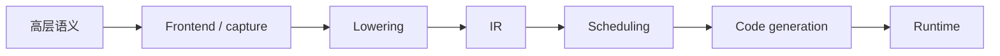

# 编译阶段与 IR 边界

## 核心问题

“codegen”不是所有编译工作的总称。为了定位问题，需要明确每个阶段的输入、输出和可做的决定。



| 阶段 | 主要问题 | 常见证据 |
|---|---|---|
| Frontend | 能否捕获、图在哪里断开 | FX graph、guard、graph break |
| Lowering | 一个 operator 如何表示 | lowering 调用、IR node |
| IR | 计算和 layout 如何表达 | buffer、loop、index expression |
| Scheduling | 节点如何排序、融合和分块 | scheduler node、fusion decision |
| Codegen | 如何发出目标语言 | generated kernel、wrapper |
| Runtime | 如何编译、缓存和启动 | cache、launcher、stream |

## 源码范围

本专题只使用上游 Inductor 的 `ir.py`、`scheduler.py` 和 `codegen/common.py` 建立边界；具体入口见
本章 index 的源码范围。Dynamo 和 NPU 的实际调用链留到后续章节。

## 源码入口

- `<workspace>/pytorch/torch/_inductor/graph.py`：`GraphLowering.codegen`、`compile_to_module`。
- `<workspace>/pytorch/torch/_inductor/scheduler.py`：`Scheduler` 和 `scheduler.codegen`。
- `<workspace>/pytorch/torch/_inductor/codegen/wrapper.py`：wrapper `generate` 和 launch code。
- `<workspace>/pytorch/torch/_inductor/codegen/triton.py`、`cpp.py`：目标 kernel emitter。

## 练习问题

- 一个错误的 stride 是在哪个阶段首次出现的，为什么最终可能表现为 codegen 精度错误？
- 一个 kernel 被拆成两个，是 scheduler 决定的，还是 runtime 临时决定的？需要什么证据？
- 什么情况下可以说“IR 正确但 emitter 错误”？

## 实现展开：以 GraphLowering.codegen 为分界

在当前 PyTorch 源码中，`GraphLowering.codegen()` 是从“IR/调度结果”进入“wrapper 和 kernel
codegen”的关键边界。实现顺序可以概括为：

```text
GraphLowering.codegen()
  1. init_wrapper_code()
  2. _update_scheduler()
       -> Scheduler(self.operations)
  3. scheduler.codegen()
       -> 每个 SchedulerNode 选择 backend 并生成 kernel
  4. wrapper_code.generate()
       -> 生成输入检查、buffer 管理和 kernel 调用
```

对应源码入口：

- `torch/_inductor/graph.py:2350`：`GraphLowering.codegen`。
- `torch/_inductor/graph.py:2409`：`compile_to_module`，将 wrapper code 编译/加载为 module。
- `torch/_inductor/scheduler.py:2757`：`Scheduler`，持有 operations 并负责调度。
- `torch/_inductor/codegen/wrapper.py`：wrapper 的 `generate` 和 launch 代码。

这里有一个很重要的边界：`GraphLowering.codegen()` 不直接对每个 `aten.add` 写 Triton。它先把
`GraphLowering.operations` 交给 `Scheduler`；scheduler 再把节点交给 backend codegen。因此定位错误
时要先问：错误已经出现在 `operations/IR`，还是出现在 scheduler/emitter。

## 产物如何对应阶段

| 产物 | 最早能证明的阶段 |
|---|---|
| FX graph | frontend capture 已完成 |
| `GraphLowering.operations` | lowering 已把 node 转为 IR/operation |
| scheduler nodes/fused nodes | dependency/fusion 已完成 |
| `output_code.py` 或 generated C++/Triton | emitter 和 wrapper 已运行 |
| cache module/binary | target compiler 已成功 |
| eager/compiled 数值 | runtime 执行和语义验证 |

因此，“能看到 output code”只能证明 codegen 到达了源码生成阶段，不能证明 kernel 编译、launch 或数值
结果正确。

## 每个边界的可执行判断

`GraphLowering.codegen()` 之前，错误仍表现为 `TensorBox`、layout、IR expression 或 operations；进入
`Scheduler(self.operations)` 后，才出现 `SchedulerNode`、dependency、fusion 和 backend group；进入
`scheduler.codegen()` 后，才出现 kernel source、metadata 和 wrapper launch。可以用下面的证据定位首次错误：

```text
IR operation 错 -> lowering/layout/shape
SchedulerNode 错 -> dependency/fusion/schedule
kernel source 错、IR 对 -> backend emitter
source 对、launch 错 -> wrapper/grid/ABI
launch 对、结果错 -> device kernel/runtime semantics
```

`compile_to_module()` 只负责将 wrapper/source 交给 code cache/compiler 并加载模块，不能证明 source 的数值语义已经
正确。一次完整闭环必须同时保留 operations、scheduler nodes、generated source、wrapper call 和 eager 对照结果。
