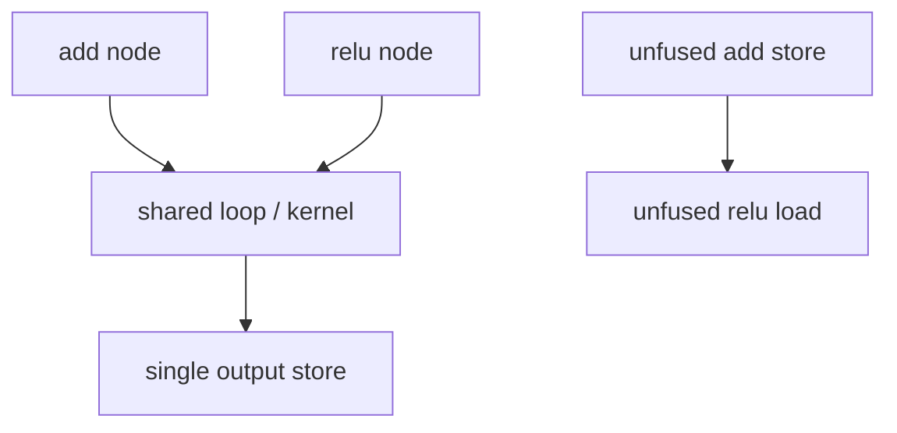

# Fusion 与并行执行模型

## Fusion 的含义

fusion 让多个逻辑计算共享循环或 kernel，通常可以减少中间 buffer 的读写和 launch 次数。它不是简单
地把源码文本拼接起来；融合后必须重新满足依赖、layout、domain、mask、资源和设备约束。



## 代价

- 中间内存访问减少。
- kernel launch 减少。
- 可能增加寄存器压力和 live range。
- 可能降低 occupancy 或阻碍专用模板使用。
- reduction 与 pointwise 融合时，store scope 和 accumulator 生命周期更复杂。

## 源码入口

具体 fusion 判定在目标 5 的 scheduler 文档中；本专题只用 `scheduler.py` 和 `codegen/common.py` 说明
并行模型，不把任何特定 backend 的 fusion 规则当成通用规则。

## 练习问题

- `(x + y).relu()` 的 add 中间结果是否物化？需要看哪个 artifact？
- 两个独立 pointwise 分支能否 horizontal fusion，依赖哪些 domain 条件？
- 为什么减少 kernel 数量不一定减少端到端耗时？

## 实现展开：SchedulerNode 到 FusedSchedulerNode

上游 scheduler 将 IR operation 包装成 `SchedulerNode`，再根据读写依赖和 backend 条件尝试融合。核心
入口包括：

- `torch/_inductor/scheduler.py:1446`：`SchedulerNode`。
- `scheduler.py:1821`：`FusedSchedulerNode`，保存被融合的一组节点。
- `scheduler.py:2195`、`2602`：不同层级的 `can_fuse` 判断。
- `scheduler.py:5125`：`can_fuse_vertical`。
- `scheduler.py:6432`：backend scheduling 的 vertical/horizontal fusion 接口。

可以把一次 vertical fusion 简化为：

```text
node0: tmp = add(x, y)
node1: out = relu(tmp)
                         |
                         +-- can_fuse(node0, node1)
                             - 检查依赖和读写
                             - 检查 iteration/reduction domain
                             - 检查 layout/device/backend 限制
                             - 成功后构造 FusedSchedulerNode
```

融合后 `tmp` 不一定有独立 store；consumer 的 load 可能直接调用 producer 的计算表达式。这也是为什么
“FX 中有两个 op”不能推出“最终有两个 kernel”。反过来，若某个中间结果必须被多个不兼容 consumer 使用，
或者 reduction domain 不兼容，scheduler 可能把它 realization 成 buffer，再生成多个 kernel。

性能分析时要同时看：中间内存流量是否减少、fused loop 的 live values 是否增多、是否阻碍 template/extern
路径。kernel 数量只是结果，不是融合判定本身。

## parallel domain 怎样从 fused nodes 得到

`FusedSchedulerNode` 保存原始 nodes，并把它们的 `ranges`、`reduction_ranges` 和 read/write 依赖交给 backend
scheduling。pointwise producer/consumer 只有在共同 output domain 可表达时才能共享 iteration vars；reduction 加
pointwise 则会生成 preserved vars 与 reduction vars 两层 scope。共享 loop 不等于共享所有 index：每个 node 仍使用自己
的 layout/indexer。

融合后的并行度由完整 domain 和 backend tiling 共同确定：scheduler 先决定哪些计算同一个 group，backend 再决定 split
axis、tiling axis、program id 和 loop。若融合扩大 live value 数量或让两个 node 的 mask/domain 无法统一，backend 可以
拒绝 fusion 或促使中间结果 realization。
