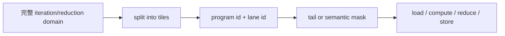

# Loop Domain、Tiling 与 Mask

## 三种范围

- iteration domain：输出元素需要遍历的逻辑空间。
- reduction domain：为一个输出元素需要聚合的输入空间。
- tile/program domain：一个并行 program 实例实际处理的子空间。



长度 1000、block size 256 的一维循环需要 4 个 tile。最后一个 tile 只有 232 个有效元素，mask 必须
阻止其余 lane 访问越界地址。

## 源码入口

- `<workspace>/pytorch/torch/_inductor/ir.py`：loop/reduction 的语义表示。
- `<workspace>/pytorch/torch/_inductor/scheduler.py`：调度节点和循环结构。
- `<workspace>/pytorch/torch/_inductor/codegen/simd.py`：循环和 SIMD 代码生成。
- `<workspace>/pytorch/torch/_inductor/codegen/triton.py`：program、mask 和 range 发射。

## 练习问题

- mask 是由 shape、stride、语义条件还是三者共同决定的？
- reduction 的 mask 与 tail mask 是否作用在同一个 axis？
- 如果把 block size 改大，哪些只是性能变化，哪些可能改变越界行为？

## 实现展开：Range、Program 和 Mask 的生成

在 Triton backend 中，循环域不是一个最终字符串，而是由 kernel 对象逐层发出。重点入口是：

- `torch/_inductor/codegen/triton.py:2628`：`codegen_range_tree`，把循环/range 树转换为 program 轴。
- `triton.py:3335`：`load`，把 buffer 名称和 SymPy index 转为 DSL load。
- `triton.py:3521`：`store`，发出带 mask/mode 的写回。
- `triton.py:4752`：`codegen_body`，组织 kernel body 的 range、load、compute、store。
- `torch/_inductor/codegen/simd.py:1266`：SIMD loop body 的对应入口。

对一维 pointwise，核心状态可以抽象为：

```text
numel = 1000
block = 256
pid = program_id(0)
offset = pid * block + arange(0, block)
mask = offset < numel
value = load(input + offset, mask=mask)
store(output + offset, result, mask=mask)
```

实际实现会把 `numel`、block 和 offset 表达为 SymPy/Inductor expression，再由 emitter 选择静态常量或
runtime scalar。`mask` 不是单独的优化步骤：它必须和 offset 的同一 axis 对齐，否则最后一个 tile
可能读取合法地址但把值写到错误 lane。

reduction 还会多一组 reduction range。此时外层 program 负责 preserved/output axes，内层循环或向量
维度负责 reduction axes；`store_reduction` 只能在 accumulator 完成后写回。阅读 generated DSL 时，先
恢复这两套 axis，再判断 mask 和 store 是否处于正确作用域。

## mask 的生成条件

mask 由 shape 范围、当前 program/block 覆盖范围和语义有效性共同决定。stride 只改变地址，不改变第一层 shape mask；
broadcast stride 0 仍需使用被 broadcast 维度的合法范围。

split axis 的 offset 已包含 `pid * BLOCK`，tail mask 通常是 `offset < axis_length`；未 split 的 tiling axis 只保护
program 内向量范围。reduction mask 沿 reduction vars 广播到 output vars，每次 partial loop 更新 accumulator，不能
把 output mask 当成 reduction mask。

改变 block size 后，完整 tile 通常只影响性能；尾 tile 的 mask、reduction identity 和 store scope 会影响语义。检查时要
同时比较 block expression、offset expression、mask shape 和 store index。

## range tree 到 program 的步骤

`codegen_range_tree()` 先按 range tree 的 parent/child 关系建立 axis variables，再由 split/tiling metadata 决定哪些
变量映射到 `program_id`、哪些映射到 `arange`、哪些进入 loop。`load()`/`store()` 使用同一组 index vars；若分别推导轴顺序，
最后一个 tile 可能 mask 正确但地址错位。
