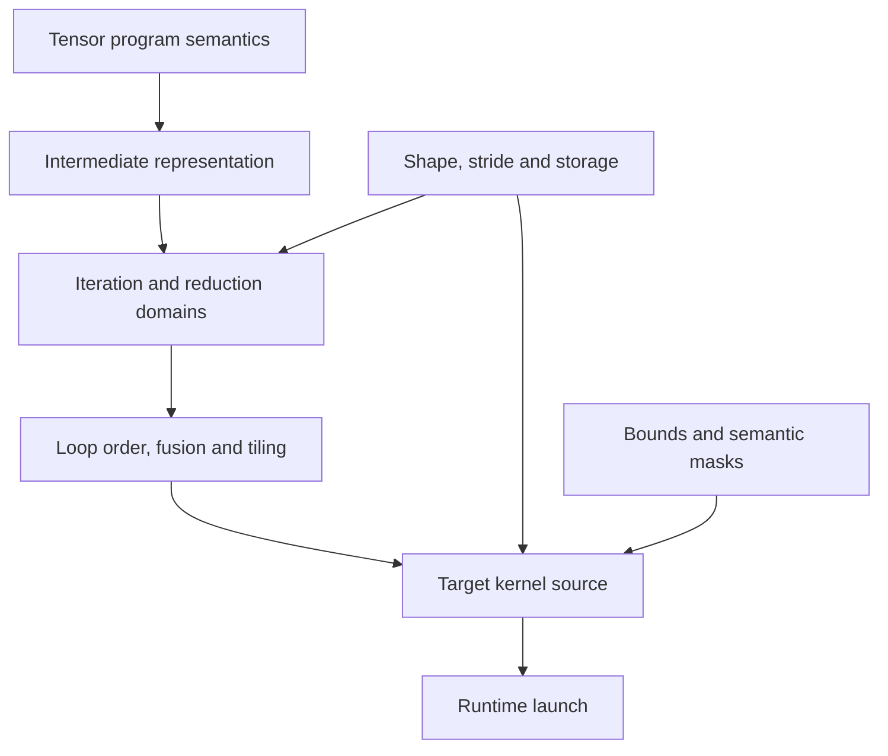

# 编译器与张量程序基础：Overview 与 Architecture

## Overview

本章先建立一个最小心智模型：源程序表达的是张量语义，编译器把语义逐层变成适合分析、调度和执行的
程序表示，最后由 runtime 启动目标代码。Inductor 的许多难点都可以还原为三个问题：

1. 当前表示还保留哪些语义？
2. 哪些循环、索引和内存访问已经被决定？
3. 哪些选择仍留给 backend 或 runtime？

## Architecture

### 数据流说明

- `Tensor program semantics` 描述 add、relu、sum 等逻辑运算。
- `IR` 保留计算、依赖、layout 和 mutation 等可分析信息。
- `Iteration and reduction domains` 把计算转换为循环空间。
- `Loop order, fusion and tiling` 决定并行粒度和 kernel 边界。
- `Target kernel source` 使用目标语言表达 load、compute、reduce、store。
- `Runtime launch` 负责参数、grid、stream 和执行顺序。

shape/stride 不是附属信息。它同时参与地址计算、可融合性、循环合并和 mask 生成；因此一个 transpose
输入即使算子语义不变，也可能产生完全不同的 kernel。

## 阅读方法

先用一个长度为 1000 的一维 pointwise 循环手算 block/lane/mask，再扩展到二维 layout 和 reduction。
读源码时优先找“谁创建循环域、谁改写索引、谁发出 store”，不要先追所有类的继承关系。

## 连接后续章节

- 目标 2 将说明这些语义如何进入 FX graph。
- 目标 4 将说明语义如何成为 Inductor IR。
- 目标 5 将说明 scheduler 如何选择循环和融合。
- 目标 6 将说明如何把循环写成 Triton/C++。
