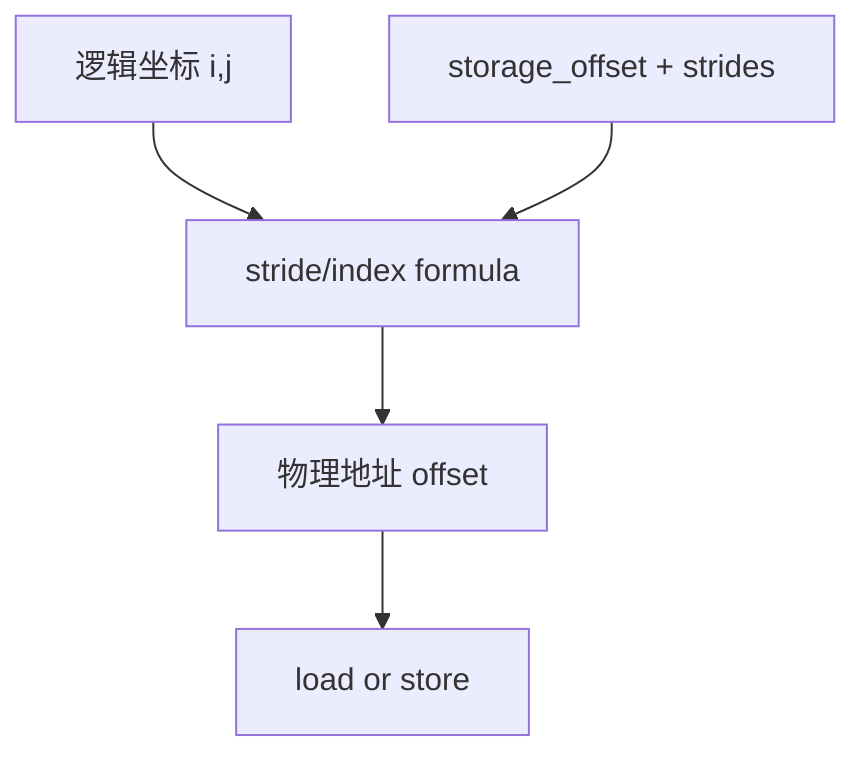

# Tensor Layout、Stride 与 Index

## 地址模型

连续二维 tensor 的逻辑坐标 `(i, j)` 可以通过 stride 转成存储 offset：

```text
offset(i, j) = storage_offset + i * stride[0] + j * stride[1]
```

transpose 只改变逻辑到存储的映射，通常不立即复制数据。generated kernel 中的 index expression 必须
保持这个映射，否则结果会在 contiguous 输入上“看起来正确”，在 non-contiguous 输入上错误。



## 源码入口

- `<workspace>/pytorch/torch/_inductor/ir.py`：layout、buffer、index 表示。
- `<workspace>/pytorch/torch/_inductor/lowering.py`：`view`、`permute`、`as_strided` 等 layout 变换。
- `<workspace>/pytorch/torch/_inductor/sizevars.py`：索引和 stride expression 的化简。
- `<workspace>/pytorch/torch/_inductor/codegen/triton.py`：把 index 表达为目标 DSL。

## 练习

对 `(3, 4)`、transpose、每隔一个元素的 slice 各记录 shape、stride、storage offset，并任选坐标手算
offset。再检查 generated code 是否使用同一公式。

## 易错点

- shape 相同不代表 stride 相同。
- `reshape` 能否零拷贝取决于 layout，不由名字保证。
- broadcast 维度可能 stride 为零；不能把它当作普通连续维度。

## 实现展开：Layout 如何变成 indexer

Inductor 在 `torch/_inductor/ir.py` 中用 `Layout` 表达逻辑尺寸和物理步长。当前实现至少要区分：

- `FixedLayout`：size、stride、device、dtype 基本确定，可以直接构造线性 indexer。
- `FlexibleLayout`：允许后续优化重新选择更合适的 layout。
- view/reindex 类对象：不一定分配新 storage，而是保存一个从输出坐标到输入坐标的 `reindex` 函数。

关键入口：

- `ir.py:3676` 附近的 `Layout` 层次。
- `ir.py:3930`：`FixedLayout.make_indexer`。
- `ir.py:3969`：`FlexibleLayout`。
- `ir.py:698`、`ir.py:755`：IR 对象读取 size/stride 的接口。
- `sizevars.py`：对 index expression 做符号化简和等价判断。

一个连续 `(M, N)` 输出的 indexer 逻辑上类似：

```python
def indexer(index):
    i, j = index
    return i * N + j
```

transpose 输入不会把这个输出 indexer 改成复制操作，而是让输入 loader 使用类似：

```python
input_offset = j * input_stride_0 + i * input_stride_1
```

`lowering.py` 中的 `permute`、`view`、`as_strided` 会构造或组合这种 reindex；后续 `Pointwise.inner_fn`
调用 `make_loader()` 时，loader 把逻辑 index 传入 reindex，再交给 backend emitter 生成 `tl.load` 或
C++ pointer expression。也就是说，generated kernel 里的地址公式通常不是 emitter 凭空发明的，而是
layout/reindex 在 IR 阶段已经确定的结果。

## 定位索引错误的顺序

1. 从错误 kernel 的 `tl.load(ptr + expr)` 找到对应 buffer 参数。
2. 查该 buffer 的 `get_size()`、`get_stride()` 和 `make_indexer()`。
3. 回到 lowering 里检查 `permute/view/as_strided` 是否改变了坐标顺序。
4. 最后才检查 Triton/C++ emitter 是否把 SymPy expression 写错。

## `FixedLayout.make_indexer()` 的推导

对 rank 为 `n` 的固定 layout，indexer 逻辑上执行：

```text
offset = storage_offset
for dim in range(n):
    offset += logical_index[dim] * stride[dim]
```

`stride == 0` 表示 broadcast；负 stride 或非零 storage offset 也必须保留在 signed expression 中。`FlexibleLayout`
没有固定 stride，通常要等 realization/scheduler 选择最终 layout 后再生成 indexer。

## view/reindex 的两层索引

consumer 的输出 index 依次经过 output layout indexer、view reindex 和 input layout indexer：

```text
consumer logical index -> output indexer -> view reindex -> input indexer -> physical offset
```

因此 transpose 错误可能出现在坐标交换，也可能出现在交换后的 stride 使用。调试时保留每一层表达式，不要只比较最终
`ptr + expr`。
