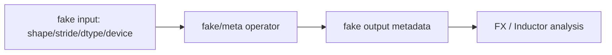

# FakeTensor 与 Tensor Metadata

## 数据流



FakeTensor 让编译器可以传播 shape、stride、dtype、device 等信息，而不必在真实设备上执行每个算子。
它不等同于真实 tensor，也不能替代最终 device kernel 的 correctness 验证。

## 源码入口

- `<workspace>/pytorch/torch/_subclasses/fake_tensor.py`：FakeTensorMode 和 fake dispatch。
- `<workspace>/pytorch/torch/fx/experimental/symbolic_shapes.py`：符号 shape 的进一步支持。
- `<workspace>/pytorch/torch/fx/graph.py`：node metadata 挂载位置。

## 练习问题

- contiguous 与 transpose 输入的 fake metadata 有哪些不同？
- 哪些 metadata 会被 lowering 消费，哪些只用于调试？
- fake propagation 成功但真实 kernel 失败时，说明哪个边界缺少验证？

## 实现展开：FakeTensorMode 的工作方式

FakeTensor 的核心不是创建一块“假的设备内存”，而是在 `FakeTensorMode` 中拦截 operator 调用，用 fake
dispatch/meta kernel 计算输出的 metadata。典型流程是：

```text
real example input
  -> FakeTensorMode.from_tensor
  -> FakeTensor(shape, stride, dtype, device)
  -> operator dispatch in fake mode
  -> meta/fake implementation
  -> output FakeTensor + node.meta
```

源码入口：

- `torch/_subclasses/fake_tensor.py`：`FakeTensorMode`、fake dispatch、device propagation、storage/alias
  metadata。
- `torch/fx/graph.py`：FX node 的 `meta` 字典挂载和读取。
- `torch/fx/experimental/symbolic_shapes.py`：当 size 是动态的，FakeTensor 保存 `SymInt` 而不是普通 int。

Inductor 依赖这些 metadata 来决定 output size、stride、dtype、device 和是否需要 layout conversion。
但 metadata 只证明编译期推导一致；它不能检查真实 NPU/CUDA kernel 的地址、数值精度或 runtime ABI。

## 调试方法

对 contiguous/transpose 输入同时打印：

```python
print(t.shape, t.stride(), t.storage_offset(), t.dtype, t.device)
```

然后比较 FX node 的 `meta['val']` 或 fake value。若 fake metadata 已错误，继续看 meta/fake dispatch；若
metadata 正确而 generated kernel 错误，转到 lowering/index/codegen 阶段。

## `FakeTensorMode.dispatch()` 的真实分支

`__torch_dispatch__()` 只负责转入 `dispatch()`；真正的判定顺序是：

```text
func in _DISPATCH_META_HANDLERS? -> 专用 metadata handler
func in _DISPATCH_HANDLE_DIRECTLY? -> 在 kernel invocation context 直接执行
cache_enabled? -> _cached_dispatch_impl
otherwise -> _dispatch_impl
```

`_cached_dispatch_impl()` 先用 operator、参数 metadata 和 ShapeEnv 构造 cache key。无法安全构造 key 时记录 bypass 并
直接 dispatch；命中 negative cache 也重新计算；普通命中通过 `_output_from_cache_entry()` 重建输出 FakeTensor。只有 miss
才执行 `_dispatch_impl()` 并尝试缓存结果。symbolic output 含输入中不存在的新 symbol 时可能禁止全局缓存，不能把
cache miss 当成 meta kernel 失败。

## `_dispatch_impl()` 如何选择实现

内部实现先 flatten 参数并检查 tensor subclass；存在无法识别的 subclass 时返回 `NotImplemented`，把控制权交给下一层
`__torch_dispatch__`。随后收集属于当前 mode 的 FakeTensor，判断是否含 symbolic size，处理 device conversion、constant
propagation、decomposition、Python fake implementation 和 Meta kernel。允许 fallback 时，缺少 fake/meta 实现的 operator
可能运行 fallback kernel；它与“正确命中 Meta kernel”不是同一证据。

`from_tensor()` 在 `static_shapes=True` 时显式把 `shape_env` 置为 `None`；否则把 source、symbolic context 和 ShapeEnv
传给 `FakeTensorConverter.from_real_tensor()`。这正是同一个真实输入在 static/dynamic tracing 下得到普通整数 size 或
`SymInt` size 的分界。

## metadata 正确性的边界

FakeTensor cache 可选 cross-check：关闭 cache 后重新 dispatch，再用 `assert_metadata_eq()` 比较输出。真实 tensor propagation
还会比较 size、storage offset 和 alias 信息。即使这些都通过，也只证明 metadata/alias 模型与参考执行一致，不证明后端
生成的地址或 reduction 正确。
