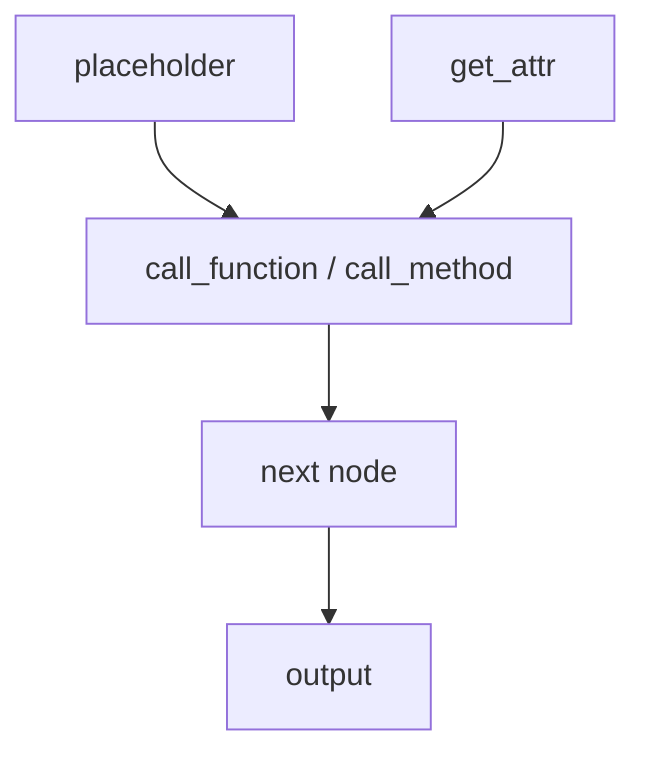

# FX Graph、Node 与 Python Codegen

## Graph 结构



Node 的 `op` 表示节点类别，`target` 表示调用目标，`args/kwargs` 表示输入，`users` 表示反向使用关系，
`meta` 携带分析信息。GraphModule 可以把图重新生成为 Python，但这只是 FX 层的 codegen。

## 源码入口

- `<workspace>/pytorch/torch/fx/graph.py`：`Graph`、`Node`、`python_code`、拓扑关系。
- `<workspace>/pytorch/torch/fx/graph_module.py`：GraphModule 构造、recompile 和执行。

## 练习

对 `(x + y).relu()` 打印 `print_tabular()`、`graph.nodes`、`node.users` 和 `traced.code`，再修改一个
node 后调用 `lint()` 与 `recompile()`。记录图结构改变和 Python code 改变之间的关系。

## 易错点

- node 顺序体现依赖，但不等于最终 kernel 顺序。
- FX graph 中的两个 node 不必对应两个物化 buffer。
- `traced.code` 正确只证明 FX 重生成正确，不证明 Inductor backend 正确。

## 实现展开：Node 如何进入 GraphModule Python code

`torch.fx.Graph` 内部维护 node 的拓扑顺序和 use-def 关系。创建 node 时，`args/kwargs` 保存输入引用，
输入 node 的 `users` 集合同步更新；删除或替换 node 时，Graph 会维护这些关系。`GraphModule` 再调用
`Graph.python_code()` 生成 Python AST/源码，并通过 `recompile()` 更新可调用的 forward。

关键对象：

- `torch/fx/graph.py:Node`：`op`、`target`、`args`、`kwargs`、`users`、`meta`。
- `torch/fx/graph.py:Graph`：node 创建、插入、lint、拓扑遍历和 `python_code`。
- `torch/fx/graph_module.py:GraphModule`：把 Graph 注册为 module 并重新编译 Python callable。

对 `(x + y).relu()`，典型图是：

```text
placeholder x ----\
                   add ---- relu ---- output
placeholder y ----/
```

FX Python codegen 会生成类似 `add = torch.add(x, y); relu = torch.relu(add)` 的 Python 表达，但此时
`add` 是否物化、是否融合、是否生成 Triton，仍由后续 backend 决定。读 FX 时重点看语义和依赖；读
Inductor 时再看 layout、IR 和 scheduler。

## 练习：修改 node 的证据链

1. `symbolic_trace` 得到 GraphModule。
2. 用 `node.replace_all_uses_with()` 替换一个 node。
3. 调用 `graph.erase_node()`、`lint()`、`recompile()`。
4. 比较 `graph.nodes`、`traced.code` 和 backend 接收到的 graph。

这个练习能直接显示 FX graph mutation 与 Python codegen 的关系。

## `create_node()` 如何维护图结构

`Graph.create_node()` 先规范化空 `args/kwargs`，再通过 graph namespace 生成唯一名称，构造 `Node`，执行 module
create-node hooks，最后调用 `_insert()` 放入双向链表，并更新查找表和节点计数。`Node` 设置 args/kwargs 时会维护输入
node 的 `users`；因此 use-def 不是 `python_code()` 临时扫描出来的。

修改图时，`replace_all_uses_with()` 遍历当前 users 并重写参数；`erase_node()` 要求 node 已无 users，再从链表和 lookup
table 移除。`Graph.lint()` 会检查拓扑顺序、所有权、target 合法性以及不存在对未定义 node 的引用。跳过这些步骤，生成的
Python 可能表面可读，但内部 users 或拓扑已经不一致。

## `python_code()` 与 `recompile()` 的内部边界

`Graph.python_code()` 创建新的 namespace，同时为局部 node 名和全局 target 分配唯一标识，再委托 `_codegen` 生成
`PythonCode(src, globals, ...)`。`GraphModule.recompile()` 保存 `src`、行号映射和 globals，调用 Python 编译器构造新的
forward，并更新 module class 上的方法。

所以 graph mutation 后只打印 `graph.nodes` 不足以让执行行为改变；必须 `lint()` 并 `recompile()`。反过来，
`GraphModule.code` 只是 FX Python emitter 的结果，不包含 Inductor fusion、layout 或 kernel codegen 决策。
