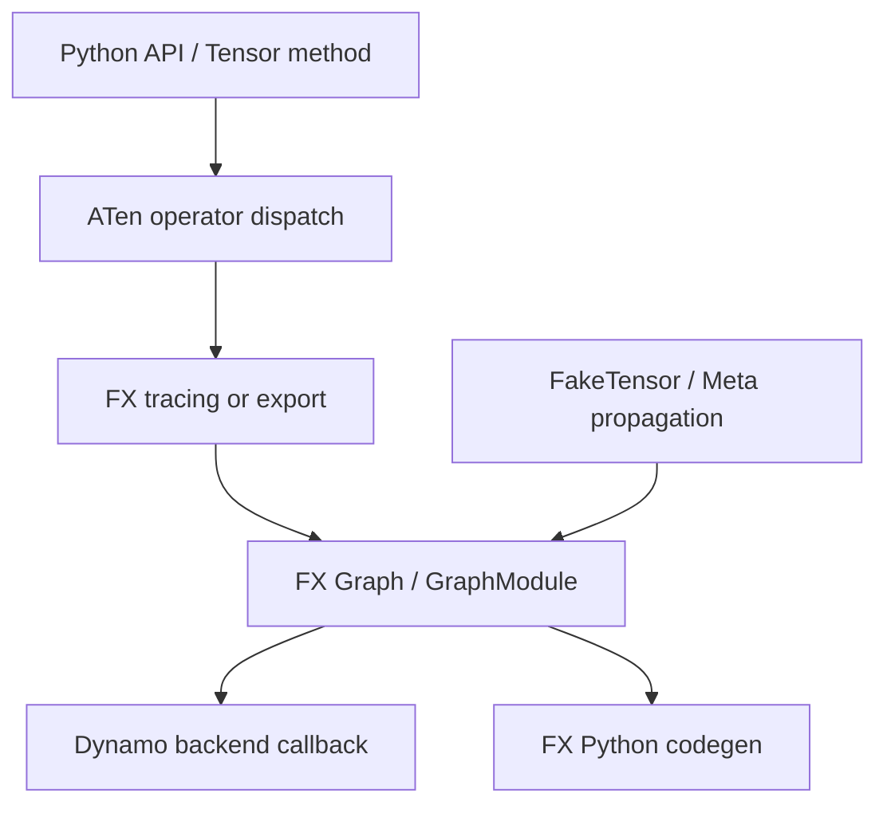

# PyTorch 执行与 FX：Overview 与 Architecture

## Overview

本章回答“编译器看到的程序是什么”。用户 API 经过 operator dispatch 和 tracing 后，成为带有
`target`、数据依赖和 tensor metadata 的 FX graph。FX graph 是编译输入，不是最终 kernel。

## Architecture

### 数据流说明

1. API 调用携带 operator、参数、device 和 dtype 语义。
2. dispatch/overload 解析得到稳定的 operator target。
3. tracing 把调用记录为 FX node，而不是计算真实结果。
4. FakeTensor/meta propagation 为 node 补充 shape、stride、dtype 和 device。
5. backend 接收 GraphModule，后续再进入 Dynamo/AOTAutograd/Inductor。

## 边界

FX `Graph.python_code()` 生成的是可执行 Python 表达，不负责 Triton/C++ kernel。要分析 backend codegen，
必须继续向 Inductor IR 和 generated source 追踪。

## 连接后续章节

- 目标 3 解释 Dynamo 如何捕获更一般的 Python bytecode。
- 目标 4 解释 FX node 如何 lowering 为 Inductor IR。
- 目标 7 解释符号 metadata 如何在 dynamic shape 中继续传播。
