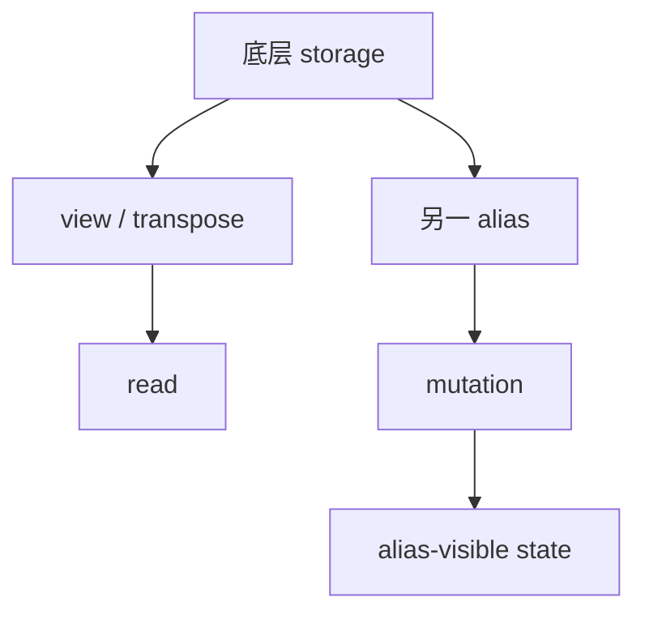

# View、Alias 与 Mutation

## 语义关系



view 通常改变逻辑索引到同一 storage 的映射；mutation 可能影响所有 alias。编译器必须保留这些语义，
否则重排、buffer reuse 或 fusion 会改变程序结果。

## 源码入口

- `<workspace>/pytorch/torch/fx/graph.py`：node 与用户关系。
- `<workspace>/pytorch/torch/_subclasses/fake_tensor.py`：metadata/alias 相关传播。
- `<workspace>/pytorch/torch/_inductor/ir.py`：view、mutation 和 buffer 语义的后续表示。
- `<workspace>/pytorch/torch/_inductor/lowering.py`：view、`as_strided`、mutation lowering。

## 练习

比较 `transpose`、`reshape`、`clone` 和 inplace add 的 graph 与 metadata。对每个操作回答：是否共享
storage、是否需要物化、后续 consumer 能否吸收该 layout 变换。

[返回本章索引](./)

## 实现展开：为什么 view/mutation 会限制优化

view 类操作通常保留同一 storage，并保存从输出逻辑坐标到输入坐标的映射；mutation 则可能修改所有
alias 可见的状态。编译器需要在 graph、IR 和 wrapper 三层保持这个约束：

```text
view/alias metadata
  -> IR reindex or alias relation
  -> scheduler dependency / mutation ordering
  -> buffer reuse and wrapper lifetime
```

源码入口：

- `torch/fx/graph.py`：node use-def 关系，决定 mutation 后哪些 user 仍然可见。
- `torch/_subclasses/fake_tensor.py`：fake storage/device/alias metadata 的传播。
- `torch/_inductor/lowering.py:1221` 附近：`view`、`permute`、`as_strided` 的 lowering。
- `torch/_inductor/ir.py`：`Layout`、view/reindex、mutation buffer 表示。
- `torch/_inductor/scheduler.py`：mutation/alias 对读写排序和 fusion 的限制。

例如 `y = x.transpose(0, 1); x.add_(1)` 不能被当成两个互不相关的 pointwise 节点；`y` 仍通过同一
storage 观察修改后的数据。分析此类问题时，不能只看数学表达式，还要追 storage alias 和 mutation
ordering。

## view 与 mutation 的内部状态

view 的关键状态不是“有一个 transpose 节点”，而是 base storage、size、stride、storage offset 与 reindex 关系。
consumer 调用 loader 时，逻辑输出 index 经 reindex 转成 base buffer index；若 consumer 能直接消费该映射，view 不需要
独立 buffer。`clone` 则创建新 storage，切断 alias 链。

mutation 需要同时更新值语义和版本顺序。scheduler 的 `mutation_real_name`/`mutation_renames` 将 mutation 前后的名字映射
到同一逻辑 storage，并加入依赖；wrapper 还要保证被 alias 观察的 storage 生命周期不被过早复用。判断是否可重排时至少
检查：schema alias annotation、FakeTensor alias metadata、IR view/base 和 scheduler mutation dependency。

### 例子

```python
y = x.transpose(0, 1)
x.add_(1)
return y
```

若把 transpose 当成已复制 buffer，scheduler 可能把 `x.add_` 移到错误位置；正确实现保留 `y -> x storage` 的 alias，输出
必须观察 mutation 后的数据。若改为 `y = x.transpose(0, 1).clone()`，clone realization 才允许两条 storage 生命周期分离。
