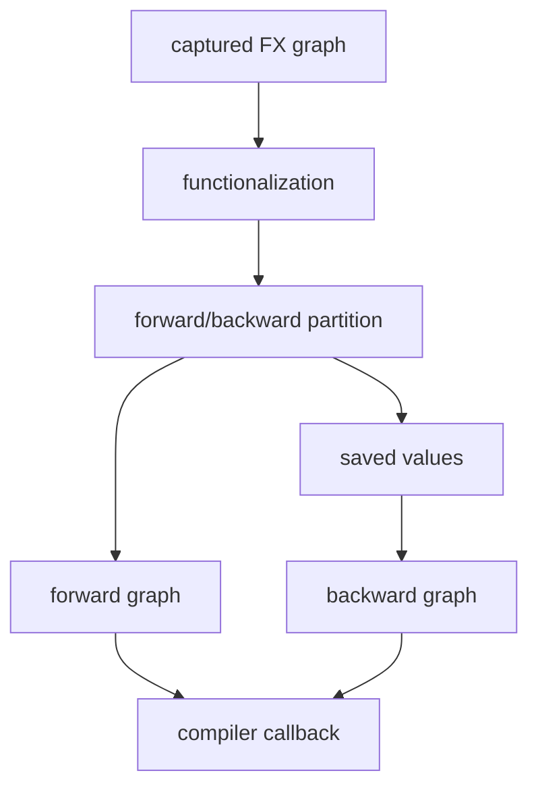

# AOTAutograd Forward/Backward Graph

## 数据流



AOTAutograd 让前向和反向可以分别进入 backend compiler，同时显式处理 backward 需要的中间值。它不
决定最终 kernel 的 loop/tile；这些决定留给 Inductor 和具体 backend。

## 源码入口

- `<workspace>/pytorch/torch/_functorch/aot_autograd.py`：公共入口和 compiler 参数。
- `<workspace>/pytorch/torch/_functorch/_aot_autograd/`：partition、functionalization、runtime 细节。
- `<workspace>/pytorch/torch/_dynamo/output_graph.py`：将 graph 交给 AOT/backend 的位置。

## 练习

对有参数的线性小 module 编译并执行 backward，记录 forward/backward graph 的输入输出、saved values
和 mutation 是否被 functionalize。

## 易错点

- backward graph 正确不等于 forward graph 正确。
- saved tensor 可能改变 buffer lifetime 和后续 realization。
- autograd graph 的拆分不能直接当作最终 kernel 拆分。

## 实现展开：AOTAutograd 如何调用 backend

公共入口位于 `torch/_functorch/aot_autograd.py`：

- `aot_function`：为函数建立 AOT dispatch wrapper。
- `aot_module`：为 module 包装 forward/backward 编译。
- `aot_module_simplified`：减少 module 包装层，直接处理 graph/module inputs。
- `create_aot_dispatcher_function`：构造真正的前后向 dispatcher。

逻辑上可以分为四步：

```text
captured FX graph
  -> FakeTensor/functionalization normalization
  -> partition_fn 生成 fw_module、joint_inputs、保存值信息
  -> fw_compiler(fw_graph, fw_inputs)
  -> bw_compiler(bw_graph, bw_inputs)
```

源码会重建或切换 backend FakeTensorMode，但复用 Dynamo 形成的 `ShapeEnv`，因为 Dynamo 已经基于该
ShapeEnv 做过 dynamic/static 决策和 guards。这个细节解释了：AOTAutograd 不是重新从真实 tensor 推导
shape，而是在前端约束之上构造可编译的 functional graph。

forward/backward 编译器的输入仍是 GraphModule 和 example inputs；Inductor backend 随后对二者分别进入
`compile_fx`。saved tensors 会影响 backward graph 的输入和 forward buffer lifetime，因此分析反向性能
时必须同时查看 partition 结果和 Inductor realization。

## AOTAutograd 内部阶段不是简单“切两张图”

`aot_function()` 建立 wrapper，并在首次调用中收集 flat args、FakeTensorMode/ShapeEnv 和 dynamic shape policy；随后进入
`create_aot_dispatcher_function` 系列逻辑。训练路径先 functionalize mutation/view，再追踪 joint forward-backward graph，
`partition_fn` 才将其拆为 forward 与 backward。

partition 的输出不仅是两个 GraphModule，还决定 forward 要返回哪些 saved values 给 backward。`fw_compiler` 接收的输出
因此可能包含用户输出和 saved tensors；runtime wrapper 会保存后者并在 backward 调用 `bw_compiler` 生成的 callable。
inference 路径不需要 backward/saved tensors，可以走更短的 dispatch。

functionalization 的职责是把 inplace/view mutation 改写成可分析的 functional 图，同时记录 alias 更新；它不能随意删除
用户可观察 mutation。若 forward buffer lifetime 异常，要比较 functionalized joint graph、partition saved values 和
Inductor realization，而不是只查看最终 backward kernel。
