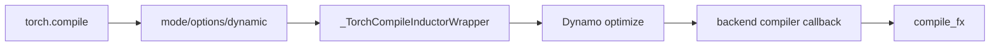

# torch.compile 入口与 Compiler Callback

## 调用链



## 源码入口

- `<workspace>/pytorch/torch/__init__.py`：`torch.compile` 和 `_TorchCompileInductorWrapper`。
- `<workspace>/pytorch/torch/_dynamo/eval_frame.py`：`optimize`、`_optimize`。
- `<workspace>/pytorch/torch/_dynamo/output_graph.py`：`call_user_compiler`。
- `<workspace>/pytorch/torch/_inductor/compile_fx.py`：Inductor callback。

## 关键判断

第一次调用可能同时包含 frame 捕获、backend 编译和 runtime 执行。要分析调用链，必须分别记录：

```text
compile wrapper -> graph capture -> backend compile -> compiled callable -> runtime launch
```

## 练习

写一个只打印 `gm.graph` 和 example inputs 的 backend，比较普通函数、带参数 module 和带 backward 的
module 被 callback 调用的次数。

## 实现展开：callback 的真实输入输出

`torch._dynamo.eval_frame._optimize()` 不是直接调用 Inductor。它先把 backend 名称解析为 callable，
再通过 `convert_frame.convert_frame()` 构造 frame converter，最后由 `OutputGraph.call_user_compiler()`
把完整 graph 交给 callback。

关键调用关系：

```text
torch.compile(..., backend="inductor")
  -> _TorchCompileInductorWrapper
  -> torch._dynamo.optimize(backend=...)
  -> _optimize()
  -> convert_frame.convert_frame(backend, hooks)
  -> frame capture
  -> OutputGraph.compile_and_call_fx_graph()
  -> OutputGraph.call_user_compiler(gm, example_inputs)
  -> compiler_fn(gm, example_inputs)
```

源码入口：

- `torch/__init__.py`：`_TorchCompileInductorWrapper.__call__` 保存 model/input，并调用编译 wrapper。
- `torch/_dynamo/eval_frame.py:1392`：`optimize`；`eval_frame.py:1407`：`_optimize`。
- `torch/_dynamo/output_graph.py:2366`：`call_user_compiler`。
- `torch/_dynamo/output_graph.py:2379`：`_call_user_compiler` 实际执行 `compiler_fn(gm, example_inputs)`。

`_call_user_compiler` 还会补齐 placeholder 的 `_dynamo_source`、参数 source metadata，并要求 callback
返回 callable。这个返回值会被 `disable(reason="do not trace Dynamo-compiled graph")` 包装，避免再次
被 Dynamo 递归捕获。也就是说，一个 backend 的最小契约是：

```python
def backend(gm: torch.fx.GraphModule, example_inputs):
    # compile gm
    return compiled_callable
```

如果 callback 抛出异常，OutputGraph 会根据 suppress/fallback 配置决定是包装为
`BackendCompilerFailed` 还是回退/继续抛错；因此要区分“backend callback 没被调用”和“callback 调用后失败”。

## callback 契约的三个检查点

1. `gm` 是已完成 capture/normalization 的 `GraphModule`，不要把它重新当 eager Python function trace。
2. `example_inputs` 与 placeholders 顺序一致，且可能携带 `FakeTensor`/`SymInt` metadata。
3. 返回值必须可调用；Dynamo 会包装它，避免下一次调用再次被同一 frame capture。

backend 失败应先区分输入契约错误、GraphLowering 失败和 kernel compile 失败。分别对应
`_call_user_compiler`、`compile_fx`/`GraphLowering`、codecache/runtime 日志。
