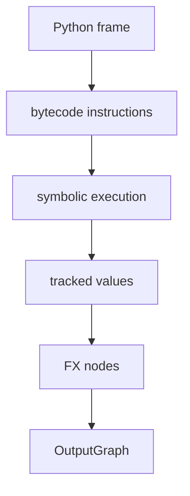

# Dynamo Frame Capture 与 Bytecode Conversion

## 架构



Dynamo 在 frame/bytecode 层工作，因此它比只对 module 做 `symbolic_trace` 能处理更广泛的 Python 调用
上下文。它需要决定哪些值可追踪、哪些控制流可转换、哪些操作必须停止捕获。

## 源码入口

- `<workspace>/pytorch/torch/_dynamo/convert_frame.py`：frame conversion。
- `<workspace>/pytorch/torch/_dynamo/symbolic_convert.py`：bytecode instruction tracing。
- `<workspace>/pytorch/torch/_dynamo/output_graph.py`：tracked values 写入 graph。

## 练习问题

- 一个 Python scalar 何时被记录为常量，何时成为 graph 输入？
- 数据相关分支为什么可能触发 graph break？
- 如何从日志确认 break 发生在 bytecode 哪个位置？

## 实现展开：ConvertFrame 与 InstructionTranslator

`convert_frame.convert_frame()` 将 backend、hooks 和配置封装成 frame converter；当 CPython eval-frame hook
发现目标函数时，converter 创建 `InstructionTranslator`，按 bytecode instruction 执行 symbolic evaluation。
每条 instruction 处理的不是普通 Python 值，而是 `VariableTracker`、`Proxy` 或带 source 的抽象值。

核心对象关系可以简化为：

```text
eval-frame callback
  -> ConvertFrame
  -> InstructionTranslatorBase / symbolic_convert
  -> VariableTracker + Proxy
  -> OutputGraph.create_node
  -> FX Graph
```

源码入口：

- `torch/_dynamo/convert_frame.py`：`convert_frame`、异常包装、frame cache。
- `torch/_dynamo/symbolic_convert.py`：instruction handler、symbolic stack/local、speculation。
- `torch/_dynamo/output_graph.py`：`create_proxy`、`create_node` 和 graph state。

当遇到已注册的 torch operator，VariableTracker 会把输入 proxy 传给 operator handler，handler 创建
`call_function`/`call_method` node；当遇到无法安全追踪的 Python 行为，translator 通过 speculation 或
graph break 结束当前 graph，并生成 continuation。

### 一个 scalar 分支为何会 break

```python
def f(x):
    if x.sum().item() > 0:
        return x + 1
    return x - 1
```

`x.sum()` 可以成为 graph node，但 `.item()` 把 tensor 值取回 Python scalar；若该 scalar 被用于 Python
控制流，translator 必须知道运行时分支，通常会触发 graph break 或配置要求的错误。判断实际行为时，
要看 Dynamo 日志中的 break reason 和 continuation graph，而不是只看最终 kernel。

## 字节码解释循环

`InstructionTranslator.run()` 在 tracing context 中循环调用 `step()`。每次 `step()`：

1. 读取 `instruction_pointer` 指向的 instruction，并提前移动指针。
2. 更新源码行号和 block stack。
3. 通过 `dispatch_table[inst.opcode]` 调用对应字节码 handler。
4. handler 操作 symbolic stack/locals 中的 `VariableTracker`，需要 tensor op 时调用 `OutputGraph.create_proxy()`。
5. 遇到 return/yield 结束；遇到 `Unsupported` 则按 fullgraph、checkpoint 和 block 可恢复性决定报错或 graph break。

这说明 Dynamo 不是先构造 Python AST 再转 FX，而是边解释 bytecode、边维护抽象栈、边创建 proxy/node。

## graph break 怎样生成 continuation

可恢复的 `Unsupported` 会令当前 speculation 失败并重新分析到 checkpoint；随后
`OutputGraph.compile_subgraph()` 清理 graph、恢复 context manager/side effect，创建 GraphModule，调用 backend，并生成调用
已编译子图和恢复 Python stack/locals 的新 bytecode。原函数剩余部分通过 resume function 继续执行。

若 `one_graph/fullgraph` 或 `error_on_graph_break` 生效，代码不生成 continuation，而是直接抛错。若位于不可恢复的 try/with
状态，也可能退回更早 checkpoint 或停止 partial compile。分析 graph break 必须记录 instruction、speculation checkpoint、
compile reason 和生成的 resume function，不能只看一句 reason。
