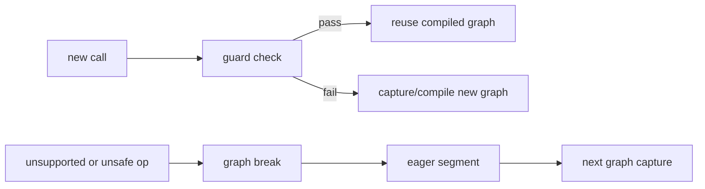

# Graph Break、Guard 与 Recompile

## 两条控制路径



guard 验证已编译 graph 的假设；graph break 则是捕获过程中主动结束当前 graph。二者都可能影响最终
编译数量，但含义不同。

## 源码入口

- `<workspace>/pytorch/torch/_dynamo/guards.py`：guard 构造和运行。
- `<workspace>/pytorch/torch/_dynamo/output_graph.py`：graph break 后续 graph 和 compiler callback。
- `<workspace>/pytorch/torch/_dynamo/eval_frame.py`：编译上下文和 cache/recompile 控制。

## 练习

依次改变 shape、stride、dtype、Python scalar 和 requires_grad，记录 guard failure reason。另加入
`.item()` 或数据相关控制流，区分 guard failure 与 graph break。

## 易错点

- 一个 FX graph 生成多个 kernel，不代表出现 graph break。
- guard 失败会触发新 graph 或其他 fallback 策略，不能只凭运行时间判断。
- kernel mask 是设备代码内的 lane 条件，与 guard 不同。

## 实现展开：GuardSet、cache hit 与 specialization

Dynamo 在 tracing 时把 Python 对象、tensor metadata、shape relation 和环境状态记录为 guards。调用
compiled function 时，eval-frame cache 先执行 guard check：命中则直接取出已编译 callable，失败则重新
进入 frame conversion。

源码入口：

- `torch/_dynamo/guards.py`：guard builder、`GuardManager` 和 guard expression。
- `torch/_dynamo/eval_frame.py:631`：`make_set_enable_dynamic`，dynamic policy 进入上下文。
- `torch/_dynamo/output_graph.py:2292` 附近：specialization guard 失败后的 `specialized_dispatch`。
- `torch/_dynamo/output_graph.py:2366`：新 graph 编译 callback。

可以把运行时分支简化为：

```text
call(args)
  -> eval-frame cache lookup
  -> guard manager(args)
       true  -> compiled_fn(args)
       false -> convert_frame -> new FX graph -> backend compile
```

graph break 是 tracing 中断，不是 guard failure。graph break 后 Dynamo 会保留前一段 graph，生成 eager
continuation，再从 continuation 处捕获下一段 graph；guard failure 则发生在已编译 graph 的再次调用阶段。

### 如何定位

1. 查看 `TORCH_LOGS="recompiles,guards,graph_breaks"` 或等价 logging 输出。
2. 若有 `guard failure`，记录失败表达式和 source。
3. 若有 `graph break`，记录 break reason、前后 graph 和 eager segment。
4. 再比较 backend callback 次数与最终 kernel 数量。

## guard 的生成、编译和执行不是同一个函数

ShapeEnv 先产生 shape relation 和 guard expression；Dynamo 把 tensor metadata、Python object、global/module state 等
guard source 交给 guard builder，最后组成 `GuardManager`。`GuardManager.check()` 在 cache lookup 时执行组合检查；其中
一个叶子 guard 失败，整个 compiled entry 就不能复用。

graph break 的调用点在 bytecode translator 捕获 Unsupported/unsafe operation 时，`OutputGraph.compile_subgraph()` 会
编译当前子图并生成 continuation。guard failure 则不会重新解释原 graph 内的 bytecode，直到 eval-frame cache miss 才
重新进入 frame conversion。两个路径的时间点、日志事件和新建对象都不同。

## specialization cache 的实际产物

specialization dispatch 为每个 specialization 保存 `check_fn` 与 compiled callable。命中时只执行 check 并调用对应函数；
未命中时会为当前 source 建立新的 specialization，再进入 compiler callback。检查 recompile 时应记录：guard expression、
specialization key、backend callback 次数和最终 source hash；单独记录 kernel 数量无法判断是哪一个分支。
