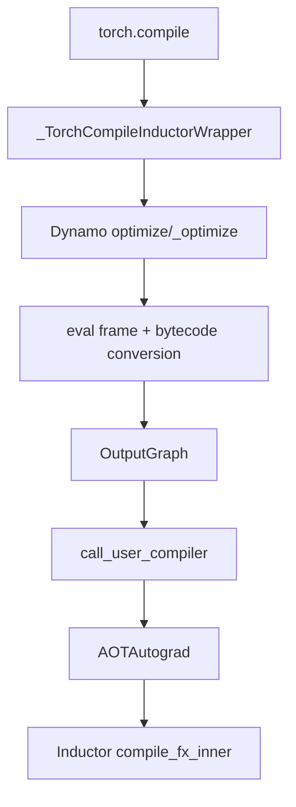

# 目标 3：TorchDynamo 与 AOTAutograd

## 目标

理解 Python 程序如何被捕获为交给 Inductor 的 graph。完成后，应当能定位 graph break、解释 guard
和重编译，并区分 Dynamo graph、AOTAutograd forward/backward graph 与 Inductor 单图编译。

## 主链



### Dynamo 的职责

Dynamo 在 Python frame/bytecode 层跟踪可编译操作，建立 FX graph，并为本次捕获依赖的 Python 和
tensor 条件生成 guards。遇到无法安全捕获的行为时，可能 graph break，前后形成多个 graph。

guard 不是 kernel 内部的边界 mask。guard 验证“这次调用是否仍满足已编译 graph 的假设”；mask
控制一个 kernel 内哪些 lane 可以访问或计算。

### AOTAutograd 的职责

AOTAutograd 在 backend 编译前处理 autograd 相关图，常见职责包括 functionalization、分离
forward/backward graph、保存 backward 所需值以及调用前后向 compiler。这里产生的 graph 已比原始
Python 函数更接近 functional ATen 语义，但仍不是 Inductor loop IR。

## 代码入口

- `<workspace>/pytorch/torch/__init__.py`
  - `_TorchCompileInductorWrapper`
  - `torch.compile`
- `<workspace>/pytorch/torch/_dynamo/eval_frame.py`
  - `optimize`
  - `_optimize`
  - `make_set_enable_dynamic`
- `<workspace>/pytorch/torch/_dynamo/output_graph.py`
  - `compile_and_call_fx_graph`
  - `call_user_compiler`
- `<workspace>/pytorch/torch/_dynamo/convert_frame.py`：frame conversion 主流程。
- `<workspace>/pytorch/torch/_dynamo/symbolic_convert.py`：bytecode instruction tracing。
- `<workspace>/pytorch/torch/_dynamo/guards.py`：guard 构造与运行。
- `<workspace>/pytorch/torch/_functorch/aot_autograd.py`：AOTAutograd 公共入口。
- `<workspace>/pytorch/torch/_functorch/_aot_autograd/`：AOTAutograd 分阶段实现。

版本升级可能移动内部函数；优先用符号搜索确认当前入口，而不是依赖固定行号。

## 源码范围

本章从 `torch.compile` 入口追到 backend compiler 被调用，重点是 graph capture、graph break、guard、
重编译和 AOTAutograd 前后向图。

- **纳入范围**：`torch/__init__.py` 中 Inductor wrapper、`torch/_dynamo/eval_frame.py`、
  `output_graph.py`、`convert_frame.py`、`symbolic_convert.py`、`guards.py`，以及
  `torch/_functorch/aot_autograd.py` 和其内部实现。
- **暂不深入**：FX node 的底层对象实现、Inductor IR/lowering、scheduler 和 device kernel runtime；
  这些是目标 2、4 至 8 的主题。
- **建议顺序**：先读 compile wrapper 和 OutputGraph，再读 bytecode conversion，随后读 guards/graph
  breaks，最后读 AOTAutograd 对 forward/backward graph 的改写。

## 章节文档地图

- [Overview 与 Architecture](overview-and-architecture.md)
- [torch.compile 入口与 Compiler Callback](compile-entry-and-callback.md)
- [Dynamo Frame Capture 与 Bytecode Conversion](dynamo-frame-capture.md)
- [Graph Break、Guard 与 Recompile](graph-break-guard-and-recompile.md)
- [AOTAutograd Forward/Backward Graph](aotautograd-forward-backward.md)

## 练习

### 练习 1：自定义 backend 观察 graph

编写一个 backend，仅打印 `GraphModule` 和 example inputs，然后返回 `gm.forward`。用它捕获
pointwise、reduction 和带 Python 分支的函数，观察 backend 被调用几次。

### 练习 2：制造 graph break

逐项加入数据相关 Python 控制流、`.item()`、打印或当前版本不支持的调用。使用 Dynamo explain 和
日志确认 break 的具体原因，而不是看到多个 kernel 就推断发生 graph break。

### 练习 3：观察 guard 与重编译

依次改变：

```text
shape -> stride -> dtype -> requires_grad -> Python scalar
```

记录哪些变化复用已有 graph，哪些触发新 graph。结论必须绑定当前 dynamic 配置和 PyTorch 版本。

### 练习 4：前向与反向

编译一个有参数且执行 backward 的小 module，分别获取 forward/backward graph。标出 saved tensors、
functionalized mutation 和 gradient 输出。

## 产出物

- 一张从 `torch.compile` 到 backend compiler 的调用链。
- 一个最小自定义 backend 脚本。
- graph break 原因、guard 和重新编译行为对照表。
- forward/backward graph 的输入输出说明。

## 验收清单

- [ ] 能解释 Dynamo 为什么工作在 bytecode/frame 层，而不只是调用 `symbolic_trace`。
- [ ] 能用证据定位一个 graph break 的原因和位置。
- [ ] 能区分 graph guard、kernel mask 和运行时 shape assertion。
- [ ] 能说明 AOTAutograd 为什么位于 Dynamo 与 Inductor 单图编译之间。
- [ ] 能确认一次用户调用可能触发几个 graph 和几次 backend 编译。

## 常见误区

- 多个 generated kernel 不等于 graph break；一个 FX graph 本来就可能生成多个 kernel。
- graph break 不等于编译失败，断点外代码可以继续 eager 执行。
- 第一次调用耗时包含 tracing/compile，不能直接与 steady-state runtime 比较。
- forward graph 正确不能证明 backward graph 正确，二者需要分别观察和验证。

[上一目标](../02-pytorch-execution-and-fx/) | [返回总路线](../) |
[下一目标](../04-inductor-ir-and-lowering/)
