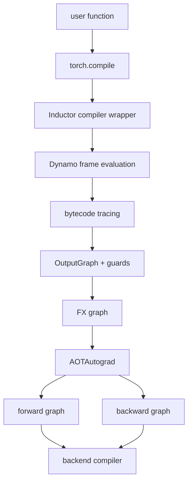

# TorchDynamo 与 AOTAutograd：Overview 与 Architecture

## Overview

本章描述 Inductor 编译前的前端编排。Dynamo 负责把 Python frame 中可捕获的操作组织成 FX graph，
guard 负责确认 graph 的假设仍成立；AOTAutograd 再把 autograd 相关语义整理为可独立编译的前向和反向图。

## Architecture

## 数据流与边界

- Dynamo 产出的是带 guards 的图，不负责生成 Triton/C++。
- AOTAutograd 处理 functionalization、保存值和前后向拆分，不负责决定具体 tile。
- backend callback 接收到 GraphModule 后，才进入 Inductor 的 lowering/IR 流程。
- graph break 会让一个用户函数对应多个 graph，但一个 graph 也可能生成多个 kernel。

## 阅读方法

先用自定义 backend 打印每次收到的 GraphModule，再用 Inductor 观察同一函数的 generated artifacts。这样
可以把“前端切图”和“后端拆 kernel”区分开。
