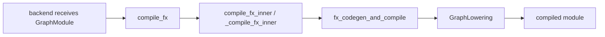

# compile_fx 与 GraphLowering

## 主链



## 源码入口

- `<workspace>/pytorch/torch/_inductor/compile_fx.py`：`compile_fx`、`compile_fx_inner`、
  `_compile_fx_inner`、`fx_codegen_and_compile`。
- `<workspace>/pytorch/torch/_inductor/graph.py`：`GraphLowering`、`codegen`、`compile_to_module`。

## 关键观察

`compile_fx` 是编排层，不等于 kernel emitter。要分析具体算子，沿调用链进入 GraphLowering 和 lowering
registry；要分析生成源码，继续进入目标 6 的 backend codegen。

## 练习

对 `add + relu` 打印 backend 输入 graph，再在 `GraphLowering.codegen` 附近观察 IR/compile artifact，
记录“graph 被接收”“IR 被构建”“源码被生成”三个时间点。

## 实现展开：GraphLowering 是 FX Interpreter 的 IR 构造器

`GraphLowering` 继承 `torch.fx.Interpreter`，但重载了 `run()`/`run_node()`，将每个 FX node 的执行结果
变成 `TensorBox`、`IRNode`、常量或符号表达式。它的构造函数会建立：

- `shape_env` 和 `SizeVarAllocator`：管理动态 size/index。
- `graph_inputs`、`buffers`、`operations`：保存输入、物化 buffer 和 extern/operation。
- `name_to_buffer`、`name_to_op`：让后续 lowering/IR 通过名字互相引用。
- device、constant、mutation 和 output metadata。

源码入口：

- `torch/_inductor/graph.py:322`：`GraphLowering.__init__`。
- `graph.py:989`：`GraphLowering.run` 调用 FX interpreter。
- `graph.py:1635`：`run_node`，每个 node 的 IR 级执行入口。
- `graph.py:2350`：`codegen`，初始化 wrapper、创建 scheduler 并生成所有节点。
- `graph.py:2409`：`compile_to_module`，把 wrapper/source 交给编译缓存。

`GraphLowering.codegen()` 的实际代码顺序是：

```text
init_wrapper_code()
_update_scheduler()       # Scheduler(self.operations)
scheduler.codegen()       # backend kernel codegen
wrapper_code.generate()   # wrapper + launch code
```

因此，调试 `compile_fx` 时建议在 `run_node`、lowering helper、`self.operations` 和 `scheduler.nodes`
四个位置分别观察一次；这能确定错误首次出现在哪一层。

## `placeholder()` 的输入分流

`GraphLowering.placeholder()` 先读取 interpreter 得到的 example input，再按类型建立不同 IR：

| 输入 | 处理 | 后续消费者 |
|---|---|---|
| `SymInt`/`SymFloat`/`SymBool` | 保存 SymNode expression | sizevars、wrapper |
| Python scalar | `sympy.sympify` | symbolic index/constant |
| static Tensor | `static_sizes_strides` + `FixedLayout` | `InputBuffer` |
| symbolic Tensor | `symbolic_sizes_strides` + `FixedLayout` | runtime size/stride |
| generator/TorchBind/`None` | 专用 IR 或空值 | extern/runtime |

如果是 backward donated input，placeholder 会创建 `DonatedBuffer`；普通输入则创建 `InputBuffer`。同时根据 example
input alignment 更新 `unaligned_buffers`，这个集合会影响后续向量化假设。因此输入 alignment 不是 runtime launcher
才决定的属性。

## `call_function()` 的真实判定顺序

```text
有 _inductor_lowering_function? -> passthrough lowering
target 不在 lowerings?
  -> fallback allowlist / implicit fallback -> make_fallback
  -> 有 decomposition -> MissingOperatorWithDecomp
  -> 无 decomposition -> MissingOperatorWithoutDecomp
有 layout constraint? -> 约束或复制输入 layout
node.meta['should_fallback']? -> fallback_handler
otherwise -> lowerings[target](*args, **kwargs)
mutable op 的输入被复制? -> propagate_mutation
```

任何异常最后包装成 `LoweringException(target, args, kwargs)`。registry miss、layout constraint、lowering body 和
fallback execution 属于不同分支，不能只按“算子不支持”归类。

## `run_node()` 的回滚边界

`run_node()` 在执行前记录 `len(self.buffers)` 和 `len(self.operations)`，并将 FX node 放入 IR origin context。
两个 watermark 用于识别本次 node 新建的 buffer/operation，尤其服务于 unbacked symbol 定义收集和诊断；它们不是自动
回滚机制。成功时，`current_node`、origin 和 traceback 会随返回 IR 保留，最终可从 generated kernel 反查 FX source。

## `output()` 为什么可能触发 realization

Graph output 只允许 TensorBox、常量或 symbolic expression 等受支持对象。对 tensor output，GraphLowering 会调用
`ExternKernel.realize_input()`，再依据 FX output metadata 处理 stride/layout、mutation output 和 graph output 注册。
因此 lazy Pointwise 何时变成 `ComputedBuffer`，可能晚到 output 阶段才确定。
