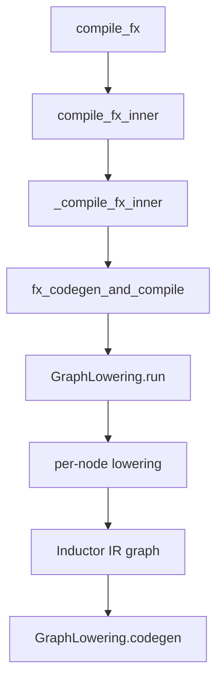

# 目标 4：Inductor IR 与 Lowering

## 目标

理解 Inductor 怎样把 functional FX/ATen graph 转换为自身 IR 和循环语义。完成后，应当能为一个
FX node 找到 lowering，并说明其输出 layout、索引、依赖和后续消费者。

## 主链



`GraphLowering` 继承 FX interpreter 的执行模型：遍历 graph node，但这里的“执行”主要是在构建
Inductor IR，而不是计算真实 tensor 数值。

## 核心概念

### Lowering 注册

lowering 将 ATen operator 映射为：

- pointwise/reduction loop；
- view/reindex/layout 变换；
- extern kernel；
- template choice；
- mutation 或其他专门 IR。

必须区分“算子有 eager 实现”和“算子有 Inductor lowering”。前者不能证明后者能融合生成 kernel。

### IR、Storage 与 Layout

学习时重点关注当前版本中承担这些职责的对象：

- buffer/storage：表示需要物化的存储。
- computed buffer：由 loop 计算得到的 buffer。
- pointwise/reduction：描述逐元素或归约计算。
- layout：描述 size、stride、device、dtype 或 flexible/fixed layout。
- view/reinterpret/reindex：改变逻辑到物理坐标的映射。
- extern/template：把部分计算委派给库调用或模板 kernel。

类名可能随版本演进，判断对象职责时同时看构造点和消费者，不只看名字。

## 代码入口

- `<workspace>/pytorch/torch/_inductor/compile_fx.py`
  - `compile_fx`
  - `compile_fx_inner`
  - `_compile_fx_inner`
  - `fx_codegen_and_compile`
- `<workspace>/pytorch/torch/_inductor/graph.py`
  - `GraphLowering`
  - `GraphLowering.codegen`
  - `GraphLowering.compile_to_module`
- `<workspace>/pytorch/torch/_inductor/lowering.py`
  - lowering registry
  - pointwise/reduction lowering helpers
- `<workspace>/pytorch/torch/_inductor/ir.py`：IR、layout、loop 与 buffer 对象。
- `<workspace>/pytorch/torch/_inductor/virtualized.py`：编译上下文中的虚拟化 handler。

## 源码范围

本章覆盖 FX/ATen graph 进入 Inductor 后的 IR 构造与算子 lowering，边界是 scheduler 消费这些 IR 之前。

- **纳入范围**：`torch/_inductor/compile_fx.py` 的编译编排、`graph.py` 的 `GraphLowering`、
  `lowering.py` 的注册和通用 lowering、`ir.py` 的 buffer/loop/layout 表示，以及
  `virtualized.py` 中影响 IR 构造的上下文接口。
- **暂不深入**：scheduler 的融合策略、具体 Triton/C++ emitter、runtime cache/autotune 和 NPU 专用
  lowering；这些在目标 5、6、8 展开。
- **建议顺序**：先读 `compile_fx` 到 `GraphLowering` 的数据流，再读 lowering registry，随后按
  pointwise、reduction、view/realization、extern/template 四类 IR 路径比较。

## 章节文档地图

- [Overview 与 Architecture](overview-and-architecture.md)
- [compile_fx 与 GraphLowering](compile-fx-and-graph-lowering.md)
- [Lowering Registry 与 Operator Mapping](lowering-registry-and-operator-mapping.md)
- [Inductor IR、Buffer 与 Loop](inductor-ir-buffer-and-loop.md)
- [Layout、View 与 Realization](layout-view-and-realization.md)
- [Pointwise、Reduction、Extern 与 Template](pointwise-reduction-extern-and-template.md)

## 源码阅读方法

对一个 FX node 固定执行下面的追踪：

```text
FX node target
  -> lowering registry entry
  -> lowering function
  -> 创建的 IR 对象
  -> output layout
  -> inner_fn / index expression
  -> users
  -> 是否需要 realization
```

不要只停在 `register_lowering()`。真正的计算语义通常位于 helper、`inner_fn` 或 ops handler 调用中。

## 练习

### 练习 1：pointwise lowering

跟踪 `aten.add` 和 `relu` 的 lowering，记录它们如何表达广播、dtype promotion 和逐元素计算。解释为什么
两个 FX node 最终可能共享一个 kernel。

### 练习 2：reduction lowering

跟踪 `sum(dim=-1)`，记录 reduction ranges、输出 ranges、accumulator dtype 和输出 layout。改变 reduction
dim，观察 IR 的 axis 含义如何变化。

### 练习 3：view 与 realization

比较 view、transpose、clone/contiguous。记录哪些只改变索引映射，哪些强制产生新存储，以及后续
consumer 是否可以把 view 语义吸收到自己的 indexing 中。

### 练习 4：extern/template 路径

跟踪 matmul，确认它在当前配置中进入 ATen extern、template choice 或其他 backend。不要预设所有算子
都会变成通用 pointwise/reduction loop。

## 产出物

- `add + relu` 的 `FX node -> lowering -> IR -> consumer` 映射表。
- reduction 的输出 ranges、reduction ranges 和 layout 注释。
- view、transpose、contiguous 的物化行为对照。
- 一个 extern/template operator 的选择证据。

## 验收清单

- [ ] 能从一个 FX target 找到对应 lowering 入口。
- [ ] 能解释 GraphLowering 为什么是 interpreter，但不执行真实数值计算。
- [ ] 能从 IR 找出 device、dtype、size、stride/index 和 dependency。
- [ ] 能区分 virtual view 与 realized buffer。
- [ ] 能解释 pointwise、reduction、extern 和 template 路径的差别。

## 常见误区

- lowering 不是最终源码输出，它仍在构建后端无关或半后端相关的程序表示。
- graph 中存在两个 op 不代表一定存在两个 IR buffer，更不代表两个 kernel。
- view 没有计算成本不等于它对 codegen 没影响；它会改变后续访问公式。
- fallback 能跑通只能说明存在替代执行路径，不能证明目标 lowering/codegen 路径正确。

[上一目标](../03-dynamo-and-aotautograd/) | [返回总路线](../) |
[下一目标](../05-scheduler-fusion-and-tiling/)
