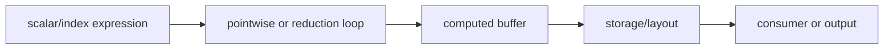

# Inductor IR、Buffer 与 Loop

## 表示层次



常见对象职责包括：

- `Buffer`/computed buffer：需要由计算或外部调用得到的存储。
- `Pointwise`：输出元素与输入索引一一对应的 loop 语义。
- `Reduction`：包含输出迭代域和 reduction 域的 loop 语义。
- `StorageBox`/view/reindex：把逻辑值与物理存储连接起来。

具体类名可能随版本变化，应同时检查构造点和消费者。

## 源码入口

- `<workspace>/pytorch/torch/_inductor/ir.py`：IR、buffer、layout、loop、reduction。
- `<workspace>/pytorch/torch/_inductor/virtualized.py`：编译期 handler/context。

## 练习

为 `sum(dim=-1)` 标出 output ranges、reduction ranges、accumulator dtype、输出 layout 和 users；再
比较 dim 改变后的 IR。

## 实现展开：Pointwise 与 Reduction 的字段

`ir.py:1071` 的 `Pointwise` 继承 `Loops`，核心字段是 `device`、`dtype`、`inner_fn` 和 `ranges`。
`store_output()` 用 output indexer 调用 `inner_fn`，再发出 `ops.store`。

`ir.py:1221` 的 `Reduction` 在 pointwise 字段之外增加：

- `reduction_ranges`：需要归约的轴范围。
- `reduction_type`：sum、max、prod、argmax 等组合语义。
- `src_dtype`：输入/accumulator 可能与目标 dtype 不同。
- `reduction_hint`：供 scheduler/backend 选择实现。

`Reduction.store_reduction()` 的关键顺序是：

```text
value = inner_fn(output_vars, reduction_vars)
value = ops.reduction(dst_dtype, src_dtype, type, value)
ops.store_reduction(output_name, output_indexer(output_vars), value)
```

也就是说，output index 和 reduction index 是两套变量；把 reduction variable 错当成 output variable，
或者在 reduction loop 尚未完成时调用普通 `store`，会造成重复写回/错误结果。

源码入口：

- `torch/_inductor/ir.py:1071`：`Pointwise`。
- `ir.py:1221`：`Reduction`。
- `ir.py:4602`：`ComputedBuffer`，把 loop result 与实际输出 buffer 连接。
- `torch/_inductor/codegen/triton.py:3734`：reduction operation 的目标 DSL 发射。

## `Pointwise` 的执行接口

`Pointwise.make_loader()` 通常直接返回 `inner_fn`；零元素 range 则返回 `nop_loader_fn`，避免执行真实 load。
`store_output()` 用 output vars 调用 loader，再执行 `ops.store(output_name, indexer(vars), value)`。因此 pointwise
只有 output domain，没有独立 reduction vars。

融合 producer 时，consumer 可以直接调用 producer loader；只有 output、mutation、extern/template 或显式
`StorageBox.realize()` 要求实际 storage 时才创建 `ComputedBuffer`。

## `Reduction` 的执行接口

`Reduction` 由 `ranges`、`reduction_ranges`、`reduction_type`、`src_dtype` 和 `reduction_hint` 共同定义。固定调用顺序是：

```text
inner_fn(output_vars, reduction_vars)
  -> ops.reduction(dst_dtype, src_dtype, reduction_type, value)
  -> ops.store_reduction(output_index(output_vars), reduced_value)
```

output index 不包含 reduction vars。`get_reduction_combine_fn()` 对 sum/max/min/prod 返回对应 combine；argmax/argmin
还组合 value/index 并处理 NaN、相等值和 tie-breaking；Welford 同时维护 mean、m2、weight。backend 可以改变循环布局，
不能改变 combine 代数和 store domain。

## 从 IR 判断错误层级

- `ranges`/`reduction_ranges` 错：lowering 或 symbolic metadata。
- `inner_fn` 的 loader index 错：layout/view/lowering。
- IR 正确、generated reduction dim 错：scheduler/emitter。
- store index 含 reduction var：违反 `Reduction.store_reduction()` 语义。
