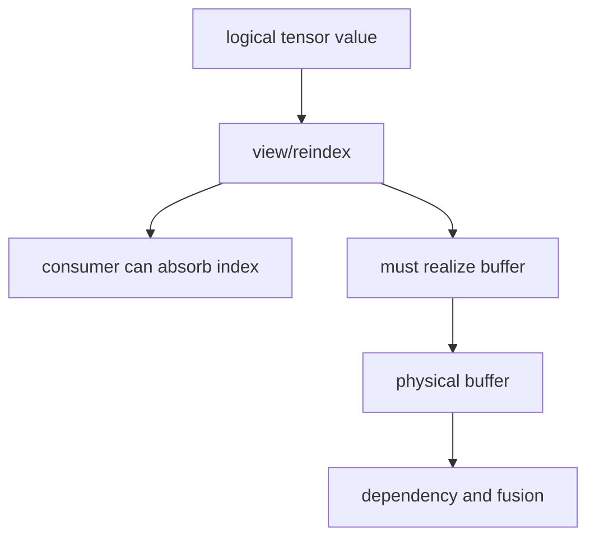

# Layout、View 与 Realization

## 决策流



view 只改变访问映射时可以延迟物化；当 layout、alias、设备或 consumer 约束不允许继续传播时，需要
realize 成为实际 buffer。这个决定会直接影响中间存储、dependency 和 kernel 边界。

## 源码入口

- `<workspace>/pytorch/torch/_inductor/lowering.py`：`view`、`permute`、`as_strided` 等。
- `<workspace>/pytorch/torch/_inductor/ir.py`：layout、view/reindex、buffer realization。
- `<workspace>/pytorch/torch/_inductor/scheduler.py`：realized buffer 参与依赖和调度。

## 练习问题

- `transpose` 后的 pointwise consumer 能否直接用 stride index？
- 哪些操作会强制 clone/contiguous？证据位于 lowering 还是 IR consumer？
- realization 增加的 buffer 是否一定增加 kernel？

## 实现展开：TensorBox、Layout 和 realization

lowering 返回的通常不是裸 `ir.Buffer`，而是带 lazy/virtual 语义的 TensorBox。view/reindex 可以继续包在
TensorBox 上，让 consumer 直接通过 loader 访问原 buffer；当需要固定 storage、满足 mutation/alias、或
后端要求具体 layout 时，才调用 realization，把值登记成 `ComputedBuffer`/`Buffer`。

阅读时沿下面的数据结构追踪：

```text
lowering result
  -> TensorBox / StorageBox
  -> Layout (size, stride, device, dtype)
  -> make_loader / make_indexer
  -> realize() if required
  -> GraphLowering.buffers / scheduler dependency
```

源码入口：

- `torch/_inductor/ir.py`：`TensorBox`/`StorageBox`、`Layout`、`Buffer`、`ComputedBuffer`。
- `torch/_inductor/lowering.py:1221` 附近：view/permute/as_strided 的 reindex 构造。
- `torch/_inductor/graph.py`：`register_buffer`、`register_operation` 和 `name_to_buffer`。
- `torch/_inductor/scheduler.py`：realized buffer 进入 read/write dependency。

判断“view 是否物化”时，不要只看是否有一个 FX view node；要看 consumer 是否需要一个实际 buffer、
是否存在 alias/mutation、以及 `TensorBox` 何时被 `realize()`。

## `TensorBox` 与 `StorageBox` 的内部关系

`TensorBox.create(data)` 实际构造 `TensorBox(StorageBox(data))`。TensorBox 提供 tensor 语义和可变引用，StorageBox
保存底层 IR；inplace mutation 可以替换 StorageBox 的 `data`。view 可以继续包装同一 storage 或使用 ReinterpretView/
reindex 表达别名，不必立刻分配新 buffer。

## `StorageBox.realize()` 的精确动作

若底层已是 realized node，直接返回其名字；否则当前实现要求底层是 Pointwise、Reduction、Scan 或 Sort，并依次：

1. 保存 origin node、traceback、device。
2. 创建带 `FlexibleLayout` 的 `ComputedBuffer`，其 data 仍是原 lazy loop。
3. 通过 `V.graph.register_buffer()` 分配 buffer 名。
4. 通过 `V.graph.register_operation()` 加入 GraphLowering operations。
5. 把 origins、origin_node 和 traceback 复制到新 buffer。

此处才把 lazy loop 变成 scheduler 可见的 operation。`realize_hint()` 会在 Pointwise/Reduction 的 nontrivial read 数量
超过阈值时提前 realization，以避免同一表达式被多个 consumer 重复展开。

## layout 何时从 flexible 变成 fixed

新 ComputedBuffer 默认使用 FlexibleLayout，允许 scheduler/backend 选择 stride；output、extern、mutation、template
或 layout constraint 可能要求 FixedLayout/contiguous。若出现额外 copy，应定位第一次固定 layout 或要求 contiguous 的调用点，
而不是从 wrapper allocation 反推原因。
