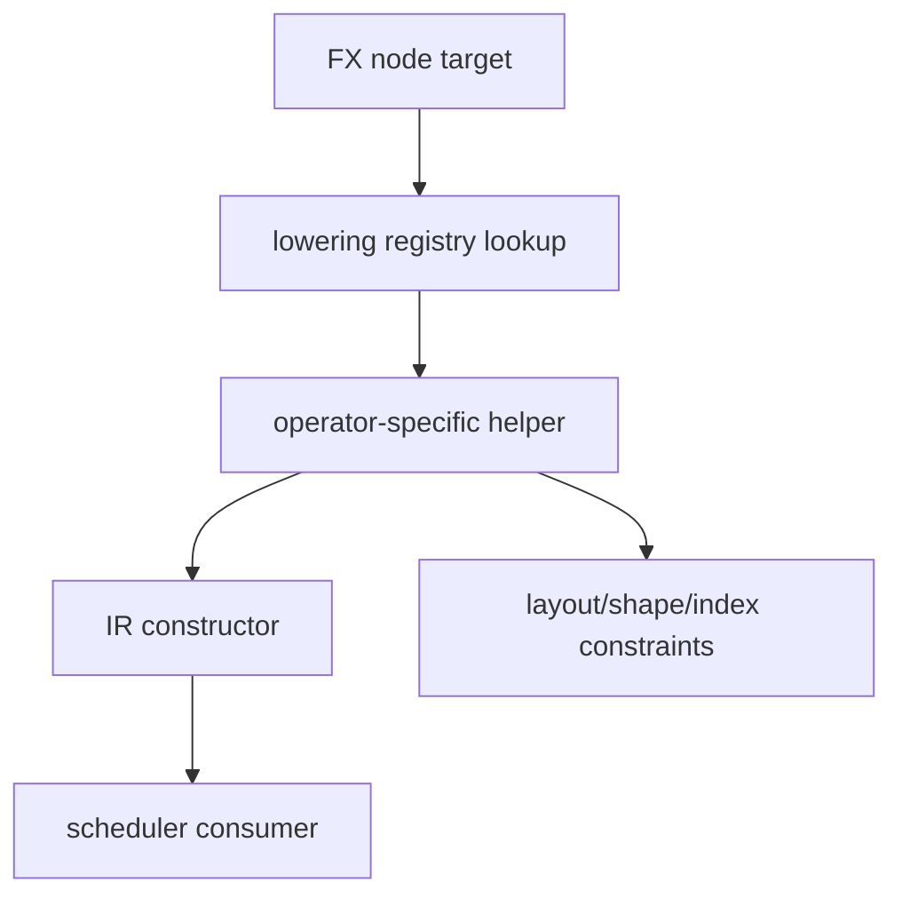

# Lowering Registry 与 Operator Mapping

## 映射模型



## 源码入口

- `<workspace>/pytorch/torch/_inductor/lowering.py`：`_register_lowering`、`register_lowering`、
  `register_pointwise`、`make_pointwise`、view/permute/reindex helpers。
- `<workspace>/pytorch/torch/_inductor/ir.py`：lowering helper 创建的 IR 类型。

## 阅读方法

不要停在 registry 装饰器。继续读 wrapper 内部的 dtype promotion、broadcast、layout constraint、
`inner_fn` 和 realization 判断，否则只看到了“注册了什么”，没有看到“语义如何实现”。

## 练习问题

- `aten.add` 的 broadcast 和 alpha 如何进入 pointwise inner function？
- `view` 为什么通常不创建计算 kernel，却会改变 consumer 的 index？
- lowering 找不到时，当前版本如何选择 extern、fallback 或报错？

## 实现展开：register_lowering 与 make_pointwise

`lowering.py:527` 的 `register_lowering()` 返回一个装饰器，最终将 overload 映射到 `lowerings` 字典。
它还携带 `broadcast`、`type_promotion_kind`、`convert_input_to_bool` 等元参数；这些参数会影响 wrapper
对输入的预处理，而不只是登记函数名。

对普通 pointwise operator，常见实现模式是：

```python
@register_pointwise(aten.add, broadcast=True)
def add(a, b, alpha=1):
    return make_pointwise(lambda x, y: x + y * alpha)(a, b)
```

当前源码的 `make_pointwise()`（`lowering.py:624`）会：

1. `promote_constants()`：把 Python scalar/SymPy expression 转成 IR constant 或 `ExpandView`。
2. `make_loader()`：为每个输入构造按 output index 读取的 loader。
3. 取得第一个输入的 `ranges`，并检查其他输入的 rank/broadcast 条件。
4. 创建 `inner_fn(index)`：对同一逻辑 index load 输入、执行 `fn`、处理 dtype cast。
5. 返回 `Pointwise.create(device, dtype, inner_fn, ranges)`。

这说明 pointwise lowering 的核心产物不是一段 Python 数值代码，而是“给定逻辑 index 如何加载和计算”的
闭包。后续 scheduler/emitter 会把这个闭包展开为循环和 kernel body。

### operator 到 registry 的排查

1. 从 FX node 的 `target` 找到具体 OpOverload。
2. 在 `lowerings` 查找该 overload，而不是只搜字符串 `aten.add`。
3. 进入注册函数，确认是否调用 `make_pointwise`、reduction helper、extern 或 template。
4. 跟踪返回的 TensorBox/IRNode 如何被 GraphLowering 注册。

## `make_pointwise()` 的关键不变量

`make_pointwise()` 构造的 `inner_fn(index)` 必须让所有输入使用同一 output 逻辑坐标，再由各自 loader 处理
broadcast、view 和 stride：

```text
promote_constants -> make_loader(input, output_ranges)
  -> broadcast/rank compatibility
  -> inner_fn(index): load -> fn -> dtype/promotion
  -> Pointwise.create(device, dtype, inner_fn, ranges)
```

scalar 或低 rank 输入通过 `ExpandView`/broadcast loader 扩展逻辑坐标，并不复制真实 storage。因此 lowering 错误
通常体现为 output range、loader index 或 dtype promotion 不一致，而不是 emitter 随机生成错误指针。

## registry miss 的真实分流

从 `lowerings[op_overload]` 查不到时，当前调用仍可能进入 extern、template、fallback 或 NPU patch 注册表。排查顺序应是
具体 overload -> lowering registry -> fallback/template choice -> 返回的 IR 类型；最后确认
`GraphLowering.register_operation()` 是否收到该 operation。
