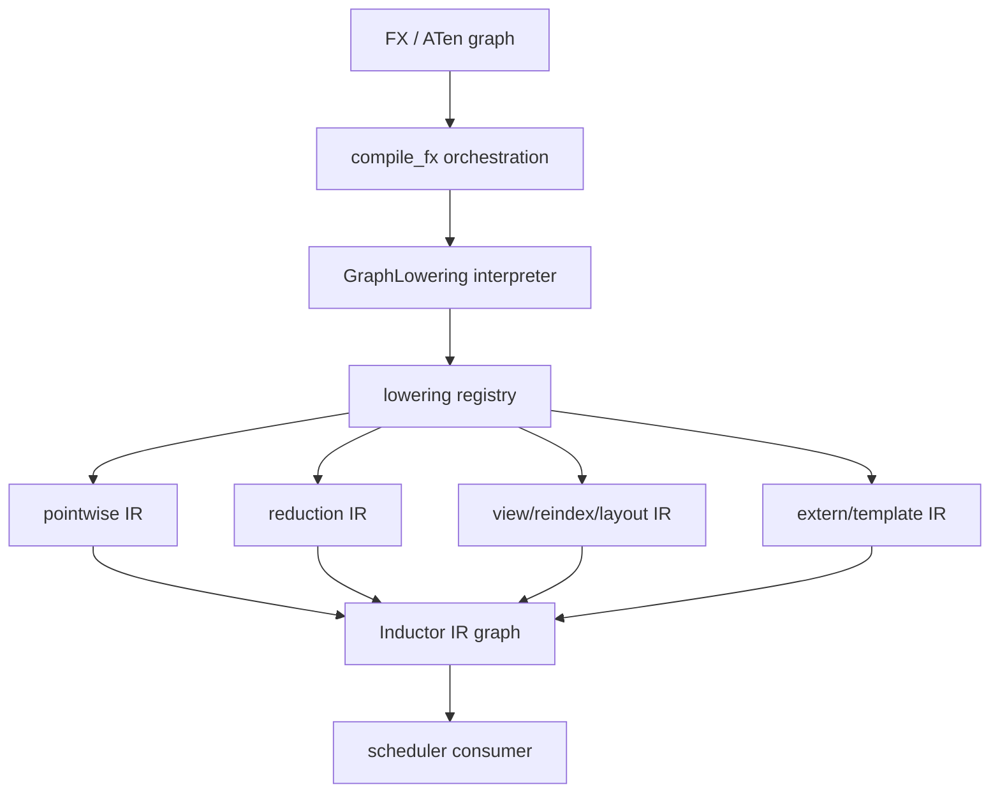

# Inductor IR 与 Lowering：Overview 与 Architecture

## Overview

本章研究 Inductor 如何把 FX/ATen graph 转换成可以做依赖分析和调度的内部表示。lowering 既要保留
operator 语义，也要暴露 layout、索引、mutation、realization 和可能的 extern/template 选择。

## Architecture

## 数据流说明

- `compile_fx` 建立编译上下文并调用 `GraphLowering`。
- `GraphLowering` 遍历 FX graph，但通过 fake/IR 对象表达结果，不计算真实数值。
- lowering registry 根据 operator target 选择语义转换。
- IR 同时保留计算和 storage/layout 信息，供 scheduler 判断依赖、融合和 realization。
- 同一个高层 op 可能进入通用 loop、extern kernel 或 template，不能只由 operator 名称判断路径。

## 阅读方法

固定追踪一条 `FX target -> lowering function -> IR object -> output layout -> users` 链；找到 IR 创建点后，
再读它如何被 scheduler 消费。
