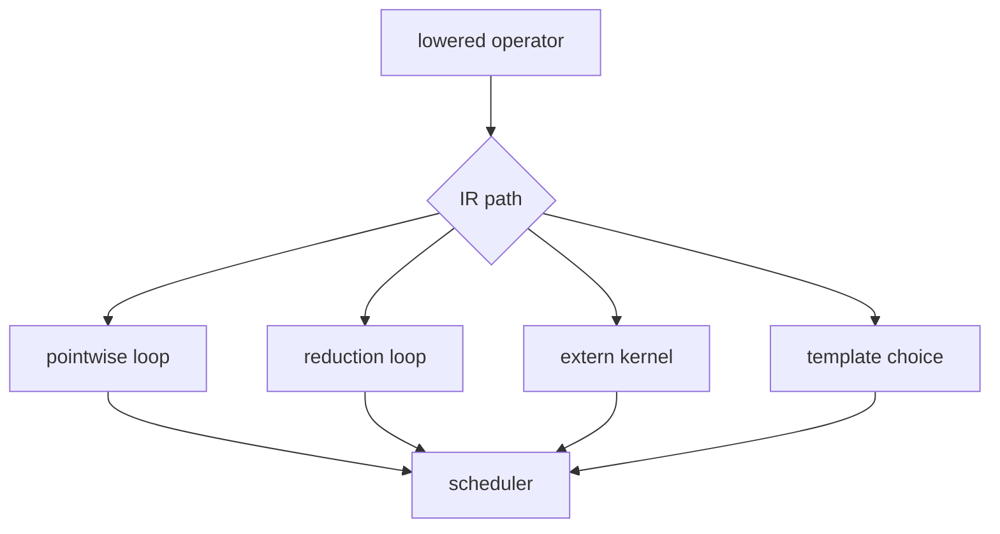

# Pointwise、Reduction、Extern 与 Template

## 路径比较

- pointwise：每个输出位置独立计算，适合与相邻 pointwise 融合。
- reduction：需要额外 reduction domain、accumulator 和最终写回。
- extern：委派给已有库或 device op，通常保留较少的通用 loop 细节。
- template：为 matmul 等结构选择预定义高性能实现和参数。

## 源码入口

- `<workspace>/pytorch/torch/_inductor/lowering.py`：通用 pointwise/reduction/extern lowering。
- `<workspace>/pytorch/torch/_inductor/ir.py`：相应 IR 对象。
- `<workspace>/pytorch/torch/_inductor/choices.py`：部分模板/后端选择。

## 练习

比较 `add + relu`、`sum` 和 matmul 的 IR。对每个回答：是否有 reduction domain、是否需要物化、是否
由通用 loop 还是 template/extern 负责。

## 实现展开：四条 lowering 路径如何分流

### Pointwise

`make_pointwise()` 生成 `Pointwise`，由一个 output index 驱动所有输入 loader；scheduler 最容易将相邻
pointwise node vertical fusion。

### Reduction

reduction lowering 需要同时传递 output ranges 和 `reduction_ranges`，并指定 combine type。后续 backend
要处理 accumulator 初始化、循环组合、最终 projection/store；因此 reduction 通常比 pointwise 更难融合。

### Extern

extern lowering 创建 `ExternKernel`/operation，保存调用所需输入、输出、layout 和 device metadata。它
可以绕过通用 loop emitter，但 wrapper 仍必须生成正确的 buffer、参数和调用顺序。

### Template

matmul 等结构化算子可能进入 template choice。template 节点保存尺寸、dtype、layout、epilogue 和候选
配置，scheduler 决定它与哪些节点融合，backend 再渲染模板和 wrapper call。

源码入口：

- `torch/_inductor/lowering.py`：pointwise/reduction/extern 注册函数。
- `torch/_inductor/ir.py`：`Pointwise`、`Reduction`、`ExternKernel`、template-related IR。
- `torch/_inductor/choices.py`：候选 backend/template 选择。
- `torch/_inductor/scheduler.py:5401`、`6500` 附近：extern/template codegen 分支。

调试时先确认 operator 进入哪条路径，再分析对应 emitter；不要拿通用 pointwise 的假设解释 template 或
extern 的生成结果。

## 四条路径的可观察分界

| 路径 | IR 主要对象 | scheduler 后续关注点 | 典型 codegen |
|---|---|---|---|
| pointwise | `Pointwise` | 相同 output domain 是否可融合 | 通用 loop/Triton |
| reduction | `Reduction` | `numel/rnumel`、accumulator、store scope | reduction loop |
| extern | `ExternKernel`/operation | ABI、workspace、layout | wrapper/extern call |
| template | template node/choice | candidate、epilogue、backend allowlist | rendered template |

matmul 后的 add 可能是 template epilogue，也可能拆成独立 pointwise；决定因素不是 FX 算子名字，而是 lowering 返回的
IR 类型和 `choices`/scheduler 的融合结果。定位时先打印 IR class，再讨论 kernel body。
