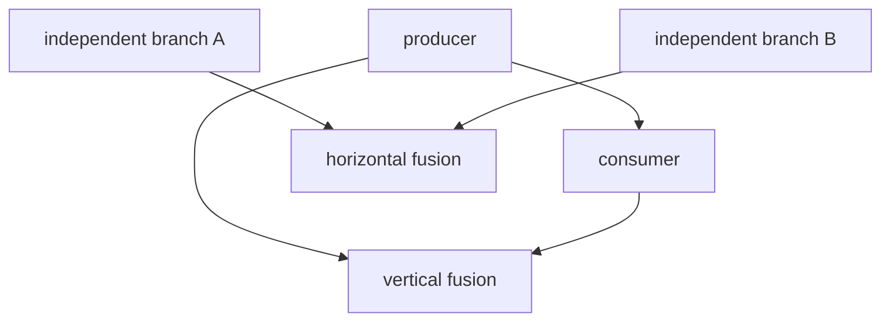

# Vertical 与 Horizontal Fusion

## 两种基本形态



- vertical fusion：producer 的值直接在 consumer 的循环内使用，通常减少中间 store/load。
- horizontal fusion：相互独立但 domain、layout 和资源条件兼容的计算共享执行结构。

## 判定维度

依赖合法性只是必要条件，还要检查：

```text
iteration domain compatibility
reduction domain compatibility
layout and device
mutation/alias
resource and recomputation cost
backend capability
```

## 源码入口

- `<workspace>/pytorch/torch/_inductor/scheduler.py`：fusion 判定和 fused node。
- `<workspace>/pytorch/torch/_inductor/codegen/common.py`：backend scheduling 公共接口。
- `<workspace>/pytorch_new/torch_npu/_inductor/codegen/npu_combined_scheduling.py`：NPU 对照行为。

## 练习

对一个成功 fusion 和一个拒绝 fusion 的用例分别记录候选 node、判定函数、失败理由和最终 kernel。不要
只记录“有几个 kernel”。

## 实现展开：can_fuse 的判定顺序

上游 `Scheduler.can_fuse()`（`scheduler.py:4942`）不是一个简单的 `if node1 and node2`。主要顺序是：

1. 拒绝自身、grouped node、普通 extern/nop 等不能融合的节点。
2. 检查 ancestor/order，避免把依赖方向反过来。
3. 对 template prologue/epilogue 检查配置、输入 allowlist、single-use 和 mutation。
4. 检查 `no_fuse_buffer_names`、device mismatch。
5. 计算 `score_fusion_memory()`，必要时尝试 loop reorder 或 index inversion。
6. 调用 `V.choices.can_fuse()` 做全局 choice/cost 判断。
7. 若 node2 依赖 node1，进入 `can_fuse_vertical()`；否则进入 horizontal fusion。
8. 最终还要通过 backend 的 `can_fuse_vertical/horizontal()`。

vertical fusion 的 `can_fuse_vertical()` 会逐个检查 node2 的 unmet dependencies：如果 node1 的 write
是同一 buffer 的可匹配 `MemoryDep`，该 read 可以被 producer 内部消除；如果 index 不匹配（例如 `x`
和 `x + 1`），则保留 dependency 并拒绝 fusion。

这解释了两个常见现象：

- 两个 node 数学上连续，但不同 stride/index domain 仍不能 vertical fuse。
- node 没有 data dependency，也可能因 device、alias、template policy 或 shared-data score 不能
  horizontal fuse。

调试时建议打开 scheduler 的 fusion reason/loop-order 日志，记录 `WhyNoFuse` 的第一条失败原因。

## vertical 与 horizontal 的源码级分流

可以把 `can_fuse(node1, node2)` 画成下面的决策树：

```text
same node / grouped / unsupported extern?
  yes -> reject
ancestor/order/mutation/device/template violation?
  yes -> reject
node2 depends on node1?
  yes -> can_fuse_vertical()
  no  -> can_fuse_horizontal()
backend can_fuse_* and V.choices.can_fuse()?
  no -> reject
  yes -> create fused node
```

vertical 路径的关键是“producer 的写入是否能直接成为 consumer 的读取”。若 `MemoryDep.index` 能通过
`statically_known_equals` 对齐，consumer 的 load 可以在同一循环中复用 producer 值；若只能证明 buffer 名相同，
仍不能消除 load。horizontal 路径没有 producer-consumer 数据边，因此重点转为 group `(numel, rnumel)`、loop order、
共同输入的读取成本和 backend 能力。

`score_fusion_memory()` 不是最终正确性判定，而是候选排序/成本信号。`loop reorder` 或 `index inversion` 能改变
访问顺序，但不会绕过 alias、device、mutation 和 template allowlist 检查。遇到“融合后变慢”，先确认是同一合法 fused
group，再比较 score、loop order 和寄存器/临时 buffer；不要把它归因给 autotune。

## NPU 的额外边界

`NPUCombinedScheduling` 覆盖 `can_fuse_vertical()` 和 `can_fuse_horizontal()`，然后仍回到上游 scheduler 的
dependency 验证。继承关系并不意味着 CUDA 与 NPU 的融合相同：实际 node backend、template 类型和 NPU backend
feature 必须在 `choose_node_backend()` 的结果中确认。正确的排查顺序是上游 `can_fuse` 失败原因，再看 NPU override，
最后看 `split_tiling` 是否让同一 fused group 产生了不同的 program domain。
