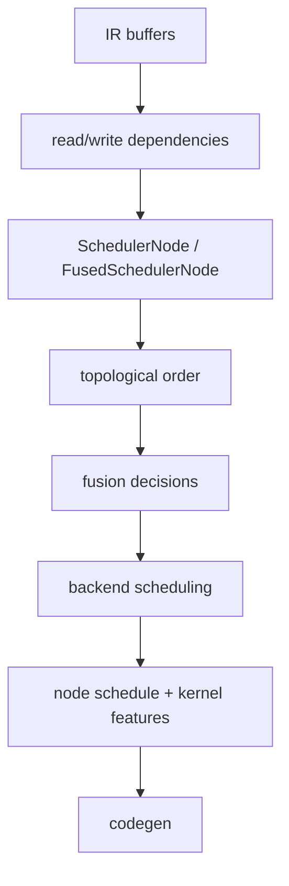

# 目标 5：Scheduler、融合与 Tiling

## 目标

理解 Inductor 如何从 IR 建立依赖、形成 scheduler nodes、决定融合和 kernel 分组，并把逻辑迭代空间
转换为 backend 可生成的循环/tiling 结构。

## 核心数据流



### Dependency

dependency 不只是“节点 A 在节点 B 前”。codegen 需要知道 buffer 的读写区域、mutation、alias 和设备，
从而判断重排或融合是否保持语义。

### Fusion

- vertical fusion：producer 和 consumer 融合，常用于消除中间 buffer。
- horizontal fusion：相互独立但迭代结构兼容的计算共享 kernel。
- reduction/pointwise fusion：需要考虑 reduction 前后 domain 和 store 位置。

融合受依赖、layout、设备、迭代空间、资源使用、重计算成本和 backend 能力共同限制。

### Scheduling 与 Tiling

Scheduler 决定“哪些逻辑计算一起生成”；backend scheduling 进一步决定 loop order、kernel 类型、维度
合并、split 和 tiling。autotune 可以从多个合法实现中选配置，但不能修复语义错误的 schedule。

## 代码入口

- `<workspace>/pytorch/torch/_inductor/scheduler.py`
  - `Scheduler`
  - `SchedulerNode`
  - `FusedSchedulerNode`
  - fusion 和 codegen 调度方法
- `<workspace>/pytorch/torch/_inductor/dependencies.py`：read/write dependency 表达。
- `<workspace>/pytorch/torch/_inductor/codegen/common.py`：backend scheduling 注册和公共接口。
- `<workspace>/pytorch/torch/_inductor/codegen/simd.py`：SIMD backend scheduling 主体。
- `<workspace>/pytorch/torch/_inductor/codegen/simd_kernel_features.py`：kernel feature 与 node schedule。
- `<workspace>/pytorch/torch/_inductor/choices.py`：部分全局 codegen choice。

NPU 对照入口：

- `<workspace>/pytorch_new/torch_npu/_inductor/codegen/npu_combined_scheduling.py`
- `<workspace>/pytorch_new/torch_npu/_inductor/codegen/scheduling.py`
- `<workspace>/pytorch_new/torch_npu/_inductor/codegen/split_tiling.py`

## 源码范围

本章从 Inductor IR 已经构建完成开始，追踪 dependency、scheduler node、fusion、循环域和 tiling，止于
backend kernel codegen 接收的 node schedule/features。

- **纳入范围**：上游 `scheduler.py`、`dependencies.py`、`codegen/common.py`、`simd.py`、
  `simd_kernel_features.py`，以及 NPU 对照实现 `npu_combined_scheduling.py`、`scheduling.py`、
  `split_tiling.py`。
- **暂不深入**：FX/Dynamo 前端、lowering 如何创建 IR、Triton/C++ 源码 emitter、runtime autotune；
  这些分别在目标 2 至 4、6 至 8 展开。
- **建议顺序**：先读 dependency 和 SchedulerNode，再读 vertical/horizontal fusion，最后读 backend
  scheduling、reduction loop 和 split/tiling。

## 章节文档地图

- [Overview 与 Architecture](overview-and-architecture.md)
- [Dependency、SchedulerNode 与拓扑顺序](dependency-and-scheduler.md)
- [Vertical/Horizontal Fusion](fusion-strategies.md)
- [Iteration Domain、Reduction Domain 与 Loop Schedule](loop-domain-and-reduction-schedule.md)
- [Tiling、Split Axis 与 Kernel Features](tiling-split-axis-and-features.md)：NPU 轴选择完整算法、动态/静态差异及
  CUDA 对照；遇到“为什么选这条轴”时直接阅读此篇。

## 分析一个 scheduler 决策

每次都收集以下证据：

```text
producer/consumer
read buffers / write buffers
iteration ranges / reduction ranges
layout and device
can_fuse 判定及失败理由
最终 fused group
backend/kernel type
node schedule
tiling axes / block configuration
```

不要从最终 kernel 数量反推唯一原因。相同 kernel 数量可能由完全不同的 fusion 和 realization 决策产生。

## 练习

### 练习 1：pointwise 纵向融合

使用 `(x + y).relu()`，确认 add 的中间结果是否物化。沿 dependency 和 fusion 判定解释为什么两个
node 能融合。

### 练习 2：横向融合

构造两个读取同一输入、输出彼此独立的 pointwise 分支。观察当前配置是否横向融合，并记录成本模型或
限制条件。改变 shape，确认结论是否稳定。

### 练习 3：reduction + pointwise

比较 reduction 前 pointwise、reduction 后 pointwise，以及两个不同 reduction。重点检查 accumulator
生命周期和最终 store 位于哪个 loop 层级。

### 练习 4：non-contiguous

对 transpose 输入重复 pointwise/reduction 实验，记录 stride dependency、loop order 和融合结果变化。
不能为了简化复现把 non-contiguous 输入转成 contiguous。

### 练习 5：tiling 变化

固定语义，改变 shape 或 backend config，比较 axis 合并、block size 和 mask。区分合法的性能配置变化与
会改变结果的语义错误。

## 产出物

- 至少三个用例的 scheduler node/fused group 图。
- 两个成功融合和两个拒绝融合的源码证据。
- pointwise、reduction、non-contiguous 三类 kernel 的 domain/tiling 表。
- 一个从错误 generated DSL 反查 scheduler metadata 的练习记录。

## 验收清单

- [ ] 能从 scheduler node 找出 reads、writes、users 和 ranges。
- [ ] 能区分 vertical fusion 与 horizontal fusion。
- [ ] 能用实际判定路径解释一次融合成功或失败。
- [ ] 能说明 scheduler、backend scheduling、tiling 和 autotune 的边界。
- [ ] 能判断 reduction store 是否位于完整归约之后。

## 常见误区

- scheduler 不是操作系统线程调度器，而是编译器中的程序调度层。
- kernel 数量少不必然性能好；大 kernel 可能增加寄存器压力或降低占用率。
- autotune 只应在语义等价的候选中选择，不能把错误候选“调优成正确”。
- reduction 的 value layout、mask layout、reduction dim 和 store scope 必须采用一致的 axis 解释。

[上一目标](../04-inductor-ir-and-lowering/) | [返回总路线](../) |
[下一目标](../06-backend-codegen-and-runtime/)
