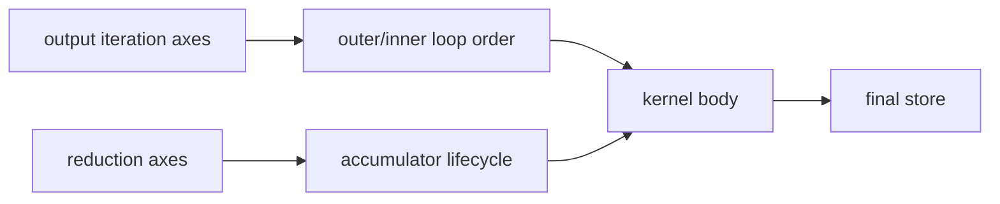

# Iteration Domain、Reduction Domain 与 Loop Schedule

## 结构



pointwise 通常直接遍历输出域；reduction 需要同时处理输出域和 reduction 域。accumulator 初始化、更新、
最终 reduce 与 store 的 loop scope 必须一致，尤其是 multi-reduction 和 fused epilogue 场景。

## 源码入口

- `<workspace>/pytorch/torch/_inductor/ir.py`：pointwise/reduction domain。
- `<workspace>/pytorch/torch/_inductor/scheduler.py`：节点 schedule 和 reduction 调度。
- `<workspace>/pytorch/torch/_inductor/codegen/simd.py`：loop emission。

## 练习

比较 `sum(dim=-1)`、连续多个 reduction 轴和 reduction 后 relu，分别标出 accumulator、partial store
和 full reduction store 的位置。

## 易错点

- reduction axis flatten 后，value、mask 和最终 reduction dim 必须采用同一轴顺序。
- store 提前到 partial loop 内会造成重复或不完整结果。

## 实现展开：从 `LoopBody` 到 reduction store

IR 的 `Pointwise`/`Reduction` 通过 `inner_fn` 描述索引计算；scheduler node 在
`_compute_attrs()` 中调用 `simplify_and_reorder()` 得到最终 `_sizes` 和 loop body。backend scheduling
再将这些 size 分为 `numel` 与 `rnumel`，生成 node schedule。

在通用 IR 层，`Reduction.store_reduction()` 明确区分：

```text
vars          = output/preserved axes
reduction_vars = reduction axes
inner_fn(vars, reduction_vars)
ops.reduction(...)
ops.store_reduction(output_index(vars), value)
```

在 C++/Triton emitter 中，这会分别映射为：

- reduction init：由 `reduction_init`/对应 kernel method 生成 identity。
- reduction combine：由 `reduction_combine`、`tl.sum` 或 max/min 等操作生成。
- reduction project：把 accumulator 转成目标 dtype。
- final store：只对 output/preserved axes 生成地址和 mask。

源码入口：

- `torch/_inductor/ir.py:1221`：`Reduction`。
- `torch/_inductor/codegen/cpp.py:162`：reduction init/combine/project helper。
- `torch/_inductor/codegen/triton.py:3734`：reduction expression。
- `triton.py:4414`：`store_reduction`。
- `triton.py:4752`：`codegen_body`，决定 range 和 store 的作用域。

因此 multi-reduction bug 要同时比较 axis order、value/mask reshape、`tl.sum` dim 和 `store_reduction`
所在 loop；只改最后一行 store 往往不能修复根因。

## `generate_node_schedule()` 如何插入 reduction 边界

上游 `SIMDScheduling.generate_node_schedule()` 与 NPU 的 `_generate_npu_node_schedule()` 都维护以下状态：

```text
done                  已排入 schedule 的节点
not_ready_yet_nodes   reduction 输出尚未完成，不能在当前 loop 复用的节点
current_loop_buffer_usage  当前 loop 已读/写的 buffer
maybe_split_index     可能需要插入 reduction 边界的位置
```

节点若 `fits_in_main_body()`，会加入当前 loop；若当前存在尚未完成的 reduction 且新节点依赖这些祖先，
`requires_closing_previous_reduction()` 要求先调用 `end_current_reduction_loop()`。该 context manager 会插入
`DisableReduction`/`EnableReduction` marker，并清空 `not_ready_yet_nodes` 与 buffer usage。

NPU 版本的一个真实差异是 `same_size()`：它先用 `sizevars.statically_known_equals()` 比较 SymPy 表达式，避免
动态 shape 下 `left == right` 返回非布尔表达式而误判 group 不同。只有启用 `enable_welford` 且 group 含 Welford
时才采用 NPU 自己的 schedule，其余路径显式回到上游实现。

## reduction store 的作用域推演

当 generated code 出现一个 store 时，沿下面的调用链反查：

```text
IR Reduction.store_reduction
  -> scheduler node schedule
  -> codegen_node_schedule_with_kernel
  -> kernel.reduction()/store_reduction()
  -> output index + accumulator projection
```

若 store 位于 `DisableReduction` 之前，它可能只写 partial accumulator；若位于 `EnableReduction` 后的外层，才是
完整 reduction 结果。fused epilogue 能否留在 reduction loop 内，取决于它是否读取“每次 partial reduce 都可用”的值；
这正是 `not_ready_yet_nodes` 和 `fits_outside_reduction()` 存在的原因。
