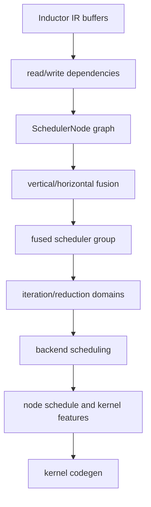

# Scheduler、融合与 Tiling：Overview 与 Architecture

## Overview

Scheduler 接收已构建的 IR，分析读写依赖并把可兼容的节点组织为 kernel group。backend scheduling 再
把 group 转成 loop order、reduction schedule、split/tiling 和 kernel features。它决定“如何执行”，
但不应改变 lowering 已表达的数学语义。

## Architecture

## 数据流说明

- dependency 约束合法顺序和可融合边界。
- fusion 把多个 node 变成共享执行空间，但要保持 alias/layout/reduction 语义。
- backend scheduling 选择 loop order、维度合并、split axis、tiling 和 kernel type。
- kernel features 将这些决定交给 Triton/C++/NPU emitter。

## 阅读方法

遇到“为什么没融合”或“为什么选择某个 tile”，先收集 node schedule、reads/writes、ranges、layout 和
失败原因，再看最终 kernel；不能只凭 kernel 数量逆推 scheduler 决策。
