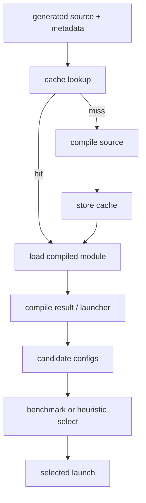

# Code Cache、Compile Result 与 Autotune

## 运行时链路



## 源码入口

- `<workspace>/pytorch/torch/_inductor/codecache.py`：源码、模块和 key/cache。
- `<workspace>/pytorch/torch/_inductor/runtime/triton_heuristics.py`：`CachingAutotuner`、compile result、
  launcher、precompile/run。

## 关键区分

- Dynamo cache：复用捕获后的 graph/compiled callable。
- Inductor code cache：复用生成源码或编译模块。
- autotune cache/choice：复用候选配置选择。
- steady-state runtime：不应把首次 tracing、compile、autotune 时间混入。

## 练习

分别执行冷 cache、同进程重复、重启进程，记录 compile、cache hit、autotune 和 kernel launch 的时间及日志。

## 实现展开：CachingAutotuner 的生命周期

上游 `runtime/triton_heuristics.py` 中，`CachingAutotuner` 的核心阶段是：

```text
kernel metadata/configs
  -> precompile()
  -> _make_launchers()
  -> make_launcher()
  -> run(args, stream)
```

源码入口：

- `triton_heuristics.py:260`：`CachingAutotuner`。
- `triton_heuristics.py:425`：`precompile`，编译候选或准备编译结果。
- `triton_heuristics.py:586`：`_make_launchers`，把 compile result 变成可调用 launcher。
- `triton_heuristics.py:1338`：`run`，按当前 args/grid/stream 执行选择的 launcher。
- `triton_heuristics.py:1694`、`1833`：不同 compile result 的 `make_launcher`。
- `codecache.py`：根据 source/key/cache path 加载已编译模块。

首次运行可能经历 source cache miss、device compiler、多个 candidate precompile 和 benchmark；重复运行
通常跳过其中一些阶段。做性能实验必须分别记录 cold compile、autotune、warmup 和 steady-state。

## 语义边界

autotuner 只在候选配置之间选择，不负责判断候选是否数学等价。若某个 candidate 的 reduction axis、mask
或 pointer ABI 已经错误，benchmark 速度再好也不能作为正确性证据。

## `run()` 中候选选择的边界

`CachingAutotuner.run()` 的关键输入不是只有 `args`，还包括 runtime grid、stream、当前 candidate/launcher 状态：

```text
第一次 run -> precompile -> _make_launchers -> benchmark candidates -> 保存 best launcher
后续 run  -> 复用 best launcher -> 重新解释 runtime grid/args -> launch
```

因此“第二次调用没有 compile 日志”只说明 code cache/launcher 已存在，不说明 runtime grid 不再计算。dynamic shape
下 grid、mask 和 scalar 参数仍可能每次由 wrapper/launcher 重新解释。

## cache key 与正确性排查

排查缓存问题时同时记录 source hash/code hash、kernel metadata（包括 split/tiling axis）、candidate config 和
compile result 的 launcher ABI。source 相同但结果不同时先查 runtime args/grid/stream；source 或 metadata 不同则回到
Inductor graph、scheduler 或轴选择，而不是先归因于 benchmark 噪声。
