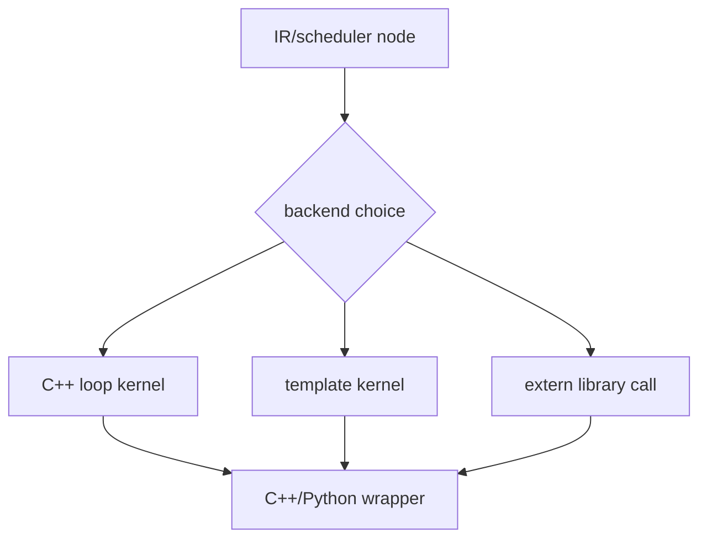

# C++、Template 与 Extern Codegen

## 路径



## 源码入口

- `<workspace>/pytorch/torch/_inductor/codegen/cpp.py`：CPU loop/vector codegen。
- `<workspace>/pytorch/torch/_inductor/codegen/cpp_wrapper_cpu.py`：CPU wrapper。
- `<workspace>/pytorch/torch/_inductor/codegen/cpp_template.py`、`cpp_gemm_template.py`：模板。
- `<workspace>/pytorch/torch/_inductor/choices.py`：部分 backend/template choice。

## 关键区别

- C++ loop emitter 直接表达循环、pointer、条件和并行结构。
- template emitter 往往只生成参数化模板实例和调用，不暴露所有内部 microkernel 细节。
- extern 路径把计算交给已有库，wrapper ABI 和 layout contract 仍是 codegen 的一部分。

## 练习

对 matmul 和 pointwise 分别确认使用了 template/extern 还是通用 loop。记录选择入口和最终 wrapper 调用。

## 实现展开：三种 backend 产物

### C++ loop

`codegen/cpp.py` 的 `load()`、`store()`、`reduction()` 将 IR index expression 转成 pointer arithmetic、
条件和 C++ scalar/vector 运算；`reduction_init/combine/project` 负责 reduction 类型的 identity、
combine 和 dtype conversion。CPU wrapper 再编译这些 loops 为扩展模块。

### Template

template node 通常保存矩阵尺寸、layout、dtype、epilogue 和候选配置。scheduler 的
`codegen_template()` 将 prologue/epilogue node 与模板连接，模板 emitter 生成专用 kernel 或调用，wrapper
只传递 ABI 参数。不能用通用 pointwise 的 load/store 数量来解释 template 内部实现。

### Extern

extern node 保存外部 op 的输入输出和调用 metadata。scheduler 在 `codegen_extern_call()`（
`scheduler.py:5401`）发出调用；真实计算由库或设备 runtime 完成，但 output layout、stream、workspace
和 wrapper 参数仍由 Inductor 管理。

## 判断路径的证据

1. 从 scheduler node 判断 `is_template()`/extern 类型。
2. 找 `codegen_node`、`codegen_template` 或 `codegen_extern_call` 分支。
3. 查看 generated source 是否存在通用 loop，还是只有模板/库调用 stub。
4. 最后检查 wrapper ABI，确认 output/workspace/stream 参数匹配。

## C++ loop 的发射顺序

`CppScheduling.codegen_node()` 根据 node schedule 进入 `codegen_loops()` 或 template 分支。通用 loop 继续经过：

```text
node ranges/reduction ranges
  -> loop nest / worksharing
  -> codegen_inner_loops
  -> load(index expression)
  -> scalar/vector compute
  -> store(pointer, condition)
```

`codegen_conditions()` 把 SymPy 条件变成 C++ `if`/mask；reduction 则在 inner loop 前发 identity，在 loop 内发 combine，
最后在正确 output scope 发 project/store。CPU vectorization 可能改变 lane 表达式和 loop order，但不改变 IR 的 output
index 与 reduction index 分离。

## template 与 extern 的选择边界

template node 有候选 choice 和 render 参数，scheduler 先确认 prologue/epilogue 能否连接，再由
`codegen_template()` 生成模板实例。extern node 则由 `ExternKernel.codegen()` 直接向 wrapper 写入 output allocation、
size asserts、alignment/memory tracking 和 call args；它通常不会产生通用 `codegen_inner_loops`。

因此排查 generated code 时：存在完整 loop nest 说明走 C++ loop；只有模板函数/调用说明 template；只有外部函数调用和 wrapper
参数说明 extern。三者都可能共享同一 output layout，却有不同的性能和 ABI 证据。
