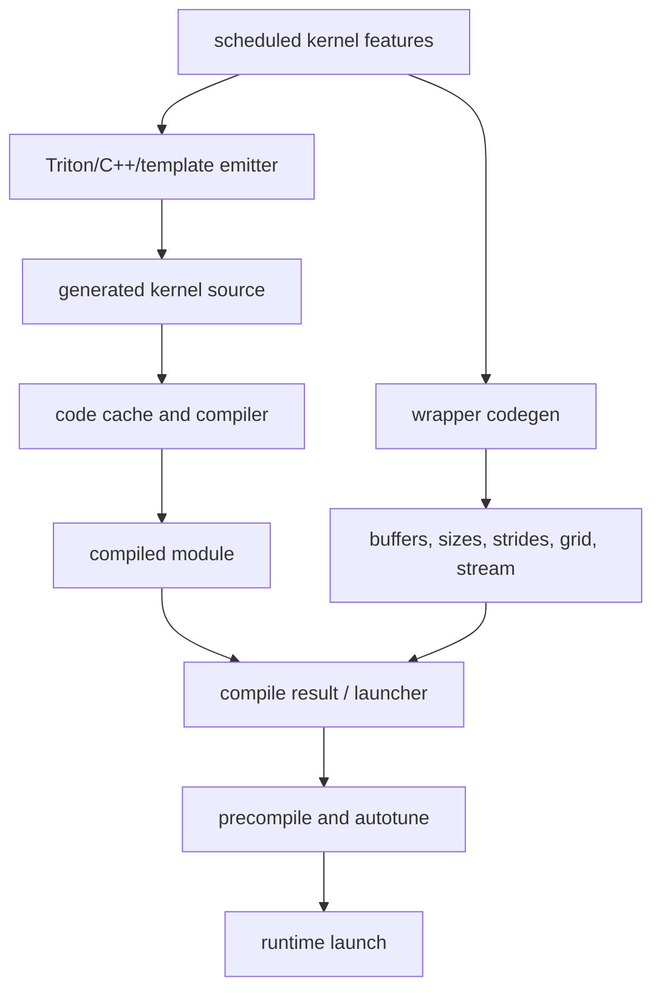

# Backend Codegen 与 Runtime：Overview 与 Architecture

## Overview

本章是“从调度结果到可执行 kernel”的主线。kernel emitter 负责计算本体，wrapper 负责参数、buffer、
grid 和调用顺序，cache/compiler 负责把源码变成可加载模块，autotuner 在语义等价候选中选择配置。

## Architecture

## 数据流说明

- scheduler features 决定 emitter 要写出的 loop、axis 和 kernel metadata。
- wrapper 把运行时 tensor 和 symbolic size 组织成 kernel ABI。
- cache 以源码/配置等信息复用编译结果，但 cache hit 不代表 runtime 已执行。
- autotune 只能比较语义等价的 candidate；grid、stream 和参数仍由 wrapper/runtime 连接。

## 阅读方法

先读一份 generated source，再反向找 emitter；然后读 wrapper 的 kernel call，最后沿 compile result、cache、
launcher 和 stream 到 runtime。不要只从 Python wrapper 推断 kernel 数学语义。
