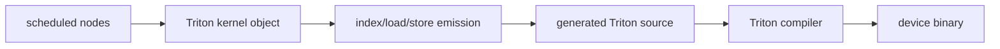

# Triton Kernel Codegen

## 生成链



## 源码入口

- `<workspace>/pytorch/torch/_inductor/codegen/triton.py`：Triton kernel、range、load/store、reduction。
- `<workspace>/pytorch/torch/_inductor/codegen/common.py`：公共 buffer/index/codegen helpers。
- `<workspace>/pytorch/torch/_inductor/ir.py`：emitter 消费的 loop/index 语义。

## 机械阅读顺序

1. 读 signature 和 metadata，映射 pointer/scalar。
2. 找 `program_id`、block offset 和 lane offset。
3. 将 load 地址还原为 shape/stride 公式。
4. 标出 mask、accumulator、`tl.sum` 和 store scope。

## 练习

对 pointwise kernel 逐行写出一个 program instance 负责的元素范围；对 reduction kernel 画出 preserved
axis、reduction axis 和最终 store。

## 实现展开：TritonKernel 的四个关键阶段

当前 `TritonKernel`（`codegen/triton.py:2466`）的生成可以按四段阅读：

1. `codegen_range_tree()`：把 scheduler 提供的 loop/range 变成 program axes、block variables 和
   可用的 mask。
2. `load(name, index)`（`triton.py:3335`）：从 `V.graph` 找 buffer layout，调用 indexer，把 SymPy
   index 转成 Triton expression，并通过 CSE 合并重复 load。
3. `store(name, index, value, mode)`（`triton.py:3521`）：生成目标 pointer、mask 和写回操作；mutation/
   scatter 可能使用不同 store mode。
4. `codegen_body()`（`triton.py:4752`）：按 node schedule 进入 range、计算、reduction 和 store；最终
   输出 kernel signature、metadata、grid expression 和源码。

pointwise 的 `load/store` 通常共享同一 program index；reduction 会在 `reduction()` 和
`store_reduction()` 中额外调整 value shape、accumulator 和 reduction dim。对于生成代码中的一行
`tl.load`，应能反查：buffer name -> Layout.make_indexer -> SymPy index -> Triton pointer。

## 最小 generated kernel 反推

看到：

```python
offs = pid * BLOCK + tl.arange(0, BLOCK)
mask = offs < n
xv = tl.load(x_ptr + offs, mask=mask)
tl.store(out_ptr + offs, xv + 1, mask=mask)
```

可以反推出这是一个一维 pointwise loop；如果看到 `offs_m[:, None] * stride_m + offs_n[None, :] *
stride_n`，则是二维 layout/index；如果 accumulator 在 `for r` 或 `tl.sum` 后才 store，才是 reduction
完成后的写回。

## NPU 轴标记如何落到代码行

NPU 的 `IterationRangesEntryNPUIndex.codegen_header()` 和 `codegen_index()` 把轴属性翻译成固定公式：

```text
split axis:
  axis_offset = tl.program_id(split_order) * AXISBLOCK
tiling axis:
  base_axis = tl.arange(0, AXISBLOCK_SUB)
normal pointwise axis:
  axis = loop_axis * AXISBLOCK_SUB + base_axis
split + tiling axis:
  axis = axis_offset + loop_axis * AXISBLOCK_SUB + base_axis
no-loop axis:
  axis = base_axis
```

`_codegen_mask()` 对 split axis 使用 `min(BLOCK + offset, axis_numel)`，对普通 tiling axis 使用
`axis_numel`。`_codegen()` 还会根据 `prefix == "r"` 选择 reduction base/loop 公式；persistent reduction 不再
使用普通 reduction loop 的偏移。由此可见，检查 kernel 时必须同时看 `program_id`、`BLOCK_SUB` 和 `loop_*`，只看
`tl.load` 的最终指针会丢失轴选择信息。

## 两遍 codegen 为什么存在

`SIMDScheduling.codegen_node_schedule_with_kernel()` 先遍历 node schedule，调用
`kernel.split_and_set_ranges()` 收集全部 indexing，并 `kernel.finalize_indexing()`；第二遍才真正调用
`node.codegen(index_vars)`。第一遍的目的，是在任何 load/store 发射前确定所有 range tree、CSE 和 inplace update。
如果只改第二遍的指针表达式而没有同步第一遍的 ranges，常见结果是 mask、reduction dim 或 index dtype 不一致。

## metadata 不是装饰字段

NPU `inductor_meta` 中会写入 `split_axis`、`tiling_axis`、`low_dims` 和 `split_axis_dtype`。runtime
`GridExprNpu`、launcher 以及 grouped autotuner 都可能消费这些字段。source 看起来合法但 metadata 中轴顺序错误时，
仍可能出现错误 grid 或错误 block；排查应把 metadata 与 generated body 中的 `program_id(dim)` 逐项对齐。
