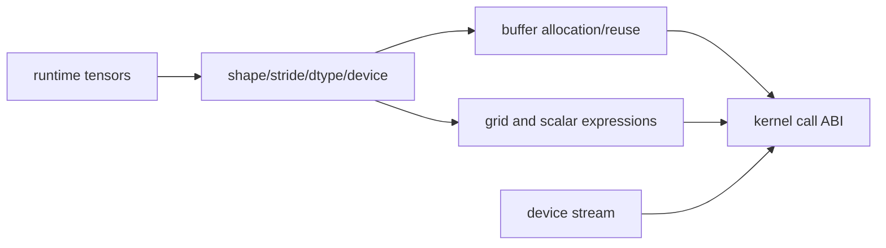

# Wrapper Codegen 与 Kernel ABI

## 数据流



wrapper 负责“怎样调用”而不是“怎么算”。但 ABI 错误会导致 kernel compile、launch 或结果错误，所以应与
kernel source 一起审查。

## 源码入口

- `<workspace>/pytorch/torch/_inductor/codegen/wrapper.py`：Python wrapper。
- `<workspace>/pytorch/torch/_inductor/codegen/cpp_wrapper_cpu.py`：CPU C++ wrapper。
- `<workspace>/pytorch/torch/_inductor/codegen/common.py`：公共 wrapper/codegen 接口。

## 练习问题

- 哪些 shape/stride 在 compile time 确定，哪些在 call time 读取？
- output buffer 在 wrapper 哪一步分配或复用？
- grid、stream 和 pointer 的顺序如何与 launcher 签名对应？

## 实现展开：wrapper 如何组织一次 kernel call

`torch/_inductor/codegen/wrapper.py` 负责将 graph outputs、buffers、size/stride expression 和 device
operation 写入 wrapper buffer。常见顺序是：

```text
wrapper.generate()
  -> input/device checks
  -> symbolic size/stride assignments
  -> allocate/reuse output buffers
  -> emit kernel definitions or compile-result references
  -> compute grid and launch args
  -> call launcher(stream, args...)
  -> free/reuse temporaries and return outputs
```

CPU C++ wrapper 的对应实现位于 `cpp_wrapper_cpu.py`，device-specific stream/device 代码通过
`device_op_overrides` 提供。wrapper 不重新计算 IR 的数学语义，但会决定实际传给 kernel 的 pointer、
size、stride、workspace 和 stream；ABI 顺序错误会在 kernel 正确的情况下仍造成错误结果。

## ABI 对照方法

1. 从 generated wrapper 的 launcher call 列出实参顺序。
2. 对照 kernel signature/`TritonCompileResult` 保存的参数元数据。
3. 对每个 tensor 检查 pointer、size、stride、dtype/device 是否来自同一个 buffer/layout。
4. 对 dynamic shape 检查 runtime scalar 是在 wrapper 计算，还是已经常量折叠。
5. 对 stream 检查 wrapper/device override 和 C++ runtime 获取的是同一 device stream。

## 动态参数的归属

wrapper 中的表达式有三种生命周期：

| 表达式 | 生成位置 | 典型用途 |
|---|---|---|
| compile-time 常量 | kernel source/metadata | 静态 `BLOCK_SUB`、dtype、固定 stride |
| wrapper runtime scalar | Python/C++ wrapper | 当前 tensor 的 size、stride、workspace |
| launcher runtime grid | `GridExpr`/device runtime | `numel / BLOCK`、grouped block、program count |

动态 size 已写入 wrapper 不代表 kernel 内没有动态逻辑：kernel 仍可能用它做 mask，launcher 还要用它计算 grid。
ABI 排查应分别记录三类值的生产者和消费者。

## 一次 call 的最小审计

```text
tensor object -> data_ptr/size/stride/dtype -> output allocation/reuse
  -> grid evaluation -> launcher argument packing -> device stream launch
```

只检查 `data_ptr` 而不检查 size/stride，non-contiguous 或 dynamic shape 错误会被误判为 kernel body bug；只检查
grid 而不检查 output allocation，越界写也可能来自错误的 buffer storage size。

## `generate()` 的具体顺序

`PythonWrapperCodeGen.generate()` 会遍历 graph inputs、mutated inputs、buffers 和 graph outputs，并在
`generate_kernel_call()` 中为每个 kernel 写入 grid、args、stream/device context。buffer allocation 由
`make_buffer_allocation()`/`codegen_allocation()` 发出，临时 buffer 的释放或复用由 `make_buffer_free()`/
`make_buffer_reuse()` 发出，最后 `generate_return()` 组织 output tuple。

这解释了三个常见 ABI 错误：allocation size 使用了旧 layout、kernel args 使用了不同 buffer name、output return 在
临时 buffer free 后才取值。调试应沿 wrapper 的实际生成顺序读，而不是只看最终 launcher 一行。
