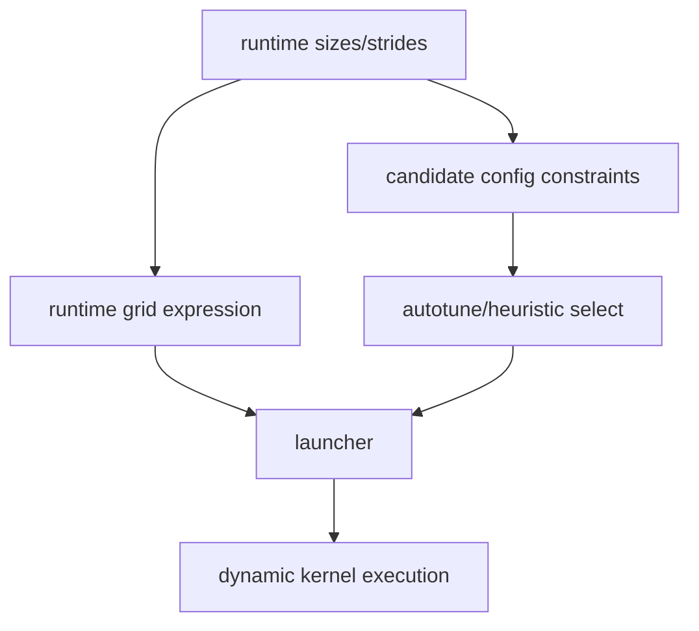

# Dynamic Grid、Runtime Dispatch 与 Autotune

## 运行时链路



动态 kernel 可能在调用时计算 grid、block 或 scalar 参数；autotune 仍要使用满足当前符号范围和 layout
约束的候选。某些动态场景会退化为 specialization、fallback 或不同 kernel type。

## 源码入口

- `<workspace>/pytorch/torch/_inductor/codegen/wrapper.py`：runtime grid/size/stride codegen。
- `<workspace>/pytorch/torch/_inductor/runtime/triton_heuristics.py`：dynamic grid、launcher、candidate
  config 和 runtime selection。
- `<workspace>/pytorch/torch/_inductor/compile_fx.py`：symbolic input 与 compiled graph 编排。

## 练习

对 dynamic pointwise 和 reduction 分别记录：运行时 grid、mask、candidate config、autotune 次数和复用
行为。区分首次 benchmark 与 steady-state launch。

## 实现展开：GridExpr 如何变成 runtime grid

上游 runtime 通过 `GridExpr` 表达 grid；NPU 版本在
`torch_npu/_inductor/runtime/triton_heuristics.py` 中扩展 `GridNpu`、`GridExprNpu`：

- `GridNpu.generate(meta)`：根据 kernel metadata 生成静态/可运行的 grid function。
- `GridExprNpu.from_meta_and_set_numel()`：从 `numel`、tile 和 metadata 构造普通动态 grid。
- `from_grouped_meta_and_numel()`：为 grouped/symbolic group 根据 runtime feature 选择 group grid。
- `runtime_grid_fn()`：调用时读取实际 size/block，计算 launch grid。

NPU `NPUCachingAutotuner.run()`（约 1775）负责把 wrapper 传入的 args、runtime blocks、grid 和 stream
组合起来；`autotune()`（约 1845）在需要时 benchmark candidates，`_interpret_args_grid()`（约 1906）
把 runtime 参数解释成实际 grid/block。

简化调用链：

```text
wrapper runtime args
  -> GridExprNpu/runtime_grid_fn
  -> runtime blocks / grid
  -> NPUCachingAutotuner.run(args, stream)
  -> selected launcher
  -> NPU stream launch
```

## grouped dynamic 的额外分支

`NPUSymbolicGroupedAutotuner`（约 2258）会根据 `runtime_feature_inputs` 解析 group id，再通过
`_materialize_runtime_blocks()` 将候选 plan 的 block 参数物化。它不是普通 dynamic kernel 的简单加速：
如果 group id、代表 shape、candidate plan 或 runtime block 无法建立，代码应回退到普通 autotuner，而不应
伪造一个 group 结果。

## 性能/正确性边界

grid 计算错误会造成 launch 覆盖不足或越界；candidate 选择错误可能只表现为性能差；kernel body 的 axis/
mask 错误则会表现为数值错误。三者必须分别收集 runtime grid、launcher 参数和 generated source 证据。

## 普通 dynamic 与 grouped dynamic 的调用差异

普通 dynamic kernel 的 grid 只需要把 runtime `numel` 和静态 metadata 代入 `GridExprNpu`；grouped kernel 还要先计算：

```text
runtime sizes/strides -> feature product -> group id
  -> group plan (representative shape + candidate blocks)
  -> runtime block materialization -> grid
```

`NPUSymbolicGroupedAutotuner.run()` 的 group id 不是 cache key 的替代品：同一个 source 可以根据 runtime feature 选不同
plan，plan 又可能决定不同 `BLOCK_SUB` 和 grid。没有匹配 group 时必须回到普通 candidate path。

动态 reduction 要特别检查 grid 来源。`SplitTiling` 对 dynamic full reduction 保持 `split_axis=[]`，于是 grid 必须为 1，
让 reduction loop 覆盖 runtime numel；这与动态 pointwise 的“动态轴提供 grid”是不同语义。

## 运行时排查样例

同一个 compiled callable 依次传入 `n=127`、`n=256`、`n=1025`，至少记录 guard、source/cache、`GridExprNpu` grid、
grouped id/代表 shape/materialized block（若启用）以及 mask 上界。只有这五项都可解释，才能判断是合法动态 dispatch。
