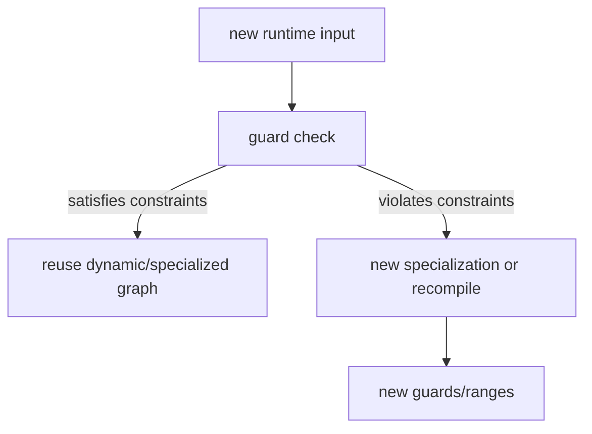

# Guard、Specialization 与 Recompile

## 选择路径



specialization 可以把部分符号固定为常量或特定关系；guard 确保复用时这些假设仍成立。dynamic=True
不意味着完全避免 specialization 或 guard。

## 源码入口

- `<workspace>/pytorch/torch/_dynamo/guards.py`：运行时 guard。
- `<workspace>/pytorch/torch/fx/experimental/symbolic_shapes.py`：symbolic guard/constraint。
- `<workspace>/pytorch/torch/_dynamo/eval_frame.py`：dynamic policy 和编译上下文。

## 练习

用多个 batch size 调用同一 compiled function，记录复用、specialization 和 recompile 的实际日志。将
shape 变化与 stride 变化分开测试。

## 易错点

- 不同 kernel 不一定是 guard 失败，也可能是一个 graph 产生多个 kernel。
- graph 复用不等于 kernel source 完全相同，runtime 参数仍可能不同。

## 实现展开：guard 的生成和执行位置

Dynamo/ShapeEnv 在 tracing 中记录 guard 条件；`ShapeEnv.produce_guards()` 将符号约束转换为可执行表达式，
Dynamo 再把这些表达式放入 guard manager。下次调用时，eval-frame cache 在进入已编译 callable 前先运行
guard manager；只有全部通过才复用该 graph。

源码关系：

```text
ShapeEnv constraints
  -> ShapeEnv.produce_guards()
  -> torch._dynamo.guards.GuardManager
  -> eval-frame cache lookup
  -> compiled_fn or frame re-entry
```

当前源码中的 specialization dispatch（`torch/_dynamo/output_graph.py` 约 2292 附近）会为每个
specialization 保存 `check_fn` 和缓存的 compiled callable。调用时按顺序执行 check；命中后从
`specialization_cache` 取函数，未命中则临时 patch source specialization、再次调用 compiler。

这带来三个不同的“动态”结果：

| 结果 | 发生位置 | 产物 |
|---|---|---|
| 复用动态 graph | guard check 通过 | 同一 compiled callable + 新 runtime scalar |
| specialization cache hit | specialization check 通过 | 对应专用 compiled callable |
| guard failure | eval-frame cache | 新 frame capture/backend compile |

## 代码级排查

1. 找到 guard failure 的 source 和 expression。
2. 确认失败的是 shape、stride、dtype、device 还是 Python object。
3. 检查新的 graph 是否真的进入 backend callback。
4. 对比新旧 FX graph、Inductor cache key 和 generated source。

不要把 `dynamic=True` 直接解释为“只编译一次”；它只改变初始 dynamic policy，不能消除不兼容的 guard、
控制流或 layout 假设。

## guard 失败后的实际分叉

```text
eval-frame cache lookup -> GuardManager.check_fn
  -> pass: 复用原 compiled_fn
  -> fail: 新 frame/新 specialization
       -> ShapeEnv 重新产生 guards -> backend callback -> 新 code cache key
```

`ShapeEnv.produce_guards()` 的约束可能是等式、上下界或 stride/layout 关系。batch size 变化若满足关系，可能只改变
wrapper runtime scalar；破坏关系才会触发新 graph。反过来，一个 graph 内也可能因 fusion/template/fallback 生成多个
kernel，所以 kernel 数量增加不能证明 guard 失败。

记录 recompile 时保留旧/新两组 guard expression、symbol value、FX graph hash、Inductor source hash 和 kernel
metadata，用来区分重新 capture、同 graph 多 kernel，以及 source 相同但 runtime grid/block 不同。
