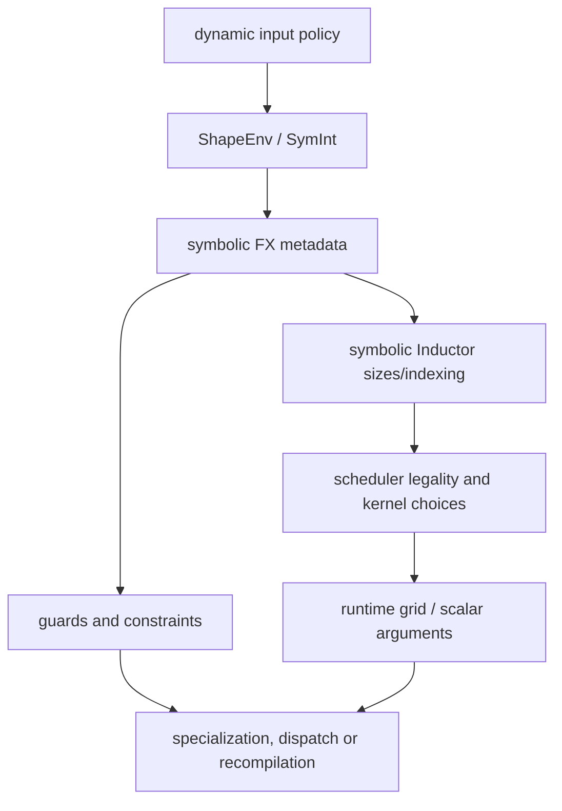

# 目标 7：Dynamic Shapes

## 目标

理解 dynamic shape 不是简单地把常量替换成变量，而是贯穿捕获、guard、符号推理、IR、scheduler、
codegen、autotune 和 runtime dispatch。完成后，应当能用产物解释 static/dynamic 路径的差异。

## 主链

### 关键术语

- `SymInt`：可携带符号表达式的整数抽象。
- `ShapeEnv`：维护符号、约束、range 和 guard 的环境。
- specialization：把某个符号在特定条件下固定为常量或特定关系。
- backed/unbacked symbol：是否能从已有输入或运行时值获得具体值。
- guard：检查运行时输入是否仍满足已编译程序的假设。
- dynamic kernel：运行时以 scalar/symbolic 参数计算索引或 grid 的 kernel，不等于完全无 guard。

## 代码入口

- `<workspace>/pytorch/torch/_dynamo/eval_frame.py`：dynamic 配置进入编译上下文。
- `<workspace>/pytorch/torch/fx/experimental/symbolic_shapes.py`
  - `ShapeEnv`
  - symbol/constraint/range/guard 相关逻辑
- `<workspace>/pytorch/torch/_subclasses/fake_tensor.py`：symbolic FakeTensor 传播。
- `<workspace>/pytorch/torch/_inductor/sizevars.py`：Inductor symbolic expression 管理。
- `<workspace>/pytorch/torch/_inductor/compile_fx.py`：symbolic inputs 与编译策略。
- `<workspace>/pytorch/torch/_inductor/codegen/wrapper.py`：运行时 size/stride 参数和 assertions。
- `<workspace>/pytorch/torch/_inductor/runtime/triton_heuristics.py`：dynamic runtime/autotune 交互。

## 源码范围

本章只讨论 shape/layout 的动态性如何进入编译和运行时，不重新讲完整 Dynamo 或 scheduler 机制。

- **纳入范围**：`torch/fx/experimental/symbolic_shapes.py` 的 `ShapeEnv`、FakeTensor 的符号传播、
  `torch/_inductor/sizevars.py`、`compile_fx.py` 中 symbolic inputs、wrapper 的 runtime size/stride
  代码，以及 Triton runtime 对动态 grid/config 的处理。
- **暂不深入**：普通 static lowering、fusion 算法、NPU backend registration 和 graph capture；需要时
  回链目标 3 至 6、8。
- **建议顺序**：先读 SymInt/ShapeEnv，再读 guard/specialization，随后读 sizevars/indexing，最后读
  dynamic wrapper、grid 和 autotune。

## 章节文档地图

- [Overview 与 Architecture](overview-and-architecture.md)
- [ShapeEnv、SymInt 与 Symbolic Metadata](shapeenv-symint-and-metadata.md)
- [Guard、Specialization 与 Recompile](guard-specialization-and-recompile.md)
- [Dynamic IR、SizeVars 与 Indexing](dynamic-ir-sizevars-and-indexing.md)
- [Dynamic Grid、Runtime Dispatch 与 Autotune](dynamic-grid-runtime-and-autotune.md)

## 对比方法

同一个用例分别执行 static 与 dynamic 模式，固定其他变量，比较：

| 层级 | 观察项 |
|---|---|
| Dynamo | graph 数量、guards、recompile reason |
| FX | placeholder 和 node metadata 中的符号表达式 |
| Inductor | sizevars、range、indexing、runtime assertions |
| Scheduler | fusion、kernel type、persistent/non-persistent 等选择 |
| Generated code | scalar 参数、grid、mask、常量展开 |
| Runtime | dispatch、autotune、cache key、实际编译次数 |

看到 generated kernel 不同，只能证明 codegen 结果不同；还需继续向上定位最早出现差异的阶段。

## 练习

### 练习 1：batch size 变化

对 pointwise 用例依次输入多个 batch size，记录 graph、guards、编译次数和 kernel signature。加入一个超出
已知 range 的尺寸，确认是复用、扩展还是重新编译。

### 练习 2：符号关系

构造两个维度相等、可整除或有上界的输入，观察 ShapeEnv 如何表达关系，以及关系是否成为 guard 或
影响 codegen。

### 练习 3：dynamic reduction

分别让 preserved axis 和 reduction axis 动态化。比较 block/grid、mask 和 kernel 类型，解释为什么
dynamic reduction 比纯 pointwise 更容易影响 scheduling/autotune。

### 练习 4：stride 动态性

比较仅 shape 变化与 layout/stride 变化。验证“支持动态 shape”不能自动推出同一编译产物支持任意
stride。

### 练习 5：static/dynamic artifact diff

保留 FX readable graph 和 `output_code.py`，从最早差异开始逐层解释。可参考仓库中的 DLRM 对比文档，
但不要把特定模型结论直接推广到所有 kernel。

## 产出物

- shape/stride/dtype 变化与 recompile 的实验矩阵。
- 一张 `SymInt -> ShapeEnv -> sizevars -> wrapper/kernel arg` 数据流图。
- 一个 dynamic pointwise 和一个 dynamic reduction 的 static/dynamic artifact diff。
- 对每个差异标注 fact、inference 和尚未验证项。

## 验收清单

- [ ] 能解释 `SymInt` 和 `ShapeEnv` 各自职责。
- [ ] 能从 guard 找到它依赖的输入条件。
- [ ] 能区分 dynamic shape、dynamic rank 和 dynamic stride。
- [ ] 能解释一个 symbolic scalar 如何进入 wrapper/grid/index expression。
- [ ] 能用重新编译日志而不是体感判断 graph 是否复用。

## 常见误区

- `dynamic=True` 不表示所有维度、stride、控制流都完全动态。
- graph 相同不代表 codegen 相同；不同 symbolic range 可能改变 scheduler 或 autotune。
- kernel source 相同也不保证 runtime dispatch 和 cache 行为相同。
- dynamic 路径可 fallback 运行不代表目标 dynamic codegen 路径正确或高效。

[上一目标](../06-backend-codegen-and-runtime/) | [返回总路线](../) |
[下一目标](../08-ascend-npu-codegen/)
