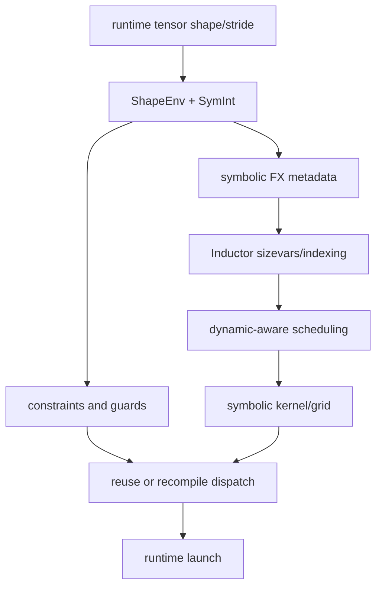

# Dynamic Shapes：Overview 与 Architecture

## Overview

dynamic shape 的核心不是“把常量替换成变量”，而是让 shape/stride 的未知部分以符号表达式、约束和
runtime 参数贯穿编译链。编译器仍可 specialization，也仍需 guard；最终 kernel 可能是动态的，但并非
没有任何假设。

## Architecture

## 数据流说明

- ShapeEnv 建立符号、range 和关系约束。
- FakeTensor/FX metadata 传播这些符号。
- Inductor sizevars 简化符号表达式并构造 runtime indexing。
- scheduler/codegen 根据已知范围和动态轴选择合法 kernel 结构。
- wrapper/runtime 在调用时读取实际 size/stride，计算 grid、mask 和 launch 参数。

## 阅读方法

对 static/dynamic 运行保留 FX readable graph、guards、sizevars、output code 和 compile 次数，从最早
差异开始解释，不要只比较最终 kernel 文本。
