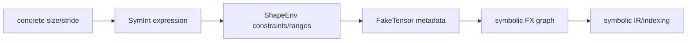

# ShapeEnv、SymInt 与 Symbolic Metadata

## 数据流



`SymInt` 是表达式载体，`ShapeEnv` 管理符号关系、range、替换和 guard。二者共同让编译器在不知道实际
尺寸时仍能推导输出 metadata 和索引。

## 源码入口

- `<workspace>/pytorch/torch/fx/experimental/symbolic_shapes.py`：`ShapeEnv`、符号、约束、range。
- `<workspace>/pytorch/torch/_subclasses/fake_tensor.py`：symbolic FakeTensor propagation。
- `<workspace>/pytorch/torch/_inductor/sizevars.py`：Inductor 中的表达式管理。

## 练习问题

- 两个维度相等、可整除或有上界时，约束如何表现？
- 哪个阶段把符号 metadata 变成 wrapper 可读取的 runtime scalar？
- unbacked symbol 为什么会影响 graph capture 或 cudagraph/npugraph 兼容性？

## 实现展开：ShapeEnv 如何管理一个符号维度

`ShapeEnv`（`torch/fx/experimental/symbolic_shapes.py:3666`）不是简单的 `name -> value` 字典，而是同时
维护符号表达式、hint、range、等式/不等式约束和待生成的 guard。核心入口包括：

- `create_symbol()`（约 5018）：为有来源的动态 size 创建带 source/range 的符号。
- `create_unspecified_symbol()`（约 4988）：为无法从已有 size 直接绑定的值创建 unbacked/unspecified symbol。
- `create_symbolic_sizes_strides_storage_offset()`（约 4500）：批量为 tensor 的 size、stride、storage
  offset 建立 symbolic metadata。
- `evaluate_expr()`（约 7396）：在当前 replacements/hints 下尝试计算表达式。
- `simplify()`（约 6475）：基于约束化简 SymPy expression。
- `produce_guards()`（约 5310）：将记录的关系、range 和 specialization 条件物化为运行时 guard。

一个动态 batch 的简化流程是：

```text
tensor.size(0) = 32 at example time
  -> ShapeEnv.create_symbol(source=batch_dim, hint=32)
  -> SymInt(SymNode(symbol=s0))
  -> fake/meta op builds output expression, e.g. s0 * 2
  -> ShapeEnv records range/equality constraints
  -> produce_guards() emits conditions for reuse
```

`hint=32` 只是编译期推理和某些 heuristic 的参考值，不等于把 `s0` 永久固定为 32；是否 specialization
由 dynamic policy、guard 和具体操作共同决定。

## metadata 如何传播

FakeTensor 保存 `SymInt` size/stride。一个 operator 的 fake/meta 实现读取这些表达式并创建输出 FakeTensor；
FX node 将其存入 `node.meta`，随后 GraphLowering 通过 `shape_env`/`sizevars` 消费。若某个输出 size 是
`s0 + 1`，后续 lowering 不应把它当普通 Python int，而要保留 expression，直到 wrapper/kernel 生成阶段
决定常量折叠或 runtime 参数化。

## 调试证据

同时收集三份数据：

1. `ShapeEnv` 的 symbol/range/guard 日志。
2. FX node 的 fake value shape/stride/dtype/device。
3. generated wrapper 中最终的 size expression。

如果第 1/2 项已经错误，问题在 symbolic shape/meta propagation；如果它们正确而 wrapper/index 错误，问题
在 sizevars、lowering 或 backend codegen。

## `ShapeEnv` 创建 symbol 的实际分支

源码中的 symbol 生命周期可以按以下顺序追踪：

```text
FakeTensor 读取动态 size
  -> ShapeEnv.create_unspecified_symbol/create_symbol
  -> SymNode + SymInt
  -> constrain_range / record equality
  -> evaluate_expr / simplify
  -> produce_guards
```

`create_unspecified_symbol()` 用于不应由当前 example 固定的输入维度；`create_symbol()` 结合 source、hint、range
和 dynamic policy 建立符号。hint 只用于编译期估算，不会自动抹掉符号。`evaluate_expr()` 只有在 replacements、hint
或约束足够时才返回具体值，否则保留符号；`produce_guards()` 再把仍需运行时验证的关系物化为 guard。

看到动态值突然变成 int 时，应定位具体的 `evaluate_expr()` 或 `guard_int()` 分支，而不是把所有 int 化都视为
specialization。

## 一个 symbol 的证据表

对 `batch = s0` 至少保存：创建时的 source/hint/range、fake/meta 的 shape/stride、lowering 中的 range/index、
sizevars simplify/evaluate 结果、`produce_guards()` 输出，以及 wrapper 最终消费该 size 的位置。
