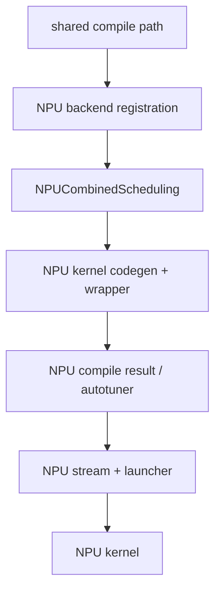

# 目标 8：Ascend NPU Codegen

## 目标

在掌握上游 Inductor 后，理解 torch_npu 如何通过注册和扩展点接管 NPU scheduling、kernel/wrapper
codegen、autotune、launcher 和 graph capture。完成后，应当能先判断代码属于共享上游主链还是 NPU
分叉，再定位问题。

## 总体模型

NPU 路径不是从 `torch.compile` 开始重写全部流程。当前工作区代码显示，它复用 Dynamo、AOTAutograd、
Inductor 编排和大量公共 IR/scheduler 机制，在关键接口注册或替换 NPU 实现：



另一条相邻路径是 graph capture：


graph capture 是编译后执行优化，不应与单个 kernel 的 lowering/codegen 混为一层。

## Backend 注册入口

重点阅读：

- `<workspace>/pytorch_new/torch_npu/utils/_dynamo.py`
  - `patch_inductor_wrapper`
  - NPU Inductor 延迟注册相关逻辑
- `<workspace>/pytorch_new/torch_npu/_inductor/__init__.py`
  - `_inductor_register_backend_for_device`
  - `register_backend_for_device`
  - device op overrides 注册
- `<workspace>/pytorch_new/torch_npu/_inductor/codegen/npu_combined_scheduling.py`
  - `NPUCombinedScheduling`

当前实现通过类似下面的注册，把 device type 映射到 NPU scheduling 和 wrapper：

```python
register_backend_for_device(
    "npu",
    NPUCombinedScheduling,
    NPUPythonWrapperCodeGen,
    CppWrapperNpu,
)
```

阅读时以当前源码实际参数为准，因为 backend 组合会随分支和版本调整。

## NPU Codegen 与 Runtime

重点阅读：

- `<workspace>/pytorch_new/torch_npu/_inductor/codegen/scheduling.py`
- `<workspace>/pytorch_new/torch_npu/_inductor/codegen/triton.py`
- `<workspace>/pytorch_new/torch_npu/_inductor/codegen/wrapper.py`
- `<workspace>/pytorch_new/torch_npu/_inductor/runtime/triton_heuristics.py`
  - `TritonCompileResultNpu`
  - `NPUCachingAutotuner`
- `<workspace>/pytorch_new/torch_npu/_inductor/codegen/npu/device_op_overrides.py`
- `<workspace>/pytorch_new/torch_npu/csrc/inductor/`：NPU C++ runtime/AOTI 边界。

对每个 NPU 类，都要找到其上游基类或对应实现，形成对照：

```text
上游默认职责
NPU override 的方法
override 依赖的 NPU metadata
生成产物差异
runtime ABI/stream 差异
fallback 行为
```

## 多后端路径

torch_npu 的 Inductor 目录可能同时包含 Triton、CATLASS、DVM、Ascend NPU IR/MLIR 或实验路径。
学习时先通过配置、kernel metadata 和实际调用栈确认当前用例选择了哪条路径，不要把不同路径的类拼成
一条不存在的调用链。

Ascend NPU IR/MLIR 的进阶入口：

- `<workspace>/pytorch_new/torch_npu/_inductor/ascend_npu_ir/ascend_npu_ir/npu/npu_lowering.py`
- `<workspace>/pytorch_new/torch_npu/_inductor/ascend_npu_ir/ascend_npu_ir/npu/codegen/`
- `<workspace>/pytorch_new/torch_npu/_inductor/ascend_npu_ir/ascend_npu_ir/npu/mlir_compiler.py`
- `<workspace>/pytorch_new/torch_npu/_inductor/ascend_npu_ir/ascend_npu_ir/npu/npu_inductor_plugin.py`

先完成 Triton/NPU 公共主线，再根据实际任务进入其中一条专用后端。

## 源码范围

本章从上游 Inductor 主链与 NPU backend 注册的交界处开始，覆盖 NPU scheduling、tiling、Triton runtime、
wrapper、graph capture 和 Ascend NPU IR/MLIR 插件的入口；不把所有 NPU 算子实现都纳入本路线。

- **纳入范围**：`torch_npu/utils/_dynamo.py`、`torch_npu/_inductor/__init__.py`、
  `_inductor/codegen/` 中 scheduling/tiling/triton/wrapper、`runtime/triton_heuristics.py`、
  `utils/_graph_tree.py`、`npu/_graph_tree.py`，以及 `ascend_npu_ir` 的 lowering/codegen/plugin 入口。
- **暂不深入**：ACLNN/算子库内部实现、设备驱动、完整 CANN 编译器实现、模型级性能调优和未被当前用例
  选中的实验 backend；这些需要独立专题和 NPU 实机证据。
- **建议顺序**：先读 backend registration，再读 NPU scheduling/tiling，随后读 runtime/wrapper，最后
  读 npugraphify 与 MLIR/AOTI 分支。

## 章节文档地图

- [Overview 与 Architecture](overview-and-architecture.md)
- [NPU Backend Registration 与接管点](npu-backend-registration.md)
- [NPU Scheduling、Tiling 与 Kernel Features](npu-scheduling-tiling-and-features.md)
- [NPU Triton Runtime、Autotune 与 Launcher](npu-triton-runtime-and-launcher.md)
- [NPU Graph Capture、MLIR 与 AOTI 分支](npu-graph-capture-and-mlir.md)

## NPU Graph Capture

重点阅读：

- `<workspace>/pytorch_new/torch_npu/utils/_graph_tree.py`
  - `npugraphify`
  - 将 Inductor graph capture 入口切换到 NPU 实现的 patch
- `<workspace>/pytorch_new/torch_npu/npu/_graph_tree.py`
  - `npugraphify_impl`
  - capture/replay 生命周期

观察 graph capture 时，必须区分首次编译、warmup、capture 和 replay。只测一次调用无法代表 replay 性能。

## 实践任务

### 任务 1：画共享与分叉调用图

以 pointwise 用例为主线，从 `torch.compile` 进入共享上游代码，标出首次发生 NPU 特化的位置。继续跟到
NPU scheduling、wrapper、autotuner 和 launcher。每条边需要源码函数证据。

### 任务 2：上游/NPU 类对照

对 `NPUCombinedScheduling`、NPU wrapper 和 `NPUCachingAutotuner` 建表，列出继承、override、输入 metadata
和产物。不要将“继承了上游”简化为“行为完全相同”。

### 任务 3：NPU pointwise 与 reduction

在获准使用的 NPU 容器中生成两类 kernel，记录 shape/stride、kernel type、axis、tiling、mask、wrapper
参数和 eager/compiled 精度。reduction 必须覆盖至少一个 non-contiguous 输入。

### 任务 4：dynamic shape

比较 static/dynamic NPU 产物，记录 symbolic group 或普通 dynamic autotuner 等实际选择。结论只适用于
被验证的版本、配置和设备。

### 任务 5：graph capture

分别记录未开启 capture、首次 capture 和 replay 路径。验证 graph compatibility 检查、static input 处理、
stream 和输出一致性。

## Codegen 故障定位模板

```text
failure stage:
device/backend/kernel type:
shape/stride/dtype/dynamic flags:
eager result:
compiled result:
FX graph evidence:
scheduler metadata:
generated kernel evidence:
wrapper/launcher evidence:
source-code cause:
fix hypothesis:
validation:
remaining risk:
```

精度问题优先直接修改单个 generated DSL 做语义验证：例如调整 reduction dim、permute/reshape 顺序或
store scope。该实验只验证假设，最终修复仍应回到通用 axis/layout/scheduler/codegen 规则，不能把手改
generated file 当作正式方案。

## 产出物

- 一张上游共享主链与 NPU 分叉图。
- 三组上游/NPU 实现对照表：scheduling、wrapper、runtime。
- NPU pointwise、reduction、dynamic shape 各一份完整 artifact 分析。
- 一个从 symptom 到 generated DSL 再到 source cause 的最小问题复盘。

## 验收清单

- [ ] 能找到 NPU backend registration 并解释各注册参数职责。
- [ ] 能判断一个选择发生在 shared Inductor 还是 NPU override。
- [ ] 能从 NPU scheduler metadata 映射到 generated kernel 的 axis/tiling。
- [ ] 能从 NPU wrapper 跟到 stream、autotuner 和 launcher。
- [ ] 能区分 kernel codegen、runtime launch 和 NPU graph capture 问题。
- [ ] 能以 eager 对比、generated artifact 和源码共同证明根因。

## 常见误区

- `is_gpu("npu")` 一类兼容处理不代表 NPU 与 CUDA 的底层行为相同。
- fallback 路径正确不能证明目标 NPU kernel type 正确。
- A2/A5 或不同 torch_npu/triton-ascend 版本可能选择不同 kernel，结论必须记录环境。
- 没有 NPU 实机结果时，可以证明静态调用关系，但不能声称 launch、精度或性能已验证。

[上一目标](../07-dynamic-shapes/) | [返回总路线](../)
