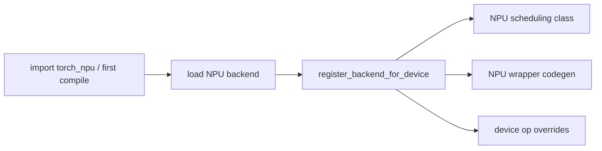

# NPU Backend Registration 与接管点

## 注册链路



## 源码入口

- `<workspace>/pytorch_new/torch_npu/utils/_dynamo.py`：Inductor wrapper patch 和 lazy registration。
- `<workspace>/pytorch_new/torch_npu/_inductor/__init__.py`：backend loading/registration。
- `<workspace>/pytorch_new/torch_npu/_inductor/codegen/npu_combined_scheduling.py`：注册后的 scheduling。
- `<workspace>/pytorch_new/torch_npu/_inductor/codegen/wrapper.py`、`cpp_wrapper_npu.py`：wrapper。

## 关键判断

注册只建立 device 到实现类的映射，不等于每个 NPU 用例都会走同一 backend。继续检查 `_get_backend()`、
配置、kernel metadata 和调用栈，确认当前实际路径。

## 练习

画出上游 `register_backend_for_device` 与 NPU 注册参数的对应表，列出每个类替换的职责和未替换的共享逻辑。

## 实现展开：`_load_triton_backend` 的注册顺序

NPU backend 并非只调用一次 registration。当前 `torch_npu/_inductor/__init__.py` 的
`_load_triton_backend()` 会先执行公共 patch/import，再导入 NPU scheduling、wrapper、runtime、lowering
和 device helpers，最后在嵌套函数 `_inductor_register_backend_for_device()` 中完成：

```python
register_backend_for_device(
    "npu",
    NPUCombinedScheduling,
    NPUPythonWrapperCodeGen,
    CppWrapperNpu,
)
```

注册之后还会执行 `_register_npu_inductor_fallbacks()`、`_register_npu_inductor_mm()`、`patch_scheduler()`、
`patch_inductor_choices()`、`patch_async_compile()` 等。它们分别改变 operator lowering/fallback、模板
选择、scheduler 行为和编译执行方式。因此只搜索 registration 行无法解释完整 NPU 行为。

## 真实加载链

```text
torch_npu import / lazy setup
  -> _load_backend()
  -> _get_backend()
  -> _load_triton_backend() or MLIR/DVM/AscendC loader
  -> common patches
  -> register_backend_for_device("npu", ...)
  -> lowering/fallback/choice/scheduler patches
```

`_get_backend()` 和配置决定实际加载哪条路径。分析某个 NPU kernel 前，必须记录 backend 配置、依赖是否
存在（例如 triton-ascend）和对应 loader；否则容易把源码中并存的 MLIR/DVM/Triton 实现误认为一条调用链。

## `_get_backend()` 到注册调用的分支

`_get_backend()` 先按配置和依赖判断实际 backend 名称；`_load_triton_backend()` 只在选中 Triton 路径时执行。进入
loader 后，源码顺序是导入/patch 公共 Inductor 接口，导入 NPU scheduling、wrapper、runtime 和 choices，再在嵌套的
`_inductor_register_backend_for_device()` 中调用 `register_backend_for_device("npu", ...)`。

注册后的 patch 会继续改变行为：fallback 注册表影响 lowering miss 的处理，MM/choice patch 影响 template/candidate，
`patch_scheduler()` 影响调度类，`patch_async_compile()` 影响编译执行。于是一次 NPU 编译的真实接管关系是：

```text
device registry -> scheduling/wrapper class
lowering patch  -> operator fallback/IR
choice patch    -> template and kernel choice
runtime patch   -> compile/launcher behavior
```

审计时应打印当前 device registry 中的 scheduling/wrapper 类，以及 loader 是否已经执行；仅凭源码中存在 NPU 类不能证明它
被选中。
